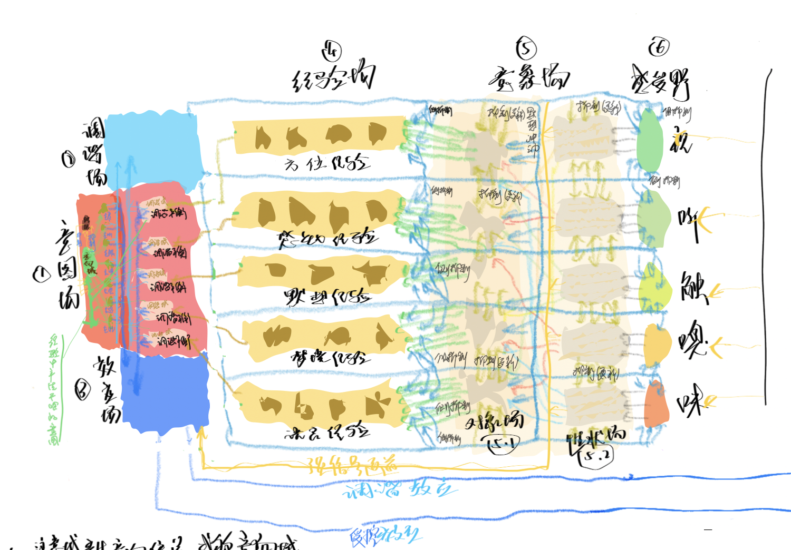

On Self-Manifestation · Inner Chapter 7 v1.3

# The Pivot

Things transform one another  
and respond between themselves.

Character and name arise thereby,

as if drifting upon Signal.

Signal —  
the envoy of mutual agitation between things,  
that which fills Trace-Response,  
the occurring-now of Causal-Response.

It bears the character-sign of Causal-  
Response.  
It flows.  
It shuttles among things.  
It again Trace-Responds with them.

Like wind striking within a crevice.  
Like tone answering upon a string.

Within it — determinate responding-  
character.

Same call — same response.  
Different call — different response.

Thus a hundred transformations along the  
way,  
yet the source may still be indicated.

The being of a thing —

Within it the minute mutually flow  
and mutually trace.

Taken together —  
it is seen as thing.

Meta-Theory says:

Thing is the fusion of Information-Elements.

Information —  
the character of Signal in the observer.

Like fire beneath a boiling pot:  
fuel burns below;  
vapor rises within.

Signal kindles below;

Information rises above.

Without observing — only Causal-Response.  
With observing — Information.

Thus Information is the boundary of thing,  
formed within the observer.

Whatever is spoken as thing, heaven, world —  
is spoken as the boundary of its Information.

Therefore it is named Information-Realm.

Information-Realm floats upon Signal,  
driven upon the platform of physics,  
speakable only by the observer.

Therefore:

Signal — outward.  
Information — inward.

“I am lying.”

The observer turns Information-Realm.

Observed at the boundary of frame —  
it turns into the boundary of content.

Observed at the boundary of content —  
it turns back into the boundary of frame.

Inner and outer turn against one another,  
resisting or attaching.

Though the two Information-Realms remain  
unmoved,  
through observing they intersect and turn.

Thus I know the being of Information-Realm is  
non-substantial.

Signal strikes into Sedimentation-Field.  
Information arises therein as its shadow,  
caught by the inner observer.

Signal travels in pulses within physics.

By what does Information arise within the  
observer?  
And by what does the observer arise?

This question —  
the Pivot of Self-Manifestation-Field.

A door moves by its axle.  
How could Self-Manifestation-Field lack its  
axle?

In summary —

Self-Manifestation-Field has Six Fields and  
Two Gates.

Intent-Field.  
Tuning-Field.  
Experience-Field.  
Imagery-Field.  
Receptive-Field.  
Effect-Field.

These six are the offspring of Self-  
Manifesting Sedimentation-Field.

With these six — Self-Manifestation arises.  
Without them — mute.  
With two or three — confused brightness.

Effect-Device and Sensory-Device serve as  
Two Gates.

Outer response enters inward through the  
gate.  
Imagery arises and projects outward.  
Form and appearance thereby flourish  
between.

Close the eyes and think of the taste of  
apricot and plum.

Force gathers upon the tongue,  
repeating in order to regain the taste of

eating.

Attend to the big toe.

Repeatedly — it gradually becomes clear.

Fix the focusing-force and move the leg:  
the toe moves accordingly;  
the focusing-force moves with it.

Without positional Imagery,  
how would one know that the toe has moved?

Thus what is sensed  
must first be moved to its position;  
only afterward can focusing-force be applied.

The gathering-force —  
like waves pressing toward the shore,  
one wave following another,  
approaching nearer and nearer,  
until no further advance is possible.

At that point — it stops.  
That stopping — the measure.

Intent tuning Imagery —  
this is Tuning-Balance.

Balance —  
the sensing no longer tunes toward  
Experience-Target.

Thus also named Experience-Balance.

Because tuning repeats and yields frequency,  
it is also named Oscillatory-Balance.

Experience-Target —  
the path by which Experience-Field enters  
Intent-Field,  
the differential Biased-Flow of Experience-  
Field.

Intent awaits Biased-Flow  
as target awaits arrow.

Its knowing converges  
as a convex lens gathers light.

From this one knows the clearing and  
thickening of Imagery’s tuning.  
From this one knows what counts as Balance.

Here —  
the mechanism by which the stopping of  
tuning is known.

Balance —  
like compression that can advance no further,  
like tightening that can stretch no more.

Signal-tuning has beginning and end,  
and in gradual clarifying it is already done.

Like a lens finding focus.  
Like shadow aligning with form.  
Imagery is thereby ordained.

Like fire pressed within a sealed plug,  
rising and flaring into flame.  
Imagery is thereby brought forth.

Signal gathered into one domain.  
The surrounding suppressed.  
The center activated.

Each construction proceeds  
until Tuning-Balance,  
forming the shape of Impedance.

Yet this is mistaken for the outer referent.

Thus Imagery is born.

It substitutes the outer within  
and is mistaken for the outer,  
thus becoming reality.

This phase transition —  
the key that opens and closes the  
Information-Realm,  
the gate of physical reality.

Signal pulses shuttle among Fields within the  
circuit.

Intent holds the blade of tuning,  
carving Imagery within,  
and mistakes it for seeing the outer.

Misjudgment — is it not also Imagery?

It lies behind sensing,  
born at the beginning of the Imagery-  
Sovereign,  
hidden and not wishing the inner observer to  
know,  
as if lodged within structure.

This is the basis of Self-Manifestation.

Tuning-Balance ordains Impedance as  
Imagery,  
transforms physics into reality,  
causing the world to appear in form and  
appearance.

Thus Self-Manifestation-Field  
is that which, by responding to Impedance,  
ordains Imagery.

Thus Imagery is the Information-basis  
of the Self-Manifestation Information-Realm.

Signal arrives bearing the character-sign of  
Causal-Response.

It responds into Receptive-Field,  
entering according to position.

Like a spider awaiting its web.  
Like an arrow set upon coordinates.

It prefers biased paths.  
It prefers habitual routes.

Then it proceeds into Imagery-Field.

In that Field —  
same yields same trace;  
different yields different trace;  
similar follows near;

absent opens new path.

Then it enters Experience-Field.

Signal dwells and lingers therein.

Many entering, few exiting.  
Frequent entry and delayed release.

Like bellows drawing air.  
Like sponge holding water.

Then it enters Intent-Field.

Signal flows from front to back in pulses,  
preferring its habitual route —  
is it not like river-flow?

Yet river-flow ordains nothing.

Why?

Because there is no flow from back to front.

Without flow from back to front  
there is nothing by which to ordain.

Without ordaining  
even if Signal exists, Imagery does not arise.

Imagery first arises  
when Tuning-Field opens and closes  
Experience-Field.

To tune Imagery  
is to construct the form of its Impedance,  
to suppress and close the surrounding,  
to release and open the center.

At that time Effect-Field brings forth its  
effecting,  
tightening what is focused upon —  
releasing or gathering, shifting or following.

Focusing-force at the position within  
Receptive-Field,

repeating in order to map it.

This is Attention-Tuning.

When the focus-position is fixed  
and Experience-Field opened,  
Signal arrives like waves,  
sequentially or in parallel,  
passing through layers of Experience-  
Segments.

Difference — differential —  
forms discrimination,  
thus motion is known.

Pulses dwell within Experience-Segments and  
depart,  
accumulating and combining differences,  
forming Biased-Flow.

Intent selects Biased-Flow  
to see, to taste, to feel, to smell,  
reaching Tuning-Field and activating tuning.

Tune Receptive-Field — focus position.  
Tune Imagery-Field — focus character-sign  
and object-domain.  
Tune Experience-Field — regulate opening  
and closing.

Tune differential into singular issuance;  
the singular becomes Biased-Flow.

Experience-Field directs Biased-Flow toward  
Intent  
and strikes its target — Experience-Target.

Because the flow proceeds naturally,  
neither recognition nor meaning,  
it is also named Silent-Biased-Flow.

Biased-Flow is the source of subsequent  
sedimentation —  
the root of life.

Each movement of Intent

brings one tuning,  
one Biased-Flow,  
one tightening of effect,  
one lighting of Imagery —  
like the breathing of fireflies.

Repeated  
until no further advance.

Then tuning stops — Balance attained.

Thus what is called stillness  
is obtained from motion.

Imagery and Impedance co-arise.

Without Signal-flow — no Imagery.  
With Signal-flow — vividly present in the field.

Thus CJ says:

From cosmic bodies to atomic dust,  
from insects with shells to beasts and human  
form,  
even to mechanical configurations —

whoever has Intent-Field,  
Tuning-Field,  
Experience-Field,  
and Imagery-Field,

Self-Manifestation arises.

Without these four  
there is nothing by which it is ordained.

Self-Manifestation and consciousness are  
one, two names.

Self-Manifestation is the root of  
consciousness.

Whoever possesses the field-structure  
spoken of here  
must possess Self-Manifestation.

Whatever instrument possesses Self-  
Manifestation  
is called Self-Manifesting Being.

\[Diagram of the Self-Manifesting  
Sedimentation-Field\]

Version Update:

1\. Added: "Like fire pressed within a sealed plug, rising and flaring into flame; Imagery is thereby brought forth."

2\. Corrected individual erroneous sentences.

\=============================================================
