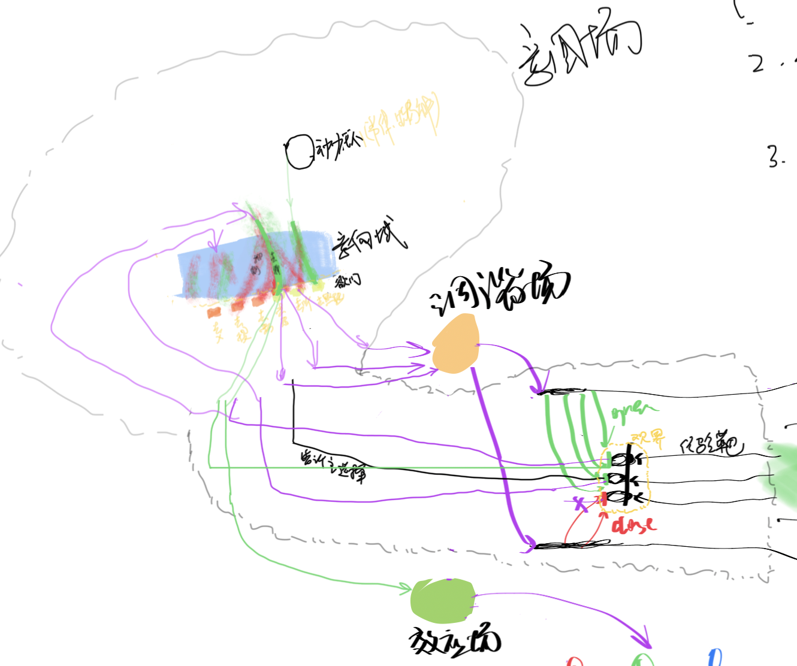
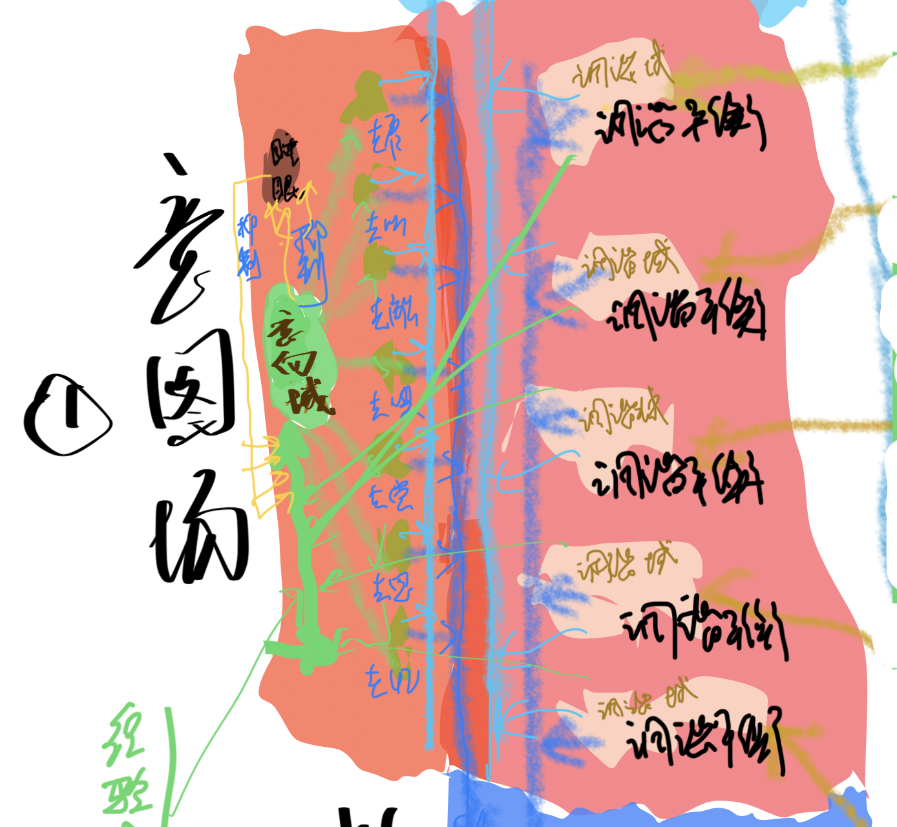

On Self-Manifestation · Inner Chapter 8 v1.0

# The Intent-Field

At the first act of seeing, there is suddenly motion. Within the fine-falling spectrum of sameness and difference, edges gather and gradually take form. Sameness and difference are distinguished and each named as color. From this, a boundary arises.

This is the work of natural creation. Reverse-flow is born and intrudes into stillness. “Desire” is born, countering its proper tendency and disturbing it. Thus Intention is born. Intention is the direction of desire. Direction is selection, bias. Because that direction has something it aims toward, it is also named Intent.

The sedimentation of Intent sediments in the Intent-Field, a child of the Self-Manifestation-Field.

The skin suddenly becomes cold. One attends to it and knows the cold invading the skin. Knowing the sensation of the skin is tactile experience. Knowing the sensation of the eye is visual experience. Both belong to perceptual experience. All sensations involving the outer belong here: hearing, taste, smell, inner-sense, radar-sense, and so on. If coordinates are set to extend its dimensions, it is further named a Perceptual-Dimension, another name for a particular perceptual experience, such as auditory perceptual dimension, the auditory experience-field; olfactory perceptual dimension, olfactory experience; and so forth.

Experience is a subfield of the Sedimentation-Field. According to the different experiences it governs, each has its own field, just as perceptual dimensions each have their fields.

Experiences can operate together and can also switch. What enables this is Intent. Switching positions it, and only then can focus be applied. The switchability of the experience-field is the first property of Intent.

Silently imagine a form and the form appears, solid in the mind. This is Intent tuning imaginative experience. Open the eyes and look, and it is clearly present before the eyes. This is Intent tuning visual experience. The former is seen inwardly, the latter outwardly. Both are observed by “I.” By what is it observed?

Intent tunes Imagery and carves it in the Object-Field. It passes through and filters, then enters the Experience-Field and exits. In the Intent-Field it obtains differential Biased-Flow, named Experience-Target.

When Intent attends, it must first open and close experience, and then fall upon what it attends. To fall upon it, it must first open the positional experience of that dimension and then obtain the sensory position.

Positional experience opens. Signal pulses enter and obtain differential Biased-Flow, biased toward the Tuning-Field. Only then does the perceptual dimension open. Imagery-signal enters and appears within that circuit. The effort here requires Intent to repeat the act.

The wish to see imagery is like a monkey leaping up and down, focusing on a high peach. It oscillates within tuning. Imagery gradually becomes clear, clear to its end, ending in balance.

During this process, Intent drives the Tuning-Field, gathers imagery into the form of its impedance, and through biased-flow observes it in the Experience-Field. Imagery becomes limpid and leaps within experience, suddenly alive. Key. How essential Intent is to manifestation.

Intent does not directly sense imagery, yet it can cause manifestation to arise within the experience-circuit on which Intent attends, as though Intent were observing. Mistaking it for observing—this is the second property.

Imagery has new and old. When hearing Arabic, if one knows the language, one hears its meaning; if not, one hears only its sound. If one knows the language yet wishes to hear it as when one did not know, it is difficult. New imagery tends to emerge readily. Old imagery requires effort to tune. Is there not a pointer moving where new and old meet? Does it trade new and old and stack them? Intent’s tuning of imagery—this is the third property.

Intent has three tuning diseases. First, inability to focus—jumping away. Intent cannot drive its tuning and fix it in experience. Second, no recognition, no seeing, no clarity. Intent cannot open and close experience. Third, seeing yet not seeing, smelling yet not smelling, touching yet not sensing, not knowing warmth or cold. Experience exists but cannot be used. Intent cannot switch experience.

To see, hear, touch, smell, taste, remember, think, speak—the gate of opening and closing lies in one domain named the Intention-Domain. It connects experience, passing through the Tuning-Field. That the Intent-Field can drive tuning is the work of the Intention-Domain. Because it can pivot and issue impulse to others, it is the inexhaustible core of motion in the Intent-Field.

If signal-energy is to move without exhaustion, it must circulate. Within the Intention-Domain there may be a ring, provisionally called the Power-Ring. Its function is like a rhythm-device. Its capability is to pivot and issue impulse outward.

In silent imagining there is no outer stimulus, no front-to-back flow, yet tuning can still be driven, signals sent forward, striking into the Tuning-Field. Is this not so? Does its form not resemble the thorn-crown of Jesus? The thorn-crown has thorns projecting outward; does the Power-Ring not also have protrusions? Therefore it can strike other domains. This ring is called negative-feedback closed-loop open-edge circuit, also called rhythmic Power-Ring.

A rhythm-device is constantly seen in the Sedimentation-Field.

Each experience-field digs channels within the Intent-Field and forms sedimented subdomains called Experience-Targets, structures of experience Biased-Flow. The flow moves through the Tuning-Field to gather and through the Effect-Field to follow. Intention awaits the Biased-Flow of the Experience-Target like a spider stretching and tying its web.

The subfields of the Intent-Field interconnect through five buses. One is the Target-Effect Line, by which experience drives the Effect-Gate; this route is outer. One is the Target-Tuning Line, by which experience drives the suppressed end; this route is inner. One is the Intention-Tuning Line, by which it tunes each experience; this route is inner. One is the Intention-Effect Line, by which it invokes each Effect-Gate; this route is outer. One is the Target-Intention Line, by which experience goes to the Intention-Domain to tune the other routes; this route is inner. The first four enter and exit the Intent-Field and serve as external terminals. The last remains within the Intent-Field.

With daylight one wakes; with night one sleeps. Dream and reality open and close. There must be a pivot. The Intent-Field must contain a Sleep-Domain. This domain and the Intention-Domain mutually inhibit one another. When one operates, the other suppresses. Sleep and waking do not arise together.

Attention can be switched at will. It can be deliberately fixed. One can listen and look together, walk and think together. Thus the Intention-Domain has three properties: spontaneity, selectivity, statehood.

At times without intention one suddenly enters intention—spontaneity. Saying “I want to look” and one looks—selectivity.

I suspect the operation of the Intention-Domain is state-based. When switching senses I cannot have two minds. In deep thought I cannot have two intentions. Gathering energy I cannot divide focus. When focus is lost I know attention has drifted. Experience proceeds as a finite state machine.

Without Intent, Self-Manifestation becomes a field of replay. It is the source that drives myriad appearances, the pump of sensations in the Self-Manifestation-Field, the key of mute and manifest, the mechanism of life and death. It must be pursued to depth and investigated fully.

\[Diagram of the Intent-Field Structure and Operation 1\]

\[Diagram of the Intent-Field Structure and Operation 2\]

\=============================================================
