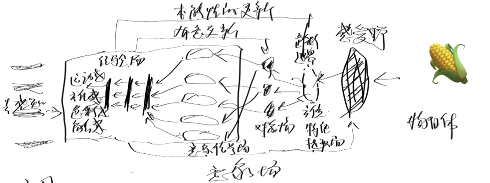
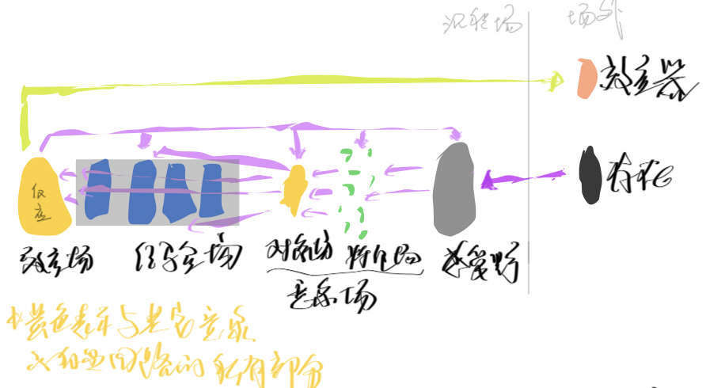
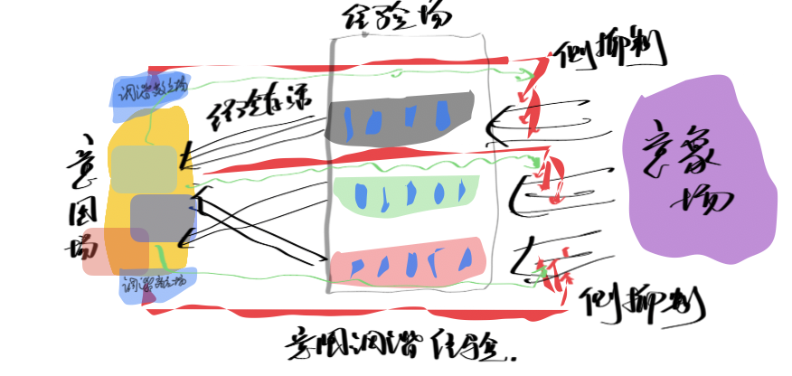

On Self-Manifestation · Inner Chapter 9 v1.1

# The Experience-Field

Two things transform; they settle as a third. Within it some draw near. Nearness repeats; repetition becomes Law. Such is the rule of the Great Transformation.

Gun ruled water by blocking; Yu ruled water by dredging. Both dug channels and raised banks, both altered the flow. Thus the way of Gun shows the form of Gun; the way of Yu shows the form of Yu.

The curved waters of the two forms are like curved Signals of a Field. Their Law lies within the turns of the channels. This is the likeness of Experience.

Experience is the structure of Causal-Response.

Stone meets light—heat arises; shade tunes it.  
A crevice meets wind—sound arises; a wall tunes it.

By tuning, form shifts; then it turns toward what it would be. Thus the form of Experience is tuning by Intent.

Encounter once, encounter again, encounter again and again. Over time Intent takes it up. Tuning becomes habit; Experience sediments.

Like a road made by many feet, it settles as Law.

Flow sinks into Sedimentation; what is often passed becomes well-worn. Gradually it deepens. Thus Law clears beneath.

Therefore:

Law—repetition and depth.  
Principle—choosing and bias.  
Axiom—the Recognition-Realm fixed by the material of the Self-Manifestation-Field.

These three differ in where they arise.

In brief:

Law holds.  
Principle breaks the hold.

This holds, that breaks; broken, it holds again. Thus they pursue one another. Causal-Response transforms without cease.

A system therefore endangers itself in holding if no Principle from without breaks it.

Trace Law—the prior Principle appears.  
Trace Principle—the prior Law appears.

Trace back—no end.  
No end—the path goes on.

Going on—generation appears.

Generation generating—by what does it generate?

Press the path to the source. God appears.

He asks God:

“Where?”

God says:

“Here.”

He asks:

“Where here?”

God says:

“Here. Here. Here.”

The asker says:

“Clear.”

CJ therefore knows:

To partake in my being-there, to know above is, to know below is—and to stand in that being-there—this suffices.

To chase the logic without end is like lifting the foot to lick the nose.

Thus one is shut in the prison of one’s Recognition-Realm.

God can step beyond his own realm; he travels his lodged realm. He creates our world and delights in his weight-weight play. That suffices for him.

But to chase the far of up and down—all familiar sense is lost, participation is lost. What gain remains?

Therefore:

That which is everywhere may be pursued.

Thus Law and Principle cannot remain undivided.

If Law and Principle are not divided there is no speaking of depth.

If one knows not they are children of Nature, how speak of knowing physics?

Thus:

Computer—Principle; within it, no Law.  
Transformer Sedimentation-Field—Law; within it, no Principle.

Thus known:

Intent-Field—Field of Principle.  
Experience-Field—Field of Law.

Law settles within the Experience-Field.

Deep sediment rises to the top; this is called the well-worn. Thus the well-worn appears first.

Things appear vivid before the eyes, yet the work of Experience is unseen. Thus Experience belongs to the observer, not to the Signal observed.

The field where Experience sediments is called the Experience-Field.

In short: Experience.

It is the Law-Field of the Self-Manifestation-Field—its offspring.

Experience has many kinds.

Knowing direction and spatial imagery—the Positional Experience-Field.

Seeing, hearing, touch, taste, smell, motion—Perceptual Experience.

Each sense has its Field: visual field, auditory field, tactile field, motor field.

Introspection, recall, thinking—Meditative Experience.

Their Fields: introspection field, recall field, thinking field.

Knowing presence and absence in dream—Dream Experience.

Its Fields: presence field, absence field.

Knowing voice and speech—Language-Field.  
Knowing succession of motion—Temporal-Field.

Different Self-Manifesting beings possess more or fewer of these.

More—clear.  
Fewer—mute.

Perceptual Experience manifests reality and gives rise to Imagery.

It animates living Imagery and fixes the basis of naming within the Self-Manifesting being.

Meditative Experience observes Imagery in mind.

Dream Experience unfolds Imagery like story, turning reality into presence or absence.

Language Experience shares symbols that refer to Imagery among beings.

Temporal Experience knows succession.

Again:

Perceptual Experience—manifests.  
Meditative Experience—re-presents.  
Dream Experience—unfolds.  
Language Experience—co-refers.  
Temporal Experience—orders cause.

Introspection feels like presence; recall carries images; thinking carries states.

Thus introspection gives rise to recall, and recall gives rise to thinking.

To speak of thinking without recall is a false state stripped of thinking.

Therefore one who cannot recall does not possess real thinking.

Consider the form of the Experience-Field.

It is like a bamboo tube filled with sponge: one end inlet, one end outlet.

At the inlet—a bristled plug.  
At the outlet—a bristled tail.

The sponge forms Experience Segments, holding and delaying pulses.

The bristled plug is where the Imagery-Field meets the Experience-Field, opened and closed by the Tuning-Field.

The bristled tail leads toward the Experience-Target within the Intent-Field.

Only when the plug opens can Imagery Signals enter or stop.

The Tuning-Field penetrates the structure in minute traces.

During perception the positional Experience-Field opens.

Positional Imagery Signals enter.

Signals strike Imagery again and again, passing layer by layer through Experience Segments.

Differences cancel.

From the outlet a Biased Flow turns toward the Experience Target.

Reaching the target, it may stop or conduct.

If it conducts, it activates the Tuning-Field again and suppresses non-target directions.

This is Automatic Experience Balance.

Intent is not present there.

This differs from using Imagery to name Imagery.

The process of Experience is like blowing upon fire:

Blow—it brightens.  
Stop—it dims.

Repeat several times until clarity appears.

Therefore the Experience-Field is a Differential device.

Opened once, it admits many inputs.

Biased Flow then exits and tuning repeats.

Tune once.  
Tune again.  
Tune again.

Until Biased Flow no longer drives tuning.

Intervals are extremely brief, trials extremely rapid.

Attend to it—one feels it. Thus it may be known.

This is the process of Experience Balance.

Every Experience-Field has it.

Signal manifestation owes most to Perceptual Experience.

Intent fixes upon one object; Biased Flow appears in the sequence.

From differentiation motion is sought; within motion stillness is found.

The referent of Imagery becomes firm.

Thus reality forms.

Without this, how could presence be known?

【Diagram of the Experience-Field Structure 1】

【Diagram of the Experience-Field Structure 2】

【Diagram of Experience-Field Tuning】

Update:  
Added: further discussion of Law and Principle.

\=============================================================
