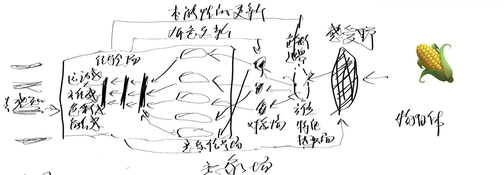

On Self-Manifestation · Inner Chapter 10 v1.0

# The Imagery-Field

To observe change,  
to see arising and vanishing,  
to know Causal-Response,  
to be endowed with affect—  
all proceed through oscillatory linkage.

This linkage moves among things, back and forth,  
stitched within physics.  
The tremor of things is called Signal;  
it stands outside the Information-Realm.

The flashing and extinguishing of a lamp is called Information,  
existing relative to the observer.

Signal and Information arise through observing;  
above Signal, Information;  
beneath Information, Signal.  
It is Signal that makes it thus.

There is Signal of lighting,  
Signal of extinguishing;  
therefore there is Information of on and off.

Signal drives Information;  
it is the physics of Information.  
The observer apprehends and names it Information;  
by observing and delimiting, a realm is drawn—  
this is the Information-Realm.

To observe a computer is the same:  
one knows the inner Information-Realm,  
one knows the outer Signal.

Information floats above Signal,  
as vapor above water.  
Thus the world must have its lodging;  
beneath it, Signal pivots and issues the world,  
as boiling water in a pot.

If there be no observer,  
Signals still Trace-Respond without cease,  
conditions still transform—  
yet none is known.  
This may be called No-Information.

There exists a kind of Field  
wherein the observer resides,  
specialized to sense incoming Signals,  
and to take those Signals as external things.

This Information has no settled name;  
provisionally, call it Imagery.

This Field takes Imagery as its Information-base.

Imagery dwells in the same Field as the observer,  
named by the structure of the observer.  
Imagery arises, lives, vanishes—  
observed only by the observer within that Field.  
Thus the Field whose Information-base is Imagery  
is called the Self-Manifestation-Field.

It knows that it is observing;  
therefore beyond Imagery there is an image of the observer.

The observer is hidden within the structure of the Field,  
same in substance yet different in configuration from Imagery,  
reaching mute and manifest.  
Between the two there must be a critical gate.  
This is detailed in Micro-Core Theory;  
here it need not be said further.

Statement:

Signal-Realm lies within the Physical-Realm.  
World lies within the Information-Realm.  
Imagery-Realm lies within the Self-Manifestation-Realm.  
The Self-Manifestation-Realm belongs within the Information-Realm.

When a camera captures,  
it adjusts focus and calibrates brightness;  
mechanism and image stand in relation.

As with a fossil of a leaf:  
rather than saying the leaf forms within the fossil,  
it is that the fossil resists collapse  
and thereby makes the leaf-shape.

So too with the arising of Imagery.

The Tuning-Field tunes Signal,  
traces its boundary,  
shapes its form—  
by means of impedance.

Like digging a river-channel to fit the flow;  
like shaping form to meet its shadow.

Signal strikes and forms;  
formed, it manifests in circuit.

Imagery is Information,  
yet it does not persist by Information.  
Its persistence is the constructed form;  
its being-there is Signal moving within.

Thus impedance-form may stand for Imagery,  
as fossil stands for leaf,  
as shadow stands for form.

Signal rushes along its path—  
strike, Imagery arises;  
strike ceases, Imagery is void.

Therefore the locus of impedances  
is named the Imagery-Field.  
The Imagery-Field is a child of the Sedimentation-Field.

Its structure:

In front, it connects to the Sensory-Gate;  
behind, to the Experience-Field;  
to the side, it couples with the Tuning-Field.

Signal comes from the Sensory-Gate,  
passes through the Imagery-Field,  
and runs toward the Experience-Field.

Where Signal differs,  
color is uneven;  
unevenness yields boundary,  
boundary yields form,  
form yields contrast,  
contrast yields near and far, high and low—  
this is seeing.

Where sound is uneven,  
boundary arises,  
syllable forms,  
position emerges—  
this is hearing.

To separate Signal and seize feature,  
there must be a Field within the Imagery-Field—  
this is the Feature-Field.

Form has image;  
sound has tone;  
taste has flavor;  
touch has sensation.  
Integrated across dimensions,  
they become Object.  
Distributed within the Imagery-Field,  
they form the Object-Field.

Signal arrives,  
passes the Feature-Field,  
crosses the Object-Field,  
and exits.

The similar adheres;  
the different separates.  
The later submerges the prior;  
what settles deeply becomes Law.  
Thus when Imagery emerges,  
the well-worn Law stands uppermost;  
the later comes forth first.  
To pursue what came before  
demands effort in tuning.

As with sedimentary rock—  
later layers lie above.  
Thus things cluster by kind;  
Imagery persists in like manner.

Within the Object-Field,  
Imagery saturates into clusters.  
Sequences stored like albums  
are called Story-Imagery;  
they serve to record events.

In recollection,  
image appears first;  
then stillness.  
At comprehension, motion seems to arise—  
yet in truth, nothing moves.  
Its motion requires Intent to exert effort;  
only thus may one pursue the comings and goings in recollection.

One may observe feature—  
boundary, color, position;  
thus the Tuning-Field intermingles with the Feature-Field.

One may observe object—  
this and not that;  
thus the Tuning-Field intermingles with the Object-Field.

Consider an apple:  
seen, it has form;  
tasted, flavor;  
touched, body;  
thought— all appear together.  
Object distributes across the Field.  
Tuning suppresses and disinhibits within.

One hears foreign speech as bird-song;  
upon understanding, bird-song can no longer be heard.  
Later learning rises;  
earlier learning is buried.  
Thus Object stores in stack-structure;  
Signal prefers the most worn path.

Tuning may traverse the stack,  
move attention between old and new.

One object may be whole or part,  
contour or detail;  
attention may contract, expand, or shift.

Listening, seeing, tasting—  
Imagery co-activates.  
Thinking Imagery also co-activates.  
Tuning co-activation is strongest in introspection.  
Name this the Imagery-Effect.

Within the same Sensory-Gate, the effect is the same;  
across different Gates, it differs.

Thus:

Imagery takes form through impedance within;  
it may re-arise in circuit;  
yet it is taken as observation of external thing.

This misjudgment—how profound its subtlety!  
It points outward, yet forms inward;  
taken as shared reference,  
yet privately constituted—  
is it not astonishing?

Because it is privately stored  
within impedance-form,  
within the Law of Experience handling,  
within the biased flow of Intention,  
Imagery cannot be replicated.

To replicate it,  
the entire circuit must be copied—  
impedance, biased flow, tuning margin.  
Difficult indeed.  
Thus living beings acquire by learning.

In learning,  
Intent moves;  
the Tuning-Field exerts force;  
cost is great.  
Once mastered,  
no Intent is required;  
it becomes Habit-Imagery.

Story-Imagery requires silent recall to manifest;  
Habit-Imagery may operate without the Intention-Domain.

As with forming a turtle-shape by fingers:  
at first one must attend carefully to each fold;  
once mastered, it follows the hand.

Thus CJ says:

Imagery is neither symbol nor number.  
Through the attention of the observer within the Field  
it points as image  
and bears the fruit of Self-Manifestation.  
Strange though it is,  
it arises from nature.

Diagram of the Imagery-Field Structure

Note:  
Sensory-Gate — see Inner Chapter 14 · Lodging-Form

\=============================================================
