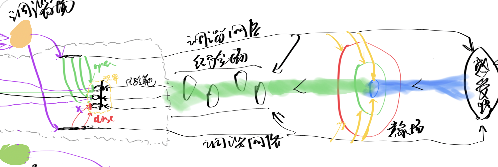

On Self-Manifestation · Inner Chapter 11 v1.0

# The Receptive-Field

The Receptive-Field  
is a child of the Sedimentation-Field.  
It is the gate of round and square.  
It is the beginning of Signal handling.

Its welcoming  
is like a front desk facing the door.

Gates have size.  
Vision has breadth.  
Touch has measure.

When stimulus strikes the Sensory-Gate,  
it has position.  
The Receptive-Field aligns to it,  
spreads a net,  
and captures it.

The two correspond  
like leaf and shadow.  
Sometimes gathered into one.  
Sometimes dispersed and thinned.  
Sometimes layered into form.  
Without end—  
as shadow follows shape.

A saying:  
large holes sieve beans;  
small holes sieve grain.  
So it sieves pulses.

Much convergence— it leaks.  
Much dispersion— it blurs.  
One response— it is true.  
Far— it leaks.  
Near— it blurs.

Thus the Tuning-Field tunes the Receptive-Field.  
Where it attends— one response,  
and clarity.  
Elsewhere— convergence and dispersion,  
leakage and blur.

A spider spreads its web  
to take insects.  
Warp— to know position.  
Weft— to know what-thing.  
So is the Receptive-Field.

It divides Signal streams.  
Left flows left.  
Right flows right.  
Center flows center.  
Position hides in warp and weft.

Along the warp run pulses.  
Within the weft lies form.

Its flow passes the Receptive-Field,  
reaches the Positional Imagery-Field,  
then goes to the Positional Experience-Field.

Its flow passes through the Imagery-Field,  
reaches the Feature-Field,  
then goes to the Object-Field.

Hearing, seeing, touch, smell, taste—  
each has its Receptive-Field.  
The Receptive-Field stands after the Sensory-Gate.  
One Gate, one Field.

Therefore CJ says:

I look upon a thing as here—  
certainly here.  
Yet I do not know  
that its substance and its soul  
have already parted.

Does not the Receptive-Field  
divide position and Signal  
in this way?

Separated— yet made one.  
Subtle craft.

\=============================================================

On Self-Manifestation • Inner Chapter 12 v1.0  
Effect-Field

The Effect-Field drives the Host-Vessel. It is the domain where the Sedimentation-Field commands the vessel. The Effect-Field opens its domain to correspond with the vessel and sediments what the vessel can do. Thus it is twin-born with the vessel, like a mirror standing within the Effect-Field.

The Effect-Field governs the Host-Body and enables the body to move within the host-world. What the eyes see, what the ears hear, what the mind reaches—because I am present in the field, the host-body may be driven and run. All this depends upon it.

Effect has three powers: Instinct, Reflex, Driven Motion.

Instinct belongs to the vessel itself and not for another. Its capacity acts without intent and moves by itself. Tracing its origin, it may arise with birth and be inherited from the parent.

Reflex appears in moments of danger. When danger arrives, response rebounds at once, like a ball striking a wall and returning. Often it occurs before consciousness is fed, and only afterward is it known.

Driven Motion occurs when Intent wishes the host-body and its organs to act and commands the Effect-Field to produce the movement. It receives from the Intent-Field; hence its name.

The host-body has inner and outer. The inner acts upon internal organs, the outer acts upon external organs. Thus the Effect-Field also divides into inner and outer.

The inner possesses autonomous motion and drives the internal organs. It moves by itself because it avoids Intent, avoiding it to protect the organs.

Within a cat reside:

Internally — heart, lungs, liver, stomach, intestines, pancreas, spleen, kidneys, bladder.  
Externally — head, eyes, ears, nose, mouth, tongue, teeth, whiskers, neck, trunk, limbs, claws, tail, fur, skin.

Each organ has its own capacity. Thus the Effect-Field generates subfields responding to them. These are Organ-Capacity Fields.

Yet one subfield differs. It governs all host-organs and unifies the body into one whole. Through it the body becomes mine rather than another’s. Thus it is called the Body-Capacity Field.

When Intent goes to see, to hear, or to smell, its impulse reaches two fields at once: one branch toward the Tuning-Field, one branch toward the Effect-Field.

Experiences such as perception, silent thought, dream, and language flow mainly into their Experience-Target. Yet three side streams appear: one toward the Intent-Domain, one toward the Tuning-Field, and one toward the Effect-Field.

When one silently attends to a place in the body, that place tightens. Within there is tuning; without there is linkage. The skin shows electric sensation and the eyes turn. Thus Effect is always present. It moves with the Tuning-Field and never departs. Hence the name Tuning-Effect.

The Effect-Field cannot be directly tuned to construct form. Living beings show this. Because it cannot be directly tuned, its function cannot change. Because its function cannot change, the eye cannot become a leg and the heart cannot become a foot. Thus instinct resides in the Effect-Field.

Yet though it cannot be directly tuned, can it be tuned indirectly? Meditation may do so.

It is often said that inner observation is possible. Observers report:

heart red  
lungs white  
liver cyan  
spleen yellow  
kidneys black  
stomach yellow  
intestines brown  
pancreas orange  
spleen gold  
gallbladder green  
bladder black  
brain purple  
blood crimson

If this is true, it may be because tuning constructs a field-domain and thus generates new Organ-Capacity Fields.

To gain such inner observation, practitioners often abandon thought and attend to the organ itself. Sometimes wishing to see it, sometimes to hear it, sometimes to taste it. Practiced long enough, a sensory field gradually emerges. The Imagery-Field and the Perceptual Experience-Field gradually adapt to the new emergence.

Thus the reality of inner meditation: through long practice, fields arise within. It is as if ears and eyes grow inside the body and reach sight and hearing there. At first the vision is vague and dim—is this not the same phenomenon?

It is also said that inner control is possible. Control the heart and it vibrates like a plucked string. Control the lungs and they move like bellows. Organs may be driven as easily as fingers move or feet step.

Close the eyes and hold the breath. Observe the heart. Intent gathers there. Pause it or excite it and sense where intent resides. The mind wanders—recall it again. Persist. With long practice the heart may become controllable.

Skill accumulated becomes habit. Habit settles as imagery in the Imagery-Field and becomes Habit-Intent.

Habit is the sedimentation of skill. It grows gradually without awareness. Practiced earlier and accumulated later, it forms over time. Passing through the Motor Experience-Field and branching from its Experience-Target, it drives the organs. Thus indirectly it reaches the Effect-Field.

When learning to drive, the car and the person are separate. After mastery they become one. It feels like moving one’s own limbs because the skill has entered the Habit-Sedimentation Field.

Balancing on one leg is the same. Learning to walk is the same. Balance is sensed and the body harmonizes through habit.

Reading is the same. Once mastered, meaning appears directly without dividing the mind among the shapes of letters. Just as walking may forget the act of walking.

Thus habit means acting without deliberate intent.

Habit may be known in the moment. Reflex can only be known afterward, after the body has already moved.

Habit may further sediment and sink into the corresponding Effect-Field, becoming instinct and passing across generations. Yet learned abilities do not immediately sink into the Effect-Field, for this protects the vessel’s private capacity. Thus long use is required before sedimentation.

Abilities unused decline, removing rare capacities and allowing organs to become more specialized. This is the way of living beings. Even physicians cannot directly tune it.

Why can one walk while attending to something else? In one phrase: the circuit runs automatically and the Intent-Domain need not participate.

Motor experience opens through tuning. Posture enters the Motor Sensory Field through the sensory gate, then the Motor Imagery-Field, then the Motor Experience-Field, and finally the Intent-Field.

Within the Intent-Field the Experience-Target branches toward the Tuning-Field and the Effect-Field, forming the Motor Tuning-Balance Circuit. Thus walking becomes possible.

Walking while looking elsewhere does not conflict, because Experience-Fields can operate in parallel.

When a limb is lost, its phantom may remain because the Tuning-Balance Circuit remains. The circuit still contains the Motor Sensory Field, Motor Imagery Field, Motor Experience Field, and Motor Experience Target. Effect impulses still travel as before, and without attention one may not realize that the vessel has lost its limb.

The Sedimentation-Field links all fields and builds roads and bridges to the vessel. This is called the Effect Circuit. It directs effect to this organ rather than that one and forms the vessel’s private domain. Thus it gains another name: the Private Field of the Host-Vessel.

When a new limb arises it is not yet private. Through practice its use becomes skillful, its sensation clearer, and its privateness gradually forms. Fields arise around it: a Sensory Field, an Imagery Subfield, an Experience Subfield, an Experience Target, and an Effect-Field. They rehearse, tune, and construct until the limb finally becomes one’s own.

All know that organs are private and limbs are private.  
Yet few know that a private car can be as a private leg, for movement;  
a private mobile-game world can be as a private eye, for beholding from within;  
a private phone can be as a private ear, for hearing afar;  
and a private Earth can be as one’s own body, to roam the vast cosmos.

\=============================================================

On Self-Manifestation • Inner Chapter 13 v1.0  
The Tuning-Field

The world circles without weariness.  
Life and death unfold and migrate.  
Without beginning–end.

Without beginning–end,  
thus it turns back into generation—  
like the dispute where generation halts:  
chicken and egg,  
which first, which after.

Therefore, not knowing generation,  
to pursue logic  
often runs to exhaustion  
and shuts oneself  
within the Recognition-Realm.

Reaching it:

one pushes two.  
two crowd three.  
three bend back into one.

Bustling—this realm.  
Teeming—never level.  
Law and Principle answer across one another.  
Blazing fire roasts beneath.  
When have fierce flames  
ever ceased?

Thus the great fire blazes,  
surging, boiling.

If undisturbed,  
it rolls along the fire-tendency  
within the realm,  
ordered in the temper of the flame.

Thus within it  
there is destiny.

Yet one pot of soup—  
stir it with a spoon,  
mix it,  
lift it—

and its fixed fate changes.

Thus the spoon  
may rule it.

Yet does our world  
have a spoon?

I dare not speak lightly.  
Yet I know  
the Self-Manifestation-Field  
has a spoon.

A spinning top spins—  
whipped into spinning.

If the Intention-Ring spins,  
there must be  
that which drives it.

It dwells  
at the core of the Intention-Domain,  
driving Signal  
into circling return,  
rhythmic, source-arising.

If it extinguishes—  
Intention extinguishes.  
If it moves—  
Intention rises.

And the arising source  
may itself have  
the source that drives it.  
And the source of that driving  
may itself have  
the source that drives the driving.

Yet one must pursue  
the primal motion,  
pursue it  
to the first forming of its heart—

an egg  
just breaking its clear shell.

Within it  
a throb—

and ripples arise of themselves.

Thus:

grasp the handle,  
raise the cord,  
whip the Sedimentation-Field.

The handle—  
the Intention-Ring.

The cord—  
the Tuning-Field.

God from time to time  
whips it  
so that the affairs of the world  
do not cease.

CJ pursued the primal motion  
and came before God.

God said:

“I tell you:  
when I am not present,  
you may ask  
the Driving-Factor.”

Thus CJ knew  
the name of the Driving-Factor.

A utility knife carving a statue—

it chooses its stone  
and carves step by step.

The image  
gradually emerges.

Thus tuning carving the Sedimentation-Field  
also carves step by step,

letting grooves return  
and draw hidden paths,  
deposits deepening—

like the growth of nerves.

If the grooves  
were predetermined,  
they are received from the father.

If not predetermined,  
they are carved into being.

Thus tracing back to the beginning—

the configuration  
of the Self-Manifestation-Field  
is received through tuning  
and formed.

Therefore the Tuning-Field  
is the sculptor of the field,

carving structure  
into destiny.

Water tuning sand—

seeping through sand,  
blending into mud.

Thus the tuning  
that tunes the field  
seeps through it without interval  
and blends with it as one.

Yet tuner and tuned  
remain distinct.

Thus the tuner  
is called the Tuning-Field,  
distinct from the field  
that is tuned.

The Tuning-Field  
is the child  
of the Self-Manifestation-Field.

The sculptor when carving—

if carving the eye,  
tension gathers at the eye.

If carving the nose,  
tension gathers at the nose.

The mind sinks  
into one place,

unifying intention  
to shape what is desired.

To gather intention  
at the place to be tuned  
is called attention.

Its single character  
is gaze.

Gazing and tuning—

tension repeats  
at that place.

Again and again  
the spirit disperses  
and regathers.

Regathers  
and disperses again.

After several cycles  
essence is spent  
and fatigue arrives.

Thus the power  
of repeated gazing  
is called Attention-Force,

briefly  
Gaze-Force.

Only after gazing  
can tuning occur.

Thus tuning and gaze  
complete one another.

Together  
they are called tuning.

CJ often calls it simply  
“tuning”.

Gaze always  
brings linkage.

Linkage means:

within and outside the field  
there are motions  
stirred by the gaze.

Motion within the field  
is tuning.

Motion outside the field  
is the tuning-effect.

Seeing rests in the eye.  
Hearing rests in the ear.  
Touch rests in the skin.

Each tuning-effect  
has its answering motion:

tongue strains,  
ear strains,  
skin strains,

or follows its responding motion  
like clearing weather.

Things move straight by force.  
Law moves by ease.

Following force is easy.  
Against force is difficult.

Thus the world.

Force—

as opening the eyes reveals form,  
as numbers suit calculation,  
as water seeks level.

Thus laying lines and nets  
costs effort,

but using switches  
is easy.

Closing  
is suppression.

Opening  
is the removal of suppression.

Thus tuning works  
by digging grooves and channels  
in idle time.

When use comes  
it employs suppression.

It favors suppression.

Thus it saves energy  
and reaches response swiftly.

It permeates  
static structures,

binding and releasing,  
translating,  
shallowing and deepening,  
lengthwise and crosswise,

making static structure  
adapt and respond.

Its constructive motion  
never tires  
within the Sedimentation-Field,

forming layers  
of logical dynamic structure,

like mist spreading  
over a lake.

Yet the use of suppression  
in the Tuning-Field  
must first lay lines and nets,

dig grooves and channels  
to connect the cities.

Without this—  
if one waits until use  
to lay them—

it is too late.

Thus the difference  
between synapse growth  
and synapse use.

Growth  
often needs several minutes.

Use  
does not reach  
five milliseconds.

That is the reason.

Without this  
would not a living being  
be like stone?

Suppress here,  
release there.

Opening and closing  
between them  
makes gaze possible.

Suppression may circle,  
press from the side,  
press front and back,  
or between.

Since suppression works so well  
nothing cannot employ it.

Where suppression is removed  
the more it connects  
the easier connection becomes—

the tendency of passage  
increases.

Where suppression holds  
the more it stagnates  
the easier stagnation becomes—

the tendency of obstruction  
increases.

The Tuning-Field builds its field  
layer upon layer,

seeping into the tuned field  
like roots penetrating soil.

It aids the contraction and release  
of the Receptive-Field.

It aids the pits and barriers  
of the Imagery-Field.

It aids the opening and closing  
of the Experience-Field.

It aids the sharpening bias  
of the Intention-Field.

It aids the transformation  
of static structure  
into motion.

Its minute filaments  
penetrate everywhere  
among the tuned.

The growth of its levels  
depends on the density  
of the tuned.

Who are the tuned?

They are:

Receptive-Field,  
Imagery-Field,  
Experience-Field,  
Intention-Field,  
Effect-Field.

Where tension arrives  
the target field  
is gathered and bound.

It tunes the Receptive-Field  
to filter pulses—

contracting,  
expanding,  
translating,  
vertical,  
horizontal,  
capturing.

It tunes impedance  
so phase transitions arise  
and imagery is born.

Observation may be  
fine, whole, side, direct,  
horizontal, vertical—

even traced.

It tunes the Experience-Field  
to know the signatures  
of environment.

It opens and closes  
the orientation  
of the Experience-Field,

so up and down,  
left and right,  
far and near,  
high and low  
become distinct.

It stirs the Intention-Domain  
like a pendulum clock,

turning and cutting,  
directing Gaze-Force  
toward the Experience-Field.

Thus it drives the host-body  
to refine its responses—

stepping, turning, shifting, leaping,  
moving through the host-world.

All this  
comes from the tuning-effect  
of the Effect-Field.

The gaze of tuning  
is like a syringe  
injecting muscle.

It gathers the target field  
to fix its position,

then injects  
intention-pulses.

So too  
with mental activity.

Inner observation  
simulates outer observation.

It often injects pulses  
to imitate incoming stimuli.

Then intention-pulses  
are fired.

Thus the Tuning-Field  
conducts intention-pulses.

In inner observation  
the pulses arise from within,

and cannot evoke  
as many imagery objects  
as outer pulses.

Thus inner observation  
has outline  
but lacks minute detail.

Tuning  
may receive command  
from the Intention-Domain,

or be driven  
by the Experience-Target.

It is linked  
with the Intention-Field.

In the Sedimentation-Field  
the Tuning-Field

arranges sediments,  
turns stillness into motion,  
revives imagery,  
and constructs reality.

Therefore  
without knowing tuning

one cannot know  
how the Self-Manifestation-Field

deploys its formations,  
manifests environment,

lets awareness take the field,  
and takes what is not-self  
as self.

\[Tuning-Field Diagram\]

\=============================================================
