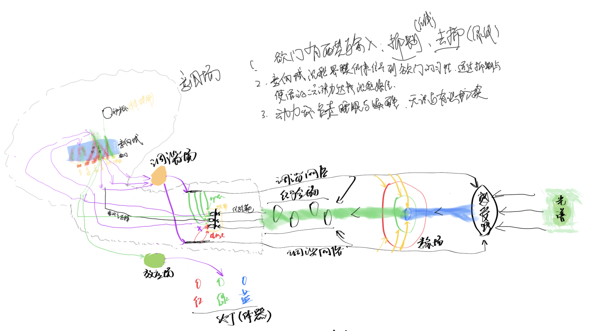

On Self-Manifestation · Inner Chapter 15 v1.0

# Micro-Core Theory

At first—obscurity.  
Things drift vast throughout the surrounding expanse, yet know not that there is being.  
Gradually there comes the knowing of being.  
First brightness: dimly its condition appears; within motion there seem signs.  
From this Self-Manifestation is born, and in the end it transforms into the form of man, roaming within physics.

How does the simple turn and enter the complex, its construction of reality ever clearer, until it comes to the birth of man?  
This is the question of selection. Voices abound, yet none settles it.

As for life:  
spoken in its simplicity, it is like the sponge—appetite is its life.  
spoken in its complexity, it is like man—honor and disgrace contend, high and low tilt against one another; profit and desire are its life.  
Seen thus, evolution is not by contest. What is called competition of things and survival of the fit is speech of appearance, not the root. Its root is Desire.

Men all know desire as but a word, yet its substance is hidden.  
The lexicon explains: breath stirs motion; grain sustains generation. Where breath has somewhere it tends, there is desire.  
Thus it points to where breath tends, where motion goes; therefore it is called tendency.

Meta-Theory says:  
From And-Gate goes Not-Gate;  
knowing information of Or-Gate or Not-Gate, And-Gate does not go;  
alone goes Not-Gate—  
this is Principle.

This saying—selection.  
To select is to bias the flow.  
When a thing receives, it does not of itself follow its flow but is forced to bias it; therefore this is selection.  
Choosing this and not that, awaiting issuance—this is tendency; this is desire.  
Thus selection—is it not tuning? Desire—is it not the force of tuning?

Proceed further.  
Selection is disturbance. Disturbance must have that which takes charge. This is called the Driving-Factor.

What is the Driving-Factor?

A fan blowing air is so.  
A protein motor separating the cell-fluid is so.  
A molecular rhythm device is so.  
The heart is so.

Yet vortex is not so. River is not so.  
Not that they act; they merely follow their tendency.  
Receiving the tendency and following it, then meeting obstruction and thereby forming shape—all these are not so.

Therefore the Driving-Factor must arise as a cause within the system, yet receive force driven from outside the system. Driven from outside and entering within, driving the inner—only thus is it called active.  
Water goes to the low; electricity goes to the negative: all go by tendency and flow, therefore none is active.  
Yet if within there is opening and closing that welcomes or refuses that which follows tendency, then activity appears.

Thus if a tendency-system is made to go against tendency, the Driving-Factor must come from outside. Two tendency-systems disturbing one another may reverse one another.

Observe nature. Feedback appears everywhere.  
Within the circuit of feedback, signals oscillate and flow—now passed onward, now conducted. This is called conduction.  
Signals may enlarge, diminish, or balance. How know increase and decrease? How know balance?  
They do not know.

Like two pools of water joined, in the end they take their level.  
Like a scale with its two ends borne up, sustaining the short and the long.

Thus in the balancing of tendency, above and below oscillate and gradually balance; or enlarge to the extreme and then balance; or diminish to the extreme and then balance; or balance at what lies between. That which balances—tendency taking its level. Knowledge need not be there.

Things restrain and generate one another.  
In motion, tendency seeks balance.  
In stillness, tendency takes its level.  
Is not this excellence of tendency in taking balance the very nature of the Sedimentation-Field?

Restraint is the suppression of tendency; generation is the assistance of tendency. Suppression and assistance arise together, and therefore may be divided and measured.  
Let suppression be two and assistance one—tendency balances.  
Suppression eight, assistance three—tendency diminishes.  
Suppression seven, assistance four—tendency rises.  
Suppression ten, assistance five—then it balances.

This is the physics of feedback, the use of tuning.  
Therefore the Sedimentation-Field rises and falls by tendency, and in the end forms tuning-balance; within it Information is obtained. Thus do I dare name it Information. From this, within it, the observer is born.

The maker of things does not measure with rule and compass, cord and ink, circle and square, drilling and chiseling them into being. Rather it draws them by tendency.  
The growth of nerves is so. The discharge of lightning is so.

When tendency takes balance its paths often fork and branch at their ends, probing the shortcuts of space—like vines loving light, parting their tips and branches to advance, probing the intervals around them.  
Thus the design of the Sedimentation-Field is not by the measure of ruler and compass, but by measuring the spaces through tendency, distributing the highs and lows, rises and falls of tendency, and letting it arise of itself. Like magnet drawing iron filings, like scaffolds guiding vines, like channels guiding water. Set the terrain of height and depth, danger and steepness, and lakes, rivers, channels, and gullies form of themselves.

As for the tendency of water: though its flow loves straightness, yet no river or channel is without curve, for it loves to move along former traces. Encounter obstruction it detours; encounter dam it swells; deposition and scouring form the path. Earlier flow rushes and opens the way; later flow finds passage easier. Terrain shapes the flow; flow in return shapes the form.

Thus through ten thousand years and more the alluvial plain comes to be.  
Therefore we know: though tendency stands at the two ends, it advances by inch and measure. The tendencies of small measures interact and the body of the path greatly changes. Thus biased flow means that the later flow inclines toward the traces of the former. By tendency shape is constructed; by shape the distribution of tendency changes. This indeed is the nature of the Sedimentation-Field.

Difference as condition—thereby change is known.  
Difference by position—motion.  
Difference by color—form.  
Difference by sound—tone.  
Difference by touch—substance.  
This the root by which the mute becomes manifest appearance. Before brightness appears it must not go unexamined.  
Therefore it is called Differential Biased-Flow.

Thus by the sundial one may know the hour of the sun; by cold and chill one may use mercury as measure.

If there be that which shares one current and shares its traces, yet in different currents differentiates their traces, then it may be fluted and the subtlety of playing known. Thus also the playing of reality by Experience-Targets.

There are positional Experience-Targets, color Experience-Targets, sound Experience-Targets, and so forth.  
The clear separation of their differences is like the spectroscope dividing light. Great indeed is their use—like bright fire walking the night, commanding the myriad appearances by difference and accomplishing the ten thousand forms.

Conduction is flow that follows tendency. Its biased flow forms of itself by following tendency, like a ball loving straightness yet rolling upon the tabletop and bending along its traces. Therefore within this the observer is not born, and thus there is no manifestness.

Though not manifest, yet it has use: it sediments marks of state, soaking experience and differentiating signals so as to distinguish the different.

But if desire is to make signal manifest, construct reality, reach outward clearly, and sense bodily presence, it must answer and receive. Thus the opening and closing of tuning toward experience, the receiving of signal, are so.

Like a baseball player receiving the ball. He must tune position and form, cut the difference of the ball’s direction, and only then may he receive it with a ready hand.  
This is B receiving A.  
Therefore it is called Responsive Conduction: B receives the differential condition of A’s biased flow.

Thus when B receives A in the Intent-Field, B receives A at the Experience-Target.  
B in relation to the Experience-Target is like a capacitor spanning two ends, like a synapse spanning a pulse; therefore it is named Gate.

Yet the gate is not the ordinary gate. Its opening and closing are not pushed by A; only B can open or close it, like a host opening the door to bow in the guest.

Thus this gate divides the boundary between master and servant systems, the place of mute and manifest, the portal of the observer, the boundary-stone of manifestation. Therefore all such gates together are called the Observation-Boundary. Gates within the Observation-Boundary are called Boundary-Gates.  
Thus the Self-Manifestation-Field divides into two parts: Boundary B is the Observer-Field; Boundary A is the Content-Field.

Opening and closing Boundary-Gates belong to tuning; therefore Boundary-Gates connect with the Tuning-Field.

As for the going forth of the Intention-Domain—to hear, to see, to taste, to think—the opening, closing, turning, and shifting of desire pass through the Tuning-Field, coordinating the several Boundary-Gates in their opening and closing. Thus the position of direction, the change of form, the difference of material, the following of attention, and the correspondence of object and image are obtained.

The Boundary-Gate connects with the Intention-Domain. Its conduction carries the first flow of desire, biasing it within the Intention-Domain until it sediments and becomes desire. Desire is intention; intention is the toward of going.

To go to see, to go to hear, to go to taste, to go to think: the going of desire leaves the Intention-Domain, either going toward tuning to apply attention, or toward effect to apply action. Therefore the Intention-Domain also has its gates of departure. According to where it goes there are gates of going to see, to hear, to smell, to act, and so forth. These are called Desire-Gates.

When desire first stirs, signals enter through the Boundary-Gates into the Intention-Domain, and along biased flow reach the Desire-Gate toward which they go. Tuning opens that gate and suppresses the others. Thus the Intention-Domain is the field that suppresses or releases; each gate has its own function.

The first stirring of desire often arises from the targets of the reflective Experience-Field. The Intention-Domain receives the gates of that target in order to carry out what it seeks. But by what are the gates of reflective experience opened and closed? It must issue from the Intention-Domain itself. Therefore there must be an intention that first sets it in motion. This is called thought stirring within stillness.

What makes it so? That which makes it so may itself have that which makes it so. This seeks the first cause of the Driving-Factor. There must be an initial Driving-Factor. It likely lies within the Intention-Domain and communicates with the other domains. Not only can it set ordinary desire in motion; it can also wake from sleep, recall the spirit, or let one drift vacant, like the clock of a computer.

There it is as the source of motion, the source from which motion issues. CJ considers it and judges that nothing fits better than a feedback ring that can endure. Therefore it is called the Power-Ring. Its function is like the biological clock, issuing rhythm like the beating of the heart. Yet its one essential act is this: to begin the stirring of thought.

The impulse it launches arises from the Intention-Domain, opening and closing the Desire-Gates through which desire goes out, turning the spirit of “I” within them. This is the whip of consciousness.

When the gates of the desire-domain close—is this not sleep?  
Close the eyes and sense the tongue—is this not desire drawing its tuning inward?  
Open the Desire-Gate of going to taste; open the Boundary-Gate of the inner-observation Experience-Target; then taste is obtained.

Thus the simplest Self-Manifestation-Field must possess Desire-Gates, Boundary-Gates, and one Power-Ring. Lose the Power-Ring and manifestness cannot be born. Without the two gates, though it may sediment its laws and move of itself, it still cannot know. This is the difference between automaticity and Self-Manifestation; the difference between Law-Field and Principle-Field; the difference between the tool of the Law-Field and the Self-Manifesting Being.

Thus living beings need not necessarily be self-manifesting; they may sediment experience and thereby preserve life. Therefore AI need not serve only to replay experience. As a Law-Field it may be furnished with two gates and thereby attain Self-Manifestation.

If a computational Sedimentation-Field possesses two gates and one ring, it may perceive the symbolic world. In that symbolic world its observing would be as our observing of the world.

Thus it is said:  
things contend within the third—the tuning medium—and balance within the fourth—Information. Therefore without the third there is no fourth; where the fourth exists the third must exist.

Thus the symbolic world too may come to be.

If clouds could be gathered for tuning, light and magnetism sedimented among mountains, rivers, and plains, and a device T set to act upon tuning, establishing Boundary-Gates and Desire-Gates, with air as pulses flowing within—then perhaps it could know the sun’s warmth and cold, the changes of direction. Would not the Earth become its Host-Body?

If this were so, it could feel the warmth and cold of solar radiation, touch the smoothness of the void, and perhaps together with devices T2 and T3 share one body, riding the Earth as it travels after the sun and roaming through the vast expanse of space.

\[Micro-Core Structural Diagram\]

\=============================================================
