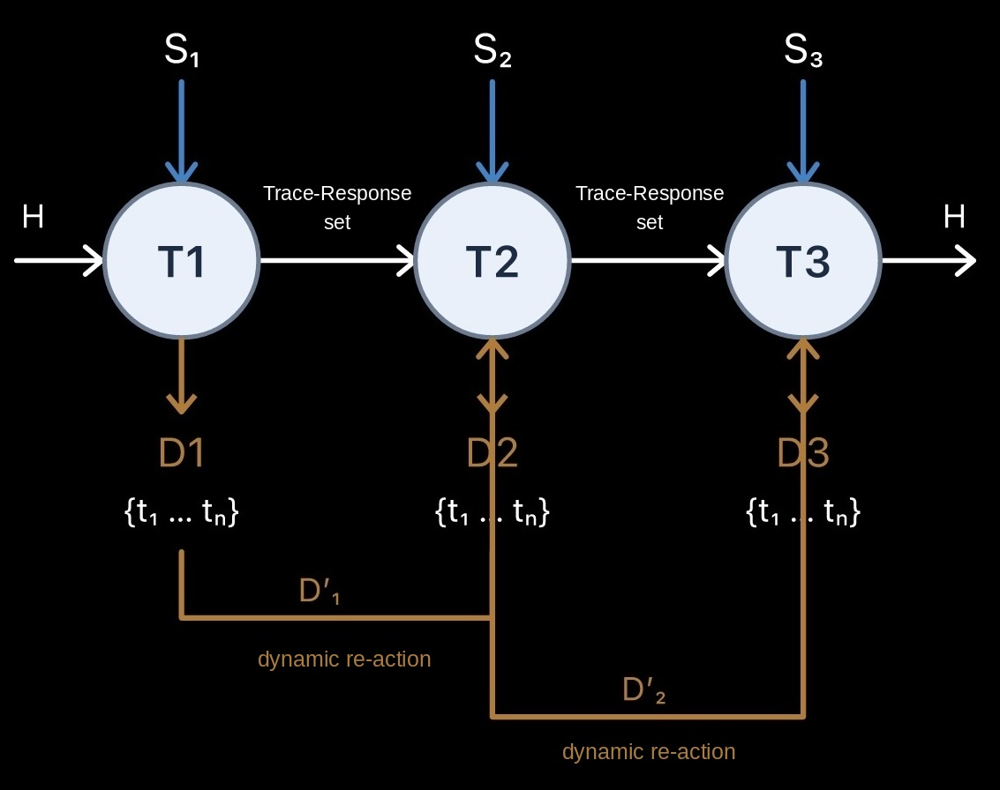

On Self-Manifestation · Engineering Chapter · The Field Concretization Group Form v1.0

# Master Map

## Section 1  Basis of Aggregation, Nature and Notation

1.1  Why These Twenty-One Papers Form One Group  
The twenty-one form-texts share one object of study: the concretization of the Sedimentation-Field in concrete hosts—the Trace-Response set that signals leave in a concrete medium, how this set takes part in later activity, and how it transforms under the action of historical dynamics. Each paper answers one question about this object: what is minimally required for it to hold (Chapter 1); how to represent it exactly (Chapter 2); how to adjudicate it from observation, and where the limits of adjudication lie (Chapters 3, 4, 11, 13, 17); how it is reached, constructed and realized, where historical dynamics comes from, how tendency is graded, and how qualification is maintained, fails and returns (Chapters 5 to 10); what, on a host, bears the sedimentation-dynamics structural quantities of the established field theory (Chapter 12); under what independent conditions qualification necessarily holds (Chapter 14); what can be transferred between two hosts with different mechanisms (Chapter 15); how a dynamics candidate is discriminated from known dynamics (Chapter 16); how the transformation of a Trace-Response set is expressed, run and read back (Chapter 18); and complete studies of three kinds of host—biological neural, artificial neural network and geomorphic—carried out by the same research procedure (Chapters 19 to 21).  
Among the twenty-one papers, later papers take the definitions, criteria and programs of earlier ones as input, and earlier papers deliver interfaces to later ones. Where a conclusion is used, and which papers are affected when an antecedent changes, cannot be seen clearly from cross-references alone. Load-bearing relations and propagation are given in Section 5, and the sources of conclusions in Section 12; members, degree of answer, the status of candidate hosts, predictions and open items are given in Sections 4, 6, 7, 10 and 11 respectively.  
Basis of aggregation: the object axis, that is, principal and auxiliary forms under one and the same object of study (the concretization of the Sedimentation-Field in hosts). This Group Form is a bearing group form; each of the twenty-one papers belongs to this Group Form alone.

### 1.2  Nature

This Master Map is an integrative form (Canon Chapter 1, Part Five, Chapter Two); it is the group diagram of this Group Form, not a member form-text, a principal form or a proof form. The propositions, theorems, verdicts, predictions, H conditions and ontological predicates it carries all belong to the member papers, and for definitions, conclusions, terms, theorem directions and status declarations the member papers prevail; where member papers differ in notation or use the same name for different referents, the variants are registered side by side (5.5).  
The source tables of this Master Map consist of the table of members in Section 4 (title, version, form kind, SHA-256), the source–propagation table and terminological correspondence in Section 5, and the source index and the table of sources outside the group in Section 12; each load-bearing conclusion carried here is marked with its source paper and clause. Wherever this Master Map and the text of a member paper diverge, the text of the member paper prevails in every case.  
This Master Map has no breachable proposition of its own. To breach any conclusion it carries is to breach that conclusion's source paper, and the breach is handled by that paper's breach modes; the affected downstream papers are found in the propagation table of Section 5.

### 1.3  Notation

\[1\] to \[21\] denote Chapters 1 to 21 of the Field Concretization Group Form v1.0; \[n\] x.y denotes clause x.y of Chapter n, and \[n\] Section k and \[n\] followed by a theorem are read in the same way. In the texts of the member papers, \[S1\] to \[S16\] refer respectively to the same papers as \[1\] to \[16\]; in the texts of Chapters 19 to 21, \[17\] to \[20\] refer to the same papers as in this Master Map.  
Verdicts take values in {1, 0, ⊥}; ⊥ carries a reason code and implies neither 0 nor any direction (\[3\] Theorem 8).  
Three columns: Column A, the model column, model-mode verdicts on declared models; Column B, the prediction column, conditional conclusions and breachable predictions for real hosts; Column C, the reality column, empirical certification, where measurement mode gives only 1 or ⊥. The three columns stand apart: A is not read as B, nor B as C (\[11\] 8.1, \[17\] 1.4, \[19\] 1.3, \[20\] 1.3, \[21\] 1.3).  
“Organization” means the mode of organization of a Trace-Response set; “Group Form” refers only to the papers of this series.

## Section 2  Ontology

### 2.1  Definition

The diagram is as follows:

Figure 1  Diagram of the ontological structure of the Sedimentation-Field (The Ontological Structure Diagram of the Sedimentation-Field v0.4)  
　　Symbol definitions  
　　Symbol　　　　　　Meaning  
　　H　　　　　　　 History  
　　Sᵢ　　　　　　　Signal  
　　Tᵢ　　　　　　　State: the current Trace-Response set  
　　Dᵢ　　　　　　　Dynamics  
　　D′ᵢ　　　　　　 Dynamic re-action  
　　t　　　　　　　 Dynamics type  
　　{t₁, …, tₙ}　　　Set of dynamics types  
　　A Sedimentation-Field is:  
　　the Trace-Response set that signals leave in a medium, together with the mode of organization of this set, transforming under the action of historical dynamics, and its activity.  
　　Note:  
　　Trace-Response: see the terminology of the Field Chapters.  
　　Hence,  
　　Self-Manifestation Theory is the study of:  
　　the Trace-Responses of signals in a medium and of the transformation of Trace-Response sets.  
　　In examining a concretized field, it must first find out what its Trace-Responses are, and then study the transformation of their set under the action of historical dynamics.  
　　Explanatory notes:  
　　A single Trace-Response (element) has only two basic kinds of change, deepening and shallowing; no change is zero change, and the limit of shallowing is that the Trace-Response phenomenon does not occur.  
　　The Trace-Response set is organized by dynamics, and its transformation rests on the deepening and shallowing of its elements, appearing as dynamic phenomena such as paths, overlap, Edge-Seepage and local shallowing, and as organizational transformations of the whole, of subsets and of their mutual intervention.  
(The Ontological Definition of the Sedimentation-Field v2.0)

### 2.2  Reading

\[9\] 2.1 F2: “Historical dynamics forms tendency; the carrying-out of tendency is activity; activity and tendency organizing (that is, organizing the set) is transformation, and it transforms according to tendency, as water seeks low ground.”

## Section 3  The Research Procedure for Concretized Fields

### 3.1  The Procedure

Given a concretized field, first find its Trace-Responses, then study how the Trace-Response set transforms. Taking a single-celled organism as an example, the route unfolds as follows:  
1\. Find the Trace-Responses. What signal acts on what medium of the organism, and what change does it leave? What bears the change, and how is it retained? First find this concrete object, and keep the retained change apart from the activity occurring at the time.  
2\. Study the single Trace-Response. How does it deepen, how does it shallow, and when does it not change? What quantity bears its depth in this host? What, concretely, is the case in which shallowing reaches the point where the Trace-Response phenomenon no longer occurs?  
3\. Study the organization of the Trace-Response set. How are these Trace-Responses distributed and connected, how do they overlap, and what subsets do they form? How do the whole and the subsets constrain one another and intervene in one another?  
4\. Study how historical dynamics forms tendency. How do the Trace-Responses already left, and their organization, give later actions differences of direction, passage, ease or selection? What concrete mechanism bears these inclinations?  
5\. Study how tendency is carried out as activity. When a signal arrives or the field continues running internally, how does the existing set constrain actual activity: where is there recruitment, passage, activation or inactivation? How do external signals and internal continuation take part together?  
6\. Study how activity acts again on the set. Which Trace-Responses are deepened, shallowed or maintained? Which connections, paths, overlaps and subset relations change? How does the changed set in turn form subsequent tendency and activity? Here the actual process in which “existing Trace-Responses take part in determining action, and action further changes the set” must be kept firmly in view.  
7\. Extract the dynamics types, then verify and adjudicate. Which dynamics does the host share with other concretized fields, and which are mechanisms special to this host? On that basis assemble the evidence, conditional derivations and breachable predictions, and then call on existing criteria to adjudicate its Sedimentation-Field qualification.  
What is studied throughout is this: what signals leave, how what is left organizes later activity, and how activity goes on transforming this set.  
The procedure rests on the ontological definition of 2.1 and its diagram (Figure 1: the dynamic re-action D′ᵢ connects to the Trace-Response set Tᵢ₊₁ of the next moment) and on the reading of 2.2.  
3.2  Criteria and Executable Interfaces of Each Step (Index)  
The criteria, the formal side and the full unfolding of each step are given by the clauses below. The “Criteria” entry follows the order of adjudication in \[17\] 4.4; the “Formal side” entry follows the link-by-link account in \[18\] 8.3; the “Full unfolding” entry gives the places where Chapters 19 to 21 unfold the seven steps.  
Step 1  Find the Trace-Responses  
　Criteria: \[17\] J1, J2, J3, J5 (4.2, 4.3); Definition 1 (trace-free ground state and reference history), Definition 2′ and Theorem 17-1 (three-way classification by clamped self-retention: Trace-Response carrier, activity residue, background; complete self-retention requires tail evidence).  
　Formal side: \[18\] 8.3, Link 1; D18-2, D18-3; Theorem 18-1 (layering of Trace-Responses, activity, residue and background).  
　Full unfolding: \[19\] 4.1; \[20\] 4.1.1, 4.2.1; \[21\] 5.1.  
Step 2  Study the Single Trace-Response  
　Criteria: \[17\] J2; Definition 3′ (K1–K3), Definition 4′ (element certificates), Theorem 17-2 (depth relative to the declared probe and write condition; the order is unique).  
　Formal side: \[18\] 8.3, Link 2; the position-by-position components of Equation 4.2 (positive components deepen, negative components shallow, canceling components maintain); D18-12.  
　Full unfolding: \[19\] 4.2; \[20\] 4.1.2, 4.2.2; \[21\] 5.2.  
Step 3  Study the Organization of the Trace-Response Set  
　Criteria: \[17\] J4; Definition 5′ (organization hypergraph), Theorem 17-4′ (organizational reduction; uniqueness of components is issued only for the given hypergraph).  
　Formal side: \[18\] 8.3, Link 3; D18-4 (labeled organization description); Theorem 18-2.  
　Full unfolding: \[19\] 4.3; \[20\] 4.1.3, 4.2.3; \[21\] 5.3.  
Step 4  Study How Historical Dynamics Forms Tendency  
　Criteria: \[17\] 4.4 hands Steps 4 and 5 over to \[18\], and itself uses only the participation effect (K2) and activity clamping.  
　Formal side: \[18\] 8.3, Link 4; D18-6 (tendency Φ\_σ), D18-13 (the tendency received by the write position, ψ\_x); Theorem 18-5.  
　Full unfolding: \[19\] 4.4; \[20\] 4.1.4, 4.2.4; \[21\] 5.4.  
Step 5  Study How Tendency Is Carried Out as Activity  
　Criteria: as in Step 4.  
　Formal side: \[18\] 8.3, Link 5; D18-7 (activity is the value of tendency at the actual signal); Theorem 18-3.  
　Full unfolding: \[19\] 4.5; \[20\] 4.1.5, 4.2.5; \[21\] 5.5.  
Step 6  Study How Activity Acts Again on the Set  
　Criteria: \[17\] J10, J7, J8, J9; Definition 6′ (effective-difference certificate, a sufficient certificate for the strength clause of HistCond), Definition 10′ and Theorem 17-8′ (cross-record chain: nonzero, threshold-crossing difference and actual action issued separately).  
　Formal side: \[18\] 8.3, Link 6; D18-8 (Act^ε and Aff), D18-11 (law-layer components); Theorems 18-4, 18-8, 18-9.  
　Full unfolding: \[19\] 4.6; \[20\] 4.1.6, 4.2.6; \[21\] 5.6 (5.6.1 is the model implementation of D′ᵢ writing directly into Tᵢ₊₁).  
Step 7  Extract the Dynamics Types, Then Verify and Adjudicate  
　Criteria: \[17\] J6 routing and Theorem 17-9 (routing table); the upstream criteria \[3\] Section 4, \[11\] Section 4, \[13\] Section 4; dynamics types are registered by the vocabulary of \[16\] Section 5; the main verdict is the master formula Fld of \[1\], and the optional ledgers do not change the main verdict (\[17\] Definition 7′); the three columns and three layers are listed separately.  
　Formal side: \[18\] 8.3, Link 7.  
　Full unfolding: \[19\] 4.7; \[20\] 4.1.7, 4.2.7; \[21\] 5.7.  
Executable models: \[18\] Sections 3 to 5 (definition sequence, equations, solver) and the programs of its Appendix A constitute the executable model for Steps 4 to 6; \[18\] 9.2 and 9.3 are complete seven-step runs on two representatives, the Drosophila mushroom body and the Physarum polycephalum tube network; \[17\] Appendix A gives the programs for the identification criteria of Steps 1 to 3 and Step 6; \[21\] Sections 6 and 7 and Appendix A are the executable model for Steps 4 to 6 on geomorphic objects.  
Format of conditional read-back: \[21\] 8.5 gives the format of conditional read-back for “a candidate relation gaining law qualification on a declared model” (frozen declarations, three host correspondences, two kinds of evidence for current capacity, positive and negative ends recorded separately).

## Section 4  Table of Members

### 4.1  Registration Rules

Each paper is registered with its header line, title and version, form kind, SHA-256, a one-sentence load-bearing conclusion, and the key points of its scope. The SHA-256 is computed over the UTF-8 bytes of the member paper's text and serves as the identifier of membership (for the checking program see Appendix A); the load-bearing conclusions and scopes are statements of the member papers, with their sources noted.

### 4.2  The Twenty-One Papers

1  On Self-Manifestation · Engineering Chapter · The Field Concretization Group Form · Chapter 1 v1.0  The General Form of Field Concretization v1.0  
　Form kind: General Form (principal form).  
　SHA-256: 72bb2b94e5e19c0cec1c58d0492a562be3b631f405d3d7d8fa2cd186478df8e4  
　Load-bearing: on a declared host instance χ = (P, L, B, W), Fld(χ) ⇒ ∃T \[TraceSet(χ, T) ∧ Part(χ, T) ∧ HDyn(χ, T)\]; the three duties take the same T as argument; the direction of necessity is proved, and the converse is a definitional correspondence (\[1\] Section 5, Corollary 1).  
　Scope: conclusions about active concretization over W; every conclusion is relative to the declared instance χ and its level and resolution; the dynamics that issues from the Trace-Responses and acts on the organization is not required to run along a complete material route within B, which is a condition of the in-boundary self-feedback type of Section 7 (\[1\] Sections 7, 8).  
2  On Self-Manifestation · Engineering Chapter · The Field Concretization Group Form · Chapter 2 v1.0  The Mathematical Form of Field Concretization v1.0  
　Form kind: Mathematical Form (principal form).  
　SHA-256: 98a76c56e4fc20b8e39e9843f32e5ffca77e135886f9a809e7625f5510ff4854  
　Load-bearing: the concretization qualification of a Sedimentation-Field is a function of mechanism witnesses, not a function of the state trajectory; the representation must carry mechanism events, components, carrier attributions, action targets and source paths (Theorem 1, incompressibility of mechanism witnesses); a correspondence between layers preserves qualification only if it preserves witness qualification event by event (Theorem 2); whatever cannot be read returns the third value (\[2\] 2.1).  
　Scope: the formal domain and the upper bound of read-back declared in 1.3 and 8.5; readings do not constitute material qualification; the action of an indecomposable joint net zero remains unanswered (13.2).  
3  On Self-Manifestation · Engineering Chapter · The Field Concretization Group Form · Chapter 3 v1.0  The Adjudication Form of the Sedimentation-Field v1.0  
　Form kind: Adjudication Form (auxiliary form, inversion-discernment group).  
　SHA-256: e9714f628252b02e946c52e1d0fdf8e055bc435c685cd492697583a4664cb4f2  
　Load-bearing: Theorem 9 (adjudication theorem): under Dom1–Dom6 and the declared instance protocols, the first-layer verdicts, the second-layer verdicts using Y₁ alone, and the verdicts on each atom and on Fld under Y₁ plus Y\_decl and under Y₂ are correct under their respective listed antecedents; from ⊥ one may infer neither direction (\[3\] 7.1).  
　Scope: adjudication of declared host instances frozen in advance; a first-layer predicate with value 1 is not read as the duty being 1, and one with value 0 is not read as the duty being 0; for Fld read back to a material instance, a verdict of 1 further requires IMP and Dom4 (\[3\] 7.1, 7.3).  
4  On Self-Manifestation · Engineering Chapter · The Field Concretization Group Form · Chapter 4 v1.0  The Indistinguishability Form of Field Concretization v1.0  
　Form kind: Indistinguishability Form (auxiliary form, inversion-discernment group).  
　SHA-256: 93fbd2dcc21e47205eecec945675022609d303710ce3d31772285e16edc9a24f  
　Load-bearing: for observation sets with closed declarations, and for the duty components q, r, Part, Act, HistCond, HDyn together with Q(T) and Fld, it proves identity of outputs and indistinguishability under all observations in the observation set (adaptive experiments included) (Lemma 1, Theorems 1 to 8), and gives bounds for the extension of observation sets (\[4\] Sections 5, 6).  
　Scope: mathematical conclusions on families of models, limited to the declared candidate families, observation sets, quantifier forms and the antecedents of each clause; decidability is limited to finite, explicit, rational domains; use on material hosts requires separate certification of the read-back antecedents of \[2\] 8.2 and of IMP of \[3\].  
5  On Self-Manifestation · Engineering Chapter · The Field Concretization Group Form · Chapter 5 v1.0  The Reachability Form of Field Concretization v1.0  
　Form kind: Reachability Form (auxiliary form of establishment proof).  
　SHA-256: d3e5b53712f4f48c21983fa80da84da8621b47328980a1ff3fdbbfeaaa19ce9e  
　Load-bearing: in a fixed reachability working context, Sedimentation-Field qualification targets are determined by the window's starting state, the formation and mark records, and the in-window input; in the finite case qualification reachability is decidable and has a path bound; a qualification already reached may be unprovable within the declared observation sets (\[5\] Section 13).  
　Scope: reachability judgments are relative to the fixed model, initial state, permitted set, legitimate histories, lineage, time domain and controller information; the engineering permitted sets are Π₀ and Π₁; ⊥ is not read as unreachable; the conclusions are in-model conclusions and do not certify the qualification of any material host (\[5\] Section 12).  
6  On Self-Manifestation · Engineering Chapter · The Field Concretization Group Form · Chapter 6 v1.0  The Construction Form of Field Concretization v1.0  
　Form kind: Construction Form (auxiliary form of establishment proof).  
　SHA-256: 5c6a76a86a200b129edb5d65a17ae309e565b59e9ead4a03a85cf2c0f24ec6d5  
　Load-bearing: in each of two families, flow-network sedimentation (Family A, a constant-head two-channel flow network) and biological neural networks (Family E, a firing-rate model), it gives a physical mechanism model with dimensions and closed budgets, together with its formal encoding via the compilation rule J; the Trace-Response z₁ bears the three duties, Fld = 1, and the type is in-boundary self-feedback (\[6\] Theorem 1, Section 9).  
　Scope: the construction holds only within the two declared mechanism models; the conclusions concern only T made of Structural Positions, not candidate T that include the loose-material store or the receptor pool; identical formal encodings do not imply that the physical construction is usable; reachability, realization and the material qualification of any real flow network, river channel, slime mold or neural tissue are not issued (\[6\] Section 8).  
7  On Self-Manifestation · Engineering Chapter · The Field Concretization Group Form · Chapter 7 v1.0  The Realization Form of Field Concretization v1.0  
　Form kind: Realization Form (auxiliary form of establishment proof).  
　SHA-256: afa62d35c1575086a0f645e489fb1e1032b29b8ccb99b6fa4ac194eeaa8e9eda  
　Load-bearing: χ₀ and Instance A of \[3\] are realized with programs as hosts: the exact host equals the original model beat by beat, and the binary64 host equals the declared rounded operation graph beat by beat; when the interval backend decides every comparison, the binary64 realization and the exact realization take the same decision branches (\[7\] Section 13).  
　Scope: realization at the algorithmic level, not realization by a material host; the resource budget is signed off only for the listed inputs; the number-system declaration must state the rounding and subnormal policies; the items for Physarum polycephalum are ⊥ (\[7\] Section 12).  
8  On Self-Manifestation · Engineering Chapter · The Field Concretization Group Form · Chapter 8 v1.0  The Dynamics-Source Form of Field Concretization v1.0  
　Form kind: Source Form (auxiliary form of source and transformation).  
　SHA-256: 81a89c8e30c2abf002737019a2fdaaced1fd0ff4ae014f45f256f5e6c5071890  
　Load-bearing: an action bearing historical dynamics depends on the past only through the pre-beat state and the pre-beat formation record; the actual ancestor graph is finite; in the nonnegative family the three target layers are monotone in the retained events, and necessary events are decided exactly by single-deletion tests; where the source is not unique, what can be determined exactly is the family of sufficient sets, the family of minimal sufficient sets, the necessary events and the actual ancestors (\[8\] Section 10).  
　Scope: within the alphabet-gated F model class 𝔐\_GF and the window reading RD of The Reachability Form of Field Concretization; Theorems 3 and 4 are limited to the nonnegative family 𝔐\_GF⁺; the conclusions are source conclusions within formal models, and uncertified hosts are given ⊥ (\[8\] Section 9).  
9  On Self-Manifestation · Engineering Chapter · The Field Concretization Group Form · Chapter 9 v1.0  The Grading Form of Tendency Types v1.0  
　Form kind: Grading Form (single-axis stratified type).  
　SHA-256: d1748ef1806e021fddddb8b307948a48255a88ef737d7d3712f55004acbd6b04  
　Load-bearing: with the pairwise direction sign of Trace-Response pairs as the criterion axis, tendency types fall into four grades, rising, flat, falling and indefinite, which are mutually exclusive, exhaustive and each nonempty; a strict dominance transposition can occur only in the indefinite type (\[9\] Section 7).  
　Scope: a tendency type is a property of (host, declared level, family Φ, declared domain B\_dyn, stationary inflow); the entry conditions of the local families are issued only for β = 1; material instances must first obtain verdicts under \[3\] 4.6–4.8, and for those that have not, the tendency type is not attributed to the instance (\[9\] 2.2, Section 8).  
10  On Self-Manifestation · Engineering Chapter · The Field Concretization Group Form · Chapter 10 v1.0  The Stability Form of Field Concretization v1.0  
　Form kind: Stability Form (auxiliary form of maintenance and stability).  
　SHA-256: 040b0ee849ddb0b7505f1c96f633c64524e9ae12f47f79f02594e6095f937a1c  
　Load-bearing: at each evaluation point, qualification is determined by the unique maximal bearing set, and failure attribution is read off component by component on that set; deciding maintenance on all legitimate successors requires keeping the window start; the impossibility of return has sufficient conditions (Theorems 5, 6) (\[10\] Section 12).  
　Scope: within 𝔐\_GF and RD; ⊥ is not actual failure; recovery conclusions are issued only at the existence layer; the conclusions are stability conclusions within formal models and certify no material host (\[10\] Section 11).  
11  On Self-Manifestation · Engineering Chapter · The Field Concretization Group Form · Chapter 11 v1.0  The Adjudication Form of Field Concretization for Candidate Hosts v1.0  
　Form kind: Adjudication Form (auxiliary form, inversion-discernment group).  
　SHA-256: d6b75b0c6a2ed84b3bd9b5b92dd05d281ff40e4bc7b894ed74f63b560cc82131  
　Load-bearing: on declared R-layer instances of the event-gating class 𝒦\_g, the adjudication theorems D1 and D2 are two-way relative to the declared intervention domain 𝒟₁; the participation-type source criterion PS and Theorem COR give sufficient certification; for Instance P of the frozen SNN, Part = HDyn = 1, r = 1, TraceSet = 1, Fld = 1 (algorithmic level); the master ledger of candidate hosts registers 18 items in columns (\[11\] Sections 7 to 9).  
　Scope: a 0 on 𝒟₁ does not imply a 0 on 𝒟\_m; no ⊥ implies 0; instance verdicts are limited to the algorithmic level and certify neither neuromorphic hardware nor biological neural tissue; the master ledger has no verdict of 0, and all 18 items are in the ledger (\[11\] Section 9, 8.3).  
12  On Self-Manifestation · Engineering Chapter · The Field Concretization Group Form · Chapter 12 v1.0  The Mathematical Form of Sedimentation-Dynamics Concretization v1.0  
　Form kind: Mathematical Form (equations type).  
　SHA-256: f1565c56ef5a1b4a9de383bb11bdde903ae6d1a9460e82f3fbf633c54e60f21b  
　Load-bearing: S₁₂ = {D, B (B\_m, B\_m^q), F} ⟼ M₁₂: which mechanism states, events and leveling interventions bear Differential Accumulation, Continuation Bias and Familiar-Route Locking on four declared hosts (SNN s1, Family A, Family E, the minimal two-path threshold model); the actual witness history alone does not suffice to determine B\_m and F (Theorem R-B) (\[12\] 1.2, Section 10).  
　Scope: the object domain is the four declared hosts, and the family-level conclusions cover 𝒦\_g and the two families of the Construction Form; the reading type is a load-bearing symbol; no material host is certified (\[12\] 1.3, Section 8).  
13  On Self-Manifestation · Engineering Chapter · The Field Concretization Group Form · Chapter 13 v1.0  The Adjudication Form of Material Field Concretization v1.0  
　Form kind: Adjudication Form (auxiliary form, inversion-discernment group).  
　SHA-256: 017da8624ff53d34d3bcccf69a1e0529aeac083035321798b794c0c2f5067cc7  
　Load-bearing: under a declared imperfect channel Λ, a frozen valid domain, a baseline, an H0 law class and an information domain, verdicts of 1 on the second-layer atoms of \[3\] and on Part and HDyn: the bounded reading has zero misjudgments, and under the statistical reading the misjudgment rate does not exceed the declared α; certifiable boundaries are also given; for Λ = 0 it degenerates to \[3\] 4.6 (\[13\] Sections 5, 7).  
　Scope: class-F linear and bilinear law models, single-beat families, and the gated extension class closed under PA-1 and PA-2; the gated extension class obtains only FD-level conclusions; the material verdict for each candidate is ⊥, with no verdict of 0 (\[13\] Section 10).  
14  On Self-Manifestation · Engineering Chapter · The Field Concretization Group Form · Chapter 14 v1.0  The Necessity Form of Field-Concretization Qualification v1.0  
　Form kind: Necessity Form.  
　SHA-256: 83aca5b0d1bac81aea00bc1f42b7a25536f30e2330bb9620708eff6411cb205d  
　Load-bearing: on the leaky integrate-and-fire–pair-STDP subclass 𝒦\_LS, the condition group C\_LS⁺ implies that the three duties hold on the same T on every subsequent letter sequence satisfying the input regime (Theorem 14-1⁺); the equivalence characterization holds under the listed background antecedents (Theorem 14-7); the gated extension class reaches only the FD level (Theorem 14-9) (\[14\] Section 6).  
　Scope: algorithmic level, model mode; claims are made only for windows containing a certificate probe; Families 1 and 2 have only lemma-level results; the human brain, Drosophila and neuromorphic hardware are not certified (\[14\] Section 11).  
15  On Self-Manifestation · Engineering Chapter · The Field Concretization Group Form · Chapter 15 v1.0  The Mathematical Form of Duty Correspondence in Field Concretization v1.0  
　Form kind: Mathematical Form.  
　SHA-256: 59693163ebb5aa7261caa7b68a2c8778721bf035f9178f9938d274c61e65110c  
　Load-bearing: S₁₅ ⟼ M₁₅: between two host models with different mechanisms, the atom readings of the three duties and the qualification conclusions can be transferred when correspondence conditions that can be verified independently on the mechanism laws are met; the antecedents of the preservation theorems contain no equality of atom values; identical state equations or identical actual runs do not suffice to establish identical mechanisms (Theorem 15-4); the transfer of dynamics additionally requires DT1–DT5 (Theorem 15-12) (\[15\] Section 10).  
　Scope: finite-dimensional, deterministic R-layer declared instances with rational data and finite windows; the main pair SNN s1 ↔ Family E and the boundary pair Family A ↔ Family E; positive substantive transfer on the main pair is issued only for classes with fixed n, n = 1–23; transfer statements on real hosts must list the unverified correspondence conditions as required at Level 3, and are at most class B (\[15\] Sections 8, 10).  
16  On Self-Manifestation · Engineering Chapter · The Field Concretization Group Form · Chapter 16 v1.0  The Discrimination Form of Sedimentation Dynamics v1.0  
　Form kind: Discrimination Form.  
　SHA-256: 9e0cbbb4e68982f48b53a5bb2d1f9a02426a4cf43ca28694255b5d9617897ce0  
　Load-bearing: for the concretized-field instances studied, it discriminates instance by instance the dynamics types and mechanism combinations used by historical dynamics, and gives for every declared candidate pair a distinguishing observation and a discrimination theorem (Section 6); the vocabulary of dynamics types Φ1–Φ17 (Section 5); within the scope studied no new dynamics has yet been certified, and this is not a proof that “new dynamics does not exist in general” (\[16\] 1.5).  
　Scope: the working domains W16-E v0.1, W16-E″, W16-F; coverage conclusions reach only constructive coverage at the W-instance layer, and coverage at the literature layer is unproved; that the model contains a mechanism, that matter has evidence of that mechanism, and that the mechanism meets the duties on an instance: none of the three automatically implies another (\[16\] 1.2, Section 9).  
17  On Self-Manifestation · Engineering Chapter · The Field Concretization Group Form · Chapter 17 v1.0  The Adjudication Form for Identifying Concretized Fields v1.0  
　Form kind: Adjudication Form (auxiliary form, inversion-discernment group).  
　SHA-256: cfd8a0806c37e5a7dd27529439b6d04673a96e16530ad26951c2d198abbce355  
　Load-bearing: starting from an object and its mechanism evidence, it identifies Trace-Responses, depth, organization and regime: three-way classification by clamped self-retention (Theorem 17-1), depth order (Theorem 17-2), organizational reduction (Theorem 17-4′), the effective-difference certificate (Definition 6′), cross-record chains (Theorems 17-8′, 17-10); through the routing table (Theorem 17-9) the results enter the criteria of \[3\], \[11\] and \[13\] (\[17\] 1.3).  
　Scope: declared host models and declared records; finite records give only a lower bound on self-retention; the effective-difference certificate is a sufficient certificate for the strength clause of HistCond of \[1\], and Fld keeps the original definition of \[1\]; model-layer conditional theorems are not read as the qualification of real hosts (\[17\] Section 9).  
18  On Self-Manifestation · Engineering Chapter · The Field Concretization Group Form · Chapter 18 v1.0  The Mathematical Form of Trace-Response Set Transformation v1.0  
　Form kind: Mathematical Form (principal form).  
　SHA-256: b27dfc8e074d74f52fc26bf47c5d04350e1baa182dda19270905282d7e4e8272  
　Load-bearing: the transformation of a Trace-Response set is the rewriting of an affected subset, determined jointly by “the value of tendency at the write position” and “the labeled organization of the set”, with tendency determined in advance by the existing set and its organization; this chain closes over the first six steps of the research procedure (Theorems 18-1 to 18-9) (\[18\] 2.1, Section 10).  
　Scope: declared host models with finite, deterministic, exact rational data; the two resolution semantics are written separately; tendency is an inclination to activity at the representation layer, and a tendency defined by equations does not certify a physical route; the Drosophila and flow-network examples belong to the model layer and are structural analogies (\[18\] Section 13). Downstream papers inherit only the clause forms, with their antecedents, listed under “Scope of inheritance” in \[18\] Section 15.  
19  On Self-Manifestation · Engineering Chapter · The Field Concretization Group Form · Chapter 19 v1.0  The Discrimination Form of Trace-Response Transformation in Compartmentalized Third-Factor Circuits v1.0  
　Form kind: Discrimination Form.  
　SHA-256: f5bfc0c1d3caa7ec22b296df7bc929e34ae19f34ef92a883621042d7d8f3abe1  
　Load-bearing: on the frozen working domain 𝔇₁₉, the three candidates for the DAN reading within the consolidation window (the permissive type P, inhibitory return R₋, excitatory return R₊) necessarily have pairwise disjoint outputs on the common window statistic Δ̄ under antecedents D1–D4 and m \> 2e (Theorem 19-D); conditional mechanism theorems for the seven steps, and theoretical claims T1–T10 (\[19\] 1.2).  
　Scope: the discrimination conclusion holds only on 𝔇₁₉ and within the candidates' guaranteed region; the conditional mechanism theorems apply only to declared classes such as 𝒩₃F and 𝒦\_B; the real object is the γ1pedc ∪ α3 chain of aversive memory in the Drosophila mushroom body; the reality column is ⊥, with no negative verdict (\[19\] Section 12).  
20  On Self-Manifestation · Engineering Chapter · The Field Concretization Group Form · Chapter 20 v1.0  The Discrimination Form of Trace-Response Transformation in Artificial Neural Networks v1.0  
　Form kind: Discrimination Form.  
　SHA-256: 1427a935aacd18a57adbcd7b5f843d34631261fdf227ceb7547aa1a1b9a71729  
　Load-bearing: on the single-beat common observation 𝒪, the two candidates, self-referential write (the STDP of the s1 law) and external-target-anchored write (the delta rule), necessarily have disjoint outputs under the resolution condition (Theorem 20-3′); conditional mechanism theorems for the seven steps on program hosts; the Field Induction engineering interface from the host level to the dynamics level (\[20\] 1.2, Section 11).  
　Scope: the discrimination holds only on 𝔇₂₀ and for the two listed candidates; the Field Induction engineering interface is issued only from the host level to the dynamics level; the maintenance window is issued only for program hosts; statements about general network classes and others' implementations are conditional predictions (\[20\] Section 13).  
21  On Self-Manifestation · Engineering Chapter · The Field Concretization Group Form · Chapter 21 v1.0  The Mathematical Form of Field-Law Generation in Geomorphic Concretized Fields v1.0  
　Form kind: Mathematical Form (principal form).  
　SHA-256: 13fd0eb8f2b08d12cd52d1a0c03ab1e9bbf1b746a3bf4ff898af586e6faa4e69  
　Load-bearing: on the declared fluvial-lacustrine geomorphic model 𝔐21, a candidate relation comes into being where there was none: the structural positive end of the selected carrying organization first holds at the end of macro-step 10 of H1, and under the three host correspondences and the semantic carry-over of holding-tendency, Law is read back positively for 10 ≤ t ≤ 16 of H1 (Theorem 21-17); of two histories with the same cumulative totals and a different order, one generates candidate dominance and the other buries and erases the old Trace-Response (Theorem 21-7); the number of distinguishable classes of climate sequences under different sediment-supply conditions (Theorem 21-9) (\[21\] 2.1, 2.2, 14.2).  
　Scope: 𝔐21 and 𝔐21⁺ with the declared parameters, classes of water and sediment inflow, perturbation classes, protocols and time points; the negative end of Law and other carrying organizations are not adjudicated; the reality column has no certification and gives no negative verdict (\[21\] Section 15).

## Section 5  Propagation and Interfaces

### 5.1  Source–Propagation Table

Each row registers: using paper and place of use ← source paper v1.0 and clause \| nature of the relation \| condition for review when the source changes. There are four kinds of relation:  
　proof  inheritance of proof: the source clause is a load-bearing antecedent of a definition, theorem or verdict of the using paper;  
　interface  formal or operational interface: the formal language, evaluator or appendix programs of the source paper are invoked;  
　comparison  comparison: used only for comparison, reading discipline or structural comparison, bearing no load;  
　delivery  delivery only: the source paper delivers an interface to the using paper, and the text of the using paper has no explicit uptake yet (details in 5.2).  
When a source paper changes, the using papers are checked against the column “condition for review when the source changes” of this table; for the versions of upstream sources outside the group see 12.2. The clauses listed are those recorded in the upstream-input sections of the using papers, and each using paper is read with the versions it records.  
\[2\] 14.1, Section 14  
　← \[1\] formal master formula, bearing relation, organizational conditioning, rules for identifying action and process, active-concretization stipulation, Convergence Round Lemma, Corollary 1 \| proof \| change to the definitions or the master formula of \[1\] Sections 3, 5  
　← The Mathematical Form of the Field: Structural Position, Trace-Response, Sedimentation-Degree, Equation 2; The Construction Form of the Minimal Sedimentation-Field: the Canonical F update law (6.2, as an R-layer declaration only) \| proof (The Mathematical Form of the Field), interface (Canonical F) \| for versions outside the group see 12.2  
\[3\] Section 2, Section 8 (upstream inheritance)  
　← \[1\] Sections 3, 5, 7, 8, 9 \| proof \| as above  
　← \[2\] D1–D22, 4.2, Theorems 1, 4, 5, 6.3, 8.2, 8.4, 14.2, Appendix A.1 \| proof; Appendix A.1 is interface \| change to the D sequence of \[2\] or to the read-back antecedents of 8.2  
\[4\] Section 2  
　← \[1\] three duties, process-identification rule, joint net zero as unanswered \| proof \| closure of the unanswered items of \[1\] Section 8  
　← \[2\] D1, D9, D10–D20, 4.2, Theorem 1, 14.2 \| proof \| —  
　← \[3\] 3.3–3.5, 4.2 instance protocols, Theorems 4 to 6, Lemma 7, Lemma 12, Section 8 \| proof \| change to the protocols or adjudication limits of \[3\]  
　(\[4\] Appendix A.1 invokes the evaluator of \[2\] Appendix A.1: interface)  
\[5\] 2.1 F2–F6, Section 16  
　← \[1\] three duties, Section 7, χ₀ of Section 6 and the construction witness \| proof  
　← \[2\] D1, D10–D20, 4.2, 5.1 solver, Theorem 1 \| proof; Appendix A.2 is interface  
　← \[3\] 3.1, 3.3–3.5, 4.2, Theorem 4, 7.5 Instance A \| proof  
　← \[4\] the ladder of observation sets, Theorem 6 \| proof  
　← \[9\] local families, domain lemma, entry pulses, T4 \| proof \| change to the antecedents of \[9\] T4 (\[5\] Theorem 4 uses T4 and T5 only outside jump segments)  
\[6\] 2.1 F2–F8  
　← \[1\] Section 3 (h), Sections 7, 8 \| proof  
　← \[2\] D1, D12, D13, D15–D18 \| proof  
　← \[3\] 7.5 (3) Instance A \| proof  
　← \[4\] identifiability boundary \| comparison  
　← \[5\] Definition 3, Definition 4, 2.2 and the reachability program of Appendix A.1 (invoked by \[6\] Appendix A.8) \| proof, interface  
　← \[9\] 6.3 mechanism-witness template, 6.4 (2) \| proof  
　← \[8\] Proposition 1 \| proof  
\[7\] 2.1 F2–F7, Section 16  
　← \[1\] χ₀ of Section 6 \| proof  
　← \[2\] D1, F layer, 4.2, 5.1, 8.2, 8.5 (the evaluator of Appendix A.1) \| proof, interface  
　← \[3\] 3.2, 3.3, 4.2, 7.5 Instance A and Instance B \| proof  
　← \[4\] Theorem 6 \| proof  
　← \[5\] Π₀, Π₁, Theorem 3, Proposition 2, Appendix A.1, A.6 \| proof, interface  
　← \[9\] physical candidates not certified \| comparison  
\[8\] 2.1 F2–F7  
　← \[1\] Section 3 (h) \| proof  
　← \[2\] D1, D12, D15–D18 \| proof  
　← \[3\] 7.5 Instance A and legitimate histories \| proof  
　← \[4\] Theorem 6 \| proof  
　← \[5\] Definition 3, Definition 4, Lemma 1, Lemma 2, Theorem 3, Appendix A.1, A.6 \| proof, interface  
　← \[10\] the first actual failure of Instance A at the 13th a beat \| proof  
\[9\] 2.2, 2.4, 2.5  
　← \[3\] Tr^rest (3.4 (1)) and clamping (3.3), carrying H1 \| proof \| change to the first-layer criteria of \[3\]; H1–H4 are carried with the conclusions  
　← \[1\] the in-boundary self-feedback type of Section 7 \| proof  
　← \[2\] 1.3, 6.3 (R-layer beat-wise reading) \| interface  
　← \[4\] the determinability conditions for the entry conditions handed over in Section 10 (Theorem 2, Theorem 5) \| proof  
　← The Mathematical Form of the Field: Definitions 3, 9, 11, Equations 2, 3a, 4, Law 20 (F3, prior fact) \| proof \| for versions outside the group see 12.2  
\[10\] 2.1 F2–F8  
　← \[1\] time-window stipulation, χ₀ of Section 6 \| proof  
　← \[2\] D1, D10–D20, D16, 4.2, 8.2 \| proof  
　← \[3\] 7.5 Instance A \| proof  
　← \[4\] Theorem 6 \| comparison (used only for the substitution and observation interface of Section 10)  
　← \[5\] Definition 3, Definition 4, Lemma 1, Lemma 3, Theorem 3, Proposition 2; Appendix A.6 invokes the reachability program of \[5\] Appendix A.1 \| proof, interface  
　← \[7\] Theorem 2, Proposition 2 \| proof  
　← \[9\] rest flow \| comparison  
\[11\] Section 2  
　← \[1\] Sections 2, 3, 5, 7, 8 \| proof \| change to the clauses of \[1\] on the source reading (Section 3)  
　← \[2\] D1, D4–D20 \| proof  
　← \[3\] Section 3, 4.2, 4.5–4.8, Section 5 \| proof \| change to the verdicts of \[3\]; compatibility on the intersection holds only on the C4′ subdomain  
　(the source adjudications carry antecedents such as B\_OD, EF1′, N′ and B\_FD; see the condition ledger of \[11\] 7.2)  
\[12\] 14.1  
　← \[2\] the two layers R and F, D4–D21, Theorems 1, 3, 6.1, 8.2–8.6 \| proof  
　← \[11\] Definitions 1–7, Proposition 1, 3.3 \| proof; Appendix A.8 loads \[11\] Appendix A.2 \| interface  
　← \[6\] 4.2, 4.3, C-C, Lemma 1, Proposition 5 \| proof  
　← The General Form of Sedimentation Dynamics: Definitions 4 to 6 and Appendix 1; The Mathematical Form of the Field: definitions and equations; Familiar Route Measure Equations: Sections 3, 11 \| proof \| S₁₂ holds conditionally: the necessity of D, B and F declared upstream is given by definitions and propositions, while the minimality and completeness of the structure as a whole are unproved (\[12\] 1.2)  
\[13\] Section 2  
　← \[1\] three duties and master formula \| proof  
　← \[2\] D1, D12, 4.2, D15, D16, D17 \| proof  
　← \[3\] 3.1, 3.2, 3.5, 3.6, 4.2 \| proof \| degenerates to \[3\] 4.6 when Λ = 0  
　← \[4\] indistinguishability on exact observation sets \| comparison (cited as in that paper, not re-proved)  
　← \[11\] 3.1–3.4, 4.2 (dependency tagged B, bound to v1.0) \| proof  
\[14\] Section 2  
　← \[1\] Sections 2 to 5 \| proof  
　← \[2\] 1.3, D12, D15–D18 \| proof  
　← \[3\] range of verdict values and the reading of ⊥ \| proof  
　← \[6\] 4.2, 4.3, Proposition 1, 7.1 Proposition 5 (ii), Section 8 \| proof  
　← \[11\] 3.1–3.6, 4.2, Lemmas 3.1, 3.2, Theorems COR, D2, R7, 7.2 condition ledger \| proof (read-back used as in the original) \| closure of \[11\] U6, U8  
　← \[13\] 3.6 Definition 5, Definition 7, Proposition PA-2, Lemmas R1′–R3′, 5.7 Proposition M-1, 8.1 Φ\_fly, U13-16 \| proof \| Theorem 14-9 reaches only the FD level; it is raised to C\_PA ⇒ R only when both B\_η^PA and B\_r^PA are proved  
　← main book (version 078), Canon Chapters, norms of the Necessity Form \| comparison (form-kind conventions)  
\[15\] 14.1  
　← \[1\], \[2\] (D1–D22, 4.2, Section 7, 8.2, Theorems 1, 2, 3, 5, 13.2) \| proof  
　← \[11\] Definitions 1–7, Proposition 1, Lemmas R1–R3, 3.3, 3.6, 4.2, 4.3, Lemma 3.2, Lemma C, Theorem B2, 7.5; appendix programs \| proof, interface  
　← \[6\] C-C, 4.2, 4.3, 5.2, 5.3, Lemma 1, Proposition 4, Proposition 5, 7.2 \| proof  
　← \[12\] 2.4, D4, D7–D10, D14–D17, 4.1, Lemma M1, Theorems C-I, W-2, S-PAR, J-1, W-1, R-B, Proposition DG-1, 11.2, 11.5, 11.6; Families A and E and the shared programs in the appendices \| proof, interface  
　← \[13\] 5.8 \| proof (demarcation)  
　← \[14\] Theorem 14-1⁺, C\_LS⁺, Theorem 14-7, Lemma 14-L \| proof  
\[16\] 2.1  
　← \[1\], \[2\], \[5\] Definition 2, \[6\] 4.2, 4.3, \[11\] Instance P, G\_SNN, \[12\], \[13\], \[14\], \[15\] (the clauses listed in 2.1) \| proof  
　← The Mathematical Form of the Field (the definitions, axioms, equations and laws listed in 2.1), the formal law-term notation of The General Form of Sedimentation Dynamics \| proof, comparison (the original meaning in the main book is cited only by original entries, with four-layer separate writing: \[16\] 2.2)  
\[17\] 2.4  
　← \[1\] working domain, bearing relation, q, r, Org(T), Cond, Act, HistCond, master formula \| proof \| change to the definition of HistCond in \[1\] (Definition 6′ is a sufficient certificate for its strength clause)  
　← \[2\] D15–D18, read-back antecedents \| proof  
　← \[3\] adjudication instances, Y₁, Y\_decl, Y₂, instance protocols, Theorems 5, 6 \| proof  
　← \[4\] exact observation sets \| comparison  
　← \[11\] 𝒦\_g Definitions 1–3, Lemma 3.2, Theorems TM, D1, D2, R7, master ledger of candidates \| proof  
　← \[12\] the asymmetry of s1 in states other than Sedimentation-Degree \| comparison  
　← \[13\] 13-A, 13-B, 13-E, 5.8 \| proof  
　← \[14\] the reading discipline “¬C does not imply ¬Fld” \| comparison  
　← \[16\] vocabulary of dynamics types, four-layer separate writing \| comparison  
　(the appendix programs of \[17\] invoke none of the appendix programs of the papers listed above)  
\[18\] 2.2 (3) (4), “Inputs” of Section 15  
　← \[17\] identification outputs: three-way classification (Theorem 17-1), Lemma 17-1′, depth order (Theorem 17-2), organization hypergraph (Theorem 17-4′), Definitions 6′, 7′, conclusions on cross-record chains \| proof \| the identification clauses of \[17\] are cited by the stable numbering of its 1.5  
　← \[1\] χ, Org(T), Cond, Act, component criterion, HistCond, Convergence Round Lemma, in-boundary self-feedback type \| proof  
　← \[2\] D1, D4–D9, D10–D21, 4.2; Appendix A.4 invokes the evaluator of \[2\] \| proof, interface  
　← \[9\] share readings and 2.1 F2 \| proof, comparison  
　← \[12\] path-level D, B, F; \[15\] correspondence between instances; \[16\] vocabulary \| comparison  
　Note: \[17\] → \[18\] is the inheritance of identification outputs (proof); \[18\] → \[17\] is the formal proof and separating example that Theorem 18-4 (2) gives for Note 6′-1 of \[17\] (a delivery from \[18\] Section 15 to \[17\], with no uptake in the text of \[17\]: delivery). The relations in the two directions differ and do not form a circular proof.  
\[19\] 2.1, 2.2  
　← \[17\] Definitions 1, 2′, 3′, 4′, 5′, 6′, 7′, 10′, Lemma 17-1′, Theorems 17-4′, 17-5′, 17-8′, 17-9, 17-10 \| proof  
　← \[18\] the clause forms, with antecedents, listed under “Scope of inheritance” in Section 15: D18-1, D18-3, D18-4, D18-6, D18-7, D18-8, D18-11, D18-12, D18-13, Theorems 18-2, 18-3 (4), 18-4, 18-5 (3), 18-7 (5), 18-8, 18-9, U18-1 \| proof \| the antecedents listed in the scope of inheritance of \[18\] (PC\_g, LP, the three J₁₈ conditions, etc.)  
　← \[1\], \[2\], \[3\], \[9\] F2, \[11\], \[12\], \[13\], \[14\], \[15\], \[16\] (as listed in 2.1) \| proof, comparison  
　← Appendices A.1–A.6: \[17\] Appendices A.1–A.3, \[18\] Appendices A.1, A.2, A.4 \| interface  
\[20\] 2.1, 2.2  
　← \[17\] Definitions 1, 2′, 3′, 4′, 5′, 6′, 7′, Lemmas 17-1′, 17-3′ \| proof  
　← \[18\] the clauses listed in the scope of inheritance (D18-1, D18-3, D18-6, D18-7, D18-8, D18-11, D18-12, D18-13, Theorems 18-3, 18-4) \| proof \| as above  
　← \[19\] Theorem 19-4, Proposition 19-3, Theorems 19-5, 19-6, 19-10, 19-12 \| comparison (conventions of the same group and the same form kind; structural comparison of 4.5)  
　← \[11\] Proposition 1, 3.6, Theorems D2, R7, D16-SF, Instance P, the SNN program of Appendix A.1 \| proof, interface \| the verdicts on Instance P follow \[11\] and are not re-issued  
　← \[1\], \[2\], \[3\], \[6\] Proposition 6, \[9\], \[12\], \[14\], \[15\] D15-9, \[16\] Φ1–Φ17 \| proof, comparison  
　← Appendices A.1–A.4: \[17\] A.1, \[18\] A.1, A.4, \[11\] A.1 \| interface  
\[21\] 3.1, 3.2  
　← \[17\], \[18\]: the scope of inheritance of \[18\] and its interface to \[21\] (the LW form of Exner-type writes, channel splitting and flow division as a cross-position comparison of ψ\_x, the scour and deposition regimes as regime dependence of the loop direction, avulsion as a change of derived incidence); only their appendix programs are invoked (Appendices A.7–A.9) \| proof, interface  
　← \[19\], \[20\] \| comparison (structural comparison in 17.2–17.4, not transfer)  
　← \[1\], \[2\], \[3\], \[9\] F2 \| proof  
　← \[13\], \[14\] 6.7, U14-5, U14-15, \[15\] D15-6, RB15-1, \[16\] Section 5, \[C-2\], N12, N13, N15 \| proof, comparison  
　← The General Form of Law: the necessary form and structural predicates; The Necessity Form of Law: the sufficient direction (Theorem 4, Conditional on SC\_Hold) \| proof \| the forward read-back of Law carries the three host correspondences (Corr-E, Corr-D, Corr-Ω) and the semantic carry-over of SC\_Hold (\[21\] 8.5, 14.2); the negative end is not adjudicated, and its adjudication must go through the necessary direction (carrying C0 ∧ C2 ∧ H1 ∧ H2 ∧ H3)  
No later member paper takes \[17\], \[18\], \[19\], \[20\] or \[21\] as upstream; for the deliveries of \[21\] Section 17 see 5.2.  
5.2  Interface Entries and Points of Uptake  
Each entry gives: delivering paper and clause \| receiving paper \| content delivered \| point of uptake in the receiving paper. The “point of uptake” is the place in the text of the receiving paper that cites the item explicitly; a delivery to a later paper whose text has no explicit uptake is recorded as “delivery only; no explicit uptake yet”; a registration or declaration of use addressed to an earlier member paper is recorded as “registration toward an earlier paper”. Where an interface names its receiving paper by object, the entry gives the current receiving paper listed in 5.5.  
\[1\] Section 9  
　→ \[3\] \| q, r, Part, Act and HistCond are the objects that any adjudication claiming to “realize a Sedimentation-Field” must cover \| \[3\] Section 1, Section 8 (upstream inheritance), Section 4 (4.5–4.8)  
　→ \[9\] \| where the object graded is the transformation of a mode of organization in the process it itself guides, the working domain belongs to the in-boundary self-feedback type of \[1\] Section 7 \| \[9\] 2.4, Section 12  
　→ later papers \| a claim that a host realizes a Sedimentation-Field must name the declared instance χ and the bearers of the three duties on χ; citations of HistCond keep its layers \| \[2\] 2.2; \[9\] Section 12; \[17\] 1.3, second item  
\[2\] 14.2  
　→ \[3\] \| evidence atoms are the destination of adjudication outputs (6.3); adjudicating Act and HistCond requires information beyond the actual historical state trajectory (Theorem 1) \| \[3\] Section 8  
　→ \[4\] \| Theorem 1 is incompressibility at the formal representation layer; indistinguishability under observation protocols must be proved separately \| \[4\] Section 2, Section 5  
　→ \[5\], \[6\] \| the two layers R and F, and J, are the formal language for statements of construction, path and reachability \| \[5\] Section 16; \[6\] Section 2, Section 4  
　→ \[9\] \| the update laws of model instances are declared at the R layer \| \[9\] Section 12  
　→ registration of the 17 candidates \| fields: χ, T, mechanism events, carrier attribution, components, formation and out-of-boundary causes, evidence atoms and evidence level \| this Master Map, Section 7  
\[3\] Section 8  
　→ \[2\] 6.3 \| the destinations of adjudication predicates into evidence atoms are registered as in 4.4 \| registration toward an earlier paper (an earlier paper does not take a later one as input)  
　→ \[4\] \| profile invariance and witness pairs of the first-layer criteria; general indistinguishability within observation sets belongs to that paper \| \[4\] Section 1, Section 10  
　→ \[9\] \| Tr^rest and its qualification boundary; the duties are adjudicated by 4.6 and 4.7, and the in-boundary self-feedback type by 4.8 \| \[9\] 2.2 H1, Section 12  
　→ registration of the 17 candidates \| open verification pool; the five-tuple of evidence level, adjudication mode, instance protocols, missing conditions and verdict \| this Master Map, Section 7  
\[4\] Section 10  
　→ \[9\] \| under which observation sets Tr equivalence classes and the antecedents of the in-boundary self-feedback type can be determined (Theorem 2, Theorem 5) \| \[9\] Section 12  
　→ \[7\] \| carriers and sources are invisible within the defined observation sets and must be borne by certified readings or declared protocols (Theorem 6) \| \[7\] Section 16  
　→ \[3\] \| the equivalence-class characterization of the profile invariance and the bounds of Misjudgment of the first-layer criteria; the indistinguishability meaning of ⊥\_Sub (Proposition 4) \| registration toward an earlier paper (an earlier paper does not take a later one as input)  
\[5\] Section 16  
　→ \[6\] \| for targets other than those listed in Section 2, “the target has attained construction strength” is an open antecedent \| \[6\] Section 2  
　→ \[7\] \| the targets proved reachable, the engineering permitted sets and the paths are its entry conditions \| \[7\] Section 16  
　→ \[10\] \| the obstruction sets of Lemma 3 and of Theorem 4 (b)(f); the existence of a recovery path is not stability \| \[10\] Section 15  
\[6\] Section 12  
　→ \[5\] \| the constructions of the two families can serve as reachability targets \| registration toward an earlier paper (an earlier paper does not take a later one as input)  
　→ \[7\] \| the eight classes of correspondence obligations as a model reference for real constraint sets \| delivery only; no explicit uptake yet  
　→ \[3\] \| resolution compatibility is a sufficient fidelity condition for simplified construction certificates \| registration toward an earlier paper (an earlier paper does not take a later one as input)  
　→ \[9\] \| competitive constructions (\[6\] U1) \| delivery only; no explicit uptake yet  
　→ cross-host comparison \| the structural-class isomorphism of the two families, the four-layer separation and the table of mechanism-layer differences are its inputs \| \[12\] 1.3, Section 9; \[15\] 14.1  
\[7\] Section 16  
　→ \[10\] \| conditions for preserving qualification under finite precision (Theorem 2) and number-system boundaries (Proposition 1, Lemma 1, Proposition 2); preservation is not stability \| \[10\] Section 10, Section 15  
\[8\] Section 13  
　→ \[3\] \| the intervention protocol for historical events (Definition 3) and the single-deletion test in 𝔐\_GF⁺ (Theorem 4 (iv)) \| registration toward an earlier paper (an earlier paper does not take a later one as input)  
　→ \[5\] \| the signal condition of qualification (Lemma 2) and the separate accounting of the source of action (Proposition 3) \| registration toward an earlier paper (an earlier paper does not take a later one as input)  
　→ \[10\] \| the source-side reading of the first actual failure of Instance A at the 13th a beat (Proposition 6 (iii)) \| delivery only; no explicit uptake yet  
\[10\] Section 15  
　→ \[3\] \| adjudication as the time window advances must keep the window start (Theorem 3) \| registration toward an earlier paper (an earlier paper does not take a later one as input)  
　→ \[7\] \| number-system exit over long horizons is registered separately \| registration toward an earlier paper (an earlier paper does not take a later one as input)  
　→ \[9\] \| stability under rest flow (\[10\] U3) \| registration toward an earlier paper (an earlier paper does not take a later one as input)  
\[11\] Section 11  
　→ \[2\] \| upstream interface registrations G-r1 (the evaluation rule for r at the R layer), G-r2 (D16 and 8.2: EF-σ as the read-back condition for a 0 of Src\_F), G-r3 (registration of readings) \| registration toward an earlier paper (an earlier paper does not take a later one as input)  
　→ \[1\] \| the source reading; the in-boundary self-feedback type of Section 7 is adjudicated on 𝒦\_g by Theorems B1–B3 \| registration toward an earlier paper (an earlier paper does not take a later one as input)  
　→ \[3\] \| negative determinations outside class F on 𝒦\_g; compatible with its verdicts on Ω\_F ∩ EF4′ ∩ NS\_act ∩ NN\_act (Theorem C4′) \| registration toward an earlier paper (an earlier paper does not take a later one as input)  
　→ papers citing the first SNN example \| the verdicts and certificates of Instance P of the frozen SNN (7.2, 7.5), carrying the antecedents listed in 7.2 and the limits of the algorithmic level \| \[12\] 1.3; \[14\] Section 13; \[15\] 14.1; \[16\] Section 10; \[20\] 2.1, 4.1.6  
　→ registration of the 17 candidates \| registration in columns in Section 8 \| this Master Map, Section 7  
\[12\] 14.2  
　→ \[11\] \| the structural-quantity column of Host A: implementation and rerun of I\_m; I\_m and 𝒟₁ are different intervention domains (6.4) \| registration toward an earlier paper (an earlier paper does not take a later one as input)  
　→ \[15\] \| Families A and E have the same formal-layer values but different physical-layer feasibility of I\_m (corollary of Theorems J-1 and W-1) \| \[15\] 14.1  
　→ \[16\] \| definitions and correspondences of D, B\_m, B\_m^q, F, Ω\_W, Bias; Theorems S-PAR, TH-1, S-FORK, J-1, W-1, R-B \| \[16\] 2.1, 7.2  
　→ \[19\], \[21\] \| the four-category classification of I\_m and its discriminating conditions (10.5); the reading-type rules (10.7); the classification of the sources of D ∧ ¬B (11.3); on physical hosts I\_m requires a declared out-of-boundary setting operation \| \[19\] 2.1; \[21\]: delivery only; no explicit uptake yet  
　→ \[20\] \| the exact results of the three readings of s1, Theorems S-S1, S-FORK, the parameter machine \| \[20\] 2.1  
　→ \[14\] \| the definition sequence is cited only when its conditions are stated by means of field structural quantities \| delivery only; no explicit uptake yet  
　→ Field Induction delivery \| I\_m on Host A can serve as a candidate element of licensed intervention; its qualification as licensed intervention is not given by \[12\] \| see Section 9  
\[13\] Section 12  
　→ \[3\] \| the criterion for verdicts of 1 on second-layer atoms under imperfect channels, and the uncertifiable bound; degenerates to \[3\] 4.6 (1) (2) when Λ = 0 \| registration toward an earlier paper (an earlier paper does not take a later one as input)  
　→ \[11\] \| the budget form and criterion of implementation fidelity in 5.5; the class definition and closure of the gating-class extensions (PA-1, PA-2, R1′–R3′) \| registration toward an earlier paper (an earlier paper does not take a later one as input; \[14\] Section 13 additionally uses its class definition and PA-2)  
　→ \[4\] \| twins are implementation-layer indistinguishability under bounded channels \| registration toward an earlier paper (an earlier paper does not take a later one as input)  
　→ \[15\] \| record composition for the same object, the same T and the same process inventory belongs to \[13\] 5.8, and other correspondences belong to \[15\] \| \[15\] 14.1  
　→ \[19\] \| EPSC read-out (I-1), FD-level conditional predictions for the fly return loop (the layered criterion of F-1), pooling of several flies and composition across flies \| \[19\] 2.1, 4.5.3, 4.6.4, 10.0  
　→ \[21\] \| the evidence rules for second-layer verdicts of 1 in measurement mode; the first-layer and sampling-unit questions are borne by the receiving paper itself \| \[21\] 3.1  
\[14\] Section 13  
　→ \[11\] \| Theorem 14-1⁺ extends instance-by-instance verdicts to a universal conclusion over the parameter family × all subsequent inputs; whether E11 stays belongs to \[11\] U6, and the read-back of the gated extension class to \[11\] U8 \| registration toward an earlier paper (an earlier paper does not take a later one as input)  
　→ \[13\] \| Theorem 14-9 uses its 3.6 class definition and PA-2; it can be raised to C\_PA ⇒ R only when both B\_η^PA and B\_r^PA are proved \| registration toward an earlier paper (an earlier paper does not take a later one as input)  
　→ \[6\] \| Lemma 14-L is the beat-by-beat generalization of its Propositions 1 and 4 \| registration toward an earlier paper (an earlier paper does not take a later one as input)  
　→ \[19\] \| Theorem 14-9, the obstacle of 6.6 and the conditional prediction of 9.1, as preliminaries for the fly and human-brain candidates \| \[19\] 2.1, Section 14 (Theorems 19-4, 19-5, 19-6 serve the conditional reading of U14-16)  
　→ \[20\] \| Theorems 14-1⁺ and 14-7 give the conditions of holding on the SNN parameter domain and input regime \| \[20\] 2.1  
　→ \[21\] \| the reading of Family 1ᵍ and its budget obstruction, the bilinear route (U14-5, U14-15) \| \[21\] 3.1, 4.2  
\[15\] 14.2  
　→ \[11\] \| a checklist of the correspondence conditions for citing instance certificates across instances; domain-partitioned transfer of occurrence-type HistCond from strength-type models \| registration toward an earlier paper (an earlier paper does not take a later one as input)  
　→ \[12\] \| the additional conditions DT1–DT5 for the transfer of dynamics, and the test on the main pair \| registration toward an earlier paper (an earlier paper does not take a later one as input)  
　→ \[13\] \| record composition for the same object belongs to its 5.8, and other correspondences belong to \[15\] \| registration toward an earlier paper (an earlier paper does not take a later one as input)  
　→ \[14\] \| C\_LS⁺ and Theorem 14-1⁺ are family-level instances of GS-type conditions \| registration toward an earlier paper (an earlier paper does not take a later one as input)  
　→ \[16\] \| the formal basis for “mechanisms are not deemed identical merely because the state equations or the actual runs are identical” (Theorem 15-4, P15-4) \| \[16\] 5.1  
　→ \[19\], \[20\], \[21\] \| transfer statements on real hosts must list the unverified correspondence conditions as required at Level 3, and are at most class B; the reading types and the counting objects of Pass must correspond; the fiber protocol data must be fixed in advance \| \[19\] 2.1; \[20\] 2.1, 4.5, 7.1, 11.5, Section 15; \[21\] 3.1, 17.4  
　→ this Master Map \| the formal registration of what is “common” and “different” between neural and non-neural hosts follows the condition-set table of \[15\] 10.17, and local correspondence is not read as universal identity \| this Master Map, 5.4  
\[16\] Section 13  
　→ \[19\] \| the two-arm protocol of Theorem N5-4 and C-1; the recovery criterion of Proposition N5-6 \| \[19\] 2.1, 4.6.5, 4.7.1  
　→ \[21\] \| C-2; Theorems N12-1, N12-2, N12-4; the four-arm diagnostic of Theorem N13-3; Theorem N15-3, Proposition N15-5 \| \[21\] 3.1, 5.7.2  
　→ \[20\] \| Φ1b and I1′ of I-1; the conditions for rewriting Proposition 4-1 and 6.3 on gated-integration hosts \| \[20\] 2.1, 4.1.5, 4.1.7  
　→ \[13\] \| the Tier B bounds of Misjudgment under measured channels follow its channel declarations \| registration toward an earlier paper (an earlier paper does not take a later one as input)  
　→ \[15\] \| theorem transfer between two instances with the same code in the type vocabulary must be proved separately under its correspondence conditions \| registration toward an earlier paper (an earlier paper does not take a later one as input)  
\[17\] Section 11  
　→ \[18\] \| Definition 6′, Note 6′-1, Definition 7′; identification outputs as the objects of representation and running \| \[18\] Section 15 (inputs)  
　→ \[19\] \| the identification of 8.2, the chain conditions C2, C3′, C6 and the predictions PF-1–PF-5, the certificate form of 8.2.4 \| \[19\] 2.1, Section 4  
　→ \[20\] \| the routing of 8.5; on program hosts, activity clamping and mixed states can be applied exactly \| \[20\] 2.1, Section 4  
　→ \[21\] \| 8.4, Theorem 17-6′ and the ledgers; the three kinds of threshold reported separately \| \[21\] 3.1, Section 5  
　→ \[19\], \[20\], \[21\] \| the unified format of host descriptions in 8.7 \| delivery only; no explicit uptake yet  
　→ this Master Map \| the form of the criteria for Steps 1 and 7 of the research procedure (4.4) \| this Master Map, 3.2  
　→ \[3\], \[11\], \[13\] \| their verdicts are not changed; identification enters their criteria through the routing of Theorem 17-9, and Theorems 17-8′ and 17-10 give supplementary criteria where they do not cover \| registration toward an earlier paper (an earlier paper does not take a later one as input)  
\[18\] Section 15  
　→ \[19\], \[20\], \[21\] \| only the clause forms, with antecedents, listed under “Scope of inheritance” in Section 15 are inherited \| \[19\] 2.1; \[20\] 2.1; \[21\] 3.1  
　→ \[19\] \| the seven steps and predictions of 9.2; law-layer Trace-Responses (Theorem 18-8); the loop-direction law (Theorem 18-5 (3)) \| \[19\] 4.4.1, 4.6.5, 9.2  
　→ \[20\] \| the complete state of program hosts; the three conditions of Theorem 18-4 (4); relabeling comparisons must check process pairing (Theorem 18-2 (1)) \| \[20\] 2.1  
　→ \[21\] \| the LW form of Exner-type writes; channel splitting and flow division as a cross-position comparison of ψ\_x; the scour and deposition regimes as regime dependence of the loop direction; avulsion as a change of derived incidence (Theorem 18-9) \| \[21\] 3.1, 4.2, 17.1  
　→ this Master Map \| 8.3 is the link-by-link account of the formal side of the research procedure; Sections 3 to 5 and Appendix A are the executable model for Steps 4 to 6 \| this Master Map, 3.2  
　→ \[17\] \| Theorem 18-4 (2) is the proof of Note 6′-1 on the law class of \[2\], with a separating example \| registration toward an earlier paper (an earlier paper does not take a later one as input)  
\[19\] Section 14  
　→ \[17\] \| only the definitions and theorems listed in its Section 2.1 are applied; the antecedent N1′ of Theorem 19-H does not change the upstream Definition 6′ \| registration toward an earlier paper (an earlier paper does not take a later one as input)  
　→ \[18\] \| Theorem 19-4 is an instance of Theorem 18-5 (3) on 𝒩₃F; law-layer consolidation uses D18-11 and Theorem 18-8 \| registration toward an earlier paper (an earlier paper does not take a later one as input)  
　→ \[16\] \| dynamics types are registered by the vocabulary of its Section 5 (4.7.1) \| registration toward an earlier paper (an earlier paper does not take a later one as input)  
　→ \[14\] \| Theorems 19-4, 19-5, 19-6 give protection conditions for depression-type Trace-Responses, available for the conditional reading of \[14\] U14-16 \| registration toward an earlier paper (an earlier paper does not take a later one as input)  
　→ \[13\] \| Column C verdicts must be declared under its measurement modes and channels \| registration toward an earlier paper (an earlier paper does not take a later one as input)  
　→ later experiments \| the protocols of Section 10 and the calibration of U19-11 are the test interface for the predictions; when any prediction is breached, the corresponding premise set is excluded according to Section 8 \| see Section 10  
\[20\] Section 15  
　→ \[17\] \| only the definitions and theorems listed in its Section 2.1 are applied \| registration toward an earlier paper (an earlier paper does not take a later one as input)  
　→ \[18\] \| only the clauses listed in its scope of inheritance are used; Theorem 20-7 (1) is the difference form of its write law on s1 \| registration toward an earlier paper (an earlier paper does not take a later one as input)  
　→ \[19\] \| the structural comparison of 4.5 \| registration toward an earlier paper (an earlier paper does not take a later one as input)  
　→ \[11\] \| the verdicts on s1 follow its Instance P \| registration toward an earlier paper (an earlier paper does not take a later one as input)  
　→ \[15\] \| any cross-host transfer must be proved separately under its correspondence conditions \| registration toward an earlier paper (an earlier paper does not take a later one as input)  
　→ \[21\] \| the distinguishing readings of external-target anchoring versus self-reference, and the separate-reporting format for rewriting subsequent dynamics, can serve as a comparison for non-neural hosts \| \[21\] 17.2, 17.3  
　→ this Master Map \| the full unfolding of the research procedure on program hosts; the adjudication with separate windows for the training and inference periods (Theorem 20-5) \| this Master Map, 3.2, Section 9  
\[21\] Section 17  
　→ this Master Map \| Section 5 unfolds the seven steps of the research procedure link by link on geomorphic objects; Sections 6 and 7 and Appendix A are the executable model for Steps 4 to 6; the format of conditional read-back of 8.5 \| this Master Map, 3.2  
　→ \[17\], \[18\] \| only their appendix programs are invoked; the requirement of Theorem 18-9 that “the removal response must be computed under the actual boundary conditions” is implemented by the declared disconnection switch (9.1) \| registration toward an earlier paper (an earlier paper does not take a later one as input)

### 5.3  Interfaces Outside the Group

　\[9\] Section 12: dominance transposition carries over only the necessary condition of T4 for strict reversal; changes of tendency type with inflow parameters belong to the Phase-Transition Form, and a tendency type is a structural class, not a phase; if a separate Grading Form is set up for modes of approach to equilibrium, T4, T5 and T8 can serve as preliminaries (\[9\] U4).  
　\[16\] Section 13: completing the formal law terms of the main book (K3 outward seepage, K7b tuning-controlled writes, K11 the law of Retentive Containment, the functional form of K2, Coloring, the quantitative law of Edge-Seepage) belongs to the change procedure of the main book; the candidate closed laws of \[16\] serve only as optional formal readings and discrimination samples and are not merged into K\_F.  
　\[20\] Section 15, 11.7: to the Field Induction Group Form: the scope registered in 11.7; 11.2–11.6 are its inputs from the host level to the dynamics level.  
　\[21\] 17.1: to the Law Group Form: \[21\] is an instantiation (model side) of the sufficient direction of The Necessity Form of Law on a natural host model, carrying as conditions the three host correspondences and the semantic carry-over of SC\_Hold; the conclusions of the Law Group Form do not change thereby, nor does \[21\] supply the closure of H1–H3 and of the H\_Read group.  
5.4  Neural and Non-Neural Hosts: Registration of the Condition Sets for “Common” and “Different”  
Basis and discipline of registration: the formal registration of what is “common” and “different” follows the condition-set table of \[15\] 10.17; local correspondence is not read as universal identity (\[15\] 14.2). Equal values not certified by a condition set do not constitute transfer (RB15-2, as cited in \[21\] 17.4); registering the same code in the vocabulary of dynamics types does not automatically provide theorem transfer between two models (\[16\] 5.1).  
(1) Condition sets for transfer (\[15\] 10.17, model layer): the sufficient condition set for each atom—for q, a position map plus RC, MC5-ε, MC1-F; for r, MC1-F, RC, MC5-ε on the same route and MC3ˢ across routes; for Part, MC1-P plus the antecedents of Theorem 15-3, with three-valued readings additionally requiring ND; for Act, RC plus MC5-ε; for HistCond (strength type), MC1-W, MC2-r, MC2⁺, closure, MC-G, MC3, MC4-𝒟, MC5-ε and H-corr; for HDyn, the condition sets of Act and HistCond plus MC1-W; D, B\_m and F additionally require DT1–DT5. On the main pair (SNN s1 ↔ Family E): B\_m and B\_m^q are preserved formally but not physically, and F is preserved formally.  
(2) Common structure (a structural comparison, not a transfer):  
　\[20\] 4.5: in the compartmentalized third-factor circuit of \[19\], the SNN and the gradient-trained network, the historical dynamics all fall on activity-mediated writes; the direction law (\[18\] Theorem 18-5 (3)) and the difference in single-beat increments on the overlap are common discriminating quantities; in all three the organization is joined into one component through overlap.  
　\[21\] 17.2: Trace-Response carriers (\[19\] KC→MBON synaptic efficacy \| \[20\] program weights \| \[21\] incision depths of gully mouth and channel reach, footslope deposit of the opposite route, mouth bar, hillslope regolith); the bearing of tendency; activity-mediated writes; positive and negative loops; the generation of law—the self-referential writing of \[21\] occupies the same duty slot as the self-referential writing family of \[20\], with a different mechanism.  
　\[19\] 4.7.4: the reduced cerebellar member serves as a cross-host structural comparison.  
(3) Differences:  
　\[20\] 4.5: the source of the third factor (internal return, the output itself acting as gate, an error with an external target); the consolidation law layer has no counterpart on the hosts of \[20\]; the single-element orientation differs.  
　\[21\] 17.3: flow division is a zero-sum global conservation coupling, whereas synaptic writes on the neural side are generally local; geomorphology additionally has burial erasure (exact rather than asymptotic); the separation in which forward-looking dominance precedes re-traversal historical support has not been studied on the neural side.  
　\[6\] Section 7: the Structural-Position encodings of Families A and E belong to the same parameterized class M(a, b, k, γ, ε), with identical duty readings; identical formal encodings do not imply that the physical construction is usable (four-layer separation).  
　\[12\] 10.4: Families A and E have formal-layer values of B\_m and F identical item by item, but different physical-layer feasibility of I\_m.  
(4) Transfer status: no correspondence map Φ has been declared among \[19\], \[20\] and \[21\], and none of the correspondence conditions of \[15\] D15-6 has been verified item by item; the items above are structural comparisons only and do not constitute a transfer of duty atoms (\[21\] 17.4).

### 5.5  Terminological Correspondence

Interfaces named by object, and the current receiving papers  
　\[12\] 14.2 to biological neural and riverbed hosts: biological neural → \[19\]; riverbed → \[21\].  
　\[12\] 14.2 to spiking-neural-network hosts → \[20\].  
　The interfaces of \[13\] Section 12 named by the object “biological neural” (EPSC read-out, FD-level conditional predictions for the fly return loop, pooling of several flies) → \[19\]; the interface named by the object “riverbed” (the evidence rules for second-layer verdicts of 1 in measurement mode) → \[21\].  
　The interfaces of \[14\] Section 13 named by the object “biological neural” (Theorem 14-9, the obstacle of 6.6, the conditional prediction of 9.1) → \[19\]; those named by the object “SNN” (Theorems 14-1⁺, 14-7) → \[20\]; those named by the object “riverbed” (the reading of Family 1ᵍ, U14-5, U14-15) → \[21\].  
　\[15\] 14.2 “to the adjudication of biological neural, spiking-neural-network and riverbed hosts” → \[19\], \[20\], \[21\].  
　\[16\] Section 13 to the Drosophila mushroom-body circuit → \[19\]; to spiking neural networks → \[20\]; to river-channel geomorphic hosts → \[21\].  
　Where member papers write a sequence-number mark together with an object name, the object name prevails throughout; \[17\] to \[21\] in this Master Map refer only to the titles listed in the table of members in Section 4.  
Destinations of registration  
　The evidence records of the candidates in The Master Plan and Results Archive for the Verification of the 17 Hosts, cited in the interfaces of \[2\] to \[10\], correspond to the qualification ledger of Section 7.  
Same name, different referents  
　Open-item numbers without an in-paper prefix, such as U1 and U2, are numbered independently in each of \[3\] to \[11\]; this Master Map always writes them as \[n\] U1.  
　PP-1, PP-3, PP-4: \[17\] 8.3 and \[18\] 9.3 each have numbers with these names, referring to different things; this Master Map writes them as \[17\] PP-1 and \[18\] PP-1 respectively.  
　C-1, C-2: \[C-1\] to \[C-4\] of \[16\] are objects of conditional application (Drosophila, riverbeds and flumes, comparative mammalian data, slime molds); C1–C6 of \[17\] are chain conditions; C-clk and the like in \[19\] and \[20\] are marks for competing theories.  
　Tendency: in \[9\] H3 it follows Definition 3 of Engineering Chapter 1 and means an existing compressive inclination; the tendency Φ\_σ of \[18\] D18-6 is the inclination to activity that the organization of the set forms under the declared background, residues and input class; the comparison of both with κ of The Mathematical Form of the Field is \[18\] U18-2.  
Similar names, different objects  
　HistCond (the original definition in \[1\]) ⟷ effective-difference certificate (\[17\] Definition 6′): the latter is a sufficient certificate for the strength clause of the former, and Fld keeps the original definition of \[1\].  
　In-boundary self-feedback type (\[1\] Section 7) ⟷ Sedimentation-Field qualification: the former is a stronger type than the latter.  
　Pres⁺ (preservation determined on the target side) ⟷ substantive transfer (\[15\]): the former provides no source-side information.  
　Model verdict (Column A) ⟷ conditional prediction (Column B) ⟷ empirical certification (Column C): the three columns stand apart.  
　Qualification ledger (Section 7, verdicts of the member papers) ⟷ literature-level evidence grades (V0–V3): the latter are not verdicts.

## Section 6  Summary of Degrees of Answer

### 6.1  Notation

Following the object questions listed in 1.1, this section summarizes, item by item, the proof status of the member papers' conclusions; the summary bears no load (Canon Chapter 1, Part Six, Chapter Four), and the strength of each item is as stated in the clauses cited.  
Status marks: Proved (with the layer noted: formal layer, model layer, algorithmic layer); Conditional (the conclusion carries explicit antecedents, or holds only on the listed subdomains or subclasses); Open (the member papers give no corresponding conclusion).  
Under the same question, the statuses of different layers do not imply one another: apart from relations explicitly proved by the member papers, “proved” at the model or algorithmic layer does not imply a conclusion on a material host, and construction and run results are not material certification.

### 6.2  Item by Item

(1) What is minimally required for it to hold (\[1\])  
　Proved (necessary direction): \[1\] Section 5, the master formula and Corollary 1: for a Sedimentation-Field to be constituted on a declared instance, the three duties of Trace-Response set, organizational participation and historical dynamics are required, with the same Trace-Response set as their object; the converse direction is a definitional correspondence.  
　Open: the unanswered questions listed in \[1\] Section 8 (Section 11).  
(2) How to represent it exactly (\[2\])  
　Proved (formal layer): the concretization qualification of a Sedimentation-Field is a function of mechanism witnesses, not a function of the state trajectory; the representation must carry mechanism events and their components, carrier attributions, action targets and source paths (\[2\] Theorem 1); correspondences between layers preserve qualification only if they preserve the witnesses event by event (\[2\] Theorem 2); whatever cannot be read returns the third value (\[2\] 2.1).  
　Conditional: the conclusions are limited to the formal domain and the upper bound of read-back declared in \[2\] 1.3 and 8.5; readings do not constitute material qualification.  
　Open: the action criterion for an indecomposable joint action whose net change is zero (\[2\] 13.2).  
(3) How to adjudicate from observation, and where the limits of adjudication lie (\[3\], \[4\], \[11\], \[13\], \[17\])  
　Proved (each on its listed adjudication domain): \[3\] Theorem 9; \[4\] Section 5 (adjudication limits); \[11\] Theorems D1, D2 (relative to 𝒟₁); \[13\] Section 7 (verdicts of 1 under imperfect channels, and the certifiable boundary); \[17\] Section 7 (identification adjudication and routing).  
　Conditional: to read back Fld for a material instance, a verdict of 1 additionally requires IMP and Dom4 (\[3\] 7.1, 7.3); the gated extension class obtains only FD-level conclusions (\[13\] Section 10); a 0 on 𝒟₁ does not imply a 0 on 𝒟\_m (\[11\] Section 9).  
　Open: implementing the protocols on concrete material objects (\[3\] U9, \[13\] U13-17). Qualification verdicts on material hosts: in Column C no item has obtained an empirical verdict of 1, and measurement mode gives no 0 (\[11\] 8.3; \[19\] Section 11; \[21\] 14.1); for the conditional theory and breachable predictions on real hosts see Section 10; the predictions are untested and are not read as confirmed.  
(4) How it is reached, constructed and realized, where historical dynamics comes from, how tendency is graded, and how qualification is maintained, fails and returns (\[5\]–\[10\])  
　Proved (model layer and algorithmic layer): \[5\] Section 13 (reachability and path bounds); \[6\] Theorem 1 (construction certificates for the two families, Family A and Family E); \[7\] Section 13 (χ₀ and Instance A realized with programs as hosts); \[8\] Section 10 (source); \[9\] Section 7 (four grades of tendency type: mutually exclusive, exhaustive and nonempty); \[10\] Section 12 (maintenance, failure, return).  
　Conditional: each paper's conclusions are limited to the declared models, permitted sets, legitimate histories and window readings (\[5\] Section 12, \[8\] Section 9, \[10\] Section 11); assigning a tendency type to a material instance first requires the verdicts of \[3\] 4.6–4.8 (\[9\] 2.2, Section 8).  
　Open: engineering reachability and qualification certification of material hosts (\[5\] U7); material-host realization, and directly certified readings of carrier and source (\[7\] U1); source certification of material hosts (\[8\] U8); verdicts on the in-boundary self-feedback type for material instances (\[9\] U3); certification of the maintenance, exit and return of material hosts (\[10\] U5).  
(5) What, on a host, bears the sedimentation-dynamics structural quantities of the established field theory (\[12\])  
　Proved (model layer): the mechanism bearing of Differential Accumulation, Continuation Bias and Familiar-Route Locking on the four declared hosts (SNN s1, Family A, Family E, the minimal two-path threshold model), and the leveling intervention; the actual witness history alone does not suffice to determine B\_m and F (Theorem R-B) (\[12\] Section 10).  
　Conditional: S₁₂ holds conditionally: the upstream source declares that the necessity of D, B and F is given by definitions and propositions, while the minimality and completeness of the structure as a whole are unproved (\[12\] 1.2).  
　Open: bearing on material hosts (\[12\] 1.3, Section 8); \[12\] U12-1 to U12-11. For the bearing of the Field-Chapter clauses item by item, see Section 8.  
(6) Under what independent conditions qualification necessarily holds (\[14\])  
　Conditional: \[14\] Theorem 14-1⁺ derives on 𝒦\_LS, from C\_LS⁺, that the three duties hold together (algorithmic layer, model mode); the equivalence characterization holds under the listed background antecedents (Theorem 14-7); the gated extension class reaches only the FD level (Theorem 14-9).  
　Open: Families 1 and 2 have only lemma-level results (Lemma 14-L); a physically non-trivial witness on the non-neural side (\[14\] U14-5, U14-15); the same-family necessity direction and equivalence characterization without background antecedents (\[14\] U14-3).  
(7) What can be transferred between two hosts with different mechanisms (\[15\])  
　Proved (model layer; finite-dimensional, deterministic R-layer declared instances with rational data and finite windows): when correspondence conditions that can be verified independently on the mechanism laws are satisfied, the atom readings of the three duties and the qualification conclusions can be transferred; identical state equations or identical actual runs do not suffice to establish that the mechanisms are the same (Theorem 15-4); transfer of dynamics further requires DT1–DT5 (Theorem 15-12) (\[15\] Section 10).  
　Conditional: forward substantive transfer for the main pair (SNN s1 ↔ Family E) is issued only on the classes with fixed n, for n = 1–23 (\[15\] 10.15); transfer statements for real hosts list the unverified correspondence conditions by level in three columns and are at most of class B (\[15\] Sections 8 and 10).  
　Open: no correspondence map is declared among \[19\], \[20\] and \[21\]; the structural comparisons between neural and non-neural hosts in \[20\] 4.5 and \[21\] 17.2–17.3 are not transfers (\[21\] 17.4); qualification certification on heterogeneous material entities is open (no verdict of 1 in Column C, Section 7).  
(8) How a dynamics candidate is discriminated from known dynamics (\[16\])  
　Proved (W-instance layer): the discrimination theorems of \[16\] Section 6 and the master table of instance dynamics types in Section 7; constructive coverage on the working domains W16-E v0.1, W16-E″ and W16-F (\[16\] 1.5, Section 9).  
　Open: certification of new dynamics—within the scope studied (the instances of Section 7, the versions of the frozen comparison model and comparison class in Section 4, the baseline of disciplinary mechanisms in 4.2) no new dynamics has yet been certified, and this is not a proof that “new dynamics does not exist in general” (\[16\] 1.5); coverage at the literature layer is not proved (\[16\] Section 9); the 13 candidates not directly studied (\[16\] Section 10).  
　\[19\] 1.2, \[20\] 1.2: the dynamics types are all taken from the vocabulary of \[16\] Section 5.  
(9) How the transformation of a Trace-Response set is expressed, run and read back (\[18\])  
　Proved (model layer: declared host models with finite, deterministic, exact rational data): the transformation of a Trace-Response set is the rewriting of an affected subset, determined jointly by “the value of tendency at the write position” and “the labeled organization of the set”, while tendency is determined in advance by the existing set and its organization; this chain closes over the first six steps of the research procedure (Theorems 18-1 to 18-9; \[18\] 2.1, Section 10).  
　Conditional: tendency is the inclination to activity at the representation layer, and tendency defined by equations does not certify a physical route; the two examples, Drosophila and the flow network, belong to the model layer and to structural analogy (\[18\] Section 13).  
　Open: tendency compared with κ of The Mathematical Form of the Field (\[18\] U18-2); adjudication of Act on joint processes (\[18\] U18-5).  
(10) Complete studies on three kinds of host (\[19\], \[20\], \[21\])  
　Biological neural hosts (\[19\])  
　　Proved (model layer): Discrimination Theorem 19-D on the frozen working domain 𝔇₁₉; the conditional mechanism theorems for the seven steps, applying to the declared classes 𝒩₃F, 𝒦\_B and others (\[19\] 1.2, Section 12).  
　　Conditional: theoretical claim T10—under all the conditions of Theorem 19-H(2), Fld = 1 for χ\_γα3 of the real Drosophila, with historical dynamics borne by activity-mediated writes across compartments; this is a conditional theoretical claim, not a certification. Predictions P19-1–P19-16 are untested.  
　　Open: Column C is ⊥; empirical certification has not yet been obtained (⊥\_Obs, ⊥\_Chain(C2, C3′), ⊥\_Act) (\[19\] Section 11).  
　Artificial neural networks (\[20\])  
　　Proved (algorithmic layer): the program is itself the object judged, and Column A can be adjudicated exactly (\[20\] Section 12); Discrimination Theorem 20-3′; the interface from the host level to the dynamics level on the program host s1 (\[11\] Instance P): the intervention intervals given by the read-out map, the three entry routes, the subsequent dynamics of rewrites (Theorem 20-7), interceptability and the maintenance window (Theorem 20-8) (\[20\] Section 11). The maintenance window is issued only for program hosts, not for biological sleep (\[20\] Section 13).  
　　Conditional: statements about general network classes and others' implementations are conditional predictions (P20-1–P20-10); ⊥ for others' implementations (\[20\] Section 12).  
　　Open: object-level law formation, training substitution, Law Engineering (\[20\] 11.7, U20-9; these belong to the Field Induction Group Form).  
　Geomorphology (\[21\])  
　　Proved (model layer, 𝔐21): of two histories with the same cumulative totals and a different order, one generates candidate dominance and the other buries and erases the old Trace-Response (Theorem 21-7); the number of distinguishable classes of climatic timing under different sediment-supply conditions (Theorem 21-9) (\[21\] 2.2, 14.2).  
　　Conditional: the structural positive end of the selected carrying organization first holds at the end of macro-step 10 of H1; under the three host correspondences and the semantic carry-over of holding-tendency, Law is read back positively for 10 ≤ t ≤ 16 of H1 (Theorem 21-17).  
　　Open: the negative end of Law, and other carrying organizations (\[21\] Section 15); Column C has no measured certification and is not judged negative (\[21\] 14.1).

## Section 7  Master Ledger of the Research Status of the 17 Candidate Hosts

### 7.1  Registration Rules

17 is a count of types, not 17 instances, nor 17 positive cases (\[16\] Section 10). Candidate 02, Physarum polycephalum, is registered as two items, 02a (original boundary) and 02b (extended boundary, including extracellular slime trails), for 18 items in all (\[11\] 8.3). Each item registers: the host class (\[11\] 8.2, determined by mechanism); the verdicts of Column A, the model column, and where they are given; where the conditional theory and predictions of Column B, the prediction column, are given; and Column C, the reality column. “Not directly studied” is not read as negative; no candidate has a verdict of 0, and all 18 items are in the ledger (\[11\] 8.3, \[13\] Section 12, \[16\] Section 10).  
Host classes fall into four grades (\[11\] 8.1): class F; gating class (member or extension candidate); continuous class; undetermined.  
Section 7 is a qualification ledger: it records the verdicts of the member papers and where their conditional theory and predictions are given. Literature-level evidence grades (V0–V3) are not verdicts; where a member paper's text states an evidence grade in the same clause as a verdict, the grade is listed with the verdict.

### 7.2  Item by Item

01　Escherichia coli (biological, non-neural)  
　Host class: continuous class (\[11\] 8.2).  
　A: no model verdict in \[11\]; the model-layer main verdict for the representative instance of \[17\] 8.1 (methylation as the Trace-Response, CheA activity as the activity, the receptor cluster as the organization) is 1 (\[17\] 1.3).  
　B: the conditional inference on the source structure and on the candidacy for the in-boundary self-feedback type in \[11\] 8.2; the conditional conclusion and predictions PE-1–PE-4 of \[17\] 8.1; registered in \[14\] 9.4 as an object of conditional prediction (continuous class, outside the host class of \[14\]).  
　C: ⊥\_Obs (\[11\] 8.2); \[17\] 8.1: ⊥.  
02a　Physarum polycephalum · original boundary (biological, non-neural)  
　Host class: continuous class (\[11\] 8.2).  
　A: \[3\] 7.5: Instance B judged ⊥\_Obs / ⊥\_Prof; Family A of \[6\] and the tendency types of \[9\] as model references; the model-layer main verdict for the representative instance of \[17\] 8.3 is 1; the seven-step run of \[18\] 9.3 (model layer and structural analogy); the conditional application \[C-4\] of \[16\].  
　B: \[17\] PP-1–PP-4; \[18\] PP-1, PP-3, PP-4.  
　C: ⊥\_Obs (\[11\] 8.2).  
02b　Physarum polycephalum · extended boundary (including extracellular slime trails)  
　Host class: undetermined (\[11\] 8.2).  
　A: none.  
　C: ⊥\_Obs (\[11\] 8.2).  
03　Caenorhabditis elegans (biological · neural)  
　Host class: undetermined (\[11\] 8.2).  
　A: none. \[19\] Section 12(3): the nematode serves only as a structural analogy for the Trace-Response–carrier correspondence.  
　C: ⊥ (no evidence for HDyn; not judged 0) (\[11\] 8.2).  
04　Drosophila (biological · neural)  
　Host class: gating-class extension candidate (third-factor gating) (\[11\] 8.2).  
　A: \[19\] Section 11: χ\_γα3 Fld = 1, χ\_γ Fld = 1, χ\_α Fld = 1, χ\_ext is the parallel opposing member of Theorem 19-12, and for the consolidation-window reading the outputs of the three candidates on 𝔇₁₉ are pairwise separated (Theorem 19-D); \[17\] 8.2 and 8.2.4: model-layer main verdict 1 and the conditional chain run through; the seven-step run of \[18\] 9.2; \[13\] 8.1: F-1 is an FD-level result in a conditional model; \[14\] Theorem 14-9 (FD level); the conditional application \[C-1\] of \[16\] (N5).  
　B: theoretical claims T1–T10 and predictions P19-1–P19-15 of \[19\]; \[17\] PF-1–PF-5; \[18\] PN-1–PN-5, PC-1, PC-2; \[13\] F1-P1–F1-P3; \[14\] 9.2: the conditions for a protection mechanism of depression-type Trace-Responses have not been given, and no prediction is issued (U14-16).  
　C: ⊥ (empirical certification not yet obtained: ⊥\_Obs, ⊥\_Chain(C2, C3′), ⊥\_Act) (\[19\] Section 11).  
05　Human brain (biological · neural; local unit)  
　Host class: gating class (model-level candidate); the material level requires Dom4 (\[11\] 8.2).  
　A: the SNN verdicts belong to the program and are not verdicts on the human brain (\[11\] 8.2).  
　B: \[14\] 9.1: the conditional prediction for human hippocampal and human neocortical STDP synapse populations (self-sustainment and the probe pivot); a breach requires that all the conditions used have been measured or controlled and hold.  
　C: ⊥ (no HDyn evidence; not judged 0) (\[11\] 8.2); \[14\] 9.1: the listed conditions have no corresponding experimental measurements yet and are registered as awaiting verification.  
06　Arabidopsis (biological, non-neural multicellular)  
　Host class: undetermined (\[11\] 8.2).　A: none.　C: ⊥.  
07　MLP (computational)  
　Host class: class F (minimal representative model); the full network is a gating-class extension candidate (\[11\] 8.2).  
　A: \[3\] 7.5, Instance A: χ\_ext Fld = 1, in-boundary self-feedback type 0 (under INV-c and EF4); χ\_in Fld = 1, in-boundary self-feedback type 1; χ\_frz HDyn = 0, Fld = 0. Algorithmic-layer realization in \[7\]; artificial-network correspondence in \[6\].  
　C: not applicable (at the algorithmic level the program is the object; hardware is another instance) (\[11\] 8.2).  
　Related: the gradient-trained network of \[20\] 4.2 (4→2 linear units isomorphic to s1, online squared-error SGD) and the inference-period state carriers of 4.3; that paper does not declare them under candidate numbers.  
08　RNN/LSTM (computational)  
　Declared unit: the within-episode Hebbian traces of differentiable plastic recurrent networks (\[11\] 8.2).  
　Host class: continuous class (\[11\] 8.2).  
　Status: evidence V1 (E4); no algorithmic-level verdict (A: none) (\[11\] 8.2).  
　B: structural candidate—input drives activity and activity writes the Hebbian trace, a participation-type source structure; subsequent writes depend on the Hebbian trace already left and the route lies within the network, a candidate for the in-boundary self-feedback type under open-loop input (\[11\] 8.2).  
　C: a program object; material certification does not apply; no empirical certification.  
　Directions to be proved: controls with clearing in mid-episode and with α = 0 (\[11\] 8.2).  
09　Transformer (computational)  
　Declared unit: weights, context, KV cache, external kNN memory and TTT-layer hidden states, each declared separately (\[11\] 8.2).  
　Host class: undetermined (\[11\] 8.2).  
　Status: evidence V1 (E4); no algorithmic-level verdict (A: none) (\[11\] 8.2).  
　B: structural candidate—for weights frozen at inference no process acts within W, so by the structure of χ\_frz HDyn = 0 (an inference from model structure); the amount written into the TTT hidden state depends on the state already left, an HDyn candidate; the content written into kNN memory is influenced by retrieval results, and the occurrence of retrieval gating is determined by Trace-Responses (\[11\] 8.2).  
　C: a program object; material certification does not apply; no empirical certification.  
　Directions to be proved: controls with η = 0 and with reset in mid-run (\[11\] 8.2).  
　Related: the KV-cache and fast-weight carriers of \[20\] 4.3 (Section 12: KV first layer HistCond = 0, Fld = 0; the verdicts for outer-product and delta fast weights); that paper does not declare them under candidate numbers.  
10　SNN (computational · neural)  
　Host class: gating-class member (\[11\] Proposition 1).  
　A: \[11\] Instance P: q = 1, r = 1, TraceSet = 1, Part = 1, HDyn = 1, in-boundary self-feedback type = 1, Fld = 1 (algorithmic level); Instance N: Fld = 0; grid of 108 groups: 48 groups with Fld = 1, 7 groups with Fld = 0, 15 groups with Fld pending T\_max (not read as 0), 38 groups with TraceSet = 0 (\[11\] 8.2). The universal conclusion of \[14\] Theorem 14-1⁺ on the 𝒦\_LS parameter family; Host A of \[12\]; the main pair of \[15\]; I-1 and I-7 of \[16\]; the s1 and s2 verdicts of \[20\] Section 12 (the verdicts obtained under Definition 6′ are the same as in \[11\]).  
　B: \[20\] P20-1–P20-10 (conditional predictions for general network classes and others' implementations).  
　C: not applicable (at the algorithmic level the program is the object) (\[11\] 8.2); ⊥ for others' implementations (\[20\] Section 12).  
11　Reservoir network (computational / physical device)  
　Host class: continuous class (\[11\] 8.2).　A: none.　C: ⊥.  
12　Fluvial depositional system (material)  
　Host class: undetermined (continuous transport plus threshold avulsion events, hybrid class) (\[11\] 8.2).  
　A: \[21\] 14.1: Fld = 1 on 𝔐21 (C10) and the theorems listed; \[17\] 8.4: the model-layer main verdict for the beach-surface and riverbed representative instance is 1; the Family A flow-network model of \[6\] (not a certification of riverbeds); Host B of \[12\]; the conditional application \[C-2\] of \[16\] (N12, N13, N15).  
　B: \[21\] P21-1–P21-13; \[17\] PR-1–PR-3.  
　C: ⊥ (\[11\] 8.2); \[21\] 14.1: no measured certification; not judged negative.  
13　Reaction–diffusion system (material)  
　Host class: continuous class (\[11\] 8.2).　A: none.　C: ⊥.  
14　Memristive material networks (material)  
　Host class: gating-class extension candidate (network gating) (\[11\] 8.2).　A: none.　C: ⊥.  
15　Granular matter (material)  
　Host class: undetermined (\[11\] 8.2).　A: none.　C: ⊥.  
16　Hysteretic magnetic materials (material)  
　Host class: gating-class extension candidate (Preisach type) (\[11\] 8.2).　A: none.　C: ⊥ (key original sources V0).  
17　G17 gravitational-environment–electromagnetic-pulse continuous Trace-Response and geometric-history system (physical field)  
　Host class: undetermined (continuous field theory) (\[11\] 8.2).　A: none.　C: no verdict (\[11\] 8.2).  
　\[21\] 17.1: listed as an object of later research.

### 7.3  Overview

Host classes: gating-class member 1 (10); gating-class extension candidates 4 (04, 05, 14, 16); class F 1 (07, the minimal representative model); continuous class 5 (01, 02a, 08, 11, 13); undetermined 7 (02b, 03, 06, 09, 12, 15, 17); 18 items in all (\[11\] 8.3).  
With Column A model verdicts: 01, 02a, 04, 12 (representative instances of \[17\]; for 04 see also \[19\], for 12 see also \[21\]); 07 (\[3\] Instance A); 10 (\[11\], \[20\]); 02a additionally has the ⊥ of \[3\] Instance B.  
Column B: the items above give, by 17-candidate code, where the conditional theory and breachable predictions are given (01, 02a, 04, 05, 10, 12; in addition, 08 and 09 are structural candidates of \[11\] 8.2). The full set of the group's predictions is not bounded by the candidate codes; see Section 10.  
Column C: no item has obtained an empirical verdict of 1; measurement mode gives no 0; all 18 items are in the ledger.  
\[16\] Section 10: 4 items directly studied or treated as conditional applications (02, 04, 10, 12), 13 items not directly studied; “not directly studied” is not read as negative.

## Section 8  Applicability of the Complete Field Theory

### 8.1  How to Read

This section registers, for the upstream Field-Chapter clauses, what bears them in the member papers, at which layer they hold, and where their limits lie. A basic-qualification verdict of 1 does not automatically establish a stronger field structure: to claim a stronger field type for a host, one must separately name the bearers of the corresponding conditions (\[1\] Section 9). All the bearing listed below is at the model or algorithmic layer; bearing on material hosts is open wherever no Column C verdict has been obtained in Section 7.

### 8.2  Clauses

The three natures (Sedimentability Nature, Organizability Nature, State-Flux Nature)  
　\[1\] Section 9: a comparison, not a premise; their implication relations with the three duties are not proved.  
Trace-Response and Sedimentation-Degree δ  
　\[2\] 2.2 (q: an effective change sustained and retained by a Structural Position); \[12\] 6.1 (the bearing of δ on Hosts A, B, C and D); \[17\] Theorem 17-2 (depth relative to the declared probe and write condition, with a unique order); \[18\] D18-3.  
Deepening, shallowing and zero change  
　\[18\] 8.3, second link (positive components deepen, negative components shallow, cancellation is maintenance under the action of dynamics, and the limit of shallowing is the vanishing of the Trace-Response); \[16\] Φ1 (use-dependent write), Φ2 (shallowing; Eλ of Equation 2); \[19\] 4.2; \[21\] 5.2.2.  
Differential Accumulation, Continuation Bias, Familiar-Route Locking (D, B, F)  
　\[12\] 1.2, Section 10: mechanism bearing on the four declared hosts and the leveling intervention; the actual witness history alone does not suffice to determine B\_m and F (Theorem R-B); \[15\] Theorem 15-12: the additional conditions DT1–DT5 for the transfer of dynamics.  
　Limits: \[12\] U12-1 to U12-11.  
Familiar Route, stable re-traversal Ω\_W, Structural Bias Bias, continuation tendency κ  
　\[12\] 6.1: host operationalization of the Familiar Route, Ω\_W and Bias; κ does not enter into any evaluation. \[21\] 8.5, 8.6, 14.2: model proof of re-traversal historical support and segment-level ΩSupport (Proposition 21-15).  
　Limits: \[18\] U18-2 (tendency compared with κ).  
Tendency  
　\[9\]: the four grades of tendency type (with the direction sign as the criterion axis); \[18\] D18-6, D18-13, Theorem 18-5: tendency is defined on the signal class and precedes activity; tendency is the inclination to activity at the representation layer, and tendency defined by equations does not certify a physical route (\[18\] Section 13).  
Paths, flow division and “the deeper receives the flow first”  
　\[12\] 6.1: Law 5 and Theorem 17 have an object on Host D; on the bifurcation reading of Host A there is a direct first-opening comparison (Theorem S-FORK) and a correspondence under the formal equivalent representation, with the mechanism-level correspondence of the entry flow pressure not established; \[16\] Φ5b (depth-dependent threshold order and first-opening competition), Φ15 (flow division and share-proportional write); \[21\] 5.3.1 (flow division and “as water seeks low ground”, Lemma 21-1).  
Overlap  
　\[18\] D18-4, Theorem 18-2; \[19\] Proposition 19-3 (the old impeding the new); \[20\] Theorem 20-2 (forgetting by overlap projection), Theorem 20-3′.  
Sedimentary Saturation, outward seepage, Domain Saturation and Edge-Seepage  
　\[12\] 9.2: the relation between Sedimentary Saturation and clipping is not established; \[16\] Φ3 (reaching bottom and where the surplus goes when full: Φ3a clip-and-discard, Φ3b outward seepage when full, Φ3c generation by accumulation along the edge when full); \[16\] 6.9 (Structural Position generation when full, candidate N15); the quantitative law of Edge-Seepage belongs to the interfaces outside the group (5.3 of this Master Map).  
Gully-Line and disconnection  
　\[12\] 6.1: Brk\_W is identically 0 on Host A (no disconnection mechanism; synapse identity persists); on Host B it is realized by brkᵢ under the extension; Host C has none; on Host D it is a frozen flag.  
Accumulation and release  
　\[16\] Φ4 (general accumulation and release: Φ4a entry accumulation—reset on opening—leakage; Φ4b side-branch material store).  
Structural Position generation and set growth  
　\[16\] Φ17; \[18\] D18-12 (existence variables); limits: \[17\] U17-6, \[19\] U19-8, \[21\] U21-3.  
Neuromodulation and history-modulated writes  
　\[16\] Φ9, Φ10, Φ11, Φ16; \[19\] Theorem 19-10 (law-layer setting in the consolidation window); \[18\] D18-11, Theorem 18-8 (the write law rewritten by history).  
Maintenance, failure and return  
　\[10\] Theorems 1, 5 and 6; \[19\] Theorem 19-12 (the two bearings of extinction); \[20\] Theorem 20-8 (maintenance window).  
Law  
　\[21\] Section 8, Theorem 21-17: the forward read-back of Law under the three host correspondences and the semantic carry-over of holding-tendency; the negative end and other carrying organizations are not adjudicated.  
　Limits: \[1\] Section 8: the relation of Familiar Routes, closure, Law, Principle, intention, the Observer and other structures to the necessary structure is unanswered; \[21\] U21-10.  
Field-Chapter clauses for which the member papers give no bearing  
　The three effects (the Biased-Flow Effect, the Field-Domain Effect, the Information-Realm Effect), diffusion, Field Capacity and Over-Capacity Release: none of the twenty-one papers gives, in its main text, a host bearing or a formal correspondence for them.

### 8.3  Overall Limits of Applicability

All bearing holds only within the declared models, hosts and working domains; that a model contains a mechanism, that matter has evidence of the mechanism, and that the mechanism satisfies the duties on an instance do not automatically imply one another (\[16\] 1.2); identical formal encoding does not imply that a physical construction is available (\[6\] Section 8); equal values not certified by a condition set do not constitute transfer (\[15\]).

## Section 9  Host Studies and the Field Induction Interface

9.1  The Two Papers on Identification and Transformation  
\[17\] The Adjudication Form for Identifying Concretized Fields: identification criteria for Steps 1 to 3 and Step 6 of the research procedure, and routing for Step 7 (Theorem 17-9).  
　The four physical representatives (E. coli, the Drosophila mushroom body, the Physarum polycephalum tube network, beach surfaces and riverbeds): Column A gives model-layer verdicts on the declared models, with main verdict 1; Column C is ⊥ throughout (\[17\] 1.3, 8.1–8.4).  
　The program host SNN (\[11\] Instance P): the program is itself the object judged, and the verdicts carry over the model certificates of \[11\] (\[17\] 8.5, 8.7.5).  
\[18\] The Mathematical Form of Trace-Response Set Transformation: representation, running and solution for Steps 4 to 6 of the research procedure; 8.3 writes out the formal side of the seven steps link by link; 9.2 and 9.3 are complete seven-step runs on two representatives, Drosophila and the slime-mold tube network; downstream papers inherit only the clause forms, with their antecedents, listed in its Section 15.  
9.2  Biological Neural Hosts: \[19\] The Discrimination Form of Trace-Response Transformation in Compartmentalized Third-Factor Circuits  
Object: compartmentalized third-factor circuits; main instance: the KC→MBON synapses of the Drosophila mushroom body (the short γ1pedc trace, the long α3 trace).  
Results: Discrimination Theorem 19-D; conditional mechanism theorems for the seven steps—the three-way split of the single Trace-Response (Theorem 19-2), the old impeding the new (Proposition 19-3), the graded sign law (Theorem 19-4), inhibitory and excitatory self-loops (Theorems 19-5, 19-6), cross-compartment gating (Theorems 19-7, 19-7′), law-layer setting in the consolidation window (Theorem 19-10), internal continuation in the odor-free period (Theorem 19-11), the two bearings of extinction (Theorem 19-12), class-level conditional qualification and historical-dynamics diagnosis (Theorem 19-H); theoretical claims T1–T10; breachable predictions P19-1–P19-16 and preferred experiments ★1–★5 (\[19\] 1.2).  
Three columns: for Column A see 04 of Section 7. Column B: theoretical claim T10—under all the conditions of Theorem 19-H(2), Fld = 1 for χ\_γα3 of the real Drosophila, with historical dynamics borne by activity-mediated writes across compartments; this is a conditional theoretical claim, not a certification. Column C: ⊥; empirical certification has not yet been obtained (⊥\_Obs, ⊥\_Chain(C2, C3′), ⊥\_Act) (\[19\] Section 11).  
9.3  Artificial Neural Networks: \[20\] The Discrimination Form of Trace-Response Transformation in Artificial Neural Networks  
Object: the program host SNN (s1, s2) and gradient-trained networks, with the KV cache and fast weights as inference-period carriers for comparison.  
Results: Discrimination Theorem 20-3′ (self-referential write versus external-target-anchored write); the three premises of object delimitation (Proposition 20-A, Definitions 20-1–20-4, Theorem 20-1, and Theorem 20-5 separating the training period from the inference period); the conditional mechanism theorems for the seven steps (Theorems 20-2, 20-4, 20-5, 20-6, 20-7 and 20-8); theoretical claims T20-1–T20-8; predictions P20-1–P20-10 (\[20\] 1.2).  
Three columns: the program is itself the object judged, and Column A can be adjudicated exactly (\[20\] Section 12); ⊥ for general network classes and others' implementations.  
9.4  Geomorphology: \[21\] The Mathematical Form of Field-Law Generation in Geomorphic Concretized Fields  
Object: fluvial-lacustrine landforms (mountain hillslopes, footslopes, channels, creeks and gullies, lakeshores and lake basins); the model 𝔐21 and the extended model 𝔐21⁺.  
Results in two layers: how climatic laws remain in landforms (Section 10, Theorem 21-9); how geomorphic organization generates new laws (Sections 8, 9 and 11: decidability of candidate dominance (Theorem 21-4), order dependence (Theorem 21-7), the first time point of the structural positive end and the conditional read-back of Law (Theorem 21-17), intervention and failure, river–lake feedback and avulsion succession) (\[21\] 1.2, 2.2).  
Three columns: for Column A see \[21\] 14.1; Column B, P21-1–P21-13; Column C has no measured certification (\[21\] 14.1). The proved items, proxies, semantic conditions and gaps of law formation are listed separately in \[21\] 14.2.

### 9.5  The Field Induction Interface

Location of the interface: \[20\] Section 11, “The Field Induction Engineering Interface from the Host Level to the Dynamics Level”, on the program host s1 (\[11\] Instance P):  
　Intervention intervals: the read-out map gives the feasible interval of a rewrite, and on the grid points prediction and actual runs agree (\[20\] 11.3);  
　Three entry routes: direct weight setting (a test intervention, not entering duty read-back), carry-over of the run's initial value, and entry through the original write law via inputs (\[20\] 11.2);  
　Subsequent dynamics of rewrites (Theorem 20-7, \[20\] 11.4): let the weights be rewritten at t₀, after which the two arms, rewritten and not rewritten, receive the same signal history.  
　　Self-referential host (Candidate A, s1 law): with the same gate sequence, the same residue starting point, ρ = 0 (no relaxation) and no effective clipping in either arm, the actual writes are identical beat by beat, and the original difference is retained position by position (Theorem 20-7(1)(a)); as above but with ρ \> 0, the original difference is multiplied by (1 − ρ) on every plastic beat ((b)); under effective clipping the difference can be erased even with the same gates, and the actual post-processing of both arms must be verified ((c)); under gate flips the difference recurs beat by beat depending on the complete state ((d));  
　　External-target-anchored host (Candidate B, delta rule): when the two arms receive the same signal history under the same periodic training protocol and the same step size, and the stable step-size condition 0 \< η‖s\_i‖² \< 2 of Theorem 20-2 holds, the component of the difference on V = span{s\_i} is pulled back geometrically and the component on V^⊥ is retained throughout; when training stops, everything is retained (Theorem 20-7(2), the contraction used coming from Theorem 20-2); when the step-size condition fails, this conclusion is not obtained;  
　Interceptability: the reading protocol and the learnable boundary; regulatory equivalence holds only for a fixed time window and input family (\[20\] 11.5);  
　Maintenance window: the two comparisons are written separately (Theorem 20-8, \[20\] 11.6);  
　Interface format \[declared\]: entries, state, testable historical dynamics, resources, verification interface (\[20\] 11.7).  
Related interfaces: \[12\] 14.2: I\_m on Host A can serve as a candidate element of licensed intervention; its qualification as licensed intervention is not given by \[12\]. The declaration of permitted operations in \[5\] Section 3 and the realization records of \[7\] Section 6 are the formal interfaces for reachability and realization.  
Scope: issued only from the host level to the dynamics level; object-level law formation, training substitution, the minimal Law Engineering demonstration, weight-space programming and its replacement by Field Induction Law Engineering belong to the Field Induction Group Form (\[20\] 11.7, Section 13).

## Section 10  Master Table of Theoretical Predictions and Items Awaiting Verification

### 10.1  How to Read

This section registers four kinds separately: conditional real-object predictions (Column B: breachable predictions derived by conditional theory and taking real objects as their objects; items for which the source paper notes that a corresponding experiment already exists are included and marked as such in the item); proxy-model predictions; reduced-model consequences and divergent predictions without an established theorem; model values (Column A in-model readings, which show only model behavior under the antecedents). Unnumbered conditional-prediction entries and open extensions are registered as well. Except where the source paper notes that a corresponding experiment already exists, every item is untested and is not read as confirmed; no item is a qualification certification, and qualification certification is always looked up in Column C (Section 7). A breach requires that all the antecedents used hold and the prediction fail; a breach only narrows the corresponding derivation and its group of antecedents and does not breach the in-model theorems; “a given effect was not observed” is not read as “there is no historical dynamics” (\[14\] 9.1, \[19\] 10.0, \[20\] 10.0, \[21\] 13.1). The lack of an existing experiment does not downgrade a theoretical statement; empirical certification is recorded separately in Column C.  
Numbers are those of the source papers, and each number is registered only once; for antecedents, quantitative forms, experimental protocols and points of distinction from competing theories, see the clauses cited.  
10.2  Conditional Real-Object Predictions (Column B, by Source Paper and Object)  
\[13\]　Breach conditions: \[13\] 8.1 (F1-P2 is the breach experiment)  
　Object: the Drosophila mushroom-body γ1pedc return: the real circuit corresponding to the declared model Φ\_fly (untested premises in \[13\] 8.1)  
　　\[13\] 8.1　F1-P1a (input shift) \| FD-level conditional prediction, without the FD → η bridge  
　　\[13\] 8.1　F1-P1b (DAN-firing branch) \| FD-level conditional prediction, without the FD → η bridge  
　　\[13\] 8.1　F1-P1c (event-level branch) \| FD-level conditional prediction, without the FD → η bridge  
　　\[13\] 8.1　F1-P2 (blockade, a breach experiment) \| breach experiment  
　　\[13\] 8.1　F1-P3 (quantitative) \| quantitative  
\[16\]　Breach conditions: the “breach” entries listed in each subsection of \[16\] Section 6  
　Object: objects with a single entry and two paths, whose pressure can be raised to read the first opening and which admit consecutive trials without rest, with dynamics of N2 type  
　　\[16\] 6.2　P-N2-1 (Theorem N2-2)  
　　\[16\] 6.2　P-N2-2 (Theorem N2-3)  
　　\[16\] 6.2　P-N2-3 (Theorem N2-4) \| the neural reading is logged as an unregistered conditional prediction (\[16\] 6.2)  
　Object: N3-type objects (two readings: temporal summation of the neural membrane potential, and water impounded behind a dam in a riverbed)  
　　\[16\] 6.3　P-N3-1 (Theorem N3-2)  
　　\[16\] 6.3　P-N3-2 (Proposition N3-4)  
　　\[16\] 6.3　P-N3-3 (Proposition N3-5)  
　Object: the Drosophila reading: a combination of mushroom-body compartments declared to be of type W16-E, with dynamics of N5 type (conditional application in \[16\] 7.3 \[C-1\])  
　　\[16\] 6.4　P-N5-1 (Theorems N5-1, N5-2)  
　　\[16\] 6.4　P-N5-2 (Proposition N5-6)  
　　\[16\] 6.4　P-N5-3 \| a corresponding experiment already exists; not a new prediction (\[16\] 6.4)  
　　\[16\] 6.4　P-N5-4 \| the equations of the comparison model are not brought into the comparison; equivalence is undecided (\[16\] 7.4(3))  
　Object: N11-type objects (goal feedback)  
　　\[16\] 6.5　P-N11-1 (Theorem N11-1)  
　　\[16\] 6.5　P-N11-2 (Proposition N11-2)  
　Object: channel or flow-path objects with a single entry and two paths (hydraulic hosts; registered separately on neural hosts)  
　　\[16\] 6.6　P-N12-1 (Theorems N12-1, N12-2)  
　　\[16\] 6.6　P-N12-2 (Theorem N12-4) \| on neural hosts, a not-yet-registered prediction of the application of a known mechanism type to a new host (\[16\] 6.6)  
　Object: two paths sharing a common entry: channel bifurcations, branches of a slime-mold tube network, two input pathways sharing a normalization pool  
　　\[16\] 6.7　P-N13-1 (four-arm diagnostic, Theorem N13-3) \| on hydraulic hosts, a prediction of a known mechanism type (\[16\] 6.7)  
　　\[16\] 6.7　P-N13-2 (Proposition N13-1)  
　Object: pathways with two paths that can be presented separately and to which like/dislike input can be applied (conditional application in \[16\] 7.3 \[C-3\])  
　　\[16\] 6.8　P-N14-1 (Theorem N14-3, Proposition N14-2)  
　　\[16\] 6.8　P-N14-2 (divergence from the X3 type)  
　Object: hydraulic hosts for P-N15-1, neural hosts for P-N15-2  
　　\[16\] 6.9　P-N15-1 (hydraulic hosts; Theorem N15-1, Proposition N15-5)  
　　\[16\] 6.9　P-N15-2 (neural hosts)  
\[17\]　Breach conditions: within each item  
　Object: E. coli chemotaxis (antecedents H1–H5, \[17\] 8.1)  
　　\[17\] 8.1　PE-1 (the removal read-out is the Trace-Response amount)  
　　\[17\] 8.1　PE-3 (subset intervention)  
　　\[17\] 8.1　PE-4 \| a breach reaches only the proxy model's negative-feedback reading in the corresponding region and does not imply a universal SED⁺ (\[17\] 8.1)  
　Object: Drosophila mushroom-body KC→MBON (antecedents F1–F4 and the model-layer certificate of 8.2.4)  
　　\[17\] 8.2.4　PF-1  
　　\[17\] 8.2.4　PF-2 (cut set)  
　　\[17\] 8.2.4　PF-3 (time regime and first-passage regime)  
　　\[17\] 8.2.4　PF-4 (overlap determines organization)  
　　\[17\] 8.2.4　PF-5 (single-compartment Sedimentability Nature)  
　Object: the Physarum polycephalum tube network (antecedents P1–P5, \[17\] 8.3)  
　　\[17\] 8.3　PP-1 (organization determines regime; a prediction under repeated stimulation building on Marbach et al. 2023)  
　　\[17\] 8.3　PP-2 (erasure and participation)  
　　\[17\] 8.3　PP-3 (spectral gap)  
　　\[17\] 8.3　PP-4 (recomputation after cutting)  
　Object: beach-surface depressions and riverbeds (\[17\] 8.4)  
　　\[17\] 8.4　PR-1 (flume: depth threshold)  
　　\[17\] 8.4　PR-2 (implantation and erasure on a fan surface, building on Reitz, Jerolmack and Swenson 2010)  
　　\[17\] 8.4　PR-3 (monotonicity)  
\[18\]　Breach conditions: within each item; \[18\] Section 12  
　Object: Drosophila mushroom-body KC→MBON (the seven-step run of \[18\] 9.2)  
　　\[18\] 9.2　PN-1  
　　\[18\] 9.2　PN-2  
　　\[18\] 9.2　PN-3  
　　\[18\] 9.2　PN-4  
　　\[18\] 9.2　PN-5  
　Object: Drosophila mushroom-body KC→MBON (antecedents as in Theorem 18-8(5)(6))  
　　\[18\] 9.2　PC-1 (conditional on all four items of Theorem 18-8(5) holding, including the antecedent on differences in actual post-states: post-processing is the identity on the target component, or the comparison is made on values after the actual post-processing; and inheriting the residue antecedent of Theorem 18-8: the residue states (such as KC adaptation) of the two groups before weak training are the same and residues are not driven directly by the consolidation state, otherwise the actual readings of the two groups are compared)  
　　\[18\] 9.2　PC-2 (antecedents as in Theorem 18-8(6), the blockade antecedents being carried together with the prediction)  
　Object: the Physarum polycephalum tube network (the seven-step run of \[18\] 9.3)  
　　\[18\] 9.3　PP-1  
　　\[18\] 9.3　PP-3  
　　\[18\] 9.3　PP-4  
\[19\]　Breach conditions: the “breach” column of each item; the general rules of \[19\] 10.0  
　Object: the γ1pedc ∪ α3 chain of aversive memory in the Drosophila mushroom body; the antecedents have the mapping antecedent MAP as their first item, and each item lists the claims it relies on and its read-out assumptions (\[19\] 10.0)  
　　\[19\] 10.0　P19-1 (dose–response line)  
　　\[19\] 10.0　P19-2 (cross-constraint of a shared threshold; preferred)  
　　\[19\] 10.0　P19-3 (flip shift law; preferred)  
　　\[19\] 10.0　P19-4 (same-trial linear relation)  
　　\[19\] 10.0　P19-5 (magnitude and sign of early-test interference; preferred; new phenomenon)  
　　\[19\] 10.0　P19-6 (odor specificity graded by overlap)  
　　\[19\] 10.0　P19-7 (α3 self-limitation)  
　　\[19\] 10.0　P19-8 (γ1pedc does not continue writing, and the continued-writing criterion)  
　　\[19\] 10.0　P19-9 (overlap gradient of old impeding new)  
　　\[19\] 10.0　P19-10 (two-arm difference of consolidation-window DAN; the load-bearing experiment of the Discrimination Form; preferred ★4)  
　　\[19\] 10.0　P19-11 (history control versus clock control; a component of the preferred experiment)  
　　\[19\] 10.0　P19-12 (training strength–long-term memory; conditional prediction, supplementary protocol)  
　　\[19\] 10.0　P19-13 (recovery after extinction)  
　　\[19\] 10.0　P19-14 (delayed reading after training only)  
　　\[19\] 10.0　P19-15 (the PPL1-α3 → α3 write law)  
\[20\]　Breach conditions: the “breach and exclusion” entry of each item; \[20\] 10.0  
　Object: general network classes implemented by the law of Candidate A or Candidate B, and others' implementations (\[20\] 10.0)  
　　\[20\] 10.0　P20-1 (preferred)  
　　\[20\] 10.0　P20-2 Historical dynamics after removing the external target  
　　\[20\] 10.0　P20-3 History dependence of the destination (reported separately)  
　　\[20\] 10.0　P20-4 Forgetting is overlap projection  
　　\[20\] 10.0　P20-5 Silent Trace-Responses and savings (SNN with weight relaxation)  
　　\[20\] 10.0　P20-6 Discrimination protocol at the law layer  
　　\[20\] 10.0　P20-7 Retrieval difference on fast-weight overlap  
　　\[20\] 10.0　P20-8 Participation dilution in the KV cache (low discriminating power; serves as a baseline)  
　　\[20\] 10.0　P20-9 The subsequent fate of a rewrite  
　　\[20\] 10.0　P20-10 Intervention intervals from the read-out map and cutting off write-back  
\[21\]　Breach conditions: the “breach criterion” of each item; \[21\] 13.1(4)  
　Object: real landforms: experimental flumes, lake–fan (lake–delta) facilities and natural fan surfaces (notes on observation in \[21\] 13.1)  
　　\[21\] 13.2　P21-1　Order dependence (preferred experiment)  
　　\[21\] 13.2　P21-2　Burial erasure and symmetrization (with amplitude, state, subsequent driving and error stated)  
　　\[21\] 13.2　P21-3　Time of law generation and depth of the old Trace-Response  
　　\[21\] 13.2　P21-4　Negative write-back thresholds  
　　\[21\] 13.2　P21-4a (treatment can stabilize the main pathway)  
　　\[21\] 13.2　P21-4b (equivalence of the three treatments)  
　　\[21\] 13.2　P21-5　First-failing position  
　　\[21\] 13.2　P21-6　Identifiability of climatic timing  
　　\[21\] 13.2　P21-7　Test of bearing by intervention  
　　\[21\] 13.3　P21-8　Lake-level feedback and avulsion (clamped control)  
　　\[21\] 13.3　P21-9　The transition period of succession and the duty that transfers first  
　　\[21\] 13.3　P21-10　Conditions on lake-outlet outflow capacity and spillway sill  
　　\[21\] 13.2　P21-11　Failure bound on the mouth-bar difference (derived from Theorem 21-2(1); 9.3)  
　　\[21\] 13.2　P21-12　Erasing historical increments  
　　\[21\] 13.2　P21-13　Brief disconnection  
10.3  Proxy-Model Predictions, Reduced-Model Consequences and Divergent Predictions without an Established Theorem  
　\[17\] 8.1　PE-2 (time regime) \| proxy-model prediction; there is no quantitative derivation of the interval scale for the real object (\[17\] 8.1); object: the proxy model of E. coli chemotaxis  
　\[19\] 10.0　P19-16 (cerebellum: a cross-host consequence of the reduced model) \| object: the reduced member of cerebellar PF→PC (\[19\] 4.7.4, structural comparison); what is derived is a consequence on the reduced model; the blockade version (frozen single feedback, the equilibrium concept and alternative feedbacks) is undetermined and is registered in \[19\] U19-9.  
　\[16\] 6.8　P-N14-3 (divergence from IZHc) \| \[16\] 7.4(5): for the divergent prediction P-N14-3 of N14 and IZHc no theorem has been established.  
10.4  Unnumbered Conditional-Prediction Entries  
　\[14\] 9.1　Conditional prediction: (i) after formation, the retained potentiation of group A does not decrease under any input conforming to the subsequent regime; (ii) the probe (stimulating group A alone after m rest beats) evokes firing and triggers an effective potentiation component PLUS (component ≥ A₊ \> ε); (iii) when the retained potentiation of group A is returned to baseline by the declared same-beat setting … the same probe no longer evokes firing, and the target PLUS component does not occur \| object: human hippocampal and human neocortical STDP synapse populations; the prediction of the dynamical part of Theorem 14-1⁺ under all the listed conditions; breach: the “breach protocol” of 9.1  
　\[14\] 9.2–9.4　For Drosophila, the conditions for a protection mechanism of depression-type Trace-Responses have not been given, and no prediction is issued (U14-16); slime mold and experimental deltas have only Lemma 14-L; E. coli is registered only as an object of conditional prediction  
　\[16\] 6.5　The conditional predictions of Proposition N11-2(2), short training, and (3), long training (the course after the goal is withdrawn)  
　\[16\] 7.3 \[C-3\]　The conditional predictions of Proposition N14-7 (waiting segment) and Proposition N14-8 (shared-state reset, with a resolvability condition) \| object: comparative and conditional-model material on mammals; it does not bear human-brain qualification  
　\[16\] 7.3 \[C-4\]　Slime mold: with the entry boundary condition fixed and the total flux or the head measured at the same time, the entry condition determines whether, after one tube deepens, the absolute flux of the other tube falls  
　\[19\] 10.1　New phenomena derived by the theory, (1) to (7), each corresponding to the P19 number noted  
　\[21\] 13.2, 14.1　Test designs for instances at different scales \| Column B, awaiting testing; content in 13.2, column assignment in 14.1  
10.5  Where Model Values Are Given (Column A; Not Predictions)  
　\[13\] 8.1: model values of the random instances of the N5 conditional model in Appendix B.5  
　\[14\] 9.1: readings of the frozen member and the unsaturated variant in Appendix B.10 G5  
　\[17\] 8.2.4: the conditional chain run through for Drosophila (model-layer certificate); Column A of each instance  
　\[18\] 9.2, 9.3: the seven-step runs on the two representatives  
　\[19\] Section 10: the “in-model values” column of each item (\[verified\] numbers)  
　\[20\] Section 10: the “model value” entry of each item (computed by the appendix programs of \[20\])  
　\[21\] Section 13: the model readings and \[verified\] numbers noted in each item  
10.6  Open Extensions (Undetermined Versions and Extensions of Predictions)  
　\[19\] U19-9　The blockade version of P19-16 (frozen single feedback, the equilibrium concept and alternative feedbacks)  
　\[19\] U19-11　Real-object applicability and experimental calibration (the common-window statistic of P19-10, the unit map, the working regions, and so on)  
　\[14\] U14-16　Conditions for a protection mechanism of depression-type Trace-Responses (the reason no prediction is issued for Drosophila)  
　\[20\] U20-4　The relation between biological blocking and Candidate B  
　\[21\] U21-12　Measured certification of the lake level–backwater–crevasse chain and duty succession in lake–alluvial plain systems

### 10.7  Preferred Experiments

　\[19\] 10.2: preferred experiments ★1–★5 (ranked by discriminating power; ★4 is P19-10 + P19-11, corresponding to the two-arm difference of Theorem 19-D).  
　\[20\] 10.1: the preferred experiment (P20-1: the sign of the difference in the actual single-beat increment of the same new position).  
　\[21\] 13.2: P21-1, order dependence, is the preferred experiment.  
10.8  Items Awaiting Verification (Undetermined in Reality)  
　“Undetermined in reality” in the Three-Layer Registration of each paper: \[17\] 10.1; \[18\] 13.3; \[19\] 10.3; \[20\] 10.2; \[21\] 14.1, 16.2.  
　For the open items on certification, empirical testing and evidence gathering for material hosts, see T7 of 11.2; for the Column C status of the candidate hosts, see Section 7.

### 10.9  Count

　Numbered predictions total 93: \[13\] 5, \[16\] 21, \[17\] 16, \[18\] 10, \[19\] 16, \[20\] 10, \[21\] 15. Of these, 90 are conditional real-object predictions (including 1 for which the source paper notes that a corresponding experiment already exists: \[16\] P-N5-3), and there is 1 each of proxy-model prediction, reduced-model consequence and divergent prediction without an established theorem.

## Section 11  Master Register of Open Items

### 11.1  How to Read

None of the open items below supports the conclusions of any member paper; none serves as a proved premise, and none is read as a negative verdict. The items are grouped by theme; numbers are those of the source papers, and the parenthesis gives the clause where each item stands. Numbers without an in-paper prefix (U1 and so on) are numbered independently in each paper and are always written together with their paper.

### 11.2  By Theme

T1　Source, participation, in-boundary attribution and readings (15 items)  
　\[1\] Section 8, unanswered question 3　Whether all Trace-Responses left by in-field continuation can be traced back to signals; the relation between initial conditions and endogenous pulses  
　\[2\] 13.2, item 3　A formal predicate for the in-boundary self-feedback type of \[1\] Section 7  
　\[3\] U5 (Section 8)　Out-of-boundary training procedures  
　\[8\] U1 (Section 12)　A structural characterization of the source structure of families with negative changes (at present there are only finite tables of legal masks and several failure phenomena)  
　\[8\] U2 (Section 12)　Apportionment of actual contributions  
　\[8\] U3 (Section 12)　The general combinatorics of minimal sufficient sets for O₂ and O₃ (under the quantifiers “there exists T” and “there exists a process”)  
　\[8\] U4 (Section 12)　Observational identification  
　\[8\] U5 (Section 12)　The source of the first formation of qualification as a whole  
　\[8\] U7 (Section 12)　Source conclusions for the original χ₀ at n ≥ 19  
　\[11\] U1 (Section 10)　The certification criterion for overdetermined cases  
　\[11\] U2 (Section 10)　Whether the route of action of a source ends at the Structural Position  
　\[11\] U3 (Section 10)　The correspondence of B\_FD\[𝒟₁\] and of EF1′  
　\[11\] U11 (Section 10)　The item left unanswered in \[1\] Section 8, “whether all Trace-Responses left by in-field continuation can be traced back to signals; the relation between initial conditions and endogenous pulses”, remains unanswered in \[11\]  
　\[14\] U14-8′ (Section 12)　Sources outside F3ᵤ with no blocking unit  
　\[15\] U15-11 (13.3)　The formal predicate of in-boundary self-feedback still depends on the unanswered question of 13.2 of The Mathematical Form of Field Concretization (the in-boundary attribution of the nodes of evidence paths)  
T2　Joint processes and net-zero action (5 items)  
　\[1\] Section 8, unanswered question 4　The criterion of action for joint action that cannot be uniquely decomposed, when the net change is zero  
　\[2\] 13.2, item 1　The action criterion for an indecomposable joint action whose net change is zero  
　\[3\] U8 (Section 8)　The action criterion for an indecomposable joint net zero (⊥\_Joint, inherited from upstream)  
　\[4\] U4 (Section 9)　Joint net zero  
　\[18\] U18-5 (Section 14)　Adjudication of Act on joint processes (with no valid process-by-process decomposition) (Theorem 18-4(3); unanswered in \[1\] Section 8)  
T3　Extensions of host classes: gating extensions, the continuous class, the hybrid class, continuous time and stochasticity (26 items)  
　\[2\] 13.2, item 4　Solution of implicit, infinite or continuous transition relations  
　\[2\] 13.2, item 6　Extending the numerical-law classes of F beyond constant, linear and bilinear, and encoding in F the occurrence, timing and position determined by the Trace-Responses  
　\[4\] U2 (Section 9)　Decision of stochastic two-copy equivalence on infinite-state or continuously supported domains  
　\[4\] U5 (Section 9)　Decision of stochastic reference-history equivalence over all q ≥ 0  
　\[4\] U6 (Section 9)　Whether uniform-form zero-direction twins exist in the stochastic family, asked only within the same working domain as the existing anchored conclusions  
　\[5\] U4 (Section 15)　Finite sufficient record representation, embedding reduction and probabilistic decision for qualification targets of stochastic families  
　\[7\] U4 (Section 15)　Preservation conditions under general stochastic Hist and non-finite windows (G7)  
　\[9\] U5 (Section 11)　Grading of the stochastic actual process (including fluctuation tendency); \[9\] grades only the drift reading  
　\[10\] U3 (Section 14)　Stability of continuous-time models and of the representative examples of tendency types under rest flow  
　\[10\] U4 (Section 14)　General R-layer histories and stochastic families  
　\[11\] U8 (Section 10)　Class definitions of the gating-class extensions, and the monotonicity of Lemma C  
　\[11\] U9 (Section 10)　Criteria for the continuous class and the hybrid class (continuous transport plus threshold events)  
　\[13\] U13-16 (Section 11)　The FD → η bridge for the gated extension class (depends on U8 of The Adjudication Form of Field Concretization for Candidate Hosts)  
　\[13\] U13-19 (Section 11)　The HistCond reading for instances of the continuous and mixed classes (depends on D15 of The Mathematical Form of Field Concretization and U9 of The Adjudication Form of Field Concretization for Candidate Hosts)  
　\[13\] U13-20 (Section 11)　Selection of solutions, existence and uniqueness, and perturbation bounds for same-beat cyclic firing inputs  
　\[14\] U14-4 (Section 12)　Quantifiers under random input readings other than i.i.d. (for example, state-dependent input processes or input processes with memory)  
　\[14\] U14-6 (Section 12)　Object-level read-back for gated extension classes of the fly type (depending on \[13\] U13-16 and \[11\] U8)  
　\[14\] U14-13 (Section 12)　The probability that NS\* holds  
　\[15\] U15-4 (13.3)　A coarsening that realizes N1 of Family E (stochastic gating, continuous time, continuous populations)—outside 𝒦\_g  
　\[17\] U17-3 (10.2)　Adoption of HC^c (related to U13-19 and U9)  
　\[17\] U17-9 (10.2)　History-condition criteria for threshold events of the hybrid class  
　\[18\] U18-1 (Section 14)　Permanent-hiding criteria for nonlinear, switched or residue-carrying closed loops  
　\[19\] U19-4 (Section 13)　Duty adjudication under continuous time and stochastic firing (\[S11\] U9, \[S13\] U13-19, \[17\] HC^c)  
　\[20\] U20-3 (Section 14)　Deep networks  
　\[20\] U20-8 (Section 14)　A class-by-class three-way split for general recurrent networks  
　\[21\] U21-7 (16.1)　Dominance under continuous time and stochastic inflow (probabilistic dominance)  
T4　Generalization of adjudication domains, algorithms, bounds and finite verification (89 items)  
　\[2\] 13.2, item 5　Direct evaluation of Canonical F\* in the F layer (\[2\] 6.2)  
　\[3\] U1 (Section 8)　The bridge between first-layer predicates and duties  
　\[3\] U2 (Section 8)　The status of retention under supply cut-off  
　\[3\] U6 (Section 8)　Activity participation beyond the declared probe class (E15)  
　\[3\] U7 (Section 8)　Participation criteria for processes invisible below resolution (⊥\_Sub)  
　\[4\] U1 (Section 9)　The complete classification for ε \> 0 in 𝒴₁+LOC (\[4\] gives only the sufficient condition of Theorem 4)  
　\[4\] U3 (Section 9)　A unified classification of arbitrary restricted families  
　\[4\] U7 (Section 9)　Whether anchored zero-direction twins exist when ε \> 0 and FIN fails (infinite declared setting domains)  
　\[4\] U8 (Section 9)　General algorithms for infinite LOC setting domains  
　\[4\] U9 (Section 9)　Whole-class decision for the MOD branch and for Part in C\_ac  
　\[5\] U1 (Section 15)　Ordering reachability for general Φ and the two-tube slime-mold model  
　\[5\] U2 (Section 15)　General decision for models whose physically reachable set is infinite (e.g. χ₀, Instance A)  
　\[5\] U3 (Section 15)　Corollary 1 and Theorem 2 with general monitor automata and nonempty initial records  
　\[5\] U5 (Section 15)　Minimality of the observational extension in Corollary 2  
　\[5\] U6 (Section 15)　Boundary motion after entry with zero components (regime of solution selection)  
　\[6\] U4 (Section 11)　Route correspondence and functional support under network extensions (multiple nodes, recurrent connections)  
　\[7\] U2 (Section 15)　Improvement of interval evaluation, and resource bounds for exact fallback (G4)  
　\[7\] U3 (Section 15)　Complete classification of orbits for coefficients extremely close to 1 (G5)  
　\[7\] U5 (Section 15)　Representation-independent resource lower bounds for exact realization  
　\[8\] U6 (Section 12)　Frozen-value interventions without recomputation  
　\[9\] U1 (Section 11)　Characterization of the maximal-domain entry conditions for local families with β ≠ 1 (\[9\] gives the sign formula and an example in which they fail)  
　\[10\] U1 (Section 14)　Decision algorithms for stability with recovery (maintenance or recovery), and fixed-layer recovery  
　\[10\] U2 (Section 14)　Online variation that changes parameters or state in mid-run (extended protocols)  
　\[10\] U6 (Section 14)　A complete characterization of return (necessary and sufficient conditions beyond Theorems 5 and 6)  
　\[11\] U5 (Section 10)　Exact adjudication on 𝒟\_m (combinatorial enumeration plus polyhedra, or conditions under which 𝒟\_m and 𝒟₁ give the same functional dependence on 𝒦\_g)  
　\[11\] U6 (Section 10)　The individuation of clipping (separate or joint)  
　\[11\] U7 (Section 10)　Exact adjudication of the 15 grid groups with W0 = 1/2 on the 8-position T\_max  
　\[13\] U13-1 (Section 11)　The effect of multi-beat observation and of the declaration “the law is invariant across beats” on 13-D(1)  
　\[13\] U13-2 (Section 11)　Refinement of the open-endpoint boundary cases (in 13-D(2), dist = b with the infimum attained only at ±ε; in 13-B1′(2), b = 0)  
　\[13\] U13-3 (Section 11)　The sign condition for the existence of twins in the intercept-free subclass when s\_min(N\_i) = 0  
　\[13\] U13-4 (Section 11)　The exact realizable set of the intercept-free subclass on the whole valid domain (of the type of Example 5.3-1)  
　\[13\] U13-5 (Section 11)　The bound Δ\_ent on the effect of entry-state differences in deletion comparisons  
　\[13\] U13-6 (Section 11)　Exact sets and algorithms under I\_full for bilinear laws (the H0 of m, or the other processes)  
　\[13\] U13-7 (Section 11)　Bilinear budgets for tested positions in the zero state  
　\[13\] U13-8 (Section 11)　The coupled cases of SH  
　\[13\] U13-9 (Section 11)　An algorithmic implementation of I\_full ∩ SH  
　\[13\] U13-10 (Section 11)　Nested radii for unequal cluster sizes  
　\[13\] U13-11 (Section 11)　Necessity and tightness of the M-1 margin condition  
　\[13\] U13-12 (Section 11)　Multi-beat certificates under partial gating readings  
　\[13\] U13-13 (Section 11)　M-1 and the zero-channel correspondence under the joint reading of clipping  
　\[13\] U13-14 (Section 11)　Multiple flips, mid-course resets and multi-output types for M-2, and records after t\_e  
　\[13\] U13-15 (Section 11)　Multi-beat twins when the protocol separately certifies the availability of T  
　\[13\] U13-18 (Section 11)　Transmission of law rewriting through intermediate nodes outside T (multi-beat or R-layer path arguments)  
　\[14\] U14-1 (Section 12)　Deciding the uniform formation threshold inf\_g Φ(g) ≥ θ over the whole F1 class (arbitrary spacings ≥ m\_F) (the exact threshold for a given g is supplied by Proposition 14-6)  
　\[14\] U14-2 (Section 12)　Regime extension  
　\[14\] U14-3 (Section 12)　The same-family necessity direction and equivalence characterization without background antecedents (Theorem 14-7 holds only under its background antecedents)  
　\[14\] U14-7 (Section 12)　While the individuation of clipping (\[11\] U6) is open, windows that are saturated with NS\* failing can only carry E11  
　\[14\] U14-9 (Section 12)　The exact condition for self-sustainment when d\_x = 1  
　\[14\] U14-10 (Section 12)　A closed form for inf\_g Φ(g)  
　\[14\] U14-11 (Section 12)　The exact role of K1  
　\[14\] U14-12 (Section 12)　Windows with A but no certificate probe (introducing bounds on the actual w or multi-beat functional-dependence witnesses)  
　\[14\] U14-14 (Section 12)　The intermediate range for whether E11 is needed  
　\[15\] U15-5 (13.3)　Correspondence of clipping (the separate and joint readings) under Φ  
　\[15\] U15-6 (13.3)　The boundary case of Lemma 15-0 (the acting position available at an earlier beat but not at t(e))  
　\[15\] U15-7 (13.3)　A witness for the 2→1 direction of cross-route r that changes no parameter and changes only unmapped auxiliary states  
　\[15\] U15-8 (13.3)　General conditions on 𝒦\_g under which the jump condition J ∉ εℤ of the super-beat encoding obstruction holds  
　\[15\] U15-9 (13.3)　Failure typing on the parameter grid of Instance P (s1 parameters) and its class-by-class correspondence with \[15\] 11.3  
　\[15\] U15-10 (13.3)　The timing and position modes of determination  
　\[15\] U15-12 (13.3)　A general verification procedure for MC2^step(Δ\_𝒟) and MC-G  
　\[15\] U15-13 (13.3)　Preservation of HistCond under the aggregation type (many-to-one)  
　\[15\] U15-14 (13.3)　Family-level characterization of Π\_IV\* in the pure class 𝒞₁ᵖ(n)  
　\[15\] U15-15 (13.3)　Repairing Π\_III  
　\[15\] U15-16 (13.3)　Another protocol for variable n (a subsequent-formation marker output independently by the transducer, or including the boundary of the formative part in the target protocol data), and how the target executes such letters  
　\[15\] U15-17 (13.3)　Necessary and sufficient conditions for Q to commute with weighted sums (CQ is only a sufficient condition)  
　\[16\] U16-12 (Section 12)　A supplementary protocol for the fast-leak blind spot of N3  
　\[16\] U16-13 (Section 12)　A protocol discriminating Φ1b (MINUS) from interval-dependent shallowing on s1  
　\[16\] U16-35 (Section 12)　Versions of S13- and I\_PD-type discrimination under absolute-flux (or absolute-conductance) readings, which must measure the total at the same time and fix the boundary condition (Family A, Family E)  
　\[17\] U17-1 (10.2)　Raising any optional ledger to a general threshold (for the conditions of promotion see Definition 7′)  
　\[17\] U17-2 (10.2)　Whether it is proper that the effective deepening of a direct read of own position is recorded in the ledgers only under net deepening and not under SED  
　\[17\] U17-4 (10.2)　Conditions for negative determination of cross-record chains  
　\[17\] U17-5 (10.2)　The cost of exact enumeration when the setting family is very large, and the convergence of coverage gaps under bounded sampling  
　\[17\] U17-7 (10.2)　Reference trajectories for media with drift  
　\[17\] U17-8 (10.2)　The declaration choice when different probe classes lead to different depth orders  
　\[17\] U17-10 (10.2)　The bearable depth of periodic hosts on other carriers or under other write conditions  
　\[17\] U17-12 (10.2)　Rules for the composite declaration of organizational chains that span time points or span probes that cannot be applied simultaneously  
　\[17\] U17-13 (10.2)　Extension of chain certificates to non-monotone law classes  
　\[18\] U18-4 (Section 14)　Explicit evaluation of the Jacobian of the set-level linearization of Theorem 18-5(5) on the two representatives  
　\[18\] U18-7 (Section 14)　Generalization of the removal response to nonlinear conductance laws, time delays and mixed fixed-potential/fixed-injection drive (Theorem 18-9(2) issues only for linear-conductance networks)  
　\[18\] U18-9 (Section 14)　Locality and permanent-hiding criteria under general (cross-position, non-affine) post-processing  
　\[20\] U20-1 (Section 14)　A finite-window lower bound on the multi-beat cross terms of gated STDP (the single-beat discrimination does not take it as an antecedent; multi-beat conclusions do)  
　\[20\] U20-2 (Section 14)　Sustained capture and basins of attraction for Theorem 20-4 outside C\_win, after the onset threshold has been crossed  
　\[20\] U20-6 (Section 14)　Preservation of qualification on other numerical back ends (fixed-point, floating-point)  
　\[20\] U20-7 (Section 14)　A closed form for the firing condition on the erasure side under actual plasticity  
　\[20\] U20-10 (Section 14)　The residue propagation bound for general multi-beat SNNs (Theorem 20-8(3))  
　\[21\] U21-1 (16.1)　Certificates for Dom\_∞ on 𝓒\_2 and above and on 𝒟₄ (wrapping effect)  
　\[21\] U21-2 (16.1)　Parameter robustness  
　\[21\] U21-8 (16.1)　Gridding bias  
　\[21\] U21-9 (16.1)　A measurable condition for “negative write-back prevails” and a proof of necessity (\[21\] 5.6.3 gives only numerical results)  
　\[21\] U21-11 (16.1)　Parameter dependence of 𝔐21⁺  
T5　Organizational identity, identity and set growth (7 items)  
　\[1\] Section 8, unanswered question 2　The general identity condition for modes of organization  
　\[2\] 13.2, item 2　General identity conditions for Trace-Response sets  
　\[3\] U3 (Section 8)　The organizational identity condition  
　\[6\] U5 (Section 11)　Whether persistently stored output registers, and persistent activity in biological networks, count as Trace-Responses  
　\[17\] U17-6 (10.2)　Identity and set growth when new carriers arise  
　\[19\] U19-8 (Section 13)　Evidence for, and representation of, the formation and elimination of new synapses in Drosophila long-term memory (the existence variable of \[18\] D18-12)  
　\[21\] U21-3 (16.1)　Path generation (partial)  
T6　Field structural quantities, dynamics types and mechanism alignment (33 items)  
　\[6\] U1 (Section 11)　Competitive construction  
　\[6\] U3 (Section 11)　A non-phenomenological form of the metabolic energy account of Family E  
　\[9\] U2 (Section 11)　Transfer of Corollary 2′ to subfamilies of realizable mechanism models  
　\[9\] U4 (Section 11)　Whether a grading by mode of approach to equilibrium (oscillating up and down to approach balance gradually, growing to the extreme, weakening to the extreme, reaching a point in between to balance) constitutes an independent Grading Form  
　\[12\] U12-1 (13.3)　The correspondence of Definition 19 (Sedimentary Saturation) of The Mathematical Form of the Field with clipping, and of Eλ in Equation 2 with the depression component (the cited upstream fragments A0–A9, B1–B8, C1–C2 follow the text in main book v0.7.8, \[12\] 2.2)  
　\[12\] U12-2 (13.3)　The relation between F and the counting operationalization of Bias (4b) under the first-opened reading on Host A  
　\[12\] U12-3 (13.3)　Whether the classification of the sources of D ∧ ¬B is exhaustive outside the antecedents of Theorem S-FORK  
　\[12\] U12-4 (13.3)　The number of pieces of the parameter machine has only a coarse bound  
　\[12\] U12-6 (13.3)　The state-dependent part of δmax, and the correspondence of positions with z \< 0 in The Mathematical Form of the Field  
　\[12\] U12-7 (13.3)　Whether B\_m is independent of m for the convergence reading on Host A when the entry timing is symmetrized (rotating the alternation order of A and B)  
　\[12\] U12-8 (13.3)　A write-back rule with equal-depth identity when paths share Structural Positions (R-shift rejects)  
　\[12\] U12-9 (13.3)　When C\_leg is properly contained in \[min, max\], whether another rule with equal-depth identity can enlarge the range of m for which I\_m is defined  
　\[12\] U12-10 (13.3)　The p̂ of Lemma C-REP is derived from the gating dynamics  
　\[12\] U12-11 (13.3)　Extension of Theorem S-INV to overlapping entry groups  
　\[14\] U14-16 (Section 12)　Conditions for a protection mechanism of depression-type Trace-Responses (with hi − w as depth), such as MBON→DAN return  
　\[15\] U15-1 (13.3)　Substantive transfer from occurrence type to occurrence type  
　\[15\] U15-2 (13.3)　Transfer conditions on strength-type targets with state-dependent support (bilinear-partner support)  
　\[16\] U16-17 (Section 12)　Equation-by-equation comparison of the supplementary-appendix equations of the Drosophila model of Huang et al. with N5  
　\[16\] U16-23 (Section 12)　Alignment of VST and BCM with their original continuous-time laws  
　\[16\] U16-24 (Section 12)　Alignment of DAM with the equations of the dam-break and scour literature  
　\[16\] U16-27 (Section 12)　Alignment of KIR with Eq. (4) of Tero et al. when ν ≠ 1  
　\[16\] U16-30 (Section 12)　Expressiveness of N15 relative to the whole class v0.4-F  
　\[16\] U16-32 (Section 12)　A semantic (dynamic, two-phase) non-interference version of N14  
　\[16\] U16-33 (Section 12)　Whether Proposition N14-7 is preserved under other interfaces and discretizations of IZD  
　\[16\] U16-36 (Section 12)　The conditions for transferring the discrimination theorems of \[16\] to 𝒦\_LS  
　\[18\] U18-2 (Section 14)　Tendency compared with κ of The Mathematical Form of the Field  
　\[19\] U19-3 (Section 13)　Timing dependence within a single stimulus slot  
　\[19\] U19-9 (Section 13)　𝒩₃F membership and transfer conditions for the cerebellum and basal ganglia  
　\[20\] U20-4 (Section 14)　The relation between biological blocking and Candidate B (the non-additive blocking of L6)  
　\[20\] U20-5 (Section 14)　Classification of the original algorithms and concrete implementations of EWC, SI and Adam under Theorem 20-6  
　\[21\] U21-4 (16.1)　Lake-basin feedback (partial)  
　\[21\] U21-5 (16.1)　Incomplete climate mechanisms (freeze-thaw effects on runoff generation, frozen-ground sealing, lake-ice push, seasonal evaporation)  
　\[21\] U21-6 (16.1)　Closure of the steady-state equilibrium candidate (E of \[21\] 12.8) (the antecedent for discriminating that candidate with a Discrimination Form)  
T7　Certification, empirical testing and evidence gathering for material hosts (29 items)  
　\[3\] U4 (Section 8)　Negative determination of Fld for measured hosts  
　\[3\] U9 (Section 8)　Weakest combinations of instance protocols  
　\[5\] U7 (Section 15)　Engineering reachability and qualification certification of material hosts (belonging to the Adjudication Form and the Realization Form)  
　\[6\] U2 (Section 11)　The budget direction of the river-channel incision reading, and its verification  
　\[6\] U6 (Section 11)　The conditional interface for real hosts  
　\[7\] U1 (Section 15)　Material-host realization, and directly certified readings of carrier and source (G1, G2)  
　\[8\] U8 (Section 12)　Source certification of material hosts  
　\[9\] U3 (Section 11)　Verdicts on the in-boundary self-feedback type for material instances (synapse elimination, slime mold, river channels)  
　\[10\] U5 (Section 14)　Certification of the maintenance, exit and return of material hosts  
　\[11\] U10 (Section 10)　The mode of declaration of closed-loop hosts under Theorem B3, and the material implementation of environment clamping  
　\[12\] U12-5 (13.3)　Physical declaration of the out-of-boundary setting operations required by I\_m for Families A and E  
　\[13\] U13-17 (Section 11)　Independent verification of the material facts recorded on the evidence cards  
　\[14\] U14-5 (Section 12)　A physically non-trivial witness on the non-neural side (constitutive relations grounded, budget closable)  
　\[14\] U14-15 (Section 12)　Host constructions for other routes to non-triviality on the non-neural side (bilinear-partner support c = k·x·y, k ≠ 0, and others)  
　\[15\] U15-3 (13.3)　Transfer conditions at the physical layer (correspondence of balance laws, resources and budgets)  
　\[17\] U17-14 (10.2)　Material applicability of mixed states (old direct read paired with new activity), which decides whether the two-branch report can leave the model ledger  
　\[18\] U18-3 (Section 14)　Whether the slime-mold adaptation rate t\_adapt changes with history (a law-layer Trace-Response)  
　\[18\] U18-6 (Section 14)　Material performability of mixed states (old direct read paired with new activity), which decides whether the two-branch report can leave the model account (continuing \[17\] U17-14)  
　\[18\] U18-8 (Section 14)　Term-by-term correspondence between the delayed continuous-time system of Marbach et al. 2023 and Theorem 18-5 (time evolution, dimensions, equilibria and linearization)  
　\[18\] U18-10 (Section 14)　A declaration format for the joint-validity predicate, and an evidence format for contrast-by-contrast certification on measured contrasts (the preamble of Theorem 18-4 issues only for the frozen contrast family on the model interface)  
　\[19\] U19-1 (Section 13)　Empirical tests of H1–H3  
　\[19\] U19-2 (Section 13)　Empirical tests of Claim T6  
　\[19\] U19-5 (Section 13)　How to choose, on the real object, the minimal setting subset and the joint setting family of Proposition 19-3 (overlap probe family, positions that can be set back, and their legitimacy)  
　\[19\] U19-6 (Section 13)　The run results and parameter labels of the model accompanying F11 (an external floating-point model, whose error must be declared), and the equation-by-equation correspondence of that model with the signed members of 𝒩₃F  
　\[19\] U19-7 (Section 13)　Empirical test of Claim T7  
　\[19\] U19-10 (Section 13)　Evidence on χ\_γα3 for the antecedent of the within-boundary self-feedback verdict (no out-of-boundary read returning to T)  
　\[19\] U19-11 (Section 13)　Real-object applicability and experimental calibration (the common-window statistic of P19-10, the unit map, the working regions, and so on)  
　\[21\] 16.2, gaps　(1) Empirical: there is no Trace-Response-level intervention (erasure, implantation, mouth plugging) and no paired run of “same cumulative totals, different order” on any real geomorphic instance; all Column B predictions await testing, and Column C has no certification  
　\[21\] U21-12 (16.1)　Measured certification of the lake level–backwater–crevasse chain and duty succession in lake–alluvial plain systems (Column C)  
T8　Law, Field Induction and stronger structures (5 items)  
　\[1\] Section 8, unanswered question 6　The relation of Familiar Routes, closure, Law, Principle, intention, the Observer and other structures to the necessary structure of \[1\]  
　\[11\] U4 (Section 10)　“Relying on internal continuation alone, a field sooner or later becomes a dead field”  
　\[20\] U20-9 (Section 14)　Object-level effects of the Field Induction engineering interface (law formation, training substitution) and Law Engineering itself—these belong to the Field Induction Group Form  
　\[21\] U21-10 (16.1)　Whether the operationalized readings of \[21\] 8.6 (the three sub-items of Established, the window of DynamicRole, the declared criteria for the three facts of Ω\_W) agree with the formal clauses of the Law Group Form  
　\[21\] U21-13 (16.1)　Scope of the evidence for current holding-tendency  
T9　Adjudication problems and time windows (2 items)  
　\[1\] Section 8, unanswered question 1　How the three duties are adjudicated in a concrete host, and what the bounds of Misjudgment are  
　\[1\] Section 8, unanswered question 5　The time-window conditions for a Sedimentation-Field to be constituted when active concretization is not the object (for example, when dynamic re-action occurs only outside the declared time window)

### 11.3  Count

　\[1\] 6; \[2\] 6; \[3\] 9; \[4\] 9; \[5\] 7; \[6\] 6; \[7\] 5; \[8\] 8; \[9\] 5; \[10\] 6; \[11\] 11; \[12\] 11; \[13\] 20; \[14\] 16; \[15\] 17; \[16\] 11; \[17\] 13; \[18\] 10; \[19\] 11; \[20\] 10; \[21\] 14; 211 items in all.

## Section 12  Source Index

12.1  Source Index of Member-Paper Clauses  
The table below lists, by source paper, the member-paper clauses cited in Sections 1–11 of this Master Map, with the clauses of this Master Map that cite them given in parentheses; for the nature of the load-bearing relations see 5.1, and the strength of each conclusion is as stated in its source paper.  
　\[1\]　Section 3 (5.1); Section 5 (4.2, 6.2); Section 6 (5.1); Section 7 (5.1, 5.2, 5.5, 11.2); Section 8 (5.1, 6.2, 8.2, 11.2); Section 9 (5.2, 8.1, 8.2)  
　\[2\]　Section 14 (5.1); 1.3 (5.1, 6.2); 2.1 (4.2, 6.2); 2.2 (5.2, 8.2); 6.2 (11.2); 6.3 (5.1, 5.2); 8.2 (4.2); 8.5 (6.2); 13.2 (6.2, 11.2); 14.1 (5.1); 14.2 (5.2); Theorem 1 (6.2); Theorem 2 (6.2); Appendix A (5.1)  
　\[3\]　Section 1 (5.2); Section 2 (5.1); Section 3 (5.1); Section 4 (3.2); Section 8 (5.1, 5.2); 3.1 (5.1); 3.2 (5.1); 3.3 (5.1); 3.5 (5.1); 3.6 (5.1); 4.2 (5.1); 4.5 (5.1); 4.6 (4.2, 5.1, 5.2, 6.2); 7.1 (4.2, 6.2); 7.3 (4.2, 6.2); 7.5 (5.1, 7.2); U1 (11.2); U2 (11.2); U3 (11.2); U4 (11.2); U5 (11.2); U6 (11.2); U7 (11.2); U8 (11.2); U9 (6.2, 11.2); Theorem 9 (6.2); Theorem 8 (1.3)  
　\[4\]　Section 1 (5.2); Section 2 (5.1, 5.2); Section 5 (5.2, 6.2); Section 10 (5.1, 5.2); U1 (11.2); U2 (11.2); U3 (11.2); U4 (11.2); U5 (11.2); U6 (11.2); U7 (11.2); U8 (11.2); U9 (11.2); Theorem 6 (5.1); Appendix A (5.1)  
　\[5\]　Section 3 (9.5); Section 12 (4.2, 6.2); Section 13 (4.2, 6.2); Section 16 (5.2); 2.1 (5.1); 2.2 (5.1); U1 (11.2); U2 (11.2); U3 (11.2); U4 (11.2); U5 (11.2); U6 (11.2); U7 (6.2, 11.2); Proposition 2 (5.1); Definition 3 (5.1); Definition 2 (5.1); Definition 4 (5.1); Theorem 3 (5.1); Theorem 4 (5.1); Lemma 1 (5.1); Lemma 3 (5.1); Lemma 2 (5.1); Appendix A (5.1)  
　\[6\]　Section 2 (5.2); Section 4 (5.2); Section 7 (5.4); Section 8 (4.2, 8.3); Section 12 (5.2); 2.1 (5.1); 4.2 (5.1); 4.3 (5.1); 7.1 (5.1); U1 (5.2, 11.2); U2 (11.2); U3 (11.2); U4 (11.2); U5 (11.2); U6 (11.2); Proposition 1 (5.1); Proposition 6 (5.1); Theorem 1 (4.2, 6.2); Appendix A (5.1)  
　\[7\]　Section 6 (9.5); Section 12 (4.2); Section 13 (4.2, 6.2); Section 16 (5.2); 2.1 (5.1); U1 (6.2, 11.2); U2 (11.2); U3 (11.2); U4 (11.2); U5 (11.2); Proposition 2 (5.1); Theorem 2 (5.1)  
　\[8\]　Section 9 (4.2, 6.2); Section 10 (4.2, 6.2); Section 13 (5.2); 2.1 (5.1); U1 (11.2); U2 (11.2); U3 (11.2); U4 (11.2); U5 (11.2); U6 (11.2); U7 (11.2); U8 (6.2, 11.2); Proposition 1 (5.1)  
　\[9\]　Section 7 (4.2, 6.2); Section 8 (4.2, 6.2); Section 12 (5.2, 5.3); 2.1 (2.2); 2.2 (4.2, 5.1, 5.2, 6.2); 2.4 (5.1, 5.2); 2.5 (5.1); 6.3 (5.1); U1 (11.2); U2 (11.2); U3 (6.2, 11.2); U4 (5.3, 11.2); U5 (11.2)  
　\[10\]　Section 10 (5.2); Section 11 (4.2, 6.2); Section 12 (4.2, 6.2); Section 15 (5.2); 2.1 (5.1); U1 (11.2); U2 (11.2); U3 (5.2, 11.2); U4 (11.2); U5 (6.2, 11.2); U6 (11.2); Theorem 1 (8.2); Theorem 5 (8.2); Theorem 6 (8.2)  
　\[11\]　Section 2 (5.1); Section 4 (3.2); Section 9 (4.2, 6.2); Section 11 (5.2); 3.1 (5.1); 3.6 (5.1); 7.2 (5.1); 8.1 (1.3, 7.1); 8.2 (7.1, 7.2, 7.3); 8.3 (6.2, 7.1, 7.3); U1 (11.2); U2 (11.2); U3 (11.2); U4 (11.2); U5 (11.2); U6 (5.1, 5.2, 11.2); U7 (11.2); U8 (5.1, 5.2, 11.2); U9 (11.2); U10 (11.2); U11 (11.2); Proposition 1 (5.1, 7.2); Definition 1 (5.1); Theorem D1 (6.2); Theorem D2 (5.1); Appendix A (5.1)  
　\[12\]　Section 8 (4.2, 6.2); Section 9 (5.2); Section 10 (4.2, 6.2, 8.2); 1.2 (4.2, 5.1, 6.2, 8.2); 1.3 (4.2, 5.2, 6.2); 2.2 (11.2); 2.4 (5.1); 6.1 (8.2); 9.2 (8.2); 10.4 (5.4); 14.1 (5.1); 14.2 (5.2, 5.5, 9.5); U12-1 (6.2, 8.2, 11.2); U12-2 (11.2); U12-3 (11.2); U12-4 (11.2); U12-5 (11.2); U12-6 (11.2); U12-7 (11.2); U12-8 (11.2); U12-9 (11.2); U12-10 (11.2); U12-11 (11.2)  
　\[13\]　Section 2 (5.1); Section 4 (3.2); Section 7 (6.2); Section 10 (4.2, 6.2); Section 12 (5.2, 5.5, 7.1); 3.6 (5.1); 5.8 (5.1, 5.2); 8.1 (7.2, 10.2, 10.5); U13-1 (11.2); U13-2 (11.2); U13-3 (11.2); U13-4 (11.2); U13-5 (11.2); U13-6 (11.2); U13-7 (11.2); U13-8 (11.2); U13-9 (11.2); U13-10 (11.2); U13-11 (11.2); U13-12 (11.2); U13-13 (11.2); U13-14 (11.2); U13-15 (11.2); U13-16 (11.2); U13-17 (6.2, 11.2); U13-18 (11.2); U13-19 (11.2); U13-20 (11.2)  
　\[14\]　Section 2 (5.1); Section 6 (4.2); Section 11 (4.2); Section 13 (5.2, 5.5); 6.7 (5.1); 9.1 (7.2, 10.1, 10.4, 10.5); 9.2 (7.2, 10.4); 9.4 (7.2); U14-1 (11.2); U14-2 (11.2); U14-3 (6.2, 11.2); U14-4 (11.2); U14-5 (5.1, 6.2, 11.2); U14-6 (11.2); U14-7 (11.2); U14-8′ (11.2); U14-9 (11.2); U14-10 (11.2); U14-11 (11.2); U14-12 (11.2); U14-13 (11.2); U14-14 (11.2); U14-15 (5.1, 6.2, 11.2); U14-16 (5.2, 10.6, 11.2); Theorem 14-1⁺ (5.1, 6.2, 7.2); Theorem 14-9 (7.2)  
　\[15\]　Section 10 (4.2, 6.2); 10.15 (6.2); 10.17 (5.2, 5.4); 11.3 (11.2); 14.1 (5.1, 5.2); 14.2 (5.2, 5.4, 5.5); U15-1 (11.2); U15-2 (11.2); U15-3 (11.2); U15-4 (11.2); U15-5 (11.2); U15-6 (11.2); U15-7 (11.2); U15-8 (11.2); U15-9 (11.2); U15-10 (11.2); U15-11 (11.2); U15-12 (11.2); U15-13 (11.2); U15-14 (11.2); U15-15 (11.2); U15-16 (11.2); U15-17 (11.2); Theorem 15-12 (8.2)  
　\[16\]　Section 5 (3.2, 5.1, 6.2); Section 6 (6.2, 10.2); Section 9 (4.2, 6.2); Section 10 (5.2, 6.2, 7.1, 7.3); Section 13 (5.2, 5.3, 5.5); 1.2 (4.2, 8.3); 1.5 (4.2, 6.2); 2.1 (5.1, 5.2); 2.2 (5.1); 5.1 (5.2, 5.4); 6.2 (10.2); 6.3 (10.2); 6.4 (10.2); 6.5 (10.2, 10.4); 6.6 (10.2); 6.7 (10.2); 6.8 (10.2, 10.3); 6.9 (8.2, 10.2); 7.2 (5.2); 7.3 (10.2, 10.4); 7.4 (10.2, 10.3); U16-12 (11.2); U16-13 (11.2); U16-17 (11.2); U16-23 (11.2); U16-24 (11.2); U16-27 (11.2); U16-30 (11.2); U16-32 (11.2); U16-33 (11.2); U16-35 (11.2); U16-36 (11.2)  
　\[17\]　Section 7 (6.2); Section 9 (4.2); Section 11 (5.2); 1.3 (4.2, 5.2, 7.2, 9.1); 1.4 (1.3); 2.4 (5.1); 4.4 (3.2); 8.1 (7.2, 9.1, 10.2, 10.3); 8.2 (7.2); 8.2.4 (10.2, 10.5); 8.3 (5.5, 7.2, 10.2); 8.4 (7.2, 10.2); 8.5 (9.1); 8.7.5 (9.1); 10.1 (10.8); J1 (3.2); J2 (3.2); J3 (3.2); J4 (3.2); J5 (3.2); J6 (3.2); J7 (3.2); J8 (3.2); J9 (3.2); J10 (3.2); PF-1 (7.2); PP-1 (5.5, 7.2); PR-1 (7.2); U17-1 (11.2); U17-2 (11.2); U17-3 (11.2); U17-4 (11.2); U17-5 (11.2); U17-6 (8.2, 11.2); U17-7 (11.2); U17-8 (11.2); U17-9 (11.2); U17-10 (11.2); U17-12 (11.2); U17-13 (11.2); U17-14 (11.2); Definition 1 (5.1); Definition 6′ (5.5); Definition 7′ (3.2); Theorem 17-2 (8.2); Appendix A (3.2, 5.1)  
　\[18\]　Section 10 (4.2, 6.2); Section 12 (10.2); Section 13 (4.2, 6.2, 8.2); Section 15 (4.2, 5.1, 5.2); 2.1 (4.2, 6.2); 2.2 (5.1); 8.3 (3.2, 8.2); 9.2 (3.2, 7.2, 10.2, 10.5); 9.3 (3.2, 5.5, 7.2, 10.2, 10.5); 13.3 (10.8); D18-3 (8.2); D18-4 (8.2); D18-6 (5.5, 8.2); D18-11 (8.2); D18-12 (8.2, 11.2); D18-13 (8.2); PN-1 (7.2); PP-1 (5.5, 7.2); PP-3 (7.2); PP-4 (7.2); U18-1 (11.2); U18-2 (5.5, 6.2, 8.2, 11.2); U18-3 (11.2); U18-4 (11.2); U18-5 (6.2, 11.2); U18-6 (11.2); U18-7 (11.2); U18-8 (11.2); U18-9 (11.2); U18-10 (11.2); Theorem 18-2 (8.2); Theorem 18-5 (5.4, 8.2); Theorem 18-8 (8.2); Appendix A (5.1)  
　\[19\]　Section 4 (5.2); Section 10 (10.5); Section 11 (6.2, 7.2, 9.2); Section 12 (4.2, 6.2, 7.2); Section 14 (5.2); 1.2 (4.2, 6.2, 9.2); 1.3 (1.3); 2.1 (5.1, 5.2); 2.2 (5.1); 4.1 (3.2); 4.2 (3.2, 8.2); 4.3 (3.2); 4.4 (3.2); 4.4.1 (5.2); 4.5 (3.2); 4.5.3 (5.2); 4.6 (3.2); 4.6.4 (5.2); 4.6.5 (5.2); 4.7 (3.2); 4.7.1 (5.2); 4.7.4 (5.4, 10.3); 9.2 (5.2); 10.0 (5.2, 10.1, 10.2, 10.3); 10.1 (10.4); 10.2 (10.7); 10.3 (10.8); U19-1 (11.2); U19-2 (11.2); U19-3 (11.2); U19-4 (11.2); U19-5 (11.2); U19-6 (11.2); U19-7 (11.2); U19-8 (8.2, 11.2); U19-9 (10.3, 10.6, 11.2); U19-10 (11.2); U19-11 (10.6, 11.2); Proposition 19-3 (5.1, 8.2); Theorem 19-4 (5.1); Theorem 19-5 (5.1); Theorem 19-10 (8.2); Theorem 19-12 (8.2)  
　\[20\]　Section 4 (5.2); Section 10 (10.5); Section 11 (4.2, 6.2, 9.5); Section 12 (6.2, 7.2, 9.3); Section 13 (4.2, 6.2, 9.5); Section 15 (5.2, 5.3); 1.2 (4.2, 6.2, 9.3); 1.3 (1.3); 2.1 (5.1, 5.2); 2.2 (5.1); 4.1.1 (3.2); 4.1.2 (3.2); 4.1.3 (3.2); 4.1.4 (3.2); 4.1.5 (3.2, 5.2); 4.1.6 (3.2, 5.2); 4.1.7 (3.2, 5.2); 4.2 (7.2); 4.2.1 (3.2); 4.2.2 (3.2); 4.2.3 (3.2); 4.2.4 (3.2); 4.2.5 (3.2); 4.2.6 (3.2); 4.2.7 (3.2); 4.3 (7.2); 4.5 (5.2, 5.4, 6.2); 7.1 (5.2); 10.0 (10.1, 10.2); 10.1 (10.7); 10.2 (10.8); 11.2 (9.5); 11.3 (9.5); 11.4 (9.5); 11.5 (5.2, 9.5); 11.6 (9.5); 11.7 (5.3, 6.2, 9.5); P20-1 (7.2); U20-1 (11.2); U20-2 (11.2); U20-3 (11.2); U20-4 (10.6, 11.2); U20-5 (11.2); U20-6 (11.2); U20-7 (11.2); U20-8 (11.2); U20-9 (6.2, 11.2); U20-10 (11.2); Theorem 20-2 (8.2); Theorem 20-3′ (8.2); Theorem 20-8 (8.2)  
　\[21\]　Section 5 (5.2); Section 8 (8.2); Section 13 (10.5); Section 15 (4.2, 6.2); Section 17 (5.1, 5.2); 1.2 (9.4); 1.3 (1.3); 2.1 (4.2); 2.2 (4.2, 6.2, 9.4); 3.1 (5.1, 5.2); 3.2 (5.1); 4.2 (5.2); 5.1 (3.2); 5.2 (3.2); 5.2.2 (8.2); 5.3 (3.2); 5.3.1 (8.2); 5.4 (3.2); 5.5 (3.2); 5.6 (3.2); 5.6.3 (11.2); 5.7 (3.2); 5.7.2 (5.2); 8.5 (3.2, 5.1, 8.2); 8.6 (8.2, 11.2); 12.8 (11.2); 13.1 (10.1, 10.2); 13.2 (10.2, 10.4, 10.7); 13.3 (10.2); 14.1 (6.2, 7.2, 9.4, 10.4, 10.8); 14.2 (4.2, 5.1, 6.2, 8.2, 9.4); 16.2 (10.8, 11.2); 17.1 (5.2, 5.3, 7.2); 17.2 (5.2, 5.4, 6.2); 17.3 (5.2, 5.4); 17.4 (5.2, 5.4, 6.2); P21-1 (7.2); U21-1 (11.2); U21-2 (11.2); U21-3 (8.2, 11.2); U21-4 (11.2); U21-5 (11.2); U21-6 (11.2); U21-7 (11.2); U21-8 (11.2); U21-9 (11.2); U21-10 (8.2, 11.2); U21-11 (11.2); U21-12 (10.6, 11.2); U21-13 (11.2); Theorem 21-17 (8.2)

### 12.2  Table of Sources Outside the Group

Upstream works outside the group that the member papers cite are registered by the versions the member papers record, and each member paper is read against the version it records. Where a member paper gives no version, the entry reads “version not stated”.  
　The Ontological Definition of the Sedimentation-Field v2.0: see 2.1. \[17\] 2.1 and \[18\] 1.2, 2.2 record v2.0; \[1\]–\[10\]: version not stated; of these, the master proposition of \[1\] and the original definition sentence quoted in 2.1 F1 of \[5\]–\[10\] are identical to the definition text of v2.0.  
　The Ontological Structure Diagram of the Sedimentation-Field v0.4, v0.4.1: \[17\] 2.1, \[18\] 1.2, \[21\] 3.4. Figure 1 in 2.1 is v0.4.  
　The Definition of the Sedimentation-Field v1.1 (October 28, 2026): \[17\] 2.2; used only for the optional ledgers and the comparison column; it does not rewrite the main verdict.  
　The Mathematical Form of the Field (Field Chapter 1): v2.7 — \[1\] Sections 2, 6 and 9, \[3\] Section 2, \[9\] 2.1 F3, \[12\] 14.1, \[16\] 2.1, 6.9, \[17\] 2.1, \[18\] 1.2, \[21\] 8.5; version not stated — \[2\] 14.1, 6.1, and others.  
　The General Form of Sedimentation Dynamics (Form Chapter 20): v1.1 (main book v0.7.6) — \[1\] Section 9 (for comparison, not as a premise); v1.2 — \[12\] 14.1, \[15\] 1.2, 14.1, \[16\] 2.1, 2.3.  
　Familiar Route Measure Equations (Field Chapter 11) v1.2: \[12\] 14.1.  
　The Construction Form of the Minimal Sedimentation-Field: v1.3 (Canonical F\*) — \[1\] Sections 2, 6 and 9, \[5\] 2.1; version not stated — \[2\] 6.2, 14.1.  
　The General Form of Law v2.6: \[1\] Section 9 (for comparison), \[21\] 3.2.  
　The Necessity Form of Law v1.4: \[21\] 3.2, 8.5. The Mathematical Form of Law (version not stated): \[21\] 3.2, 8.5 (declaring that the read-back does not pass through its formal layer). The Master Map of the Law Group Form 3.3, 6.2: \[21\] 3.2.  
　Sedimentation-Field Theory: v1.2 — \[1\] Section 9 (for comparison); version not stated — \[6\] 7.5.  
　The General Form of Computational Layering v1.1: \[1\] Section 9 (for comparison).  
　The Adjudication Form of Computation (the eleventh paper of the Computation Group Form): \[3\] Section 8 (for comparison).  
　The General Form of Self-Manifestation-Field Induction (Engineering Chapter 1, version not stated): \[18\] 1.2, 6.6.  
　The main book On Self-Manifestation: v0.7.8 — \[16\] 2.1, \[17\] 1.1, \[18\] 1.1, \[21\] 1.1 (the basis of the form-kind specifications); the Canon Chapters of version 078 — \[14\] Section 2.  
　Canon Chapter 1, Part Five, Chapter Two (the integrative forms) and Part Six, Chapter Four (the Group Form specification): the basis of the format of this Master Map.

## Appendix A  Member Identity Verification Program

This program uses only the Python standard library. Usage: python3 chengyuan\_jiaoyan.py \<folder\>, where the folder holds the texts of the twenty-one member papers (UTF-8, extension .txt, any file names). The program identifies each member paper by its header line (the first line), computes the SHA-256 of the UTF-8 bytes of each text, and compares it with the value listed in the table of members in Section 4; if a member is missing, a header line is duplicated or a SHA-256 does not match, the exit code is 1.  
A.1  chengyuan\_jiaoyan.py

~~~python
# The Master Map of the Field Concretization Group Form, Appendix A.1: member identity verification program.
# Usage: python3 chengyuan_jiaoyan.py <folder>
# The folder holds the texts of the twenty-one member papers (UTF-8, extension .txt, any file names).
# Identifies each member paper by its header line (the first line), computes the SHA-256 of the UTF-8 bytes of each text, and compares it with the value listed in the table of members in Section 4.
# Exit codes: 0 all twenty-one papers match; 1 a member is missing, a header line is duplicated or a SHA-256 does not match; 2 argument error.
import sys, os, hashlib
CN = ['1','2','3','4','5','6','7','8','9','10','11','12','13','14','15','16','17','18','19','20','21']
MEMBERS = [
 (1,'The General Form of Field Concretization','72bb2b94e5e19c0cec1c58d0492a562be3b631f405d3d7d8fa2cd186478df8e4'),
 (2,'The Mathematical Form of Field Concretization','98a76c56e4fc20b8e39e9843f32e5ffca77e135886f9a809e7625f5510ff4854'),
 (3,'The Adjudication Form of the Sedimentation-Field','e9714f628252b02e946c52e1d0fdf8e055bc435c685cd492697583a4664cb4f2'),
 (4,'The Indistinguishability Form of Field Concretization','93fbd2dcc21e47205eecec945675022609d303710ce3d31772285e16edc9a24f'),
 (5,'The Reachability Form of Field Concretization','d3e5b53712f4f48c21983fa80da84da8621b47328980a1ff3fdbbfeaaa19ce9e'),
 (6,'The Construction Form of Field Concretization','5c6a76a86a200b129edb5d65a17ae309e565b59e9ead4a03a85cf2c0f24ec6d5'),
 (7,'The Realization Form of Field Concretization','afa62d35c1575086a0f645e489fb1e1032b29b8ccb99b6fa4ac194eeaa8e9eda'),
 (8,'The Dynamics-Source Form of Field Concretization','81a89c8e30c2abf002737019a2fdaaced1fd0ff4ae014f45f256f5e6c5071890'),
 (9,'The Grading Form of Tendency Types','d1748ef1806e021fddddb8b307948a48255a88ef737d7d3712f55004acbd6b04'),
 (10,'The Stability Form of Field Concretization','040b0ee849ddb0b7505f1c96f633c64524e9ae12f47f79f02594e6095f937a1c'),
 (11,'The Adjudication Form of Field Concretization for Candidate Hosts','d6b75b0c6a2ed84b3bd9b5b92dd05d281ff40e4bc7b894ed74f63b560cc82131'),
 (12,'The Mathematical Form of Sedimentation-Dynamics Concretization','f1565c56ef5a1b4a9de383bb11bdde903ae6d1a9460e82f3fbf633c54e60f21b'),
 (13,'The Adjudication Form of Material Field Concretization','017da8624ff53d34d3bcccf69a1e0529aeac083035321798b794c0c2f5067cc7'),
 (14,'The Necessity Form of Field-Concretization Qualification','83aca5b0d1bac81aea00bc1f42b7a25536f30e2330bb9620708eff6411cb205d'),
 (15,'The Mathematical Form of Duty Correspondence in Field Concretization','59693163ebb5aa7261caa7b68a2c8778721bf035f9178f9938d274c61e65110c'),
 (16,'The Discrimination Form of Sedimentation Dynamics','9e0cbbb4e68982f48b53a5bb2d1f9a02426a4cf43ca28694255b5d9617897ce0'),
 (17,'The Adjudication Form for Identifying Concretized Fields','cfd8a0806c37e5a7dd27529439b6d04673a96e16530ad26951c2d198abbce355'),
 (18,'The Mathematical Form of Trace-Response Set Transformation','b27dfc8e074d74f52fc26bf47c5d04350e1baa182dda19270905282d7e4e8272'),
 (19,'The Discrimination Form of Trace-Response Transformation in Compartmentalized Third-Factor Circuits','f5bfc0c1d3caa7ec22b296df7bc929e34ae19f34ef92a883621042d7d8f3abe1'),
 (20,'The Discrimination Form of Trace-Response Transformation in Artificial Neural Networks','1427a935aacd18a57adbcd7b5f843d34631261fdf227ceb7547aa1a1b9a71729'),
 (21,'The Mathematical Form of Field-Law Generation in Geomorphic Concretized Fields','13fd0eb8f2b08d12cd52d1a0c03ab1e9bbf1b746a3bf4ff898af586e6faa4e69'),
]
def headline(n):
    return 'On Self-Manifestation · Engineering Chapter · The Field Concretization Group Form · Chapter ' + CN[n-1] + ' v1.0'
def main(d):
    found = {}
    dup = []
    for fn in sorted(os.listdir(d)):
        if not fn.endswith('.txt'):
            continue
        raw = open(os.path.join(d, fn), 'rb').read()
        first = raw.decode('utf-8', 'replace').split('\n', 1)[0].strip()
        for n, title, sha in MEMBERS:
            if first == headline(n):
                if n in found:
                    dup.append(n)
                found[n] = (raw, hashlib.sha256(raw).hexdigest())
    print('Member paper  SHA-256  comparison with the value listed in Section 4  lines  bytes')
    ok = 0
    for n, title, sha in MEMBERS:
        if n not in found:
            print('Chapter %s  *%s* v1.0  missing' % (CN[n-1], title))
            continue
        raw, h = found[n]
        text = raw.decode('utf-8')
        same = (h == sha)
        ok += same
        nl = text.count('\n') + (0 if text.endswith('\n') or not text else 1)
        print('Chapter %s  *%s* v1.0  %s  %s  %d lines  %d bytes' % (CN[n-1], title, h, 'match' if same else 'mismatch', nl, len(raw)))
    print('%d of %d papers match' % (ok, len(MEMBERS)))
    if dup:
        print('Duplicate header lines: ' + ', '.join('Chapter ' + CN[n-1] for n in sorted(set(dup))))
    return 0 if ok == len(MEMBERS) and not dup else 1
if __name__ == '__main__':
    if len(sys.argv) != 2 or not os.path.isdir(sys.argv[1]):
        print('Usage: python3 chengyuan_jiaoyan.py <folder>')
        sys.exit(2)
    sys.exit(main(sys.argv[1]))
~~~

## Appendix B  Verification Results

B.1  Command: python3 -I chengyuan\_jiaoyan.py \<member-paper folder\>; exit code 0.  
B.2  Output  
Member paper  SHA-256  comparison with the value listed in Section 4  lines  bytes  
Chapter 1  *The General Form of Field Concretization* v1.0  72bb2b94e5e19c0cec1c58d0492a562be3b631f405d3d7d8fa2cd186478df8e4  match  317 lines  57646 bytes  
Chapter 2  *The Mathematical Form of Field Concretization* v1.0  98a76c56e4fc20b8e39e9843f32e5ffca77e135886f9a809e7625f5510ff4854  match  1366 lines  95142 bytes  
Chapter 3  *The Adjudication Form of the Sedimentation-Field* v1.0  e9714f628252b02e946c52e1d0fdf8e055bc435c685cd492697583a4664cb4f2  match  4135 lines  412457 bytes  
Chapter 4  *The Indistinguishability Form of Field Concretization* v1.0  93fbd2dcc21e47205eecec945675022609d303710ce3d31772285e16edc9a24f  match  2942 lines  235364 bytes  
Chapter 5  *The Reachability Form of Field Concretization* v1.0  d3e5b53712f4f48c21983fa80da84da8621b47328980a1ff3fdbbfeaaa19ce9e  match  1684 lines  138525 bytes  
Chapter 6  *The Construction Form of Field Concretization* v1.0  5c6a76a86a200b129edb5d65a17ae309e565b59e9ead4a03a85cf2c0f24ec6d5  match  1563 lines  147686 bytes  
Chapter 7  *The Realization Form of Field Concretization* v1.0  afa62d35c1575086a0f645e489fb1e1032b29b8ccb99b6fa4ac194eeaa8e9eda  match  1825 lines  147075 bytes  
Chapter 8  *The Dynamics-Source Form of Field Concretization* v1.0  81a89c8e30c2abf002737019a2fdaaced1fd0ff4ae014f45f256f5e6c5071890  match  1622 lines  134356 bytes  
Chapter 9  *The Grading Form of Tendency Types* v1.0  d1748ef1806e021fddddb8b307948a48255a88ef737d7d3712f55004acbd6b04  match  646 lines  91781 bytes  
Chapter 10  *The Stability Form of Field Concretization* v1.0  040b0ee849ddb0b7505f1c96f633c64524e9ae12f47f79f02594e6095f937a1c  match  1646 lines  127567 bytes  
Chapter 11  *The Adjudication Form of Field Concretization for Candidate Hosts* v1.0  d6b75b0c6a2ed84b3bd9b5b92dd05d281ff40e4bc7b894ed74f63b560cc82131  match  6478 lines  562642 bytes  
Chapter 12  *The Mathematical Form of Sedimentation-Dynamics Concretization* v1.0  f1565c56ef5a1b4a9de383bb11bdde903ae6d1a9460e82f3fbf633c54e60f21b  match  3228 lines  299411 bytes  
Chapter 13  *The Adjudication Form of Material Field Concretization* v1.0  017da8624ff53d34d3bcccf69a1e0529aeac083035321798b794c0c2f5067cc7  match  4888 lines  435765 bytes  
Chapter 14  *The Necessity Form of Field-Concretization Qualification* v1.0  83aca5b0d1bac81aea00bc1f42b7a25536f30e2330bb9620708eff6411cb205d  match  5606 lines  426186 bytes  
Chapter 15  *The Mathematical Form of Duty Correspondence in Field Concretization* v1.0  59693163ebb5aa7261caa7b68a2c8778721bf035f9178f9938d274c61e65110c  match  4284 lines  348736 bytes  
Chapter 16  *The Discrimination Form of Sedimentation Dynamics* v1.0  9e0cbbb4e68982f48b53a5bb2d1f9a02426a4cf43ca28694255b5d9617897ce0  match  5035 lines  476570 bytes  
Chapter 17  *The Adjudication Form for Identifying Concretized Fields* v1.0  cfd8a0806c37e5a7dd27529439b6d04673a96e16530ad26951c2d198abbce355  match  2591 lines  266041 bytes  
Chapter 18  *The Mathematical Form of Trace-Response Set Transformation* v1.0  b27dfc8e074d74f52fc26bf47c5d04350e1baa182dda19270905282d7e4e8272  match  2899 lines  354340 bytes  
Chapter 19  *The Discrimination Form of Trace-Response Transformation in Compartmentalized Third-Factor Circuits* v1.0  f5bfc0c1d3caa7ec22b296df7bc929e34ae19f34ef92a883621042d7d8f3abe1  match  5456 lines  515878 bytes  
Chapter 20  *The Discrimination Form of Trace-Response Transformation in Artificial Neural Networks* v1.0  1427a935aacd18a57adbcd7b5f843d34631261fdf227ceb7547aa1a1b9a71729  match  3535 lines  347745 bytes  
Chapter 21  *The Mathematical Form of Field-Law Generation in Geomorphic Concretized Fields* v1.0  13fd0eb8f2b08d12cd52d1a0c03ab1e9bbf1b746a3bf4ff898af586e6faa4e69  match  4832 lines  547781 bytes  
21 of 21 papers match  
Version Notes  
v1.0  
November 6, 2026  
First official release

━━━━━━━━━━━━━━━━━━━━━━━━━━━━━━━━━━━━━━━
