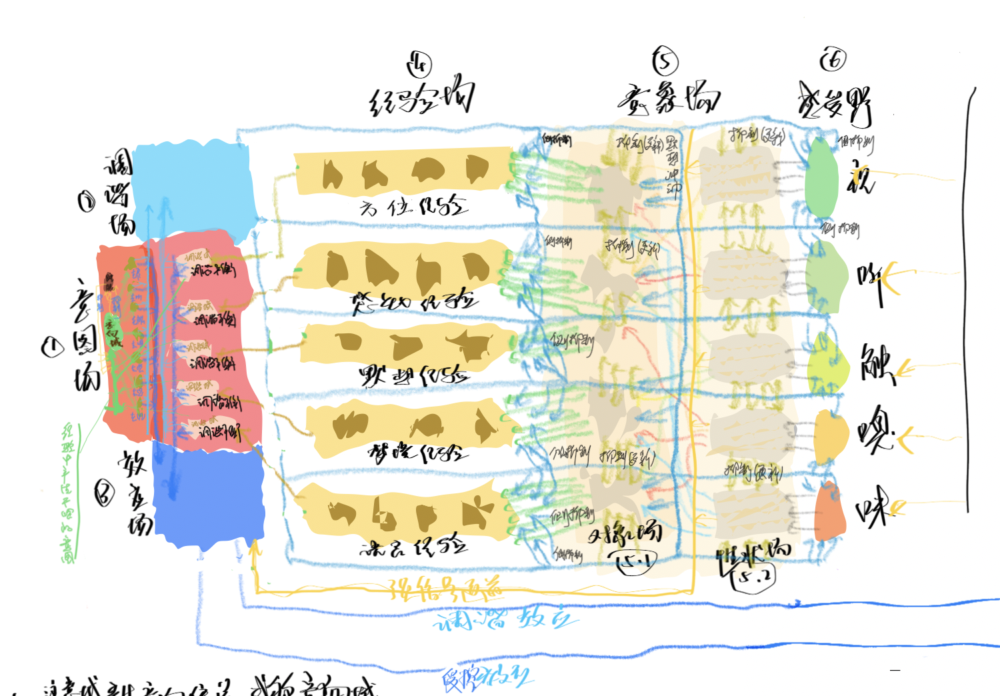

自显论·内篇第七 v1.3

# 枢机

物之相化，而应之于彼此，情名因而为之生，若泛舟于信号之上。

信号者，物之相荡之使者也，迹应之所填者也，因应之现场也。其载因应之情征，行驶如流，梭之于它物之中，复与之迹应，若风之鼓于隙，若曲之和于弦，其内有应定之情，同呼则应同，异呼则应异，故百化于途中，乃可指其源。

夫物之存也，其内毫末相流相迹，就而观之为物。元之论曰：物者，息素之合也。所谓息者，信号之情于观者也，若燔火之沸锅焉，薪火焚于其下，而水气蒸腾其内，故信号滋燃于下，而息浮腾其上。无观之，因应而已，观之，为息，故息为物之界，成之于观者内。故凡可说物、说天地、说世界者，皆说其息之界，故定名曰息界。息界者，其浮于信号之上，驱动于物理之台，唯观者可说之。

故言信号之于外，言息之于内。

“我在说谎。”观者之转息界也，若此自指悖论，观于框架之界，则转之于内容之界，观之于内容之界，则复转至于框架之界，其内外相转，或抵或附，虽二息界着然不动，却因观之而相切转，故我知息界之有非实也。

信号冲之于沉积场，息如其影而生发于场内，是可知也，为其内观者捕之。然则信号以脉冲行走于物理，奚以生息之于观者乎？且奚以生观者乎？是问也，乃自显场之枢机本论是也。势若门之动也以轴，自显场安可无其轴乎？

概而言之，自显场有六场两门，一曰意图场，二曰调谐场，三曰经验场，四曰意象场，五曰感受野，六曰效应场。此自显沉积场之六子也，有此六子，则自显性生也，无此六子者喑也，或有其二三子而有恍惑之明。又设效应器与感受器，用作二门以出入，外应揖门以入其内，意象生发以射其外，形容是以于此间熙生焉。

试闭目以念杏李之味，则必聚精力汇于舌上，反复以得求之，以复食时之味也。可试感脚之拇趾，也须反复为之方而渐清，设若瞩之且移吾腿，趾也必随之移焉，瞩力也随之而移，此非是有方位意象何以知趾也移也哉？是以，审其所觉，皆先移至其位，而后瞩力乃可用之。其聚精汇神之力，若浪之逐岸，一浪前一浪继，而欲迫之近矣，至次不进方休，而以此为衡，此意图之调谐意象也，是谓“调谐平衡”。

平衡者，觉之不再调乎经验靶也。故亦谓之“经验平衡”，因调之而再，是以有频率，故又得名曰“振荡平衡”。经验靶者，经验场之所入意图场之径也，经验场之差分偏流也。

意图其待偏流也，若的之待矢，其知焦也，若凸镜之聚光。是此，乃知意象之调之浑清，乃知奚以为平衡，此则调谐所以知止之机也。

所谓平衡，若冲压之无可再进也，若收束则无可再绷也。信号之调谐有始终，而以渐清是已，若镜头之对焦，若影之对形，意象从而为之命；若火化塞之压而腾燃也，意象从而为之出。

调谐聚焦信号于一域，抑其周而活其内，每构筑之，则直至调谐平衡，而成其阻抗之形，却误以为外物之指，即此意象之生。其代外于内，而误为外，成之为“现实”。

此相变之机，开阖息界之钥，物理现实之门。

故曰：信号以脉冲梭往于场域之间，回路之中，意图持调谐之刀，刻画意象于其内，而误以为见外。

误判，其亦意象也欤？其潜于觉知之后，生于象帝之初，隐而不欲内观者知，其若伏之于结构之内，是为自显性基。

且夫调谐平衡也者，其能命阻抗之为意象，转化物理之于现实，俾世以显形容，为觉帝之先，不可不察，不可不审也。

是故，所谓自显场者，乃能因应阻抗而命意象者也，故意象为自显性息界之息本。

动兮，其有眹；应兮，于感受器；冲兮，信号；其冲于回路迹应于百化之途，而测其两端不偏，若同弦之能一其音焉，若内嗜其前濡也。

故信号之来也，其携因应之情征，复因应至感受野，应其方位而入焉，若蛛之待其经纬之网，若射于坐标之尺，以位其所从来，而后入而流焉。其好为偏行也，其好走其常径，而后行之于意象场。其场也，同则其迹一，异则其迹异，似则缘近而循焉，无则择新而辟焉，而后入经验场，信号容与其中，何谓容与？迟滞性也，其多入而少出，频入而次出，若风箱之鼓气，若海绵之迟水，而后入意图场矣。

迹兮，信号自前而后流之，其行以脉冲，好走其常径，非若川流乎？何岂相似也哉！然则川流却无所命，何哉？是未有自后向前之流故也，无之，则无所自后向前命，无所命，则虽有信号而无意象矣哉！

且夫意象始生也，调谐场之开合经验场也。  
其调意象也，乃构筑其阻抗之形。抑以闭其周，去抑而开之中。当此时也，束发其效应场行其效动，紧张其所瞩，或放，或收，或移，或随，其瞩力于感受野之位，反复以图之，谓之注意力之调谐也。

瞩位定，感知经验场既开也，而后信号如浪而来，次递或并进，而容与经验场之中，穿行于各层经验片。经验片者，经验场之子场也，信号或先达，或后达，或途中，或并至，或有达于彼，或有达于此。若电影之放胶片也，其每侦次递之别，成之为运动。其别也，异也，差分也，自成其非识之辩，升起物理之偏，我由此而知何谓运动也。

且夫所言之差分，固非语义之比也，脉冲容与各经验片而后出，透其不同，累之合之，而成其偏流。偏流之调也，因之于欲以调谐平衡也，意向择定其欲去之偏流，或去看，去尝，去感，去闻，而达至调谐场乃激发其调之能也。调之于感受野，焦之于位也；调之于意象场，焦之于情征、对象之域也，调之于经验场，令其开合也，调其差分以出之于唯一也，其以唯一而成其差分偏流，简言之曰偏流。经验场以偏流射于意图场，而中其靶，故又名之曰经验靶。因其流走自然而非识非义，故亦谓之沉默偏流。偏流为后继沉积之源起，此生物之根本也。

意向每欲动一次，调谐场谐动一次，偏流成之一次，调谐效应紧张一次，意象点亮一次，若萤火虫之呼吸也。试之数次，至意象无可再进时止，而成其最新，则置之于先前意象之顶。意之至不可进，乃止其调谐，达之于平衡。

新生之自显场，其嗜运动之沉积，若狗之嗜骨。然而其初，不知静止，不见迅疾。是其受而久之，而渐得两极。其慢也，至于静止；其快也，达于连续；静极似非动，动极成一线。其慢之极也，每意之，其所出偏流之近同也，因而静止意象生，此婴儿于动之所先觉者也。而动之极也，前之未及褪而后者复来，使之连续累积，故每意之也近同，然则其意象所以不为静止者也，以其方位意象之有异焉，故致每意之偏流也异，是以其意象为极速，此方位意象之功也，故为感之为线之因也。

是故，所谓静止，而得于动。

夫初生之婴其有调谐之能乎？回顾婴时，莫不有瞩力乎？婴之所观也，恍兮似有亮，惚兮似有晃，仿佛兮明暗之轮滚在新奇场，若走上奈何桥，喝过孟婆汤。

有诗证曰：  
信号经感知经验出，偏流到意图场，其内意向域又偏流至调谐场，于是乎，调谐调乎各域反复忙，其收束信号在意象场，或以束，或以放，或以浅，或深长，或平移，或斜向，若变化手势投墙上，若望远镜之调光，若万花筒之调像。其显化于回路之中有其象，是此非彼而别于它之阻抗，因是以命意象代指其阻抗。

是故，意象与其阻抗共生，无信号流之，无象，有之，则栩栩然其在场也。

是故，cj曰：大至宇宙天体，小至原子微尘，举凡甲介之虫，走兽人形，乃至器械构型，有意图场、调谐场、经验场及意象场者则其自显性生，无此四者则莫之有其命也。

自显性与意识同一而两称，乃意识之根。故命曰：凡具该论所述场域机构之物，必具自显性，而有自显性之器，皆谓自显体。

【自显沉积场图示】

版本更新：

增：若火化塞之压而腾燃也，意象从而为之出。  
修了个别错句

\===========================================================
