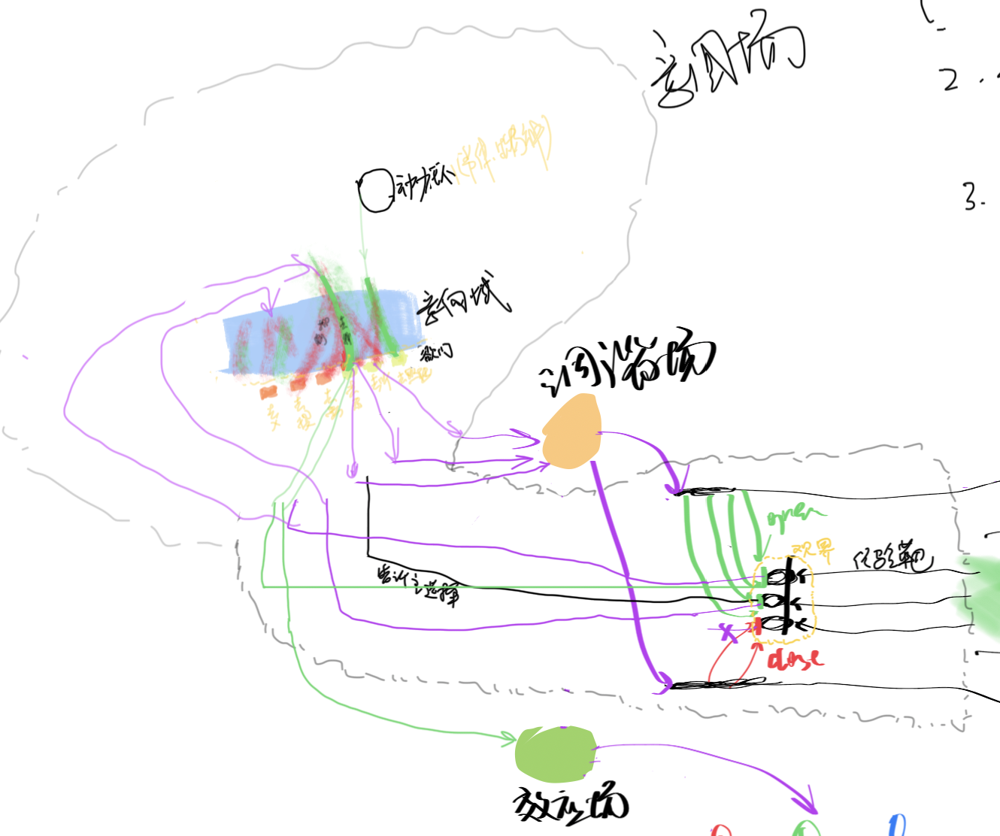
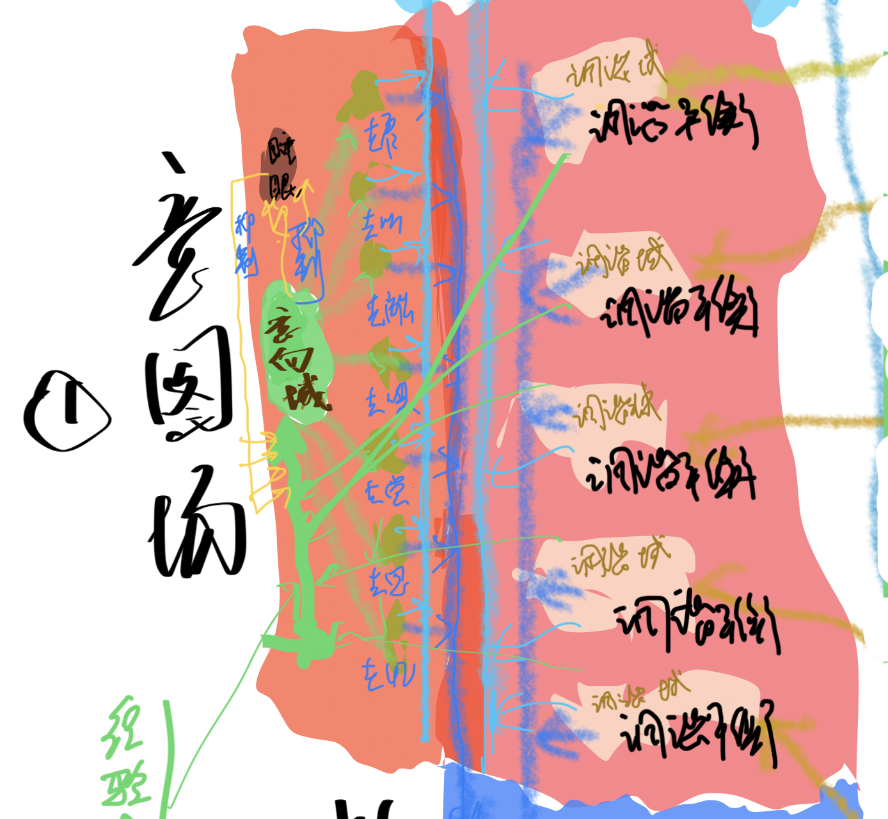

自显论·内篇第八v1.0

# 意图场

视之初也，晃然有动，其沥淅光谱之同与不同，收束边缘以渐其形，辩同异而命各色，由此界焉。此自然造化之工，逆流生而侵入寂静，诞“欲”反其正势而扰之，故意向由此生焉。所谓意向，欲之方向者也，所谓方向，择也，偏也，且其向有所图，故又名之为意图。

意图之沉积，沉之于意图场也，为自显场之子。

肌肤忽焉冷，瞩之，乃知侵肤之寒也。知肤之感，触觉经验也；知目之感，视觉经验也，二者皆属感知经验之类。且凡涉外之感，皆属之。涉外之感，犹有听，味，嗅，内感，雷达感等，若设坐标以张其维，故又得名感知维，乃某一感知经验之别称也，如听觉感知维，听觉经场也，嗅觉感知维，嗅觉经验也，诸如此类。

经验者，沉积场之子场也，按其所司经验之不同，又各有其场，如感知维各有其场。

经验可以并用，亦可切换，使之者，意图也。切换以位之，而后方可施以专注，故经验场之可切换，此意图之性者一也。

默想一形而形现，骨然之在心也，乃意图之调默想经验者也；张目而视，历历之在目也，则意图之调视觉经验也。前者见之于内，后者见之于外，而咸由“我”观之矣，奚以观之哉？

意图之调谐意象也，雕之于对象场，其流过而筛之，而后入经验场而出，于意图场得其差分偏流，名之经验靶。

意图之瞩也，必先开合经验，而后落于其所瞩，而欲落于其所瞩，则必先开启该维之方位经验，而后得感官方位之所在。

继之开启方位经验，信号脉冲以入，而得差分偏流，偏至调谐场，至此方启其感知维，意象信号以入，而显象于该回路之中，此间之费神也，须意图反复为之。

其欲见意象之念，若猴子上下其跃，而焦之于高桃，于是振荡于调谐之中，意象渐次而明，而明乎其终，终其于平衡。

当其间也，意图役之调谐场，收束意象于其阻抗之形，透偏流而观之于经验场，于是乎意象澄然而跃于经验之内，矍然活矣。键兮！意图之于显性是何其要也。虽然，意图不直感于意象，却可令显性，生发于意图所瞩之经验回路之中，仿佛意图之在观也。误判为在观，此性者二也。

意象有新旧，譬若听阿拉伯语，会其语，则自然而听其义，不会，则惟得其音，若夫会其语而欲得其不会时之音，则难为之听矣。故新意象常能顺势而出，旧意象则需竭力调之，莫不有指针可游于新旧交合之处？其货其新旧而以栈乎？意图之调谐意象也，谓其性者三也。

意图患调谐病有三：  
不能专注，时其跳脱，乃意图不能役使其调谐而定之于经验，此一也；  
无识，无见，无明，乃意图之不可开阖经验也，此病二；  
或视而不见，嗅而不闻，触之不觉，温寒不知，有其经验而不可用之，乃意图不可切换经验也，为病三。

意欲去看，去听，去触，去嗅，去尝，去忆，去思，去说，其开合之门，在于一域，名之曰意向域。其间而连接经验，中过之于调谐场，意图场之所能使役调谐，意向域之为也。因其能枢发冲动于其它，故为意图场源动不竭之核。

若夫欲使信号之能源动而不竭，则必以环行。故疑意向域之内或有一环，权且谓之动力环，其用，如同节律器，其能，以枢发冲动而驱策于外。在默想之时，无外之剌激，无自前而后之流，却仍可使役其调谐之能，发信号而前，冲之于调谐场，莫不有之乎？且夫其形莫不类耶稣之荆棘冠冕乎？耶稣之荆棘冠冕也，在边有毛剌探出，动力环不也有其毛剌乎？是以可冲乎其它，故谓此环曰：负反馈闭环开边回路，或称之曰节律性动力环。

节律器于沉积场中恒见也。

各经验场挖沟掘渠于意图场之内，其各成沉积子域，称为经验靶，为经验偏流之构造。其流，行于调谐场以收束，行于效应场以跟随。意向之待乎经验靶之偏流也，若蛛之张结网而望。

意图场之各子场之相通也，有五总线为之焉，一曰靶效应线，以使经验之驱策效应门，此一路也，为外。一曰靶调谐线，以使经验驱使所抑之端，此一路也，为内。一曰意向调谐线，以使能调谐各经验，此一路也，为内。一曰意向效应线，以使其能调用各效应门，此一路也，为外。一曰靶意向线，此经验去意向域以其可调其它路也，此亦为一路，为内。前四者皆能出入意图场内外，为其外接端子，唯后一路仅限在意图场之中。

且夫天亮而醒，逢晚而眠，开合梦境与现实，其必有枢机，断意图场必有休眠域在其内，该域盖与意向域互为抑斥，彼用此抑，彼抑此用，故眠与醒不同生。

可随意而切注意力，可着意而瞩之，可且听且看，边走边思，我由是而知意向域有之三性也，曰：随意性，选择性，状态性。

其时无意而忽入意，常以随意；言之“我想看”则得其看，知选择焉。

我常疑，意向域之运行，其也状态欤？我切换感官之时而不能二心，深思时而不能二意，数汇我精力而不能凝神，待我失其焦乃知瞩已游离，思考经验啊，其必以状态机而成行。

嗟夫，意图之于自显，无之则成重放之场矣，其为万象策动之源，为自显场众感之泵，喑显之要，死生之机，不可不穷深达奥而究之也。

【意图场结构及的作原理图示1】

【意图场结构及的作原理图示2】

\===========================================================
