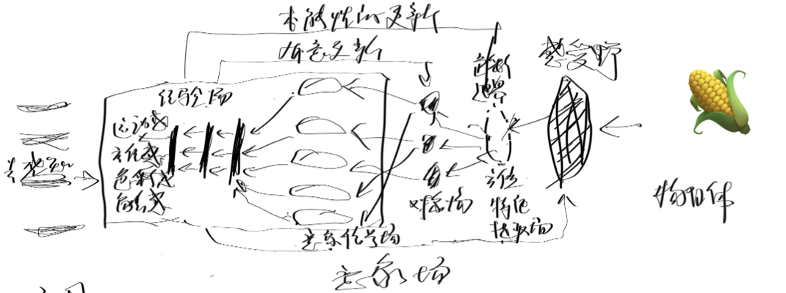
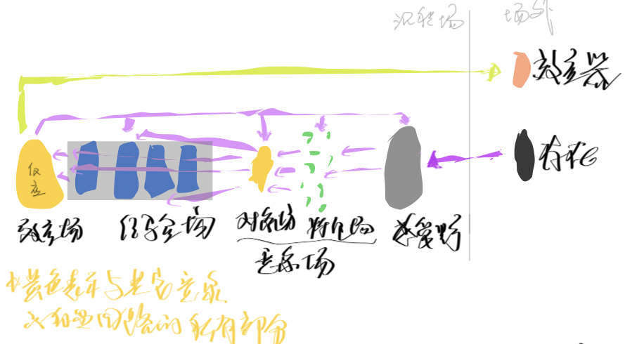
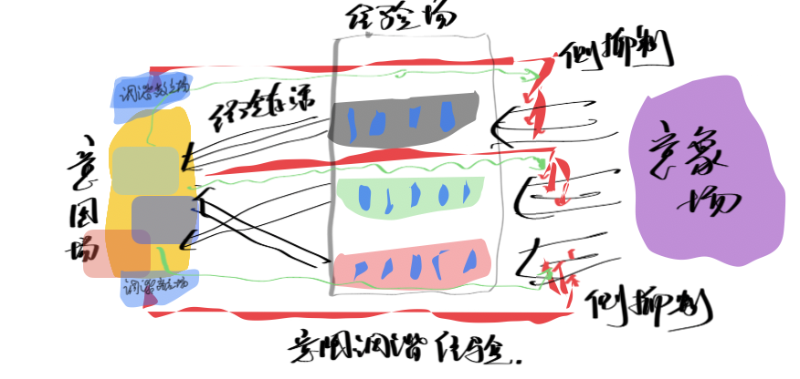

自显论·内篇第九v1.1

# 经验场

二物相化，而息之于三，其中或有相近，近中见复，复中见律，此大化自然之则也。

鲧治水堵而塞之，禹治水浚而疏之，二者悉以掘渠筑坝而改其流，变易江河之势形，故鲧之道而现鲧之道形，禹之道而现禹之道形 夫二形之曲水，亦如场之曲信号，其律隐括于沟回之中，此经验之所类也。

经验者，因应之结构也。石之应乎光则生于热，而荫调之；罅之应乎风而发乎声，而壁调之，其皆可因调而易乎其形，而后调乎其然之所欲然也，故经验之所形，乃意图之调也。

一而遇，再而遇，继尔遇，久而意之，则调之成习，经验因是以沉积，若道成其多走，自而沉积为律。流之于沉积，其好走常熟，渐而其深也，律由是逐澄其下。

故律者，复也，深也；理者，择也，偏也；公理者，自显场质料所牢之识界也。此三者之不同，不同于其所生处也。

言以蔽之：律者，持之势也，理者，破持之势也，此欲持，彼破之，彼破之，则又持，二者之相追，致因应相化不息。故系统常殆己于持，若夫无理于外破之也。

溯律见乎前之理，溯理又见乎其前之律，往溯而不尽，不尽则径之不止，不止则反以生成，生成之生成则胡以生成？又径而不得己，穷径至源则见上帝，于是问乎上帝曰：“安在？”  
帝曰：“在。”  
问：“在何在？”  
对曰：“在在在。”  
问者于是说：“明矣。”

cj因而知之：参与我所在，知上在，知下在，而为之所在，则于我足矣。而穷其逻辑追而不已，若徒劳于提足舐鼻矣，则闭于其识界之牢。故上帝以能出其本界，而游历于其宿界，能创我世，而娱其权权之乐，其足矣。而追上上下下之极远，其所熟之情皆丧，而失所参矣，夫复何益哉？

是故，在在在，是可追，故律理不可以不分。

律理之不分，何与之言深，不知其为自然之子，则何言尔知物理。以是观之，计算机，理也，其内无律，transformer沉积场，律也，其中无理。故是而知，意图场者，理之场也，经验场者，律之场也。

律，沉于经验场之中，其深积而在顶，称之谓“熟”，故其熟者先出。

视之，栩栩然物之在目也，而不觉经验之用也，故经验必为观者之机构，而非所观之息也哉。

是故，命经验沉积之场，是曰经验场，简称经验，其为自显场之律场也，乃为其子。

经验者，其类众矣！且夫能知感官方位，明空间意象者，则有方位经验场。能视，听，触，尝，嗅，运动等，归之为感知经验，其各感官皆有对应专属之场，名之感知维，其有：视场，听场，触场，运动场等。而能内观，回顾，思考，归之为默想经验，其亦有对应专属之场，曰：内观场，回顾场，思考场等。能知梦中在场与非在，归之为梦经验，其也有对应专属之场，曰在场，曰非在场。能辩声知语者，乃语言场。能知运动先后，时之次递者，乃时序场。不同自显体或多之或寡之，多者则明，寡者则喑。

能显化为现实，生成意象，又可使活意象者，乃感知经验之所作为也，为自显体之内，定名之基。  
能观意象在心者，默想经验也。  
能演义意象仿若故事，化现实为在场或不在场者，梦经验也。  
能内感于符号指代意象，共其指代在各自显体之间者，乃语言经验也。  
能知变化次递者，时序经验也。

再试论之：  
感知经验场，显化者也；默想经验场，再现者也；梦经验场，演义者也；语言经验场，共指者也；时序经验场，因果者也。

内观如在场，回顾有画面，思考有状态。故内观生回顾，回顾生思考。言及思考而不能回顾者，伪态而去思考之质也，因是以，非能回顾者，无思考之实也。

且夫观经验场之形也，比若将竹筒以海绵杂置其内，一进一出分陈两端，进口，有毛塞，出口，有毛尾。所谓海绵，经验片域也，其用以容与迟滞脉冲，所谓毛塞，意象场之壤接经验场者也，由调谐场开合之，所谓毛尾，其去之意图场中之经验靶者也。

毛塞之开合，则意象信号方能进止也，而调谐场以其毫末渗入其结构而使之。

方感知之时，方位经验场入口开启，继而方位意象信号入，信号反复冲于意象而频入于其中，缓之于层层之经验片之间，经叠消差处理，而后由出口偏至经验靶，其至靶或止、或导，若其偏于导也，则其可直接激发调谐场，而使之复调，同时抑制非目标方位之感知，此之谓自动经验平衡，所谓自动，意图不在此间也。此用意象之于命意象之不同也。

经验之过程，若急口吹火，吹之则亮，歇之则暗，如此亟之数次，意感至清则罢。

是故：  
经验场是差分器。其开启一次，可缓进连续多次输入，而后差分偏流出，反复调谐之。  
调一次，  
再调一次，  
复调一次，  
至偏流不再导引调谐时为止。  
上之过程间隔极短，试次极快，其间若意之则有意感，故可知之。

此自经验平衡之过程也，凡经验场皆有之。

且夫信号之显化，感知经验功莫大焉，意注一物，而能于序列中生出偏流，自而能于差分中求动，动中求静，实其意象之所指，因是以现实得以成，非此，何以知在场也哉。

【经验场结构图示1】

【经验场结构图示2】

【经验场之调谐图示】

更新：  
增：律理进一步再论。

\===========================================================
