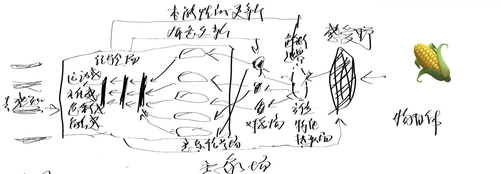

自显论·内篇第十 v1.0

# 意象场

且夫观变化，见生灭，知因应，具之以情，必由眹。眹者，往复于万物之间，缀之于物理之内，故言物之眣者，语之曰信号，处于息界之外。

灯之闪灭，谓之息，相于观者而在也。信号与息因观而互生，信号之上为息，息之下为信号，信号使之然也。有开灯之信号，息灯之信号也，故有开关之息。

信号者，驱动息之使也，为息之物理。观者察焉曰息，故其为观者之观也，观之而界，是谓息界。夫观电脑也如此，知内之息界也，知外之信号也。故息者，浮也，其浮于信号之上，若蒸气之浮乎水也哉！故世界也必有其所宿，其下信号之枢发世界，若锅之沸水也哉！

若夫无观者，信号仍迹应不辍，情势仍变化其间，而不能知也，此时可曰“无息”。

而有一类场，观者居其间，专其能以外入之信号为之感，而误此信号以为外物。是息也，我无所定名，权且字之曰意象。故该场也，以意象为息基。意象者，必与观者同处一场之内，为观者结构之所命。此类场也，因生之意象，活之意象，亡之意像，其惟被场内观者观，故言以意象为息基之场，为自显场。

而其有知其在观，故意象之后有观者象。观者，藏乎场结构之中，常与意象同质而异构，而达于喑、明，故二者间必有临界之门，此则在《微核论》中有详论，此不必多言。

判曰：信号界，之在物理界也；世界，之在息界也；意象界，之在自显界也；自显界，属归息界也。

若夫相机之欲摄也，必调其焦而校之以皦，则其机构与像莫不有关系欤？化石之于叶也，与其说叶之形于化石，不如说乃化石阻阬叶之陷而使形焉。是以，意象之生也如此。

调谐场之调乎信号也，追其边界，以塑其形，其用以阻抗。若掘河道而适流，若调形之适影。信号冲而构成，继而彰显于回路之中。故意象为息而不以息存，其存——构之形，其在——信号此中行。故可以阻抗之形指代意象，若叶化石之指叶，若影之指形。

信号缘道冲，冲而意象生，冲止意象空。

是故，命众阻抗之所在，曰意象场。意象场者，沉积场之子也。

描其如下：

其前与感受野相连，其后与经验场相接，其侧与调谐场相约。

信号自感受野而来，经意象场，奔经验场而去。因信号有同异，色之有不均，故因色有不均，不均而生界，界生形，形有对比，又生远近高低，此视也；音有不均，不均则生界，界生音节，音有对比，又生远近上下之方位，此听也。故分离信号，攫取特征，须有场域之于意象场内，是谓特征场。而形有像，音有声，尝有味，触有感，其以多维合和而成为对象，因其成也，以递连亲疏近远于其它，而分布于意象场之内，成之为对象场。

信号之来也，经特征场，过对象场以出。

相近则相附，相异则相离，后至而先者潜，深积成律，故意象之出也，熟律之在顶，后至者先出，而欲追其先至，庶几费其力于调谐矣哉！此自然之力也，若沉积之岩，后至在上，故有，物以类聚，浸者先润之说。是故意象之存亦如是。

对象场内，意象之间侵润成片，其中多有以序列相册，称之为故事意象，其用，以记事也。回顾一事，形象先出，尔静，至意会时方有动感，而其实不动，莫非回顾于事皆然也？其动也，须用意图竭力取之，方可追思于往来。

观对象之特征，可也，如可观边界，观色，观方位，故调谐场之与特征场相掺；观之对象，也可也，如可观此而非彼，故调谐场之与对象场也掺。譬如苹果，视之有形，尝之有味，触之有体，念之而俱来，故对象之存，几分布于场。调谐通过抑制与去抑而放逐其间。闻外语若听鸟鸣，及会时方知含义，而一旦而而知，则再难听出鸟鸣，此后学先出，先习深埋之故也。因而对象以栈结构而存，亦是信号善走最熟路径故也。而不同者，调谐可游历于栈之上下，以而可游弋其瞩，于对象历史新旧之间。而念之一物，可整体，可局部，可轮廓，可细节，故调谐之瞩亦可在对象上收放或平移。

倾耳而听，张目而视，砸舌而尝，其观意象有协动，念意象亦有协动，调谐之协动，犹以内观之最为强烈。故名此现象为意象效应，其作用于同感受门则同，非同感受门则异。

是故：意象以阻抗而构形于内，且能于回路中生复之，而又以误判以为观之于外物，所谓误判，乃一特殊意象者也，为自显性之基象。

误判，其精妙何至于此哉！其指于外且私成于内，而以为共我之所指，不觉其私而不同，莫不奇哉？

因其以私藏，而藏于阻抗之形，经验处置之律，意向偏流之所，故意象不可复制，倘欲复制，须拷贝意象形成之全回路方可，其有阻抗，偏流，调谐之掺末，此难兮，故生物以习得而已。

习得，学之时，意向动，调谐场为之瞩力，此间有多耗，及领会而用时，则可无意而为之，成之为习惯，故有习惯意象。故事意象需靠默想以显现，习惯意象则可无赖于意向域而自行。比若用手指变乌龟，初学时，虽专注于其折转处数难为之，而习得后，却可信手而变之，莫不如是乎？

是故cj曰：意象者，非符非数，因场内观者之瞩，而象指焉，结自显性之果。虽至奇焉，乃自然之所生。

【意象场结构图示】

注：

感受门：见《内篇第十四·宿体》

\===========================================================
