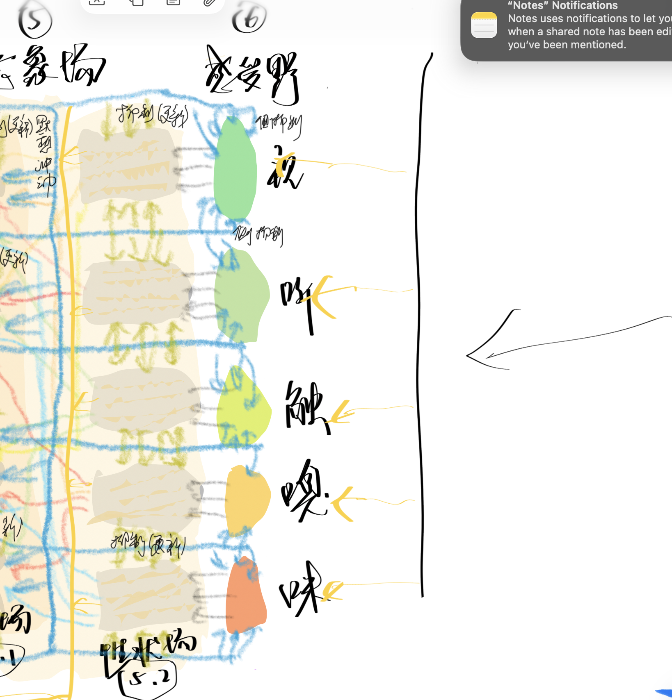

自显论·内篇第十一 v1.0

# 感受野

感受野，沉积场之子也，为圆方之门户，信号处置之始也。其迎也，若前台之望乎门也。

门有大小，视有宽广，触有方寸，故剌激射于感受门则有方位，而感受野位适之，张置网以捕之。二者之相应，如叶之与影，或聚而一之，或散而疏之，或叠而形之，变化无端，若影之逐其形。

俗谚曰：大孔以筛豆，小孔以筛谷，其筛脉冲也如此。多汇而漏，多散而糊，一应而真。是以远则漏，近则糊。故调谐场之调感受野也如此，于其瞩处则一应，使清晰之，余则多汇而散，漏且糊。

且夫蛛夫人张网布阵以钓虫也，经之，以知方位；纬之，以知什物。感受野也如此，其分流信号，左流则左，右流则右，中流则中，位隐于经纬。而经走脉冲，纬中藏形。

其流也，过感受野，达于方位意象场，而后去方位经验场。  
其流也，穿意象场，达于特征场，乃后去对象场。

听、视、触、嗅、味等，各有其感受野，感受野处感受门之后，则一门一野。

是故，cj曰：我观一物在此，确确然其在焉，不觉其质与魂魄已离矣。感受野之分流方位、信号，莫不亦如此乎？离而能一之，何其工妙也哉！

【感受野结构图示】

注：

感受门：见《内篇第十四·宿体》

\===========================================================
