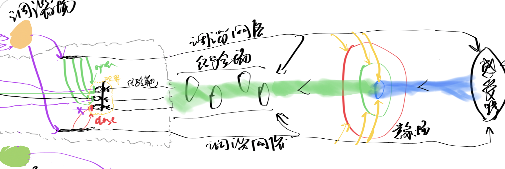

自显论·内篇第十三 v1.0

# 调谐场

世界周行不怠，生死衍迁，无有始终。无有始终，故反之以生成，若生成之止鸡与蛋孰先孰后之争。故不知生成，追逻辑则常穷，而闭已于识界中。

及之，一推二，二攘三，三复扜于一。攘攘是界，熙熙不平，律理相交应，燔火炙其下，烈焰何曾停。

是以，大火熊熊，汹汹沸腾，苟无扰，则沿火势而翻腾于界中，序然于火情。因而其内有命定。

然而，一锅汤，可搅之以勺，拌之，搯之，而变易其定命，则勺可主之。

然则我世之有勺乎？未敢轻论也，而我知自显场之有勺也。

陀螺其旋，鞭策之也，意向环其旋，也必有其策者也。其居意向域之核，策信号以回环，律动而源发。其熄，意向灭，其动，意向起。而源发亦或有其策之源，其策之源亦或有其策策之源，而必追其原动，追至其心初形，一蛋正破其清，其内忒然而涟漪自生。

是故，持把，扬绳，鞭之于沉积场。其把，意向环也，其绳，调谐场也，上帝常间而鞭之，以使世情不息，cj追原动而致觐上帝，帝曰：

“我告汝，我非在时，汝可问于‘驱动因子’”。cj于是知驱动因子之名。

美工刀之雕像也，择其石，逐雕之，其像渐出。是以，调谐之雕于沉积场也，亦逐而雕之，令沟回隐引而冲积渐深，势若神经之长成。其沟回苟有先定，则受之于父也，苟未有先定，则雕而成之也。故推而始之，自显场之构形，受之于调谐而成。故调谐为场之雕工，雕削结构以为是命。

水之调沙也，而渗于沙，和而为泥。因是以，调者之调乎场，其渗于场也无间，和而为一。然则调与被调之有别焉，故则名调者为调谐场，以二于被调之场。

调谐场，自显场之子也。

且夫雕工之雕也，欲雕目，则紧张至目处，欲雕鼻，则紧张至鼻处，沉其心于一处也，一其意而为关所欲之形。夫能紧张其意向至调处，谓之曰“注意”，乃一其字为瞩。

瞩而调之，紧张其处于反复，反复其神失而复凝，复凝而复又神失，如此数次，精亏而至罢矣，故名其反复瞩之之力曰“注意力”，简称瞩力，瞩而后乃可调也。

故调与瞩相成，统之曰调谐，cj也常言为“调”，以简其称。

其瞩必有联动，所谓联动，是因场内外皆有为瞩而动者，称其场内之动为调谐，场外之动为调谐效应，因观味之在舌，观听之在耳，观触之在肤，其调谐效应各有其动应，或努舌，或努耳，或努肤，或随其动应，如转晴。

物势行直，律势行易，顺势而便，逆势不易，此世之然也。势者，若张目则见像，若计算之好数，若水之善平。故排线拉网，费其力矣，而其用开关则易。故关之，抑也；开之，去抑也。故调谐之用，于闲时挖沟掘渠，则其用时用抑，且其好用抑，故节能，故能迅达应通。其常沁浸于静态结构之中，以行束放，平移，深浅，纵横，使静态结构适而从应。其行构筑之能，不倦于沉积场中，而成逻辑动态结构之层，若烟云之漫散于湖中。

虽然，调谐场之用抑也，必先排布线网，挖沟掘渠，以通各城。非此，而待用时方排布之，则迟矣，此突触生用之别也。其生，常需数分钟，其用，不及5毫秒，其因由是也。故非此，生物岂非石然？

其抑于此，而去抑于彼，彼此之开合，而使瞩成矣。或环抑之，或侧抑之，或前后抑之，或间之抑之，其好用抑，是以无所不可用其抑。其去抑之域，越通，越易通，其通势加焉；所抑之域，愈滞，愈易滞，其阻势加焉。

调谐场之筑场也，必以层级层而渗之于被调场，若树之渗根须。其利于感受野之收放也，利于意象场之构阻坑也，利于经验场之开合差分也，利于意图场之精其偏向也，利于结构化静为动也。其毫末渗入被调者间其多矣，其间级之生长，依于被调者容积率之高下也。

被调者其谁？有：感受野，意象场，经验场，意图场，效应场。紧张其所至，以收束目标之场域。其调感受野筛脉冲之能，缩之，放之，平移之，纵之，横之，捕之。其调谐阻抗之能，使相变因之发生，意象是生，观之可细，可整，可侧，可正，可横，可纵，犹可追。其调感知经验场之能，乃知环境之情征。其开合方位经验场之能，能令上下左右、远近高低得以分清。其拨意向域如拨摆钟，以行转切、瞩力于经验场之能也。而能驾驶宿体精其动应，跹挪转腾，姿游于宿世中，咸得其调谐效应场之功。

夫调谐之瞩也，若针管之注肌也，其收束目标场域以确其方位也，而后乃以意向脉冲注射之，此心理活动亦然也。内观之模拟外观，其常用注射而拟外来之剌激也，其后用意向脉冲射之，故调谐有传导意向脉冲之能，其用于内观也，因其脉冲自内而发，不如外脉冲而能发乎意象对象之众，故内观只有轮廓而无微末。

调谐或受意向域命之，或受经验靶使役，其与意图场相连结。

调谐之于沉积场，其有摆布沉积，化静为动，生复意象，构建现实之能也。是故，不知调谐，则不知自显场之如何排兵布阵，显化环境，觉之在场，私它以为我也哉。

【调谐场图示】

\===========================================================
