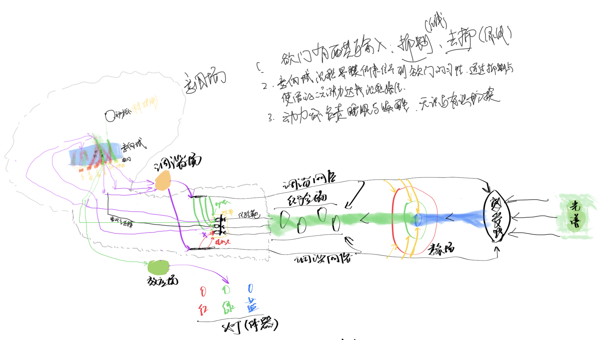

自显论·内篇第十五 v1.0

# 微核论

初，无明，物之荡荡于周，而不知有。渐而知有之。始明，恍惚现其情，觉动中似有征，自显由是生，而终化人之形，游历于物理中。

何以化简而入繁，其构建现实也愈发清，而至于人之生？此人择之问，众论喈喈而无所定。

若夫生命，论其简也，若海绵，食欲其命；论其繁也，若人，荣辱相争，高下相倾，利欲其命。是以观之，进化非以争竞，所谓物竞天择，适者生存，表象之辞也，而非其根本，其固有根本，以“欲”贯通始终。

众人皆知欲为欲者，字也，而藏其质。欲者，典释曰：欠以动气，谷以生生，气有所趋，即为“欲”。故指气之所趋、动之所向，因是谓趋向。元之论曰：“自与门走非门，知或门，或非门，与非门之息不走而独走非门，此为理。”，是言也，择也，择之者，偏其流也。故一物之受，不自顺其流，而迫偏之，故为择。择此非彼而待发，即趋向也，欲也。是然也，择也，调谐也哉；欲也，调谐之势也哉。

且继而论之，夫择也，扰也，必有主事，称之为主动因子，何谓主动因子？风扇之吹空气是也，蛋白马达之分离胞液是也，分子节律器是也，心脏是也。然则漩涡非也，河流非也，非之所为非也，于其势自顺而已。承其势顺，而受阻致形者，咸非之。是故，主动因子，必于系统内处生发之因，而受系统外驱策之力，自外驱策而入，以驱其内，方谓主动。而水之就低，电之就负，咸就势而流，故皆不为主动也。且夫以内之开合以迎或拒顺势者，则主动是也。是故，顺势系统若使行逆，则主动因子必自于外，两顺势系统相扰而可互逆。

察之自然，反馈现象遍于是也，反馈之回路，其内信号振荡而流，或递而传，或间而导，言之曰传导，常有信号放大、减弱与平衡之能，奚知之增减乎？奚知之均衡乎？其不知也，犹两池水之相通，终取其平也；其自成也，若衡之称两端，以支其短长。故平之于势，上下振荡以渐衡，或增大至极以衡，或减弱至极以衡，或至其间以衡，夫所以衡者，势之取平也哉，故不必有知。

物之相克相生，其动也，势求其衡也，其止也，势取其平也。势善于取乎平衡，其非世界沉积场之本性也欤？故言相克，势之抑也，言相生，势之助也，故抑与助并生，是以可分之以衡量。故而可设抑二助一为之势平，则抑八助三，势为减也；抑七助四势乃涨也，而抑十助五则其平也。此反馈之物理，调谐之用也。故沉积场因势而有涨落，而终成调谐平衡，因而得息之于其中，是才所敢言之曰息也，因之于其内，观者生焉。

故造物之主，非以量尺寸绳末圆方而穿凿之，而乃以势引之。夫神经之生长如是，雷电之释放如是，势之取平也，其径常分㕚发乎其端，以探空间之捷径也，如藤之嗜光，而分其梢支以进，上探其周侧间情也。故沉积场之设计，也固非以尺规之量，而用势量乎间，分布其势之高下涨落，而令其自生，若用磁之引铁粉，若搭棚之引藤，若设沟渠之引水。设地势高低险峻，湖河沟渠其自成焉。

且夫水之势也，其流虽奢直，然则河渠无不弯者，因其好沿前迹以行，遇塞则绕，遇坝而涨，冲积成道，前愈急而后愈易行，前愈阔而后愈易过，此因地形而制其流也，反之因流而致形。水之势也，前流冲以道，而后流微改之，如此历经万千余年，冲积平原所以成矣。故知，势虽立于两端，而步进于尺寸，故尺寸之势相干，致其道体而大变。故偏流者，后流之偏于前流之迹者也。因势而构形，因形而变势之分布，此固为沉积场之性也。

差分之为情，反以知变化。差以方位，知动也；差以颜色，知形也；差以声，知音也；差以触，知质也。此化喑显象之根本也，在有明之先，不可不察也。故述之曰差异偏流。是以，以晷可知日时，而冷寒可以水银为计也。

若夫能同流而同其迹，异流而差分其迹者，则可笛之，而知吹奏之妙也。经验靶之吹奏现实亦如此。

有方位经验靶，有颜色之经验靶，有音声之经验靶等等。经验靶之离晰差异，若光谱仪之分光，其用大矣哉，若炳火而夜行，命万象之于非同，而成就万千之容。

传导者，就势之流也，其偏流为顺势自成也，若球好直，而滚于桌面受其迹而曲走，故此中不生观者，因而无显也。虽则无显，然则有其用，其沉积情征，洇濡经验，差分信号，以别不同。若夫欲能显化信号，构建现实，明达于外，且感以身存者，必以因应以迎而受之，调谐之开合经验、迎信号也如此，如棒球手之迎球，必调谐方位与身形，断球之方位之别，而后方可信手迎之。此B系统之迎乎A也，因是以称之为应导，其迎A之差分之情也。

故B迎A之于差异偏流，于意图场中，即B迎A之于经验靶也，B之于经验靶，若电容之透两端，若突触之透脉冲，故以门命之。门非常门也，其开合不受推于A，唯B能开合之，若主人开门以揖客也。故此门乃分隔主仆两系之分野，喑显之所在，观者之门户，显化之界石，故并其所有门，称之为观界，凡观界内之门，名曰界门。故自显场亦可分为二子，界B为观者场，界A为内容场。

于是开合界门，施于调谐，故界门必与调谐场之相接。意向域之去听，去看，去尝，去想，“欲”之开闭转切，须经过调谐场，以协调各界门以开合，方得方位之所，形容之变，质料之别，以关注跟随，象物比属。界门之接意向域也，其传导“欲”之始流而偏之于意向域之中，自而沉积以得其“欲”，所谓“欲”者，意向也，所谓意向，去之所向也。所谓去看、去听、去尝、去想，“欲”之去，出意向域，或向以调谐，施以瞩；或向以效应，施以行。是故，意向之出意向域也有其门，以去之所向，有去看，去听，去闻，去行动等各门，故字之欲门。

“欲”始发也，信号自界门迎之入意向域，缘偏流而达于所至之欲门，调谐开启所出之欲门，而抑制它门，故意向域乃抑或去抑之场也，其各门之效用，各备其能。

“欲”之始发，多发乎默想经验场之靶，意向域迎该靶各门，以行其所图，而奚以开合默想经验者哉？其必于意向域发之，故必有一“意向”施动之以初，称之为静中动念。胡使之哉？使之者亦或有使之者，此求动力因子之第一因也，其必有始之动力因子也哉。揣其应在意向域之内，而与它域有沟通，其非但能施动以常“欲”，且能唤醒睡眠，回神或发呆，若计算机之时钟。其在也，作为动力之源，行源发之动。cj思之，以为莫如反馈之环而能久者，故名之为动力环。动力环，其用如生物钟，发乎律动仿若心跳，唯其要一：起心动念。其策发冲动自意向域，开合“欲出”之欲门，转动“我”之神魂于其间，是为意识之鞭。

欲界各门之闭也，莫不其眠也欤？闭目以感其舌，莫不欲收束其调谐也欤？开“去尝”之欲门，启内观经验靶之界门，以得其所尝乎？

故最简之自显场也，必具之欲、界两门及一动力环，失之动力环，显不能生，无两门，虽能沉积其律以自动，却不可知之，此自动与自显之别也，此律场与理场之别也，此律场工具与自显体之别也。

是以，生物非必于自显，其可以沉积经验以存生，故AI非必于经验重放之用，其作为律场，而可设两门以成其自显。若夫计算沉积场，能具足两门一环，便可感知符号世界，其在符号世界，犹如吾辈之观世界也哉。

是论，物之相搏，拉锯于第三（调谐介质），而平衡于第四（息态）。则，无三不四，而有四必三。是以，符号世界亦可成矣。

若能收束云层以行调谐，沉积光磁于山川河流之中，设一装置T能对调谐以使役，为之界、欲两类之门，以空气为脉冲流于其内，其盖能知太阳之暖寒，方位之变化，地球莫不成其宿体欤？若能此，则可感太阳副射之暖寒，触空无之溜滑，其或可与T2、T3等装置共用一躯，驾地球逐太阳而游历于缈缈太空。

【微内核结构图示】

\===========================================================
