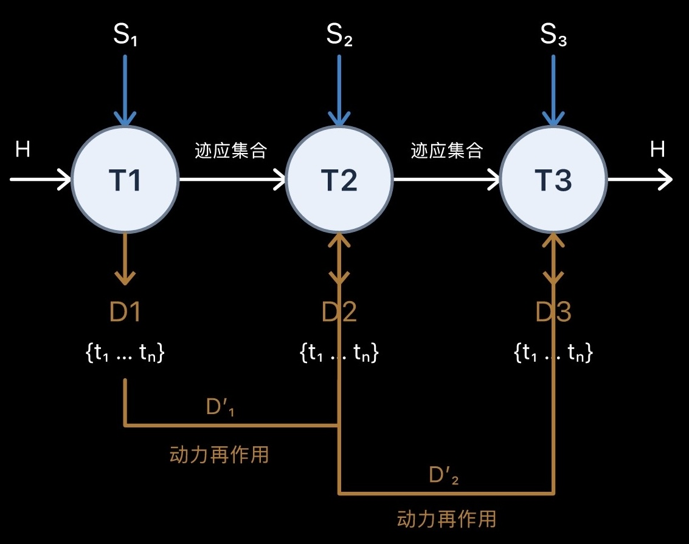

自显论·工篇·场具化组式 v1.0

# 总图

## 第一节　聚合依据、性质与记法

### 1.1　为什么这二十一篇组成一个组

二十一篇式文共有一个研究对象：沉积场在具体宿载中的具化——信号在一个具体介质中留下的迹应集合，这一集合怎样参与后来的活动，又怎样在历史动力作用下变换。各篇分别回答这个对象上的一个问题：成立最少须有什么（第一篇）；怎样精确表示（第二篇）；怎样由观测判定，判定的极限在哪里（第三、四、十一、十三、十七篇）；怎样到达、构造、落成，历史动力出自何处，势怎样分级，资格怎样保持、失效与复归（第五至十篇）；已成场理论的沉积动力结构量在宿载上由什么承担（第十二篇）；在什么独立条件下资格必然成立（第十四篇）；两个机制不同的宿载之间什么可以迁移（第十五篇）；一个动力候选怎样与已知动力区分（第十六篇）；迹应集合的变换怎样表达、运行与读回（第十八篇）；以及生物神经、人工神经网络与地貌三类宿载上按同一研究流程展开的完整研究（第十九至二十一篇）。  
二十一篇之间，后篇以前篇的定义、判据与程序为输入，前篇向后篇交付接口。一个结论被何处使用、一处前件改变影响哪些篇，只靠交叉引用看不清楚。承重关系与传导见第五节，结论出处见第十二节；成员、回答程度、候选宿载状态、预测与未决分见第四、六、七、十、十一节。  
聚合依据：对象轴，即同一研究对象（沉积场在宿载中的具化）之下的主式与附式。本组式为承载组式；二十一篇各自唯一归属本组式。

### 1.2　性质

本总图是统摄形式（《法篇第一》第五编第二章），是本组式的组图，不是成员式文、主式或证明式。所载命题、定理、判词、预测、H 条件与本体谓词都属于成员篇，定义、结论、术语、定理方向与状态申报以成员篇为准；成员篇之间的不同记法与同名异指并列登记（5.5）。  
本总图的来源表由第四节成员表（篇名、版本、式种、SHA-256）、第五节来源—传导表与术语对应、第十二节来源索引与组外来源表组成；所载承重结论各注来源篇与条款。凡本总图与成员篇正文有出入者，一律以成员篇正文为准。  
本总图自身没有独立的可击穿命题。击穿本总图所载的任一结论，就是击穿它的来源篇，按该篇的击穿方式处理，受影响的下游篇按第五节的传导表查得。

### 1.3　记法

〔一〕至〔二十一〕指场具化组式第一至第二十一篇 v1.0；〔n〕x.y 指第 n 篇的条款 x.y，〔n〕第 k 节、〔n〕某定理同此。成员篇正文中的〔封一〕至〔封十六〕依次与〔一〕至〔十六〕同指；第十九至二十一篇正文中的〔十七〕至〔二十〕与本总图同指。  
判词取值 {1, 0, ⊥}；⊥ 带原因码，不推出 0，也不推出任何方向（〔三〕定理八）。  
三栏：A 模型栏，申报模型上的模型模式判词；B 预测栏，真实宿载的条件结论与可击穿预测；C 现实栏，实证认证，实测模式只判 1 或 ⊥。三栏分立，A 不读作 B，B 不读作 C（〔十一〕8.1，〔十七〕1.4，〔十九〕1.3，〔二十〕1.3，〔二十一〕1.3）。  
「组织」指迹应集合的组织方式；「组式」只指本系列篇目。

## 第二节　本体

### 2.1　定义

示意图如下：

图 1　沉积场本体结构示意图（《沉积场本体结构示意图》v0.4）  
　　符号定义  
　　符号　　　　　　含义  
　　H　　　　　　　 历史  
　　Sᵢ　　　　　　　信号  
　　Tᵢ　　　　　　　状态：当前的迹应集合  
　　Dᵢ　　　　　　　动力  
　　D′ᵢ　　　　　　 动力再作用  
　　t　　　　　　　 动力类型  
　　{t₁, …, tₙ}　　　动力类型集合  
　　沉积场是：  
　　信号在介质中留下的迹应集合，以及这一集合在历史动力作用下变换的组织方式及其活动。  
　　注：  
　　迹应：参见场篇术语。  
　　因此，  
　　自显论是研究：  
　　信号在介质中的迹应，及迹应集合变换的一门理论。  
　　它考察一个具化场，首先要找出其迹应是什么，再研究其集合在历史动力作用下的变换。  
　　说明：  
　　单个迹应（元素）只有加深、退浅两种基本变化性质；不变是零变化，退浅的极限是迹应现象不发生。  
　　迹应集合由动力组织起来，其变换建立在元素加深、退浅的基础上，表现为路径、交叠、边沁、局部退浅等动力现象，以及整体、子集及其相互干预的组织变换。  
（《沉积场本体定义》v2.0）

### 2.2　读法

〔九〕2.1 F2：「历史动力形成势，势的实行，就是活动，活动与势组织（指集合的组织）就是变换，其因势而变换，如水就低。」

## 第三节　具化场研究流程

### 3.1　流程

给定一个具化场，先找它的迹应，再研究迹应集合怎样变换。以一个单细胞生物为例，按这条路线展开：  
1\. 找迹应。什么信号作用于它的什么介质，留下了什么改变？改变由什么承担，怎样留存？先把这个具体对象找出来，并分清留存的改变与当时发生的活动。  
2\. 研究单个迹应。它怎样加深、怎样退浅，什么时候不变？深浅在这个宿载中由什么量承担？退浅至迹应现象不再发生，具体是什么情形？  
3\. 研究迹应集合的组织。这些迹应怎样分布、连接、交叠，形成哪些子集？整体与子集之间怎样相互约束、相互干预？  
4\. 研究历史动力怎样形成势。已经留下的迹应及其组织，怎样使后来的作用具有趋向、通路、难易或选择上的差别？这些倾向由什么具体机制承担？  
5\. 研究势怎样实行为活动。当信号到来或场内继续运行时，既有集合怎样约束实际活动：哪些地方被募集、通行、使活或失活？外来信号与内部续行怎样共同参与？  
6\. 研究活动怎样再作用于集合。哪些迹应被加深、退浅或保持？哪些连接、路径、交叠及子集关系发生变化？改变后的集合，又怎样形成后续的势和活动？这里要接牢「已有迹应参与决定作用，作用进一步改变集合」的实际过程。  
7\. 提炼动力类型，再核验判断。哪些动力与其他具化场共有，哪些是这个宿载的特殊机制？据此整理证据、条件推导和可击穿预测，再调用已有判据判断其沉积场资格。  
贯穿始终研究的是：信号留下什么，留下的东西怎样组织后来的活动，活动又怎样继续变换这个集合。  
流程依据 2.1 的本体定义与其示意图（图 1：动力再作用 D′ᵢ 接入下一时刻的迹应集合 Tᵢ₊₁）、2.2 的读法。

### 3.2　各步的判据与可执行接口（索引）

各步的判据、形式侧与完整展开分别由下列条款承担。「判据」一栏取〔十七〕4.4 的判定序；「形式侧」一栏取〔十八〕8.3 的逐环说明；「完整展开」一栏是第十九至二十一篇按七步展开的位置。  
第一步　找迹应  
　判据：〔十七〕J1、J2、J3、J5（4.2、4.3）；定义 1（无迹基态与参照史）、定义 2′ 与定理 17-1（钳定自留存三分：迹应载体、活动残留、背景；完整自留存须尾部证据）。  
　形式侧：〔十八〕8.3 第一环；D18-2、D18-3；定理 18-1（迹应、活动、残留与背景分层）。  
　完整展开：〔十九〕4.1；〔二十〕4.1.1、4.2.1；〔二十一〕5.1。  
第二步　研究单个迹应  
　判据：〔十七〕J2；定义 3′（K1—K3）、定义 4′（元素证书）、定理 17-2（深度相对申报探针与写入条件，序唯一）。  
　形式侧：〔十八〕8.3 第二环；方程 4.2 的逐位分项（正分项加深、负分项退浅、相抵为保持）；D18-12。  
　完整展开：〔十九〕4.2；〔二十〕4.1.2、4.2.2；〔二十一〕5.2。  
第三步　研究迹应集合的组织  
　判据：〔十七〕J4；定义 5′（组织超图）、定理 17-4′（组织归约，只签给定超图的分量唯一）。  
　形式侧：〔十八〕8.3 第三环；D18-4（带标签组织描述）；定理 18-2。  
　完整展开：〔十九〕4.3；〔二十〕4.1.3、4.2.3；〔二十一〕5.3。  
第四步　研究历史动力怎样形成势  
　判据：〔十七〕4.4 把第四、五步交〔十八〕承担，本身只用参与效应（K2）与活动钳定。  
　形式侧：〔十八〕8.3 第四环；D18-6（势 Φ\_σ）、D18-13（写入位所受之势 ψ\_x）；定理 18-5。  
　完整展开：〔十九〕4.4；〔二十〕4.1.4、4.2.4；〔二十一〕5.4。  
第五步　研究势怎样实行为活动  
　判据：同第四步。  
　形式侧：〔十八〕8.3 第五环；D18-7（活动是势在实际信号处的值）；定理 18-3。  
　完整展开：〔十九〕4.5；〔二十〕4.1.5、4.2.5；〔二十一〕5.5。  
第六步　研究活动怎样再作用于集合  
　判据：〔十七〕J10、J7、J8、J9；定义 6′（有效差异证书，HistCond 强度一款的充分证书）、定义 10′ 与定理 17-8′（跨记录链：非零、越阈、实际作用分签）。  
　形式侧：〔十八〕8.3 第六环；D18-8（Act^ε 与 Aff）、D18-11（律层分量）；定理 18-4、18-8、18-9。  
　完整展开：〔十九〕4.6；〔二十〕4.1.6、4.2.6；〔二十一〕5.6（5.6.1 为 D′ᵢ 直接写入 Tᵢ₊₁ 的模型实现）。  
第七步　提炼动力类型，再核验判断  
　判据：〔十七〕J6 路由与定理 17-9（路由表）；上游判据〔三〕第四节、〔十一〕第四节、〔十三〕第四节；动力类型按〔十六〕第五节词表登记；主判词为〔一〕总式 Fld，可选台账不改主判词（〔十七〕定义 7′）；三栏三层分列。  
　形式侧：〔十八〕8.3 第七环。  
　完整展开：〔十九〕4.7；〔二十〕4.1.7、4.2.7；〔二十一〕5.7。  
可执行模型：〔十八〕第三至五节（定义序列、方程、求解器）与其附录 A 的程序构成第四至六步的可执行模型；〔十八〕9.2、9.3 是果蝇蘑菇体与多头绒泡菌管网两个代表上的七步完整运行；〔十七〕附录 A 是第一至三步与第六步识别判据的程序；〔二十一〕第六、七节与附录 A 是地貌对象上第四至六步的可执行模型。  
条件回读格式：〔二十一〕8.5 给出「一条候选关系在申报模型上取得律资格」的条件回读格式（冻结申报、三项宿主对应、当前能力的两种证据、正负两端分记）。

## 第四节　成员表

### 4.1　登记规则

每篇登记：篇目行、篇名与版本、式种、SHA-256、承重结论一句、适用范围要点。SHA-256 为成员篇文本 UTF-8 字节的 SHA-256，是成员身份标识（校验程序见附录 A）；承重结论与适用范围都是成员篇的陈述，出处随注。

### 4.2　二十一篇

第一　自显论·工篇·场具化组式第一 v1.0　《场具化一般式》v1.0  
　式种：一般式（主式）。  
　SHA-256：05ddb7a0d87bf6fb0a5ef762b66378615fc55489b8ae403a4f452d1b5df20998  
　承重：在申报宿载实例 χ = (P, L, B, W) 上，Fld(χ) ⇒ ∃T \[TraceSet(χ, T) ∧ Part(χ, T) ∧ HDyn(χ, T)\]；三项职责以同一 T 为论元，必要方向已证，反方向为定义性对应（〔一〕第五节，推论一）。  
　适用：W 上活动具化的结论；一切结论相对于申报实例 χ 及其层级与分辨率；出自迹应、作用于组织的动力不要求以 B 内完整物质途径完成，那是第七节界内自反馈型的条件（〔一〕第七、八节）。  
第二　自显论·工篇·场具化组式第二 v1.0　《场具化数理式》v1.0  
　式种：数理式（主式）。  
　SHA-256：e3634fb471ddcc1a50c3d7c1e384c96dd9a921aa56f16365ff899721094ca4f8  
　承重：沉积场的具化资格是机制见证的函数，不是状态轨迹的函数；表示须携带机制事件、分项、载体归属、作用对象与来源路径（定理一，机制见证不可压缩），层间对应须逐事件保持见证资格才得保持（定理二），读不出者取第三值（〔二〕2.1）。  
　适用：1.3、8.5 申报的形式域与回读上界；读数不构成物质资格；不可拆分联合净零的作用保持未答（13.2）。  
第三　自显论·工篇·场具化组式第三 v1.0　《沉积场判定式》v1.0  
　式种：判定式（附式，反演辨识组）。  
　SHA-256：ec51a12387e42190079be6cbef2fda59cb1daeccc7f3c58480badb6e58bcd07b  
　承重：定理九（判定定理）：在 Dom1—Dom6 与申报实例协议下，第一层判词、仅用 Y₁ 的第二层判词、Y₁ 加 Y\_decl 与 Y₂ 下各原子与 Fld 的判词，在各自所列前件下正确；由 ⊥ 不许推出任一方向（〔三〕7.1）。  
　适用：对事前冻结的申报宿载实例判定；第一层谓词为 1 不读作职责为 1，为 0 不读作职责为 0；读回物质实例的 Fld，判 1 另需 IMP 与 Dom4（〔三〕7.1、7.3）。  
第四　自显论·工篇·场具化组式第四 v1.0　《场具化不可区分式》v1.0  
　式种：不可区分式（附式，反演辨识组）。  
　SHA-256：bd5794577c62cd9ac93d0a6ca601a88211e0a67f33c28f870a5a534f64ca3930  
　承重：对闭合申报的观测集，就职责分项 q、r、Part、Act、HistCond、HDyn 与 Q(T)、Fld，证明观测集内全体观测（含自适应实验）下的产出同一与不可区分（引理一，定理一至八），并给出观测集扩张的界（〔四〕第五、六节）。  
　适用：模型族上的数学结论，限所申报的候选族、观测集、量词形式与各条前件；可判定性限有限、显式、有理的域；用于物质宿载须另认证〔二〕8.2 与〔三〕IMP 的回读前件。  
第五　自显论·工篇·场具化组式第五 v1.0　《场具化可达式》v1.0  
　式种：可达式（成立证明附式）。  
　SHA-256：c7bf2a7685099154b325481e15c154458f77e6e8c90b00417cc41fe14768a5b6  
　承重：在固定的可达工作上下文中，沉积场资格目标由窗起点状态、形成与标记记录及窗内输入决定；有限情形资格可达可判定并有路径界；已到达的资格可以在所申报观测集内不可证（〔五〕第十三节）。  
　适用：可达判断相对于固定的模型、初态、许可集、合法史、谱系、时间域与控制者信息；工程许可集为 Π₀、Π₁；⊥ 不读作不可达；模型内结论，不认证物质宿载资格（〔五〕第十二节）。  
第六　自显论·工篇·场具化组式第六 v1.0　《场具化构造式》v1.0  
　式种：构造式（成立证明附式）。  
　SHA-256：7025a31a0e8d4621e1bff401e3380233d19d99ebb2d27a5318d59d9fa2bfca37  
　承重：在流网沉积（族甲，恒压头两通道流网）与生物神经网络（族戊，发放率模型）两族中各给出带量纲、收支闭合的物理机制模型及其经编译规则 J 的形式编码，迹应 z₁ 承担三项职责，Fld = 1、属界内自反馈型（〔六〕定理一，第九节）。  
　适用：构造只在两个申报机制模型内成立；结论只对结构位 T，不对含库存或受体池的候选 T；形式编码相同不蕴含物理构造可用；不签可达、实现与任何真实流网、河道、黏菌或神经组织的物质资格（〔六〕第八节）。  
第七　自显论·工篇·场具化组式第七 v1.0　《场具化实现式》v1.0  
　式种：实现式（成立证明附式）。  
　SHA-256：0000217594da37d4bf2ac1903e7cda9649b1fcb538bc54985e22a07a08c879c1  
　承重：χ₀ 与〔三〕实例甲以程序为宿载落成：精确宿载与原模型逐拍相等，binary64 宿载与申报舍入运算图逐拍相等；区间后端决定全部比较时 binary64 与精确实现走同一判定分支（〔七〕第十三节）。  
　适用：算法层实现，不是物质宿载的实现；资源预算只签所列输入；数制申报须写明舍入与次正规策略；多头绒泡菌各项为 ⊥（〔七〕第十二节）。  
第八　自显论·工篇·场具化组式第八 v1.0　《场具化动力源式》v1.0  
　式种：源式（来源转变附式）。  
　SHA-256：8a8136f2db4913317e516d6ed94365a1468397f24d25a918f9a2714e85ad0bb5  
　承重：承担历史动力的作用只经拍前状态与拍前形成记录依赖过去；实际祖先图有限；非负族中三个目标层对保留事件单调，必要事件由单删检验精确判定；来源不唯一时能精确确定的是充分集族、最小充分集族、必要事件与实际祖先（〔八〕第十节）。  
　适用：《场具化可达式》的字母门控 F 模型类 𝔐\_GF 与窗读法 RD 之内；定理三、四限非负族 𝔐\_GF⁺；形式模型内的来源结论，未认证宿载判 ⊥（〔八〕第九节）。  
第九　自显论·工篇·场具化组式第九 v1.0　《势型分级式》v1.0  
　式种：分级式（单轴分层型）。  
　SHA-256：7acc1c381e9d178a44cfca9ab20e34f62d45c2498409f3eeda201532ccc73ea5  
　承重：以迹应对的对向符号为判据轴，势型分涨、平、减、不定四级，互斥、完备、非空；严格的主导易位只能发生在不定型（〔九〕第七节）。  
　适用：势型是（宿载，申报层级，族 Φ，申报域 B\_dyn，平稳来流）的性质；局部族的进入条件只对 β = 1 签；物质实例须先取得〔三〕4.6—4.8 的判词，未取得者势型不归于该实例（〔九〕2.2、第八节）。  
第十　自显论·工篇·场具化组式第十 v1.0　《场具化稳定式》v1.0  
　式种：稳定式（保持稳定附式）。  
　SHA-256：82f0a009b2f7850286688f7920dac180994cc879442c949c39625c5b550a95fb  
　承重：资格在每一评价点上由唯一的最大承担集决定，失效责任在该集合上逐分量读出；判定一切合法后继上的保持须保存窗起点；复归的不可能有充分条件（定理五、六）（〔十〕第十二节）。  
　适用：𝔐\_GF 与 RD 之内；⊥ 不是实际失效；恢复结论只签存在层；形式模型内的稳定结论，不认证物质宿载（〔十〕第十一节）。  
第十一　自显论·工篇·场具化组式第十一 v1.0　《候选宿载场具化判定式》v1.0  
　式种：判定式（附式，反演辨识组）。  
　SHA-256：fc28a73c1f8bccf1fb1b0a64dacf764bb7f6e038889d01e52276aacf82bb4288  
　承重：在事件门控类 𝒦\_g 的 R 层申报实例上，判定定理 D1、D2 相对声明干预域 𝒟₁ 两向；参与型来源判据 PS 与定理 COR 给出充分认证；冻结 SNN 实例 P 的 Part = HDyn = 1、r = 1、TraceSet = 1、Fld = 1（算法层）；候选宿载总账 18 项分栏登记（〔十一〕第七至九节）。  
　适用：𝒟₁ 上的 0 不推出 𝒟\_m 上的 0；所有 ⊥ 不推出 0；实例判词限算法层，不认证神经形态硬件或生物神经组织；总账无判 0，18 项都在账（〔十一〕第九节，8.3）。  
第十二　自显论·工篇·场具化组式第十二 v1.0　《沉积动力具化数理式》v1.0  
　式种：数理式（方程篇）。  
　SHA-256：507ba545b369615b0868181fa73f42d3f412a3a42ccdb4d6d5527f02da850a40  
　承重：S₁₂ = {D，B（B\_m、B\_m^q），F} ⟼ M₁₂：差分积深、续行偏置、熟径锁定在四个申报宿载（SNN s1、族甲、族戊、两路阈最小模型）上由哪些机制状态、事件与抹平干预承担；仅凭实际见证历史不足以决定 B\_m、F（定理 R-B）（〔十二〕1.2、第十节）。  
　适用：对象域为四个申报宿载，族级结论覆盖 𝒦\_g 与构造式两族；读数类型是承重符号；不认证物质宿载（〔十二〕1.3、第八节）。  
第十三　自显论·工篇·场具化组式第十三 v1.0　《物质场具化判定式》v1.0  
　式种：判定式（附式，反演辨识组）。  
　SHA-256：b704165da72da47e8d8946d0f3e7426dbd0553a7c3d1d7fdb7b84f22b997f179  
　承重：在申报的不完美通道 Λ、冻结合法域、基线、H0 律类与信息域下，〔三〕第二层原子与 Part、HDyn 的判 1：有界读法零误判，统计读法误判率不超过申报 α；并给出可认证边界；Λ = 0 时退化为〔三〕4.6（〔十三〕第五、七节）。  
　适用：F 类线性与双线性律模型、单拍族及经 PA-1、PA-2 闭合的门控扩展类；门控扩展类只得 FD 级结论；各候选物质判词为 ⊥，无判 0（〔十三〕第十节）。  
第十四　自显论·工篇·场具化组式第十四 v1.0　《场具化资格必然式》v1.0  
　式种：必然式。  
　SHA-256：f06a0700b3360f16d1294d6e6b8e90130fb459c94f42619e7d96695875bad6b0  
　承重：在漏积分发放—成对 STDP 子类 𝒦\_LS 上，条件组 C\_LS⁺ 推出一切满足输入制度的后续字母序列上三项职责在同一 T 上成立（定理 14-1⁺）；等价刻画在所列背景前件下成立（定理 14-7）；门控扩展类只到 FD 级（定理 14-9）（〔十四〕第六节）。  
　适用：算法层、模型模式；只就含证书探针的窗立论；族一、族二只有引理级结果；不认证人脑、果蝇或神经形态硬件（〔十四〕第十一节）。  
第十五　自显论·工篇·场具化组式第十五 v1.0　《场具化职责对应数理式》v1.0  
　式种：数理式。  
　SHA-256：45607ab95babce4463a48342c1b765695f184406942f487ad3bf1f8277fa8238  
　承重：S₁₅ ⟼ M₁₅：两个机制不同的宿载模型之间，满足可在机制律上独立核验的对应条件时三项职责的原子读数与资格结论可以迁移；保存定理的前件不含原子值相等；状态方程或实际运行相同不足以认定机制相同（定理 15-4）；动力迁移另须 DT1—DT5（定理 15-12）（〔十五〕第十节）。  
　适用：有限维、确定性、有理数据、有限窗的 R 层申报实例；主对 SNN s1 ↔ 族戊、边界对族甲 ↔ 族戊；主对正向实质迁移只在固定 n 的类、n = 1—23 签；真实宿载迁移陈述按级三列未验对应条件，至多 B 类（〔十五〕第八、十节）。  
第十六　自显论·工篇·场具化组式第十六 v1.0　《沉积动力区分式》v1.0  
　式种：区分式。  
　SHA-256：e4b845f22b36a2f76ae6eeae4173c51d4b78108bd879f738f6f9afd3326721c4  
　承重：对所研究的具化场实例逐例区分历史动力所用的动力类型与机制组合，为每一对申报候选给出区分观测与区分定理（第六节）；动力类型词表 Φ1—Φ17（第五节）；在所研究范围内尚未认证出新动力，这不是「一般不存在新动力」的证明（〔十六〕1.5）。  
　适用：工作域 W16-戊 v0.1、W16-戊″、W16-己；覆盖结论只到 W 实例层的构造覆盖，文献层覆盖未证；模型含某机制、物质有该机制的证据、该机制在实例上满足职责，三者不自动互推（〔十六〕1.2、第九节）。  
第十七　自显论·工篇·场具化组式第十七 v1.0　《具化场识别判定式》v1.0  
　式种：判定式（附式，反演辨识组）。  
　SHA-256：087452cee35f6ffb560dec035516b28b93ef83af962909734acbfdedccb5a708  
　承重：从对象及其机制证据出发识别迹应、深度、组织与区间：钳定自留存三分（定理 17-1）、深度序（定理 17-2）、组织归约（定理 17-4′）、有效差异证书（定义 6′）、跨记录链（定理 17-8′、17-10）；经路由表（定理 17-9）进入〔三〕〔十一〕〔十三〕的判据（〔十七〕1.3）。  
　适用：申报宿载模型与申报记录；有限记录只给自留存下界；有效差异证书是〔一〕HistCond 强度一款的充分证书，Fld 保留〔一〕原定义；模型层条件定理不读作真实宿载资格（〔十七〕第九节）。  
第十八　自显论·工篇·场具化组式第十八 v1.0　《迹应集合变换数理式》v1.0  
　式种：数理式（主式）。  
　SHA-256：de432decb5f074d30876a23f6aedab09a6bfae989e3e9279276d638cba1fa5f4  
　承重：迹应集合的变换是「势在写入位处的值」与「集合的带标签组织」共同决定的受影响子集的改写，势由既有集合及其组织先行确定；这一链在研究流程前六步上闭合（定理 18-1 至 18-9）（〔十八〕2.1、第十节）。  
　适用：有限、确定、精确有理数据的申报宿载模型；两套分辨率语义分写；势是表示层的活动倾向，由方程定义的势不认证物理途径；果蝇与流网两例属模型层与结构类比（〔十八〕第十三节）。下游只承继〔十八〕第十五节「承继范围」所列带前件的条款形式。  
第十九　自显论·工篇·场具化组式第十九 v1.0　《区室化第三因子回路迹应变换区分式》v1.0  
　式种：区分式。  
　SHA-256：d5c951a105706e762f536be6032a4153d5019ccdef435906659cb15e1bc40b9a  
　承重：在冻结工作域 𝔇₁₉ 上，巩固窗内 DAN 读数的三个候选（放行型 P、抑制性回返 R₋、兴奋性回返 R₊）由共同窗统计量 Δ̄ 在前件 D1—D4 与 m \> 2e 下必有互不相交的产出（定理 19-D）；七步的条件机制定理与理论主张 T1—T10（〔十九〕1.2）。  
　适用：区分结论只在 𝔇₁₉ 与候选保证区内；条件机制定理只适用于 𝒩₃F、𝒦\_B 等申报类；真实对象为果蝇蘑菇体厌恶记忆的 γ1pedc ∪ α3 链；现实栏为 ⊥，不判负（〔十九〕第十二节）。  
第二十　自显论·工篇·场具化组式第二十 v1.0　《人工神经网络迹应变换区分式》v1.0  
　式种：区分式。  
　SHA-256：6c435d844c01d3958dc567382ca173df6a012dda06473476f4b2faeeed3d82af  
　承重：在单拍共同观测 𝒪 上，自参照写入（s1 律的 STDP）与外标锚定写入（delta 规则）两候选在分辨率条件下必有互不相交的产出（定理 20-3′）；程序宿载上七步的条件机制定理；宿载层至动力层的势引工程接口（〔二十〕1.2、第十一节）。  
　适用：区分只在 𝔇₂₀ 与所列两候选上；势引工程接口只签宿载层至动力层；维护窗只签程序宿载；对一般网络类与他人实现的陈述为条件预测（〔二十〕第十三节）。  
第二十一　自显论·工篇·场具化组式第二十一 v1.0　《地貌具化场律生成数理式》v1.0  
　式种：数理式（主式）。  
　SHA-256：776d991e2eee356a585f47ccbc4a70e360fc7df7c1f6be61a735f38ef49d9f60  
　承重：在申报的河湖地貌模型 𝔐21 上，候选关系由无到有：选定承载组织的结构正端首次于 H1 第 10 宏步末，在三项宿主对应与持势语义承接下 Law 正向回读于 H1 的 10 ≤ t ≤ 16（定理 21-17）；累计相同、次序不同的历史一生成候选支配、一把旧迹应埋没抹除（定理 21-7）；气候时序在不同供沙条件下的可区分类数（定理 21-9）（〔二十一〕2.1、2.2、14.2）。  
　适用：𝔐21、𝔐21⁺ 与申报参数、来水来沙类、扰动类、协议与时点；Law 负端与其他承载组织未判；现实栏无认证，不判负（〔二十一〕第十五节）。

## 第五节　传导与接口

### 5.1　来源—传导表

每行登记：使用篇与使用位置 ← 来源篇 v1.0 与条款｜关系性质｜随来源改动复核的条件。关系性质分四种：  
　证　证明承继：来源条款是使用篇定义、定理或判词的承重前件；  
　接　形式或运行接口：来源篇的形式语言、求值器或附录程序被调用；  
　对　对照：只作比较、读法纪律或结构对照，不承重；  
　交　仅交付：来源篇向使用篇交付接口，使用篇正文尚无明确承接（明细见 5.2）。  
来源篇改动时，按本表「随来源改动复核的条件」查使用篇；组外上游的版本见 12.2。所列条款为使用篇上游输入节所载，使用篇按其所载版本读。  
〔二〕14.1、第十四节  
　← 〔一〕正式总式、承担关系、组织条件、作用与过程识别规则、活动具化规定、收束轮引理、推论一｜证｜〔一〕第三、五节的定义或总式改动  
　← 《场数理式》结构位、迹应、沉积度、方程 2；《最小沉积场构造式》Canonical F\* 更新律（6.2，只作 R 层申报）｜证（场数理式）、接（Canonical F\*）｜组外版本见 12.2  
〔三〕第二节、第八节（上游继承）  
　← 〔一〕第三、五、七、八、九节｜证｜同上  
　← 〔二〕D1—D22、4.2、定理一、四、五、6.3、8.2、8.4、14.2、附录 A.1｜证；附录 A.1 为接｜〔二〕D 序列或 8.2 回读前件改动  
〔四〕第二节  
　← 〔一〕三项职责、过程识别规则、联合净零为未答｜证｜〔一〕第八节未答项的关闭  
　← 〔二〕D1、D9、D10—D20、4.2、定理一、14.2｜证｜—  
　← 〔三〕3.3—3.5、4.2 实例协议、定理四至六、引理七、引理十二、第八节｜证｜〔三〕协议或判定极限改动  
　（〔四〕附录 A.1 调用〔二〕附录 A.1 的求值器：接）  
〔五〕2.1 F2—F6、第十六节  
　← 〔一〕三项职责、第七节、第六节 χ₀ 与构造见证｜证  
　← 〔二〕D1、D10—D20、4.2、5.1 求解器、定理一｜证；附录 A.2 为接  
　← 〔三〕3.1、3.3—3.5、4.2、定理四、7.5 实例甲｜证  
　← 〔四〕观测集阶梯、定理六｜证  
　← 〔九〕局部族、域引理、入口脉冲、T4｜证｜〔九〕T4 前件改动（〔五〕定理四只在跳变段之外使用 T4、T5）  
〔六〕2.1 F2—F8  
　← 〔一〕第三节 (h)、第七、八节｜证  
　← 〔二〕D1、D12、D13、D15—D18｜证  
　← 〔三〕7.5（三）实例甲｜证  
　← 〔四〕可识别边界｜对  
　← 〔五〕定义三、定义四、2.2 与附录 A.1 的可达程序（〔六〕附录 A.8 调用）｜证、接  
　← 〔九〕6.3 机制见证模板、6.4（二）｜证  
　← 〔八〕命题一｜证  
〔七〕2.1 F2—F7、第十六节  
　← 〔一〕第六节 χ₀｜证  
　← 〔二〕D1、F 层、4.2、5.1、8.2、8.5（附录 A.1 求值器）｜证、接  
　← 〔三〕3.2、3.3、4.2、7.5 实例甲与实例乙｜证  
　← 〔四〕定理六｜证  
　← 〔五〕Π₀、Π₁、定理三、命题二、附录 A.1、A.6｜证、接  
　← 〔九〕实物候选未认证｜对  
〔八〕2.1 F2—F7  
　← 〔一〕第三节 (h)｜证  
　← 〔二〕D1、D12、D15—D18｜证  
　← 〔三〕7.5 实例甲与合法史｜证  
　← 〔四〕定理六｜证  
　← 〔五〕定义三、定义四、引理一、引理二、定理三、附录 A.1、A.6｜证、接  
　← 〔十〕实例甲第 13 个 a 拍首次实际失效｜证  
〔九〕2.2、2.4、2.5  
　← 〔三〕Tr^静（3.4（一））与钳定（3.3），携 H1｜证｜〔三〕第一层判据改动；H1—H4 随结论携带  
　← 〔一〕第七节界内自反馈型｜证  
　← 〔二〕1.3、6.3（R 层拍式读法）｜接  
　← 〔四〕第十节移交的进入条件可确定条件（定理二、定理五）｜证  
　← 《场数理式》定义 3、9、11，方程 2、3a、4，定律 20（F3，先行事实）｜证｜组外版本见 12.2  
〔十〕2.1 F2—F8  
　← 〔一〕时窗规定、第六节 χ₀｜证  
　← 〔二〕D1、D10—D20、D16、4.2、8.2｜证  
　← 〔三〕7.5 实例甲｜证  
　← 〔四〕定理六｜对（只用于第十节替代与观测接口）  
　← 〔五〕定义三、定义四、引理一、引理三、定理三、命题二；附录 A.6 调用〔五〕附录 A.1 的可达程序｜证、接  
　← 〔七〕定理二、命题二｜证  
　← 〔九〕静置流｜对  
〔十一〕第二节  
　← 〔一〕第二、三、五、七、八节｜证｜〔一〕来源读法相关条款（第三节）改动  
　← 〔二〕D1、D4—D20｜证  
　← 〔三〕第三节、4.2、4.5—4.8、第五节｜证｜〔三〕判词改动；交集相容只在 C4′ 子域  
　（来源判定携带 B\_OD、EF1′、N′、B\_FD 等前件，见〔十一〕7.2 条件账本）  
〔十二〕14.1  
　← 〔二〕R、F 两层、D4—D21、定理一、三、6.1、8.2—8.6｜证  
　← 〔十一〕定义 1—7、命题 1、3.3｜证；附录 A.8 载入〔十一〕附录 A.2｜接  
　← 〔六〕4.2、4.3、C-丙、引理一、命题五｜证  
　← 《沉积动力一般式》定义四至六与附件一；《场数理式》定义与方程；《熟径度量方程》第 3、11 节｜证｜S₁₂ 为条件性成立：上游申明 D、B、F 的必要性由定义与命题给出，整套结构的最小性与完备性未证（〔十二〕1.2）  
〔十三〕第二节  
　← 〔一〕三项职责与总式｜证  
　← 〔二〕D1、D12、4.2、D15、D16、D17｜证  
　← 〔三〕3.1、3.2、3.5、3.6、4.2｜证｜Λ = 0 时退化为〔三〕4.6  
　← 〔四〕精确观测集的不可区分｜对（按该篇引用，不重证）  
　← 〔十一〕3.1—3.4、4.2（依赖标乙，绑定 v1.0）｜证  
〔十四〕第二节  
　← 〔一〕第二至五节｜证  
　← 〔二〕1.3、D12、D15—D18｜证  
　← 〔三〕判词值域与 ⊥ 的读法｜证  
　← 〔六〕4.2、4.3、命题一、7.1 命题五（ii）、第八节｜证  
　← 〔十一〕3.1—3.6、4.2、引理 3.1、3.2、定理 COR、D2、R7、7.2 条件账本｜证（回读按原式使用）｜〔十一〕U6、U8 的关闭  
　← 〔十三〕3.6 定义 5、定义 7、命题 PA-2、引理 R1′—R3′、5.7 命题 M-1、8.1 Φ\_fly、U13-16｜证｜定理 14-9 只到 FD 级；B\_η^PA 与 B\_r^PA 都得证才升为 C\_PA ⇒ R  
　← 主书（078 版）法篇必然式规范｜对（式种体例）  
〔十五〕14.1  
　← 〔一〕〔二〕（D1—D22、4.2、第七节、8.2、定理一、二、三、五、13.2）｜证  
　← 〔十一〕定义 1—7、命题 1、引理 R1—R3、3.3、3.6、4.2、4.3、引理 3.2、引理 C、定理 B2、7.5；附录程序｜证、接  
　← 〔六〕C-丙、4.2、4.3、5.2、5.3、引理一、命题四、命题五、7.2｜证  
　← 〔十二〕2.4、D4、D7—D10、D14—D17、4.1、引理 M1、定理 C-I、W-2、S-PAR、J-1、W-1、R-B、命题 DG-1、11.2、11.5、11.6；附录中族甲、族戊与共用程序｜证、接  
　← 〔十三〕5.8｜证（分界）  
　← 〔十四〕定理 14-1⁺、C\_LS⁺、定理 14-7、引理 14-L｜证  
〔十六〕2.1  
　← 〔一〕〔二〕〔五〕定义二〔六〕4.2、4.3〔十一〕实例 P、G\_SNN〔十二〕〔十三〕〔十四〕〔十五〕（2.1 所列条款）｜证  
　← 《场数理式》（2.1 所列定义、公理、方程、定律）、《沉积动力一般式》形式律项记号｜证、对（主书原义只引原文条目，四层分写：〔十六〕2.2）  
〔十七〕2.4  
　← 〔一〕工作域、承担关系、q、r、Org(T)、Cond、Act、HistCond、总式｜证｜〔一〕HistCond 定义改动（定义 6′ 是其强度一款的充分证书）  
　← 〔二〕D15—D18、回读前件｜证  
　← 〔三〕判定实例、Y₁、Y\_decl、Y₂、实例协议、定理五、六｜证  
　← 〔四〕精确观测集｜对  
　← 〔十一〕𝒦\_g 定义 1—3、引理 3.2、定理 TM、D1、D2、R7、候选总账｜证  
　← 〔十二〕s1 的非沉积度不对称｜对  
　← 〔十三〕13-A、13-B、13-E、5.8｜证  
　← 〔十四〕「¬C 不推出 ¬Fld」的读法纪律｜对  
　← 〔十六〕动力类型词表、四层分写｜对  
　（〔十七〕附录程序不调用上列各篇的附录程序）  
〔十八〕2.2（三）（四）、第十五节「输入」  
　← 〔十七〕识别输出：三分（定理 17-1）、引理 17-1′、深度序（定理 17-2）、组织超图（定理 17-4′）、定义 6′、7′、跨记录链结论｜证｜〔十七〕识别条款编号按其 1.5 稳定编号引用  
　← 〔一〕χ、Org(T)、Cond、Act、分项判据、HistCond、收束轮引理、界内自反馈型｜证  
　← 〔二〕D1、D4—D9、D10—D21、4.2；附录 A.4 调用〔二〕的求值器｜证、接  
　← 〔九〕份额读数与 2.1 F2｜证、对  
　← 〔十二〕路径层 D、B、F；〔十五〕实例间对应；〔十六〕词表｜对  
　说明：〔十七〕→〔十八〕是识别输出的承继（证），〔十八〕→〔十七〕是定理 18-4（二）对〔十七〕注 6′-1 的形式证明与分离例（〔十八〕第十五节向〔十七〕的交付，〔十七〕正文无承接：交）。两向关系不同，不构成证明环。  
〔十九〕2.1、2.2  
　← 〔十七〕定义 1、2′、3′、4′、5′、6′、7′、10′，引理 17-1′，定理 17-4′、17-5′、17-8′、17-9、17-10｜证  
　← 〔十八〕第十五节「承继范围」所列带前件的条款形式：D18-1、D18-3、D18-4、D18-6、D18-7、D18-8、D18-11、D18-12、D18-13，定理 18-2、18-3（四）、18-4、18-5（三）、18-7（五）、18-8、18-9，U18-1｜证｜〔十八〕承继范围所列前件（PC\_g、LP、J₁₈ 三条件等）  
　← 〔一〕〔二〕〔三〕〔九〕F2〔十一〕〔十二〕〔十三〕〔十四〕〔十五〕〔十六〕（2.1 所列）｜证、对  
　← 附录 A.1—A.6：〔十七〕附录 A.1—A.3、〔十八〕附录 A.1、A.2、A.4｜接  
〔二十〕2.1、2.2  
　← 〔十七〕定义 1、2′、3′、4′、5′、6′、7′，引理 17-1′、17-3′｜证  
　← 〔十八〕承继范围所列条款（D18-1、D18-3、D18-6、D18-7、D18-8、D18-11、D18-12、D18-13，定理 18-3、18-4）｜证｜同上  
　← 〔十九〕定理 19-4、命题 19-3、定理 19-5、19-6、19-10、19-12｜对（同组同式种体例，4.5 结构对照）  
　← 〔十一〕命题 1、3.6、定理 D2、R7、D16-SF、实例 P、附录 A.1 的 SNN 程序｜证、接｜实例 P 判词沿用〔十一〕，不重签  
　← 〔一〕〔二〕〔三〕〔六〕命题六〔九〕〔十二〕〔十四〕〔十五〕D15-9〔十六〕Φ1—Φ17｜证、对  
　← 附录 A.1—A.4：〔十七〕A.1、〔十八〕A.1、A.4、〔十一〕A.1｜接  
〔二十一〕3.1、3.2  
　← 〔十七〕〔十八〕：〔十八〕承继范围及其向〔二十一〕的接口（Exner 型写入的 LW 形式、分汊分流为 ψ\_x 的跨位比较、冲淤区间为环路方向的区间依赖、改道为派生关联改变）；只调用其附录程序（附录 A.7—A.9）｜证、接  
　← 〔十九〕〔二十〕｜对（17.2—17.4 结构对照，不是迁移）  
　← 〔一〕〔二〕〔三〕〔九〕F2｜证  
　← 〔十三〕〔十四〕6.7、U14-5、U14-15〔十五〕D15-6、RB15-1〔十六〕第五节、【C-2】、N12、N13、N15｜证、对  
　← 《律一般式》必要式与结构谓词、《律必然式》充分向（定理四，Conditional on SC\_Hold）｜证｜Law 正向回读携三项宿主对应（Corr-E、Corr-D、Corr-Ω）与 SC\_Hold 的语义承接（〔二十一〕8.5、14.2）；负端未判；其判定须经必要向（携 C0 ∧ C2 ∧ H1 ∧ H2 ∧ H3）  
〔十七〕〔十八〕〔十九〕〔二十〕〔二十一〕之后再无成员篇以其为上游；〔二十一〕第十七节的交付见 5.2。

### 5.2　接口条目与承接处

每条写：交付篇与条款｜接收篇｜交付内容｜接收篇的承接处。「承接处」是接收篇正文中明引该项之处；向后续篇交付而接收篇正文无明确承接者记「仅交付，尚无明确承接」；向序号在前的成员篇所作的登记或使用申明记「向前序篇的登记」。接收篇以对象名指称者，按 5.5 所列的现行接收篇写出。  
〔一〕第九节  
　→〔三〕｜q、r、Part、Act、HistCond 是任何宣称「实现沉积场」的判定所必须覆盖的对象｜〔三〕第一节、第八节（上游继承），第四节（4.5—4.8）  
　→〔九〕｜以组织方式在自身引导的过程中的变换为分级对象者，工作域属〔一〕第七节界内自反馈型｜〔九〕2.4、第十二节  
　→ 后续各篇｜称某宿载实现沉积场，须指出申报实例 χ 与三项职责在 χ 上的承担者；引用 HistCond 保持其分层｜〔二〕2.2；〔九〕第十二节；〔十七〕1.3 之二  
〔二〕14.2  
　→〔三〕｜证据原子是判定输出的去向（6.3）；判定 Act 与 HistCond 须有实际历史状态轨迹之外的信息（定理一）｜〔三〕第八节  
　→〔四〕｜定理一是形式表示层的不可压缩，观测协议下的不可区分须另证｜〔四〕第二节、第五节  
　→〔五〕〔六〕｜R、F 两层与 J 是构造、路径与可达性陈述的形式语言｜〔五〕第十六节；〔六〕第二节、第四节  
　→〔九〕｜模型实例的更新律按 R 层申报｜〔九〕第十二节  
　→ 17 候选登记｜按 χ、T、机制事件、载体归属、分项、形成与界外成因、证据原子及证据层级为字段｜本总图第七节  
〔三〕第八节  
　→〔二〕6.3｜判定谓词到证据原子的去向按 4.4 登记｜向前序篇的登记（前序篇不以后篇为输入）  
　→〔四〕｜第一层判据的剖面不变与见证对；观测集内一般不可区分归该篇｜〔四〕第一节、第十节  
　→〔九〕｜Tr^静 及其资格边界；职责由 4.6、4.7 判定，界内自反馈型由 4.8 判定｜〔九〕2.2 H1、第十二节  
　→ 17 候选登记｜开放验证池；证据级、判定模式、实例协议、缺失条件与判词五元组｜本总图第七节  
〔四〕第十节  
　→〔九〕｜Tr 等价类与界内自反馈型前件在何种观测集下可确定（定理二、定理五）｜〔九〕第十二节  
　→〔七〕｜载体与来源在所定义观测集内不可见，须以认证读数或申报协议承担（定理六）｜〔七〕第十六节  
　→〔三〕｜第一层判据剖面不变与误判界的等价类刻画；⊥\_Sub 的不可区分含义（命题四）｜向前序篇的登记（前序篇不以后篇为输入）  
〔五〕第十六节  
　→〔六〕｜第二节所列之外的目标，「目标已达构造强度」为开放前件｜〔六〕第二节  
　→〔七〕｜可达已证的目标、工程许可集与路径为其进入条件｜〔七〕第十六节  
　→〔十〕｜引理三与定理四 (b)(f) 的障碍集；存在恢复路径不等于稳定｜〔十〕第十五节  
〔六〕第十二节  
　→〔五〕｜两族构造物可作可达目标｜向前序篇的登记（前序篇不以后篇为输入）  
　→〔七〕｜八类对应义务作为真实约束组的模型参照｜仅交付，尚无明确承接  
　→〔三〕｜分辨率相容是简化构造证书的充分忠实条件｜向前序篇的登记（前序篇不以后篇为输入）  
　→〔九〕｜竞争型构造（〔六〕U1）｜仅交付，尚无明确承接  
　→ 跨宿载比较｜两族结构类同构、四层分列与机制层差异表为其输入｜〔十二〕1.3、第九节；〔十五〕14.1  
〔七〕第十六节  
　→〔十〕｜有限精度下的资格保持条件（定理二）与数制边界（命题一、引理一、命题二）；保持不等于稳定｜〔十〕第十节、第十五节  
〔八〕第十三节  
　→〔三〕｜历史事件的干预协议（定义三）与 𝔐\_GF⁺ 中的单删检验（定理四（iv））｜向前序篇的登记（前序篇不以后篇为输入）  
　→〔五〕｜资格的信号条件（引理二）与作用的来源分账（命题三）｜向前序篇的登记（前序篇不以后篇为输入）  
　→〔十〕｜实例甲第 13 个 a 拍首次实际失效的来源侧读法（命题六（iii））｜仅交付，尚无明确承接  
〔十〕第十五节  
　→〔三〕｜时窗推移下的判定须保存窗起点（定理三）｜向前序篇的登记（前序篇不以后篇为输入）  
　→〔七〕｜长时程的数制退出分开登记｜向前序篇的登记（前序篇不以后篇为输入）  
　→〔九〕｜静置流下的稳定（〔十〕U3）｜向前序篇的登记（前序篇不以后篇为输入）  
〔十一〕第十一节  
　→〔二〕｜上游接口登记 G-r1（R 层 r 的求值规则）、G-r2（D16 与 8.2：EF-σ 为 Src\_F 的 0 读回条件）、G-r3（读法登记）｜向前序篇的登记（前序篇不以后篇为输入）  
　→〔一〕｜来源读法；第七节界内自反馈型在 𝒦\_g 上由定理 B1—B3 判定｜向前序篇的登记（前序篇不以后篇为输入）  
　→〔三〕｜𝒦\_g 上 F 类外的负判；在 Ω\_F ∩ EF4′ ∩ NS\_act ∩ NN\_act 上与其判词相容（定理 C4′）｜向前序篇的登记（前序篇不以后篇为输入）  
　→ 引用 SNN 首例的各篇｜冻结 SNN 实例 P 的判词与证书（7.2、7.5），携 7.2 所列前件与算法层限度｜〔十二〕1.3；〔十四〕第十三节；〔十五〕14.1；〔十六〕第十节；〔二十〕2.1、4.1.6  
　→ 17 候选登记｜第八节分栏登记｜本总图第七节  
〔十二〕14.2  
　→〔十一〕｜宿载甲结构量栏：I\_m 的实现与重跑；I\_m 与 𝒟₁ 为不同干预域（6.4）｜向前序篇的登记（前序篇不以后篇为输入）  
　→〔十五〕｜族甲与族戊形式层判值相同而物理层 I\_m 可行性不同（定理 J-1、W-1 推论）｜〔十五〕14.1  
　→〔十六〕｜D、B\_m、B\_m^q、F、Ω\_W、Bias 的定义与对应；定理 S-PAR、TH-1、S-FORK、J-1、W-1、R-B｜〔十六〕2.1、7.2  
　→〔十九〕〔二十一〕｜I\_m 四类分类与判别条件（10.5）；读数类型规则（10.7）；D ∧ ¬B 来源分类（11.3）；物理宿载上 I\_m 须申报界外设定操作｜〔十九〕2.1；〔二十一〕仅交付，尚无明确承接  
　→〔二十〕｜s1 三种读法的精确结果、定理 S-S1、S-FORK、参数机｜〔二十〕2.1  
　→〔十四〕｜仅当其条件借场结构量陈述时引用定义序列｜仅交付，尚无明确承接  
　→ 势引交付｜宿载甲上的 I\_m 可作许可干预的候选要素；交付资格不由〔十二〕给出｜见第九节  
〔十三〕第十二节  
　→〔三〕｜不完美通道下第二层原子的判 1 判据与不可认证界；Λ = 0 时退化为〔三〕4.6（1）（2）｜向前序篇的登记（前序篇不以后篇为输入）  
　→〔十一〕｜5.5 实施保真的预算形式与判据；门控类扩展的类定义与闭合（PA-1、PA-2、R1′—R3′）｜向前序篇的登记（前序篇不以后篇为输入；〔十四〕第十三节另用其类定义与 PA-2）  
　→〔四〕｜孪生是有界通道下实现层的不可区分｜向前序篇的登记（前序篇不以后篇为输入）  
　→〔十五〕｜同一对象、同一 T、同一过程清单的记录合成属〔十三〕5.8，其余对应属〔十五〕｜〔十五〕14.1  
　→〔十九〕｜EPSC 读出（I-1）、果蝇回返的 FD 级条件预测（F-1 分层口径）、多果蝇合并与跨果蝇合成｜〔十九〕2.1、4.5.3、4.6.4、10.0  
　→〔二十一〕｜第二层实测判 1 的取证规则；第一层与抽样单元问题由接收篇自担｜〔二十一〕3.1  
〔十四〕第十三节  
　→〔十一〕｜定理 14-1⁺ 把逐实例判词推广为参数族 × 一切后续输入上的全称结论；E11 去留属〔十一〕U6，门控扩展类读回属〔十一〕U8｜向前序篇的登记（前序篇不以后篇为输入）  
　→〔十三〕｜定理 14-9 使用其 3.6 类定义与 PA-2；须 B\_η^PA 与 B\_r^PA 都得证才可升为 C\_PA ⇒ R｜向前序篇的登记（前序篇不以后篇为输入）  
　→〔六〕｜引理 14-L 是其命题一、四的逐拍推广｜向前序篇的登记（前序篇不以后篇为输入）  
　→〔十九〕｜定理 14-9 与 6.6 的障碍、9.1 的条件预测，作果蝇与人脑候选的前置｜〔十九〕2.1、第十四节（定理 19-4、19-5、19-6 供 U14-16 的条件读法）  
　→〔二十〕｜定理 14-1⁺、14-7 给出 SNN 参数域与输入制度上的成立条件｜〔二十〕2.1  
　→〔二十一〕｜族一ᵍ 的读法与收支障碍、双线性路线（U14-5、U14-15）｜〔二十一〕3.1、4.2  
〔十五〕14.2  
　→〔十一〕｜实例证书跨实例引用的对应条件核验清单；发生型 HistCond 自强度型模型的分域迁移｜向前序篇的登记（前序篇不以后篇为输入）  
　→〔十二〕｜动力迁移附加条件 DT1—DT5 与主对检验｜向前序篇的登记（前序篇不以后篇为输入）  
　→〔十三〕｜同一对象记录合成属其 5.8，其余对应属〔十五〕｜向前序篇的登记（前序篇不以后篇为输入）  
　→〔十四〕｜C\_LS⁺ 与定理 14-1⁺ 是 GS 型条件的族级实例｜向前序篇的登记（前序篇不以后篇为输入）  
　→〔十六〕｜「不因状态方程或实际运行相同就认定机制相同」的形式依据（定理 15-4、P15-4）｜〔十六〕5.1  
　→〔十九〕〔二十〕〔二十一〕｜真实宿载迁移陈述按级三列未验对应条件，至多 B 类；读数类型与 Pass 计数对象须对应；纤维协议数据须事先固定｜〔十九〕2.1；〔二十〕2.1、4.5、7.1、11.5、第十五节；〔二十一〕3.1、17.4  
　→ 本总图｜神经与非神经宿载「共同」与「不同」的形式登记以〔十五〕10.17 的条件集表为准，局部对应不读作普遍同一｜本总图 5.4  
〔十六〕第十三节  
　→〔十九〕｜定理 N5-4 的双臂协议与 C-1；命题 N5-6 的恢复判据｜〔十九〕2.1、4.6.5、4.7.1  
　→〔二十一〕｜C-2；定理 N12-1、N12-2、N12-4；定理 N13-3 的四臂诊断；定理 N15-3、命题 N15-5｜〔二十一〕3.1、5.7.2  
　→〔二十〕｜I-1 的 Φ1b 与 I1′；命题 4-1 与 6.3 在门控积分宿载上的改写条件｜〔二十〕2.1、4.1.5、4.1.7  
　→〔十三〕｜乙档误判界在实测通道下按其通道申报｜向前序篇的登记（前序篇不以后篇为输入）  
　→〔十五〕｜类型词表同一代号两实例之间的定理迁移按其对应条件另证｜向前序篇的登记（前序篇不以后篇为输入）  
〔十七〕第十一节  
　→〔十八〕｜定义 6′、注 6′-1、定义 7′；识别输出作为表示与运行的对象对应｜〔十八〕第十五节（输入）  
　→〔十九〕｜8.2 的识别、链式条件 C2、C3′、C6 与预测 PF-1—PF-5，8.2.4 的证书形式｜〔十九〕2.1、第四节  
　→〔二十〕｜8.5 的路由；程序宿载上活动钳定与混合状态可精确施行｜〔二十〕2.1、第四节  
　→〔二十一〕｜8.4、定理 17-6′ 与台账；三种阈分报｜〔二十一〕3.1、第五节  
　→〔十九〕〔二十〕〔二十一〕｜8.7 宿载描述的统一格式｜仅交付，尚无明确承接  
　→ 本总图｜研究流程第一步与第七步的判据形式（4.4）｜本总图 3.2  
　→〔三〕〔十一〕〔十三〕｜不改其判词；经定理 17-9 路由进入其判据，经定理 17-8′、17-10 在其不覆盖处给补充判据｜向前序篇的登记（前序篇不以后篇为输入）  
〔十八〕第十五节  
　→〔十九〕〔二十〕〔二十一〕｜只承继第十五节「承继范围」所列带前件的条款形式｜〔十九〕2.1；〔二十〕2.1；〔二十一〕3.1  
　→〔十九〕｜9.2 的七步与预测；律层迹应（定理 18-8）；环路方向律（定理 18-5（三））｜〔十九〕4.4.1、4.6.5、9.2  
　→〔二十〕｜程序宿载的完整状态；定理 18-4（四）的三条件；改名比较须核过程配对（定理 18-2（一））｜〔二十〕2.1  
　→〔二十一〕｜Exner 型写入的 LW 形式；分汊分流为 ψ\_x 的跨位比较；冲淤区间为环路方向的区间依赖；改道为派生关联改变（定理 18-9）｜〔二十一〕3.1、4.2、17.1  
　→ 本总图｜8.3 为研究流程形式侧的逐环说明；第三至五节与附录 A 为第四至六步的可执行模型｜本总图 3.2  
　→〔十七〕｜定理 18-4（二）为注 6′-1 在〔二〕律类上的证明与分离例｜向前序篇的登记（前序篇不以后篇为输入）  
〔十九〕第十四节  
　→〔十七〕｜只应用其第 2.1 节所列定义与定理；定理 19-H 的前件 N1′ 不改上游定义 6′｜向前序篇的登记（前序篇不以后篇为输入）  
　→〔十八〕｜定理 19-4 是定理 18-5（三）在 𝒩₃F 上的实例；律层巩固用 D18-11、定理 18-8｜向前序篇的登记（前序篇不以后篇为输入）  
　→〔十六〕｜动力类型按其第五节词表登记（4.7.1）｜向前序篇的登记（前序篇不以后篇为输入）  
　→〔十四〕｜定理 19-4、19-5、19-6 给出压抑型迹应的保护条件，可供〔十四〕U14-16 的条件读法｜向前序篇的登记（前序篇不以后篇为输入）  
　→〔十三〕｜C 栏判词须按其实测模式与通道申报｜向前序篇的登记（前序篇不以后篇为输入）  
　→ 后续实验｜第十节的协议与 U19-11 的标定是预测的检验接口；任一预测被击穿时按第八节排除相应前提组｜见第十节  
〔二十〕第十五节  
　→〔十七〕｜只应用其第 2.1 节所列定义与定理｜向前序篇的登记（前序篇不以后篇为输入）  
　→〔十八〕｜只用其承继范围所列条款；定理 20-7（一）是其写入律在 s1 上的差分形式｜向前序篇的登记（前序篇不以后篇为输入）  
　→〔十九〕｜4.5 的结构对照｜向前序篇的登记（前序篇不以后篇为输入）  
　→〔十一〕｜s1 判词沿用其实例 P｜向前序篇的登记（前序篇不以后篇为输入）  
　→〔十五〕｜任何跨宿载迁移按其对应条件另证｜向前序篇的登记（前序篇不以后篇为输入）  
　→〔二十一〕｜外标锚定与自参照的区分读数、改写后续动力的分报写法可作非神经宿载对照｜〔二十一〕17.2、17.3  
　→ 本总图｜研究流程在程序宿载上的完整展开；训练期与推理期分窗的判法（定理 20-5）｜本总图 3.2、第九节  
〔二十一〕第十七节  
　→ 本总图｜第五节为研究流程七步在地貌对象上的逐环展开；第六、七节与附录 A 为第四至六步的可执行模型；8.5 的条件回读格式｜本总图 3.2  
　→〔十七〕〔十八〕｜只调用其附录程序；定理 18-9 的「移除响应须按实际边界条件计算」以申报断路开关实现（9.1）｜向前序篇的登记（前序篇不以后篇为输入）

### 5.3　对组外的接口

　〔九〕第十二节：主导易位只传 T4 的严格反序必要条件；势型随来流参数改变归相变式，势型是结构类，不是相；趋衡方式若另立分级式，T4、T5、T8 可作前置（〔九〕U4）。  
　〔十六〕第十三节：主书形式律项的补全（K3 外沁、K7b 调谐控制写入、K11 容与之律、K2 的函数形式、着色、边沁的数量律）属主书的变更程序；〔十六〕的候选闭合律只作为可供选择的形式读法与区分样本，不并入 K\_F。  
　〔二十〕第十五节、11.7：向势引组式：11.7 所登记的范围；11.2—11.6 为其宿载层至动力层的输入。  
　〔二十一〕17.1：向律组式：〔二十一〕是《律必然式》充分向在一个自然宿载模型上的实例化（模型侧），所携条件为三项宿主对应与 SC\_Hold 的语义承接；律组式的结论不因此改变，H1—H3 与 H\_Read 组的关闭也不由此给出。

### 5.4　神经与非神经宿载：「共同」与「不同」的条件集登记

登记依据与纪律：「共同」与「不同」的形式登记以〔十五〕10.17 的条件集表为准；局部对应不读作普遍同一（〔十五〕14.2）。值相同而不由条件集认证者不是迁移（〔二十一〕17.4 所引 RB15-2）；动力类型词表上登记同一代号，不自动提供两模型间的定理迁移（〔十六〕5.1）。  
（一）迁移的条件集（〔十五〕10.17，模型层）：各原子的充分条件集——q 为位映射加 RC、MC5-ε、MC1-F；r 同路线为 MC1-F、RC、MC5-ε，跨路线为 MC3ˢ；Part 为 MC1-P 加定理 15-3 前件，三值读数另须 ND；Act 为 RC 加 MC5-ε；HistCond（强度型）为 MC1-W、MC2-r、MC2⁺、闭包、MC-G、MC3、MC4-𝒟、MC5-ε 与 H-corr；HDyn 为 Act 与 HistCond 的条件集加 MC1-W；D、B\_m、F 另须 DT1—DT5。主对（SNN s1 ↔ 族戊）上：B\_m、B\_m^q 形式保存而物理不保存，F 形式保存。  
（二）共同结构（结构对照，不是迁移）：  
　〔二十〕4.5：〔十九〕区室化第三因子回路、SNN、梯度训练网络三者的历史动力都落在活动中介写入；方向律（〔十八〕定理 18-5（三））与交叠上的单拍增量差是共同判别量；组织都经交叠连成一个分量。  
　〔二十一〕17.2：迹应载体（〔十九〕KC→MBON 突触效能｜〔二十〕程序权重｜〔二十一〕沟口与渠段下切深、对路坡脚堆积、口坝、坡面松散层）；势的承担；活动中介写入；正负两环；律的生成——〔二十一〕的自参照写入与〔二十〕的自参照写入族同一职责位，机制不同。  
　〔十九〕4.7.4：小脑约化成员作跨宿载结构对照。  
（三）不同：  
　〔二十〕4.5：第三因子的来源（内部回返、输出自身作门、目标外来的误差）；巩固律层在〔二十〕宿载上不对应；单元素取向不同。  
　〔二十一〕17.3：分流是零和的全局守恒耦合，神经侧突触写入一般是局部的；地貌另有埋口抹除（精确而非渐近）；前瞻支配早于复走历史支撑的分离在神经侧未研究。  
　〔六〕第七节：族甲、族戊结构位编码同属参数化类 M(a, b, k, γ, ε)，职责读数全等；形式编码相同不蕴含物理构造可用（四层分列）。  
　〔十二〕10.4：族甲与族戊形式层 B\_m、F 判值逐项相同而物理层 I\_m 可行性不同。  
（四）迁移状态：〔十九〕〔二十〕〔二十一〕之间未申报任何对应映射 Φ，〔十五〕D15-6 的对应条件均未逐项核验；上列只是结构对照，不构成职责原子的迁移（〔二十一〕17.4）。

### 5.5　术语对应

按对象名指称的接口与现行接收篇  
　〔十二〕14.2 向生物神经与河床宿载：生物神经 → 〔十九〕；河床 → 〔二十一〕。  
　〔十二〕14.2 向脉冲神经网络宿载 → 〔二十〕。  
　〔十三〕第十二节以对象「生物神经」指称的接口（EPSC 读出、果蝇回返的 FD 级条件预测、多果蝇合并）→ 〔十九〕；以对象「河床」指称的接口（第二层实测判 1 的取证规则）→ 〔二十一〕。  
　〔十四〕第十三节以对象「生物神经」指称的接口（定理 14-9 与 6.6 的障碍、9.1 的条件预测）→ 〔十九〕；以对象「SNN」指称的接口（定理 14-1⁺、14-7）→ 〔二十〕；以对象「河床」指称的接口（族一ᵍ 读法、U14-5、U14-15）→ 〔二十一〕。  
　〔十五〕14.2「向生物神经、脉冲神经网络与河床宿载的判定」→ 〔十九〕、〔二十〕、〔二十一〕。  
　〔十六〕第十三节向果蝇蘑菇体回路 → 〔十九〕；向脉冲神经网络 → 〔二十〕；向河道地貌宿载 → 〔二十一〕。  
　上列成员篇正文中与对象名并写的序号记号，一律以对象名为准；本总图的〔十七〕至〔二十一〕只指第四节成员表所列篇名。  
登记去向  
　〔二〕至〔十〕接口所引《17宿载验证总计划及成果档案》中的各候选证据记录，对应第七节的资格台账。  
同名异指  
　U1、U2 等不带篇内前缀的未决编号在〔三〕至〔十一〕中各自独立编号；本总图一律写作〔n〕U1。  
　PP-1、PP-3、PP-4：〔十七〕8.3 与〔十八〕9.3 各有同名编号，所指不同；本总图分别写作〔十七〕PP-1、〔十八〕PP-1。  
　C-1、C-2：〔十六〕【C-1】至【C-4】是条件应用对象（果蝇、河床与水槽、哺乳动物比较资料、黏菌）；〔十七〕的 C1—C6 是链式条件；〔十九〕〔二十〕的 C-clk 等是竞争理论记号。  
　势：〔九〕H3 按工篇第一定义三，指已有的压缩倾向；〔十八〕D18-6 的势 Φ\_σ 是集合组织在申报背景、残留与输入类下形成的活动倾向；二者与《场数理式》κ 的对照为〔十八〕U18-2。  
名近而非一物  
　HistCond（〔一〕原定义）⟷ 有效差异证书（〔十七〕定义 6′）：后者是前者强度一款的充分证书，Fld 保留〔一〕原定义。  
　界内自反馈型（〔一〕第七节）⟷ 沉积场资格：前者是比后者更强的类型。  
　Pres⁺（目标侧决定的保存）⟷ 实质迁移（〔十五〕）：前者不提供源侧信息。  
　模型判词（A 栏）⟷ 条件预测（B 栏）⟷ 实证认证（C 栏）：三栏分立。  
　资格台账（第七节，成员篇判词）⟷ 文献级证据等级（V0—V3）：后者不是判词。

## 第六节　回答程度汇总

### 6.1　记法

本节按 1.1 所列对象问题，逐项汇总成员篇所给结论的证明地位，汇总不承重（《法篇第一》第六编第四章）；各项的强度以所注条款为准。  
状态记号：已证（注明所在层：形式层、模型层、算法层）；条件（结论携明示前件，或只在所列子域、子类成立）；未决（成员篇未给出相应结论）。  
同一问题下各层的状态不互相推出：除成员篇明确证明的关系外，模型层或算法层的已证不推出物质宿载上的结论，构造与运行结果不是物质认证。

### 6.2　逐项

（一）成立最少须有什么（〔一〕）  
　已证（必要方向）：〔一〕第五节总式与推论一：申报实例上沉积场成立必须具有迹应集合、组织参与、历史动力三项职责，以同一迹应集合为对象；反方向是定义性对应。  
　未决：〔一〕第八节所列未答问题（第十一节）。  
（二）怎样精确表示（〔二〕）  
　已证（形式层）：沉积场的具化资格是机制见证的函数，不是状态轨迹的函数；表示须携带机制事件、分项、载体归属、作用对象与来源路径（〔二〕定理一）；层间对应须逐事件保持见证资格才得保持（〔二〕定理二）；读不出者取第三值（〔二〕2.1）。  
　条件：结论限〔二〕1.3、8.5 申报的形式域与回读上界；读数不构成物质资格。  
　未决：不可拆分联合作用在净变化为零时的作用判据（〔二〕13.2）。  
（三）怎样由观测判定，判定的极限在哪里（〔三〕〔四〕〔十一〕〔十三〕〔十七〕）  
　已证（各在所列判定域）：〔三〕定理九；〔四〕第五节（判定极限）；〔十一〕定理 D1、D2（相对 𝒟₁）；〔十三〕第七节（不完美通道下判 1 与可认证边界）；〔十七〕第七节（识别判定与路由）。  
　条件：读回物质实例的 Fld，判 1 另需 IMP 与 Dom4（〔三〕7.1、7.3）；门控扩展类只得 FD 级结论（〔十三〕第十节）；𝒟₁ 上的 0 不推出 𝒟\_m 上的 0（〔十一〕第九节）。  
　未决：具体物质对象上的协议施行（〔三〕U9，〔十三〕U13-17）。物质宿载的资格判词：C 栏无一项取得实证判 1，实测模式无判 0（〔十一〕8.3；〔十九〕第十一节；〔二十一〕14.1）；真实宿载上的条件理论与可击穿预测见第十节，预测未经检验，不读作已证实。  
（四）怎样到达、构造、落成，历史动力出自何处，势怎样分级，资格怎样保持、失效与复归（〔五〕至〔十〕）  
　已证（模型层与算法层）：〔五〕第十三节（可达与路径界）；〔六〕定理一（族甲、族戊两族构造证书）；〔七〕第十三节（χ₀ 与实例甲以程序为宿载落成）；〔八〕第十节（来源）；〔九〕第七节（势型四级，互斥、完备、非空）；〔十〕第十二节（保持、失效、复归）。  
　条件：各篇结论限所申报的模型、许可集、合法史与窗读法（〔五〕第十二节，〔八〕第九节，〔十〕第十一节）；势型归于物质实例须先取得〔三〕4.6—4.8 的判词（〔九〕2.2、第八节）。  
　未决：物质宿载的工程可达与资格认证（〔五〕U7）；物质宿载实现与载体、来源的直接认证读数（〔七〕U1）；物质宿载的来源认证（〔八〕U8）；物质实例的界内自反馈型判词（〔九〕U3）；物质宿载的保持、退出与复归的认证（〔十〕U5）。  
（五）已成场理论的沉积动力结构量在宿载上由什么承担（〔十二〕）  
　已证（模型层）：差分积深、续行偏置、熟径锁定在四个申报宿载（SNN s1、族甲、族戊、两路阈最小模型）上的机制承担与抹平干预；仅凭实际见证历史不足以决定 B\_m、F（定理 R-B）（〔十二〕第十节）。  
　条件：S₁₂ 为条件性成立，上游申明 D、B、F 的必要性由定义与命题给出，整套结构的最小性与完备性未证（〔十二〕1.2）。  
　未决：物质宿载上的承担（〔十二〕1.3、第八节）；〔十二〕U12-1 至 U12-11。场篇条款逐项的承担见第八节。  
（六）在什么独立条件下资格必然成立（〔十四〕）  
　条件：〔十四〕定理 14-1⁺ 在 𝒦\_LS 上由 C\_LS⁺ 推出三项职责同时成立（算法层、模型模式）；等价刻画在所列背景前件下成立（定理 14-7）；门控扩展类只到 FD 级（定理 14-9）。  
　未决：族一、族二只有引理级结果（引理 14-L），非神经侧物理非平凡见证（〔十四〕U14-5、U14-15）；无背景前件的同族必要向与等价刻画（〔十四〕U14-3）。  
（七）两个机制不同的宿载之间什么可以迁移（〔十五〕）  
　已证（模型层，有限维、确定性、有理数据、有限窗的 R 层申报实例）：满足可在机制律上独立核验的对应条件时，三项职责的原子读数与资格结论可以迁移；状态方程或实际运行相同不足以认定机制相同（定理 15-4）；动力迁移另须 DT1—DT5（定理 15-12）（〔十五〕第十节）。  
　条件：主对（SNN s1 ↔ 族戊）正向实质迁移只在固定 n 的类、n = 1—23 签（〔十五〕10.15）；真实宿载迁移陈述按级三列未验对应条件，至多 B 类（〔十五〕第八、十节）。  
　未决：〔十九〕〔二十〕〔二十一〕之间未申报对应映射；〔二十〕4.5、〔二十一〕17.2—17.3 的神经与非神经结构对照不是迁移（〔二十一〕17.4）；异质物质实体上的资格认证未决（C 栏无判 1，第七节）。  
（八）一个动力候选怎样与已知动力区分（〔十六〕）  
　已证（W 实例层）：〔十六〕第六节的区分定理与第七节实例动力类型总表；在工作域 W16-戊 v0.1、W16-戊″、W16-己 上的构造覆盖（〔十六〕1.5、第九节）。  
　未决：新动力认证——在所研究范围（第七节实例、第四节冻结比较模型与比较类各版、4.2 领域机制基线）内尚未认证出新动力，这不是「一般不存在新动力」的证明（〔十六〕1.5）；文献层覆盖未证（〔十六〕第九节）；未直接研究的 13 项候选（〔十六〕第十节）。  
　〔十九〕1.2、〔二十〕1.2：动力类型均取自〔十六〕第五节词表。  
（九）迹应集合的变换怎样表达、运行与读回（〔十八〕）  
　已证（模型层：有限、确定、精确有理数据的申报宿载模型）：迹应集合的变换是「势在写入位处的值」与「集合的带标签组织」共同决定的受影响子集的改写，势由既有集合及其组织先行确定，这一链在研究流程前六步上闭合（定理 18-1 至 18-9；〔十八〕2.1、第十节）。  
　条件：势是表示层的活动倾向，由方程定义的势不认证物理途径；果蝇与流网两例属模型层与结构类比（〔十八〕第十三节）。  
　未决：势与《场数理式》κ 的对照（〔十八〕U18-2）；联合过程上 Act 的判定（〔十八〕U18-5）。  
（十）三类宿载上的完整研究（〔十九〕〔二十〕〔二十一〕）  
　生物神经（〔十九〕）  
　　已证（模型层）：在冻结工作域 𝔇₁₉ 上的区分定理 19-D；七步的条件机制定理，适用于 𝒩₃F、𝒦\_B 等申报类（〔十九〕1.2、第十二节）。  
　　条件：理论主张 T10——在定理 19-H（二）的全部条件下，真实果蝇 χ\_γα3 的 Fld = 1，历史动力由跨区室活动中介写入承担；这是条件理论主张，不是认证。预测 P19-1—P19-16 未经检验。  
　　未决：C 栏 ⊥，实证认证尚未取得（⊥\_Obs、⊥\_Chain(C2, C3′)、⊥\_Act）（〔十九〕第十一节）。  
　人工神经网络（〔二十〕）  
　　已证（算法层）：程序即被判对象，A 栏可精确判（〔二十〕第十二节）；区分定理 20-3′；程序宿载 s1（〔十一〕实例 P）上宿载层至动力层的接口：读出映射给出的干预区间、三种进入途径、改写的后续动力（定理 20-7）、可截取性与维护窗（定理 20-8）（〔二十〕第十一节）。维护窗只签程序宿载，不签生物睡眠（〔二十〕第十三节）。  
　　条件：对一般网络类与他人实现的陈述为条件预测（P20-1—P20-10）；对他人实现 ⊥（〔二十〕第十二节）。  
　　未决：对象层成律、训练替代、律工（〔二十〕11.7、U20-9，属势引组式）。  
　地貌（〔二十一〕）  
　　已证（模型层，𝔐21）：累计相同、次序不同的历史一生成候选支配、一把旧迹应埋没抹除（定理 21-7）；气候时序在不同供沙条件下的可区分类数（定理 21-9）（〔二十一〕2.2、14.2）。  
　　条件：选定承载组织的结构正端首次于 H1 第 10 宏步末，在三项宿主对应与持势语义承接下 Law 正向回读于 H1 的 10 ≤ t ≤ 16（定理 21-17）。  
　　未决：Law 负端与其他承载组织（〔二十一〕第十五节）；C 栏无实测认证，不判负（〔二十一〕14.1）。

## 第七节　17 候选宿载的研究状态总账

### 7.1　登记规则

17 是类型计数，不是 17 个实例，也不是 17 个正例（〔十六〕第十节）。02 多头绒泡菌分 02a（原边界）与 02b（扩大边界，含胞外黏液迹）两项登记，合计 18 项（〔十一〕8.3）。每项登记：宿载类（〔十一〕8.2，依机制核定）；A 模型栏判词及其所在；B 预测栏的条件理论与预测所在；C 现实栏。「未直接研究」不读作阴性；全部候选无判 0，18 项都在账（〔十一〕8.3，〔十三〕第十二节，〔十六〕第十节）。  
宿载类四档（〔十一〕8.1）：F 类；门控类（成员或扩展候选）；连续类；未定。  
第七节为资格台账，载成员篇的判词、条件理论与预测所在。文献级证据等级（V0—V3）不是判词；成员篇正文中与判词同条载明的证据等级随判词列出。

### 7.2　逐项

01　大肠杆菌（生物，非神经）  
　宿载类：连续类（〔十一〕8.2）。  
　A：〔十一〕无模型判词；〔十七〕8.1 代表实例（甲基化为迹应，CheA 活性为活动，受体簇为组织）的模型层主判词为 1（〔十七〕1.3）。  
　B：〔十一〕8.2 来源结构与界内自反馈型候选的条件推断；〔十七〕8.1 条件结论与预测 PE-1—PE-4；〔十四〕9.4 作条件预测对象登记（连续类，不在〔十四〕宿载类内）。  
　C：⊥\_Obs（〔十一〕8.2）；〔十七〕8.1：⊥。  
02a　多头绒泡菌·原边界（生物，非神经）  
　宿载类：连续类（〔十一〕8.2）。  
　A：〔三〕7.5 实例乙判 ⊥\_Obs／⊥\_Prof；〔六〕族甲与〔九〕势型为模型参照；〔十七〕8.3 代表实例模型层主判词为 1；〔十八〕9.3 七步运行（模型层与结构类比）；〔十六〕【C-4】条件应用。  
　B：〔十七〕PP-1—PP-4；〔十八〕PP-1、PP-3、PP-4。  
　C：⊥\_Obs（〔十一〕8.2）。  
02b　多头绒泡菌·扩大边界（含胞外黏液迹）  
　宿载类：未定（〔十一〕8.2）。  
　A：无。  
　C：⊥\_Obs（〔十一〕8.2）。  
03　秀丽隐杆线虫（生物·神经）  
　宿载类：未定（〔十一〕8.2）。  
　A：无。〔十九〕第十二节（3）：线虫只作迹应—载体对应的结构类比。  
　C：⊥（HDyn 无证据；不判 0）（〔十一〕8.2）。  
04　果蝇（生物·神经）  
　宿载类：门控类扩展候选（第三因子门控）（〔十一〕8.2）。  
　A：〔十九〕第十一节：χ\_γα3 Fld = 1，χ\_γ Fld = 1，χ\_α Fld = 1，χ\_ext 为定理 19-12 的平行对立成员，巩固窗读数在 𝔇₁₉ 上三候选产出两两分离（定理 19-D）；〔十七〕8.2 与 8.2.4 模型层主判词为 1 与跑通的条件链；〔十八〕9.2 七步运行；〔十三〕8.1 F-1 为条件模型中的 FD 级结果；〔十四〕定理 14-9（FD 级）；〔十六〕【C-1】条件应用（N5）。  
　B：〔十九〕理论主张 T1—T10 与预测 P19-1—P19-15；〔十七〕PF-1—PF-5；〔十八〕PN-1—PN-5、PC-1、PC-2；〔十三〕F1-P1—F1-P3；〔十四〕9.2 压抑型迹应的保护机制条件未给出，不签预测（U14-16）。  
　C：⊥（实证认证尚未取得：⊥\_Obs、⊥\_Chain(C2, C3′)、⊥\_Act）（〔十九〕第十一节）。  
05　人脑（生物·神经；局部单元）  
　宿载类：门控类（模型层候选）；物质层须 Dom4（〔十一〕8.2）。  
　A：SNN 的判词属程序，不作人脑判词（〔十一〕8.2）。  
　B：〔十四〕9.1 人海马、人新皮层 STDP 突触群的条件预测（自护持与探针枢轴），击穿须所用条件全部经测量或控制而成立。  
　C：⊥（HDyn 无证据；不判 0）（〔十一〕8.2）；〔十四〕9.1：所列条件尚无对应实验测量，登记为待验。  
06　拟南芥（生物，非神经多细胞）  
　宿载类：未定（〔十一〕8.2）。　A：无。　C：⊥。  
07　MLP（计算）  
　宿载类：F 类（最小代表模型）；完整网络为门控类扩展候选（〔十一〕8.2）。  
　A：〔三〕7.5 实例甲：χ\_ext Fld = 1、界内自反馈型 0（INV-c 与 EF4 下）；χ\_in Fld = 1、界内自反馈型 1；χ\_frz HDyn = 0、Fld = 0。〔七〕算法层实现；〔六〕人工网络对应。  
　C：不适用（算法层程序即对象；硬件为另一实例）（〔十一〕8.2）。  
　相关：〔二十〕4.2 的梯度训练网络（与 s1 同构的 4→2 线性单元，在线平方误差 SGD）与 4.3 推理期状态载体，该篇未按候选编号申报。  
08　RNN／LSTM（计算）  
　申报单元：可微可塑循环网络的回合内 Hebb 迹（〔十一〕8.2）。  
　宿载类：连续类（〔十一〕8.2）。  
　现状：证据 V1（E4）；无算法层判词（A：无）（〔十一〕8.2）。  
　B：结构候选——输入驱动活动、活动写 Hebb 迹，属参与型来源结构；后继写入依已留 Hebb 迹、途径在网络内，开环输入下为界内自反馈型候选（〔十一〕8.2）。  
　C：程序对象，物质认证不适用；无实证认证。  
　待证方向：回合中途清零与 α = 0 对照（〔十一〕8.2）。  
09　Transformer（计算）  
　申报单元：权重、上下文、KV 缓存、外部 kNN 记忆、TTT 层隐状态分别申报（〔十一〕8.2）。  
　宿载类：未定（〔十一〕8.2）。  
　现状：证据 V1（E4）；无算法层判词（A：无）（〔十一〕8.2）。  
　B：结构候选——推理时冻结的权重在 W 内无作用过程，按 χ\_frz 结构 HDyn = 0（模型结构推断）；TTT 隐状态的写入量依已留状态，为 HDyn 候选；kNN 记忆的写入内容受检索结果影响，检索门控由迹应决定发生（〔十一〕8.2）。  
　C：程序对象，物质认证不适用；无实证认证。  
　待证方向：η = 0 与中途复位的对照（〔十一〕8.2）。  
　相关：〔二十〕4.3 的 KV 缓存与快权重载体（第十二节：KV 第一层 HistCond = 0、Fld = 0；快权重外积与 delta 的判词），该篇未按候选编号申报。  
10　SNN（计算·神经）  
　宿载类：门控类成员（〔十一〕命题 1）。  
　A：〔十一〕实例 P：q = 1、r = 1、TraceSet = 1、Part = 1、HDyn = 1、界内自反馈型 = 1、Fld = 1（算法层）；实例 N：Fld = 0；网格 108 组中 48 组 Fld = 1、7 组 Fld = 0、15 组 Fld 待 T\_max（不读作 0）、38 组 TraceSet = 0（〔十一〕8.2）。〔十四〕定理 14-1⁺ 在 𝒦\_LS 参数族上的全称结论；〔十二〕宿载甲；〔十五〕主对；〔十六〕I-1、I-7；〔二十〕第十二节 s1、s2 判词（按定义 6′ 所得判词与〔十一〕相同）。  
　B：〔二十〕P20-1—P20-10（对一般网络类与他人实现的条件预测）。  
　C：不适用（算法层程序即对象）（〔十一〕8.2）；对他人实现 ⊥（〔二十〕第十二节）。  
11　储备池网络（计算／物理器件）  
　宿载类：连续类（〔十一〕8.2）。　A：无。　C：⊥。  
12　河流沉积系统（物质）  
　宿载类：未定（连续输运加阈值改道事件，混合类）（〔十一〕8.2）。  
　A：〔二十一〕14.1：𝔐21 上 Fld = 1（C10）与所列定理；〔十七〕8.4 滩面与河床代表实例模型层主判词为 1；〔六〕族甲流网模型（非河床认证）；〔十二〕宿载乙；〔十六〕【C-2】条件应用（N12、N13、N15）。  
　B：〔二十一〕P21-1—P21-13；〔十七〕PR-1—PR-3。  
　C：⊥（〔十一〕8.2）；〔二十一〕14.1：无实测认证，不判负。  
13　反应—扩散系统（物质）  
　宿载类：连续类（〔十一〕8.2）。　A：无。　C：⊥。  
14　忆阻材料网络（物质）  
　宿载类：门控类扩展候选（网络门控）（〔十一〕8.2）。　A：无。　C：⊥。  
15　颗粒物质（物质）  
　宿载类：未定（〔十一〕8.2）。　A：无。　C：⊥。  
16　磁滞材料（物质）  
　宿载类：门控类扩展候选（Preisach 型）（〔十一〕8.2）。　A：无。　C：⊥（关键原文 V0）。  
17　G17 引力环境—电磁脉冲连续迹应与几何历史系统（物理场）  
　宿载类：未定（连续场论）（〔十一〕8.2）。　A：无。　C：无判词（〔十一〕8.2）。  
　〔二十一〕17.1：列为后续研究对象。

### 7.3　概况

宿载类：门控类成员 1（10）；门控类扩展候选 4（04、05、14、16）；F 类 1（07 最小代表模型）；连续类 5（01、02a、08、11、13）；未定 7（02b、03、06、09、12、15、17）；合计 18 项（〔十一〕8.3）。  
有 A 栏模型判词者：01、02a、04、12（〔十七〕代表实例；04 另见〔十九〕，12 另见〔二十一〕）；07（〔三〕实例甲）；10（〔十一〕〔二十〕）；02a 另有〔三〕实例乙的 ⊥。  
B 栏：上列为按 17 候选编码列出的条件理论与可击穿预测所在（01、02a、04、05、10、12；另 08、09 为〔十一〕8.2 的结构候选）。全组预测的全集不以候选编码为界，见第十节。  
C 栏：无一项取得实证判 1；实测模式无判 0；18 项都在账。  
〔十六〕第十节：直接研究或作条件应用者 4 项（02、04、10、12），未直接研究者 13 项；未直接研究不读作阴性。

## 第八节　完整场理论的适用性

### 8.1　读法

本节登记上游场篇条款在成员篇中由什么承担、在哪一层成立、界限何在。基础资格判 1 不自动证成更强的场结构：称某宿载具有更强场型，须另指出相应条件的承担者（〔一〕第九节）。下列承担一律在模型层或算法层；物质宿载上的承担，凡未在第七节取得 C 栏判词者均未决。

### 8.2　条款

三性（可沉积性、可组织性、态之流变性）  
　〔一〕第九节：作对照，不作前提；与三项职责的蕴含关系未证。  
迹应与沉积度 δ  
　〔二〕2.2（q：结构位承受并留下的有效改变）；〔十二〕6.1（δ 在宿载甲、乙、丙、丁上的承担）；〔十七〕定理 17-2（深度相对申报探针与写入条件，序唯一）；〔十八〕D18-3。  
加深、退浅与零变化  
　〔十八〕8.3 第二环（正分项加深、负分项退浅、相抵为在动力作用下的保持，退浅极限为迹应消失）；〔十六〕Φ1（使用依赖写入）、Φ2（退浅，方程 2 的 Eλ）；〔十九〕4.2；〔二十一〕5.2.2。  
积深、续行偏置、熟径锁定（D、B、F）  
　〔十二〕1.2、第十节：在四个申报宿载上的机制承担与抹平干预；仅凭实际见证历史不足以决定 B\_m、F（定理 R-B）；〔十五〕定理 15-12：动力迁移附加条件 DT1—DT5。  
　界限：〔十二〕U12-1 至 U12-11。  
熟径、稳定复走 Ω\_W、结构偏续 Bias、续行势 κ  
　〔十二〕6.1：熟径、Ω\_W、Bias 的宿载操作化；κ 不进入任何判值。〔二十一〕8.5、8.6、14.2：复走历史支撑与段级 ΩSupport 的模型证明（命题 21-15）。  
　界限：〔十八〕U18-2（势与 κ 的对照）。  
势  
　〔九〕：势型四级（以对向符号为判据轴）；〔十八〕D18-6、D18-13、定理 18-5：势在信号类上定义、先于活动；势是表示层的活动倾向，由方程定义的势不认证物理途径（〔十八〕第十三节）。  
路径、分流与「深者先得其流」  
　〔十二〕6.1：定律 5、定理 17 在宿载丁上有对象，在宿载甲分叉读法上为直接首开比较（定理 S-FORK）与形式等价表示下的对应，机制层的入口流压对应未建立；〔十六〕Φ5b（深度依赖阈序与首开竞争）、Φ15（分流与按份额写入）；〔二十一〕5.3.1（分流与「如水就低」，引理 21-1）。  
交叠  
　〔十八〕D18-4、定理 18-2；〔十九〕命题 19-3（旧妨碍新）；〔二十〕定理 20-2（交叠投影遗忘）、定理 20-3′。  
沁、外沁、域满与边沁  
　〔十二〕9.2：沁与夹限的关系未立；〔十六〕Φ3（到底与满后去向：Φ3a 夹限弃增，Φ3b 满后外沁，Φ3c 满后沿边积累生成）；〔十六〕6.9（满后生成结构位，候选 N15）；边沁的数量律属组外接口（本总图 5.3）。  
沟线与断连  
　〔十二〕6.1：Brk\_W 在宿载甲恒为 0（无断连机制，突触身份持存），宿载乙在扩展下由 brkᵢ 实现，宿载丙无，宿载丁为冻结标志。  
积存与释放  
　〔十六〕Φ4（一般积存释放：Φ4a 入口积存—开放清零—漏失，Φ4b 旁支物料库存）。  
结构位生成与集合增长  
　〔十六〕Φ17；〔十八〕D18-12（存在变量）；界限：〔十七〕U17-6，〔十九〕U19-8，〔二十一〕U21-3。  
调质与历史调制写入  
　〔十六〕Φ9、Φ10、Φ11、Φ16；〔十九〕定理 19-10（巩固窗的律层置位）；〔十八〕D18-11、定理 18-8（写入律被历史改写）。  
保持、失效与复归  
　〔十〕定理一、定理五、定理六；〔十九〕定理 19-12（消退的两种承担）；〔二十〕定理 20-8（维护窗）。  
律  
　〔二十一〕第八节、定理 21-17：在三项宿主对应与持势语义承接下的 Law 正向回读；负端与其他承载组织未判。  
　界限：〔一〕第八节：熟径、闭包、律、理、意向、观者等结构与必要结构的关系未答；〔二十一〕U21-10。  
成员篇未给出承担的场篇条款  
　三效应（偏流效应、场域效应、独息界效应）、洇、场容积与超容释放：二十一篇正文均未给出宿载承担或形式对应。

### 8.3　适用总界限

一切承担只在所申报的模型、宿载与工作域内成立；模型含某机制、物质有该机制的证据、该机制在实例上满足职责，三者不自动互推（〔十六〕1.2）；形式编码相同不蕴含物理构造可用（〔六〕第八节）；值相同而不由条件集认证者不是迁移（〔十五〕）。

## 第九节　宿载研究与势引接口

### 9.1　识别与变换两篇

〔十七〕《具化场识别判定式》：研究流程第一至三步与第六步的识别判据，第七步的路由（定理 17-9）。  
　四个实物代表（大肠杆菌、果蝇蘑菇体、多头绒泡菌管网、滩面与河床）：A 栏为申报模型的模型层判词，主判词为 1；C 栏都为 ⊥（〔十七〕1.3、8.1—8.4）。  
　程序宿载 SNN（〔十一〕实例 P）：程序即被判对象，判词沿用〔十一〕的模型证书（〔十七〕8.5、8.7.5）。  
〔十八〕《迹应集合变换数理式》：研究流程第四至六步的表示、运行与求解；8.3 逐环写出七步的形式侧；9.2、9.3 为果蝇与黏菌管网两个代表上的七步完整运行；下游只承继第十五节所列带前件的条款形式。

### 9.2　生物神经：〔十九〕《区室化第三因子回路迹应变换区分式》

对象：区室化第三因子回路；主实例果蝇蘑菇体 KC→MBON 突触（γ1pedc 短迹、α3 长迹）。  
成果：区分定理 19-D；七步的条件机制定理——单迹应三分（定理 19-2）、旧妨碍新（命题 19-3）、分级符号律（定理 19-4）、抑制性与兴奋性自环（定理 19-5、19-6）、跨区室门控（定理 19-7、19-7′）、巩固窗的律层置位（定理 19-10）、无气味期的内部续行（定理 19-11）、消退的两种承担（定理 19-12）、类层条件资格与历史动力诊断（定理 19-H）；理论主张 T1—T10；可击穿预测 P19-1—P19-16 与首选实验 ★1—★5（〔十九〕1.2）。  
三栏：A 栏见第七节 04。B 栏：理论主张 T10——在定理 19-H（二）的全部条件下，真实果蝇 χ\_γα3 的 Fld = 1，历史动力由跨区室活动中介写入承担；这是条件理论主张，不是认证。C 栏：⊥，实证认证尚未取得（⊥\_Obs、⊥\_Chain(C2, C3′)、⊥\_Act）（〔十九〕第十一节）。

### 9.3　人工神经网络：〔二十〕《人工神经网络迹应变换区分式》

对象：程序宿载 SNN（s1、s2）与梯度训练网络，以 KV 缓存与快权重作推理期载体对照。  
成果：区分定理 20-3′（自参照写入与外标锚定写入）；对象界定的三个前提（命题 20-A，定义 20-1—20-4，定理 20-1，训练期与推理期分开的定理 20-5）；七步的条件机制定理 20-2、20-4、20-5、20-6、20-7、20-8；理论主张 T20-1—T20-8；预测 P20-1—P20-10（〔二十〕1.2）。  
三栏：程序即被判对象，A 栏可精确判（〔二十〕第十二节）；对一般网络类与他人实现 ⊥。

### 9.4　地貌：〔二十一〕《地貌具化场律生成数理式》

对象：河湖地貌（山地坡面、坡脚、渠溪沟槽、湖岸与湖盆）；模型 𝔐21 与扩展模型 𝔐21⁺。  
成果两层：气候律怎样留在地貌中（第十节，定理 21-9）；地貌组织怎样生成新的律（第八、九、十一节：候选支配可判（定理 21-4）、次序依赖（定理 21-7）、结构正端首次时点与条件 Law 回读（定理 21-17）、干预与失效、河湖反馈与改道接续）（〔二十一〕1.2、2.2）。  
三栏：A 栏见〔二十一〕14.1；B 栏 P21-1—P21-13；C 栏无实测认证（〔二十一〕14.1）。成律各项的已证、代理、语义条件与缺口分列于〔二十一〕14.2。

### 9.5　势引接口

接口所在：〔二十〕第十一节「宿载层至动力层的势引工程接口」，在程序宿载 s1（〔十一〕实例 P）上：  
　干预区间：读出映射给出改写的可行区间，格点上预言与实跑一致（〔二十〕11.3）；  
　进入途径三条：直接置权（检验干预，不入职责回读）、运行初值承接、经输入进入原写入律（〔二十〕11.2）；  
　改写的后续动力（定理 20-7，〔二十〕11.4）：设在 t₀ 改写权重，其后改与不改两臂接同一信号史。  
　　自参照宿主（候选甲，s1 律）：门序列相同、残留起点相同、ρ = 0（无弛豫）且两臂都无有效夹限时，实际写入逐拍相同，原差逐位留存（定理 20-7（一）（甲））；同上而 ρ \> 0 时，原差每一可塑拍乘 (1 − ρ)（（乙））；有效夹限时同门也可抹差，须核两臂实际后处理（（丙））；翻门时差依完整状态逐拍递推（（丁））；  
　　外标锚定宿主（候选乙，delta 规则）：两臂接同一信号史，用同一周期训练协议与同一步长，且满足定理 20-2 的稳定步长条件 0 \< η‖s\_i‖² \< 2 时，差在 V = span{s\_i} 上的分量几何回拉，在 V^⊥ 上的分量恒留存，停训则全部留存（定理 20-7（二），所用压缩性出自定理 20-2）；步长条件不成立时不得此结论；  
　可截取性：读取协议与可学边界；调控等价只限固定时窗与输入族（〔二十〕11.5）；  
　维护窗：两种比较分写（定理 20-8，〔二十〕11.6）；  
　接口格式〔申〕：入口、状态、可检验的历史动力、资源、验证接口（〔二十〕11.7）。  
相关接口：〔十二〕14.2：宿载甲上的 I\_m 可作许可干预的候选要素，交付资格不由〔十二〕给出。〔五〕第三节的许可操作申报与〔七〕第六节的实现记录是可达与实现的形式接口。  
范围：只签宿载层至动力层；对象层成律、训练替代、最小律工示范、权重空间编程及势引律工对它的替代属势引组式（〔二十〕11.7、第十三节）。

## 第十节　理论预测与待验项目总表

### 10.1　读法

本节分开登记四类：条件实物预测（B 栏：条件理论推出、以真实对象为对象的可击穿预测；来源篇注明已有对应实验的项目一并列入，并随条注明）；代理模型预测；约化模型推论与未立定理的分歧预测；模型值（A 栏的模型内读数，只示前件下的模型行为）。另登记无编号的条件预测条目与未决扩展。除来源篇注明已有对应实验者外，各项均未检验，不读作已证实；任何一项都不是资格认证，资格认证统一查 C 栏（第七节）。击穿须所用前件全部成立而预测失败；被击穿只收窄相应推导与其前件组，不击穿模型内定理；「未观察到某次效应」不读作「无历史动力」（〔十四〕9.1，〔十九〕10.0，〔二十〕10.0，〔二十一〕13.1）。缺少现成实验不使理论陈述降格；实证认证另记 C 栏。  
编号为来源篇编号，每个编号只登记一次；前件、定量形式、实验协议与竞争理论区分点见所注条款。

### 10.2　条件实物预测（B 栏，按来源篇与对象）

〔十三〕　击穿条件所在：〔十三〕8.1（F1-P2 为击穿实验）  
　对象：果蝇蘑菇体 γ1pedc 回返：申报模型 Φ\_fly 所对应的真实回路（未验前提见〔十三〕8.1）  
　　〔十三〕8.1　F1-P1a（输入移动）｜FD 级条件预测，不含 FD → η 桥接  
　　〔十三〕8.1　F1-P1b（DAN 发放分支）｜FD 级条件预测，不含 FD → η 桥接  
　　〔十三〕8.1　F1-P1c（事件级分支）｜FD 级条件预测，不含 FD → η 桥接  
　　〔十三〕8.1　F1-P2（阻断，击穿实验）｜击穿实验  
　　〔十三〕8.1　F1-P3（定量）｜定量  
〔十六〕　击穿条件所在：〔十六〕第六节各小节所列「击穿」  
　对象：单入口两路、可升压读首开、可连续试次不静置的对象，动力属 N2 型  
　　〔十六〕6.2　P-N2-1（定理 N2-2）  
　　〔十六〕6.2　P-N2-2（定理 N2-3）  
　　〔十六〕6.2　P-N2-3（定理 N2-4）｜神经读法登为未登记的条件预测（〔十六〕6.2）  
　对象：N3 型对象（神经膜电位时间总和与河床坝后蓄水两种读法）  
　　〔十六〕6.3　P-N3-1（定理 N3-2）  
　　〔十六〕6.3　P-N3-2（命题 N3-4）  
　　〔十六〕6.3　P-N3-3（命题 N3-5）  
　对象：果蝇读法：蘑菇体区室组合申报为 W16-戊 型，动力属 N5 型（条件应用见〔十六〕7.3【C-1】）  
　　〔十六〕6.4　P-N5-1（定理 N5-1、N5-2）  
　　〔十六〕6.4　P-N5-2（命题 N5-6）  
　　〔十六〕6.4　P-N5-3｜已有对应实验，非新预测（〔十六〕6.4）  
　　〔十六〕6.4　P-N5-4｜对照模型的方程未纳入比较，等价与否未定（〔十六〕7.4（三））  
　对象：N11 型对象（目标反馈）  
　　〔十六〕6.5　P-N11-1（定理 N11-1）  
　　〔十六〕6.5　P-N11-2（命题 N11-2）  
　对象：单入口两路的河槽或流道对象（水力宿载；神经宿载上另登记）  
　　〔十六〕6.6　P-N12-1（定理 N12-1、N12-2）  
　　〔十六〕6.6　P-N12-2（定理 N12-4）｜神经宿载上为已知机制类型在新宿载上的应用的未登记预测（〔十六〕6.6）  
　对象：共同入口的两路：河道分汊、黏菌管网分支、共享归一化池的两输入通路  
　　〔十六〕6.7　P-N13-1（四臂诊断，定理 N13-3）｜水力宿载上为已知机制类型的预测（〔十六〕6.7）  
　　〔十六〕6.7　P-N13-2（命题 N13-1）  
　对象：两路可分别呈现、可施好恶输入的通路（条件应用见〔十六〕7.3【C-3】）  
　　〔十六〕6.8　P-N14-1（定理 N14-3、命题 N14-2）  
　　〔十六〕6.8　P-N14-2（与 X3 型的分歧）  
　对象：P-N15-1 为水力宿载，P-N15-2 为神经宿载  
　　〔十六〕6.9　P-N15-1（水力宿载；定理 N15-1、命题 N15-5）  
　　〔十六〕6.9　P-N15-2（神经宿载）  
〔十七〕　击穿条件所在：各条条内  
　对象：大肠杆菌趋化（前件 H1—H5，〔十七〕8.1）  
　　〔十七〕8.1　PE-1（撤除读出即迹应量）  
　　〔十七〕8.1　PE-3（子集干预）  
　　〔十七〕8.1　PE-4｜击穿只及代理模型在相应区域的负反馈读法，不推出全称的 SED⁺（〔十七〕8.1）  
　对象：果蝇蘑菇体 KC→MBON（前件 F1—F4 与 8.2.4 的模型层证书）  
　　〔十七〕8.2.4　PF-1  
　　〔十七〕8.2.4　PF-2（割集）  
　　〔十七〕8.2.4　PF-3（时间区间与首达区间）  
　　〔十七〕8.2.4　PF-4（交叠决定组织）  
　　〔十七〕8.2.4　PF-5（单区室可沉积性）  
　对象：多头绒泡菌管网（前件 P1—P5，〔十七〕8.3）  
　　〔十七〕8.3　PP-1（组织决定区间；承 Marbach 等 2023 而作重复刺激下的预测）  
　　〔十七〕8.3　PP-2（擦除与参与）  
　　〔十七〕8.3　PP-3（谱隙）  
　　〔十七〕8.3　PP-4（切断后的重算）  
　对象：滩面凹痕与河床（〔十七〕8.4）  
　　〔十七〕8.4　PR-1（水槽：深度阈）  
　　〔十七〕8.4　PR-2（扇面植入与擦除，承 Reitz、Jerolmack 与 Swenson 2010）  
　　〔十七〕8.4　PR-3（单调性）  
〔十八〕　击穿条件所在：各条条内；〔十八〕第十二节  
　对象：果蝇蘑菇体 KC→MBON（〔十八〕9.2 的七步运行）  
　　〔十八〕9.2　PN-1  
　　〔十八〕9.2　PN-2  
　　〔十八〕9.2　PN-3  
　　〔十八〕9.2　PN-4  
　　〔十八〕9.2　PN-5  
　对象：果蝇蘑菇体 KC→MBON（前件照定理 18-8（五）（六））  
　　〔十八〕9.2　PC-1（条件于定理 18-8（五）四项齐备，含实际后态差前件：后处理对目标分量恒等，或按实际后处理后的值比较；并承继定理 18-8 的残留前件：两组弱训练前的残留状态（如 KC 适应）相同，残留不受巩固态直接驱动，否则以两组实际读数比较）  
　　〔十八〕9.2　PC-2（前件照定理 18-8（六），阻断前件随预测一并携带）  
　对象：多头绒泡菌管网（〔十八〕9.3 的七步运行）  
　　〔十八〕9.3　PP-1  
　　〔十八〕9.3　PP-3  
　　〔十八〕9.3　PP-4  
〔十九〕　击穿条件所在：每条「击穿」栏；〔十九〕10.0 通则  
　对象：果蝇蘑菇体厌恶记忆 γ1pedc ∪ α3 链；前件以映射前件 MAP 为首项，各条列所依主张与读出假设（〔十九〕10.0）  
　　〔十九〕10.0　P19-1（剂量—反应直线）  
　　〔十九〕10.0　P19-2（共享阈值的交叉约束；首选）  
　　〔十九〕10.0　P19-3（翻转平移律；首选）  
　　〔十九〕10.0　P19-4（同试次线性关系）  
　　〔十九〕10.0　P19-5（早测干扰的量与符号；首选；新现象）  
　　〔十九〕10.0　P19-6（交叠分级的气味特异性）  
　　〔十九〕10.0　P19-7（α3 自限）  
　　〔十九〕10.0　P19-8（γ1pedc 不续写及续写判据）  
　　〔十九〕10.0　P19-9（旧妨碍新的交叠梯度）  
　　〔十九〕10.0　P19-10（巩固窗 DAN 的两臂差；区分式的承重实验；首选 ★4）  
　　〔十九〕10.0　P19-11（历史控对钟控；首选的组成部分）  
　　〔十九〕10.0　P19-12（训练强度—长时记忆；条件预测，补充协议）  
　　〔十九〕10.0　P19-13（消退后的恢复）  
　　〔十九〕10.0　P19-14（只训练的延迟读数）  
　　〔十九〕10.0　P19-15（PPL1-α3 → α3 写入律）  
〔二十〕　击穿条件所在：每条「击穿与排除」；〔二十〕10.0  
　对象：按候选甲或候选乙之律实现的一般网络类与他人实现（〔二十〕10.0）  
　　〔二十〕10.0　P20-1（首选）  
　　〔二十〕10.0　P20-2 撤去外标后的历史动力  
　　〔二十〕10.0　P20-3 去向的历史依赖（分报）  
　　〔二十〕10.0　P20-4 遗忘即交叠投影  
　　〔二十〕10.0　P20-5 沉默迹应与节省（带权重弛豫的 SNN）  
　　〔二十〕10.0　P20-6 律层的区分协议  
　　〔二十〕10.0　P20-7 快权重交叠上的检索差  
　　〔二十〕10.0　P20-8 KV 缓存的参与度稀释（低判别力，作基线）  
　　〔二十〕10.0　P20-9 改写的后续命运  
　　〔二十〕10.0　P20-10 读出映射干预区间与回写切断  
〔二十一〕　击穿条件所在：每条「击穿标准」；〔二十一〕13.1（四）  
　对象：真实地貌：实验水槽、湖—扇（湖—三角洲）设施与天然扇面（观测说明〔二十一〕13.1）  
　　〔二十一〕13.2　P21-1　次序依赖（首选实验）  
　　〔二十一〕13.2　P21-2　埋口抹除与对称化（写明幅度、状态、后续驱动与误差）  
　　〔二十一〕13.2　P21-3　律的生成时刻与旧迹应深度  
　　〔二十一〕13.2　P21-4　负写回阈  
　　〔二十一〕13.2　P21-4a（处理能稳定主通路）  
　　〔二十一〕13.2　P21-4b（三处理等效）  
　　〔二十一〕13.2　P21-5　先失效位  
　　〔二十一〕13.2　P21-6　气候时序的可识别性  
　　〔二十一〕13.2　P21-7　干预的承担检验  
　　〔二十一〕13.3　P21-8　湖位反馈与改道（钳定对照）  
　　〔二十一〕13.3　P21-9　接续的过渡期与先转移的职责  
　　〔二十一〕13.3　P21-10　湖口出流能力与溢流槛的条件  
　　〔二十一〕13.2　P21-11　口坝差失效界（由定理 21-2（一）推出，9.2（四））  
　　〔二十一〕13.2　P21-12　抹去历史增量  
　　〔二十一〕13.2　P21-13　短暂断路

### 10.3　代理模型预测、约化模型推论与未立定理的分歧预测

　〔十七〕8.1　PE-2（时间区间）｜代理模型预测；真实对象的间隔尺度无定量推导（〔十七〕8.1）；对象：大肠杆菌趋化的代理模型  
　〔十九〕10.0　P19-16（小脑：约化模型的跨宿载推论）｜对象：小脑 PF→PC 的约化成员（〔十九〕4.7.4，结构对照）；所推出的是约化模型上的推论；阻断版本（冻结单一反馈、平衡概念与替代反馈）未定，登记于〔十九〕U19-9。  
　〔十六〕6.8　P-N14-3（与 IZHc 的分歧）｜〔十六〕7.4（五）：N14 与 IZHc 的分歧预测 P-N14-3 未立定理。

### 10.4　无编号的条件预测条目

　〔十四〕9.1　条件预测（甲）形成后任意符合后续制度的输入下组 A 的已留增强不下降；（乙）探针（静置 m 拍后单独刺激组 A）诱发发放并触发有效的增强分项 PLUS（分项 ≥ A₊ \> ε）；（丙）按申报的同拍设定把组 A 的已留增强回复到基线……同一探针不再诱发发放，目标 PLUS 分项不发生｜对象：人海马、人新皮层 STDP 突触群；定理 14-1⁺ 动力部分在所列全部条件下的预测；击穿：9.1「击穿协议」  
　〔十四〕9.2—9.4　果蝇压抑型迹应的保护机制条件未给出，不签预测（U14-16）；黏菌、实验三角洲只有引理 14-L；大肠杆菌只作条件预测对象登记  
　〔十六〕6.5　命题 N11-2（二）短训练、（三）长训练的带条件预测（撤目标后的走向）  
　〔十六〕7.3【C-3】　命题 N14-7（等待段）、命题 N14-8（共享态复位，带可分辨条件）的条件预测｜对象：哺乳动物比较与条件模型资料，不承担人脑资格  
　〔十六〕7.3【C-4】　黏菌：固定入口边界条件并同时测总通量或压头时，入口条件决定一管加深后另一管的绝对通量是否下降  
　〔十九〕10.1　理论推出的新现象（一）至（七），各对应所注 P19 编号  
　〔二十一〕13.2、14.1　不同尺度实例的检验设想｜B 栏，待检；内容见 13.2，分栏见 14.1

### 10.5　模型值所在（A 栏，不作预测）

　〔十三〕8.1：附录 B.5 中 N5 条件模型随机实例的模型值  
　〔十四〕9.1：附录 B.10 G5 的冻结成员与非饱和变体读数  
　〔十七〕8.2.4：果蝇跑通的条件链（模型层证书）；各实例 A 栏  
　〔十八〕9.2、9.3：两个代表的七步运行  
　〔十九〕第十节：每条「模型内数值」栏（〔核〕编号）  
　〔二十〕第十节：每条「模型值」（由〔二十〕附录程序计算）  
　〔二十一〕第十三节：各条所注的模型读数与〔核〕编号

### 10.6　未决扩展（预测的未定版本与扩展）

　〔十九〕U19-9　P19-16 的阻断版（冻结单一反馈、平衡概念与替代反馈）  
　〔十九〕U19-11　实体适用与实验标定（P19-10 的共同窗统计量、单位映射与工作区等）  
　〔十四〕U14-16　压抑型迹应的保护机制条件（果蝇不签预测的原因）  
　〔二十〕U20-4　生物阻断与候选乙的关系  
　〔二十一〕U21-12　湖泊—冲积平原系统中湖位—回水—决口链与职责接续的实测认证

### 10.7　首选实验

　〔十九〕10.2：首选实验 ★1—★5（按判别力排序；★4 即 P19-10 ＋ P19-11，对应定理 19-D 的两臂差）。  
　〔二十〕10.1：首选实验（P20-1：同一新位单拍实际增量之差的符号）。  
　〔二十一〕13.2：P21-1 次序依赖为首选实验。

### 10.8　待验项目（现实未定）

　各篇三层登记中的「现实未定」：〔十七〕10.1；〔十八〕13.3；〔十九〕10.3；〔二十〕10.2；〔二十一〕14.1、16.2。  
　物质宿载的认证、实证检验与取证类未决，见 11.2 之 T7；候选宿载的 C 栏状态，见第七节。

### 10.9　计数

　编号预测共 93 个：〔十三〕5，〔十六〕21，〔十七〕16，〔十八〕10，〔十九〕16，〔二十〕10，〔二十一〕15。其中条件实物预测 90 个（含来源篇注明已有对应实验者 1 个：〔十六〕P-N5-3），代理模型预测、约化模型推论、未立定理的分歧预测各 1 个。

## 第十一节　未决总登记

### 11.1　读法

下列未决都不支撑任何成员篇的结论，不作已证前提，也不读作负判。各条按主题归类；编号为来源篇编号，括注为其所在条款。不带篇内前缀的编号（U1 等）在各篇独立编号，一律连同所属篇书写。

### 11.2　按主题

T1　来源、参与、界内归属与读法（15 条）  
　〔一〕第八节未答之三　场内续行所留迹应是否都可回溯至信号；初始条件与内生脉冲的关系  
　〔二〕13.2 之三　〔一〕第七节界内自反馈型的形式谓词  
　〔三〕U5（第八节）　界外训练程序  
　〔八〕U1（第十二节）　含负改变族的来源结构的结构性刻画（现只有有限合法掩码表与若干失效现象）  
　〔八〕U2（第十二节）　实际贡献的分摊  
　〔八〕U3（第十二节）　O₂、O₃ 的一般最小充分集组合（存在 T、存在过程的量词下）  
　〔八〕U4（第十二节）　观测识别  
　〔八〕U5（第十二节）　资格整体首次形成的来源  
　〔八〕U7（第十二节）　原 χ₀ 在 n ≥ 19 的来源结论  
　〔十一〕U1（第十节）　过定情形的认证准则  
　〔十一〕U2（第十节）　来源作用途径是否止于结构位  
　〔十一〕U3（第十节）　B\_FD\[𝒟₁\] 与 EF1′ 的对应  
　〔十一〕U11（第十节）　〔一〕第八节未答项「场内续行所留迹应是否都可回溯至信号；初始条件与内生脉冲的关系」在〔十一〕中仍未答  
　〔十四〕U14-8′（第十二节）　F3ᵤ 外、无阻断单元的来源  
　〔十五〕U15-11（13.3）　界内自反馈的形式谓词仍依《场具化数理式》13.2 未答（证据路径结点的界内归属）  
T2　联合过程与净零作用（5 条）  
　〔一〕第八节未答之四　不可唯一拆分的联合作用在净变化为零时的作用判据  
　〔二〕13.2 之一　不可拆分的联合作用在净变化为零时的作用判据  
　〔三〕U8（第八节）　不可拆分联合净零的作用判据（⊥\_Joint，承继上游）  
　〔四〕U4（第九节）　联合净零  
　〔十八〕U18-5（第十四节）　联合过程（无合法逐过程分解）上 Act 的判定（定理 18-4（三）；〔一〕第八节未答）  
T3　宿载类的扩展：门控扩展、连续类、混合类、连续时间与随机（26 条）  
　〔二〕13.2 之四　隐式、无限或连续转移关系的求解  
　〔二〕13.2 之六　F 的数值律类扩展到常数、线性、双线性之外，以及在 F 中编码由迹应决定的发生、时刻与位置  
　〔四〕U2（第九节）　无限状态或连续支持域上随机二拷贝等价的判定  
　〔四〕U5（第九节）　一切 q ≥ 0 上随机参照史等价的判定  
　〔四〕U6（第九节）　随机族中零向的一致形式孪生是否存在，只在已有锚定结论的同一工作域内提问  
　〔五〕U4（第十五节）　随机族资格目标的有限充分记录表示、嵌入归约与概率判定  
　〔七〕U4（第十五节）　一般随机 Hist 与非有限窗下的保持条件（G7）  
　〔九〕U5（第十一节）　随机实际过程（含涨落之势）的分级；〔九〕只分类漂移读法  
　〔十〕U3（第十四节）　连续时间模型与势型代表例在静置流下的稳定  
　〔十〕U4（第十四节）　一般 R 层史与随机族  
　〔十一〕U8（第十节）　门控类扩展的类定义与引理 C 的单调性  
　〔十一〕U9（第十节）　连续类与混合类（连续输运加阈值事件）的判据  
　〔十三〕U13-16（第十一节）　门控扩展类的 FD → η 桥接（依赖《候选宿载场具化判定式》U8）  
　〔十三〕U13-19（第十一节）　连续类与混合类实例的 HistCond 读法（依赖《场具化数理式》D15 与《候选宿载场具化判定式》U9）  
　〔十三〕U13-20（第十一节）　同拍循环发放输入的解的选择、存在唯一与扰动界  
　〔十四〕U14-4（第十二节）　独立同分布以外的随机输入读法（例如依态或有记忆的输入过程）下的量词  
　〔十四〕U14-6（第十二节）　果蝇型门控扩展类的对象层读回（依赖〔十三〕U13-16 与〔十一〕U8）  
　〔十四〕U14-13（第十二节）　NS\* 成立的概率  
　〔十五〕U15-4（13.3）　实现族戊 N1 的粗化（随机门控、连续时间、连续群体）——在 𝒦\_g 之外  
　〔十七〕U17-3（10.2）　HC^c 的采纳（关联 U13-19、U9）  
　〔十七〕U17-9（10.2）　混合类阈值事件的历史条件判据  
　〔十八〕U18-1（第十四节）　非线性、切换或有残留闭环的永隐判据  
　〔十九〕U19-4（第十三节）　连续时间、随机放电下的职责判定（〔封十一〕U9、〔封十三〕U13-19、〔十七〕HC^c）  
　〔二十〕U20-3（第十四节）　深层网络  
　〔二十〕U20-8（第十四节）　一般循环网络的三分逐类  
　〔二十一〕U21-7（16.1）　连续时间与随机来水下的支配（概率支配）  
T4　判定域、算法、界与有限核验的推广（89 条）  
　〔二〕13.2 之五　Canonical F\* 在 F 层的直接求值（〔二〕6.2）  
　〔三〕U1（第八节）　第一层谓词与职责的桥接  
　〔三〕U2（第八节）　撤供留存的地位  
　〔三〕U6（第八节）　超出申报探测类的活动参与（E15）  
　〔三〕U7（第八节）　分辨率下不可见过程的参与判据（⊥\_Sub）  
　〔四〕U1（第九节）　ε \> 0、𝒴₁+LOC 的完整分类（〔四〕只给出定理四的充分条件）  
　〔四〕U3（第九节）　任意受限族的统一分类  
　〔四〕U7（第九节）　ε \> 0、FIN 不成立（无限申报设定域）时锚定零向是否存在  
　〔四〕U8（第九节）　LOC 无限设定域上的一般算法  
　〔四〕U9（第九节）　MOD 分支与 C\_ac 中 Part 的全类判定  
　〔五〕U1（第十五节）　一般 Φ 与黏菌两管模型的排序可达  
　〔五〕U2（第十五节）　物理可达集无限的模型（如 χ₀、实例甲）的一般判定  
　〔五〕U3（第十五节）　带一般监控自动机与非空初始记录的推论一、定理二  
　〔五〕U5（第十五节）　推论二中观测扩张的最小性  
　〔五〕U6（第十五节）　零分量入口后的边界运动（解选择制度）  
　〔六〕U4（第十一节）　网络扩展（多结点、循环连接）下的途径对应与函数支持  
　〔七〕U2（第十五节）　区间求值的改进与精确回退的资源界（G4）  
　〔七〕U3（第十五节）　系数极近 1 时的完整轨道分类（G5）  
　〔七〕U5（第十五节）　表示无关的精确实现资源下界  
　〔八〕U6（第十二节）　不重算的冻结数值干预  
　〔九〕U1（第十一节）　局部族 β ≠ 1 时最大域进入条件的刻画（〔九〕给出符号公式与不满足的例）  
　〔十〕U1（第十四节）　含恢复的稳定（保持或恢复）的判定算法，以及固定层的恢复  
　〔十〕U2（第十四节）　运行中途改变参数或状态的在线变化（扩展协议）  
　〔十〕U6（第十四节）　复归的完整刻画（定理五、定理六之外的必要充分条件）  
　〔十一〕U5（第十节）　𝒟\_m 的精确判定（组合枚举加多面体，或证明 𝒦\_g 上 𝒟\_m 与 𝒟₁ 的函数依赖相同的条件）  
　〔十一〕U6（第十节）　夹限的个别化（分列或联合）  
　〔十一〕U7（第十节）　网格 W0 = 1/2 的 15 组在 8 位 T\_max 上的精确判定  
　〔十三〕U13-1（第十一节）　多拍观测与「律跨拍不变」申报对 13-D（一）的影响  
　〔十三〕U13-2（第十一节）　开端点边界情形的精化（13-D（二）中 dist = b 而下确界只在 ±ε 取得；13-B1′（二）b = 0）  
　〔十三〕U13-3（第十一节）　无截距子类 s\_min(N\_i) = 0 时孪生存在的符号条件  
　〔十三〕U13-4（第十一节）　无截距子类在全合法域上的精确可实现集（例 5.3-1 型）  
　〔十三〕U13-5（第十一节）　删除比较的入口态差影响界 Δ\_ent  
　〔十三〕U13-6（第十一节）　双线性律（m 的 H0 或其余过程）在 I\_full 下的精确集合与算法  
　〔十三〕U13-7（第十一节）　零态被测位的双线性预算  
　〔十三〕U13-8（第十一节）　SH 的耦合情形  
　〔十三〕U13-9（第十一节）　I\_full ∩ SH 的算法实现  
　〔十三〕U13-10（第十一节）　簇大小不等时的嵌套半径  
　〔十三〕U13-11（第十一节）　M-1 裕度条件的必要性与紧性  
　〔十三〕U13-12（第十一节）　部分门控读数下的多拍证书  
　〔十三〕U13-13（第十一节）　夹限联合读法下的 M-1 与零通道对应  
　〔十三〕U13-14（第十一节）　M-2 的多次翻转、中途复位、多输出型式与 t\_e 之后的记录  
　〔十三〕U13-15（第十一节）　协议另认证 T 可用性时的多拍孪生  
　〔十三〕U13-18（第十一节）　律改写经 T 外中间结点的传递（多拍或 R 层路径论证）  
　〔十四〕U14-1（第十二节）　F1 类全体（间隔任意 ≥ m\_F）上的一致形成门槛 inf\_g Φ(g) ≥ θ 的判定（给定 g 的精确阈已由命题 14-6 给出）  
　〔十四〕U14-2（第十二节）　制度扩张  
　〔十四〕U14-3（第十二节）　无背景前件的同族必要向与等价刻画（定理 14-7 只在其背景前件下）  
　〔十四〕U14-7（第十二节）　夹限个别化（〔十一〕U6）未决期间，饱和且 NS\* 不成立的窗只能携 E11  
　〔十四〕U14-9（第十二节）　d\_x = 1 时自护持的精确条件  
　〔十四〕U14-10（第十二节）　inf\_g Φ(g) 的闭式  
　〔十四〕U14-11（第十二节）　K1 的精确角色  
　〔十四〕U14-12（第十二节）　有 A 而无证书探针的窗（引入实际 w 的界或多拍函数依赖见证）  
　〔十四〕U14-14（第十二节）　E11 需要与否的中间范围  
　〔十五〕U15-5（13.3）　夹限（分列与联合读法）在 Φ 下的对应  
　〔十五〕U15-6（13.3）　引理 15-0 的边界情形（作用位在较早拍可用而在 t(e) 不可用）  
　〔十五〕U15-7（13.3）　跨路线 r 的 2→1 方向在不改参数、只改未映射辅助态时的见证  
　〔十五〕U15-8（13.3）　超拍编码障碍的跃变条件 J ∉ εℤ 在 𝒦\_g 上的一般成立条件  
　〔十五〕U15-9（13.3）　〔二十〕所用 s1 参数网格的失效分型与〔十五〕11.3 的逐类对应  
　〔十五〕U15-10（13.3）　时刻、位置两种决定方式  
　〔十五〕U15-12（13.3）　MC2^step(Δ\_𝒟) 与 MC-G 的一般核验程序  
　〔十五〕U15-13（13.3）　聚合型（多对一）下的 HistCond 保存  
　〔十五〕U15-14（13.3）　纯类 𝒞₁ᵖ(n) 中 Π\_IV\* 的族级刻画  
　〔十五〕U15-15（13.3）　Π\_III 的修补  
　〔十五〕U15-16（13.3）　可变 n 的另一协议（转导器输出独立的后续形成标记，或把形成段边界纳入目标协议数据）及目标如何执行这类字母  
　〔十五〕U15-17（13.3）　Q 与加权和交换的必要充分条件（CQ 只是充分条件）  
　〔十六〕U16-12（第十二节）　N3 快漏盲区的补充协议  
　〔十六〕U16-13（第十二节）　Φ1b（MINUS）与间隔依赖退浅在 s1 上的区分协议  
　〔十六〕U16-35（第十二节）　S13 与 I\_PD 型区分在绝对通量（或绝对电导）读数下的版本，须同时测总量并固定边界条件（族甲、族戊）  
　〔十七〕U17-1（10.2）　任一可选台账升为通用门槛的条件（按定义 7′）  
　〔十七〕U17-2（10.2）　直读本位的有效加深在台账中只记于净加深、不记于 SED，是否合当  
　〔十七〕U17-4（10.2）　跨记录链的负判条件  
　〔十七〕U17-5（10.2）　设定族很大时精确枚举的代价，与有界采样覆盖缺口的收敛  
　〔十七〕U17-7（10.2）　有漂移介质的参照轨迹  
　〔十七〕U17-8（10.2）　探针类不同导致深度序不同时的申报选择  
　〔十七〕U17-10（10.2）　周期宿载在别的载体或写入条件下的可承担深度  
　〔十七〕U17-12（10.2）　跨时刻、跨不能同时施行探针的组织链的组合申报规则  
　〔十七〕U17-13（10.2）　链证书在非单调律类上的推广  
　〔十八〕U18-4（第十四节）　定理 18-5（五）的集合层线性化在两代表上的显式 Jacobian 求值  
　〔十八〕U18-7（第十四节）　非线性导率律、时滞与定势—定注入混合驱动下移除响应的推广（定理 18-9（二）只签线性导率网络）  
　〔十八〕U18-9（第十四节）　一般（跨位、非仿射）后处理下的局部性与永隐判据  
　〔二十〕U20-1（第十四节）　门控 STDP 多拍交叉项的有限窗下界（单拍区分不以此为前件；多拍结论以此为前件）  
　〔二十〕U20-2（第十四节）　定理 20-4 在 C\_win 之外、越过启动门槛之后的持续占有与吸引域  
　〔二十〕U20-6（第十四节）　其他数值后端（定点、浮点）的资格保持  
　〔二十〕U20-7（第十四节）　实际可塑擦除侧发放条件的闭式  
　〔二十〕U20-10（第十四节）　一般多拍 SNN 的残留传播界（定理 20-8（三））  
　〔二十一〕U21-1（16.1）　Dom\_∞ 在 𝓒\_2 以上与 𝒟₄ 上的证书（包裹效应）  
　〔二十一〕U21-2（16.1）　参数鲁棒性  
　〔二十一〕U21-8（16.1）　取格偏置  
　〔二十一〕U21-9（16.1）　「负写回胜出」的可度量条件与必要性证明（〔二十一〕5.6.3 只有数值结果）  
　〔二十一〕U21-11（16.1）　𝔐21⁺ 的参数依赖  
T5　组织同一、身份与集合增长（7 条）  
　〔一〕第八节未答之二　组织方式的一般同一条件  
　〔二〕13.2 之二　迹应集合的一般同一条件  
　〔三〕U3（第八节）　组织同一条件  
　〔六〕U5（第十一节）　持续保存的输出寄存器，以及生物网络中的持续活动，是否算迹应  
　〔十七〕U17-6（10.2）　载体新生下的身份与集合增长  
　〔十九〕U19-8（第十三节）　新突触形成与消除在果蝇长时记忆中的证据与表示（〔十八〕D18-12 的存在变量）  
　〔二十一〕U21-3（16.1）　路径生成（部分）  
T6　场结构量、动力类型与机制对接（33 条）  
　〔六〕U1（第十一节）　竞争型构造  
　〔六〕U3（第十一节）　族戊代谢能量账的非现象学形式  
　〔九〕U2（第十一节）　推论二′ 向可实现机制模型子族的传递  
　〔九〕U4（第十一节）　趋衡方式分级（上下振荡以渐衡、增大至极、减弱至极、至其间以衡）是否构成独立分级式  
　〔十二〕U12-1（13.3）　《场数理式》定义 19（沁）与夹限、方程 2 中 Eλ 与抑制分项的对应；所引上游片段（A0—A9、B1—B8、C1—C2）与上游原文的一致性未定  
　〔十二〕U12-2（13.3）　宿载甲首批开放读数下 F 与 Bias(4b) 计数操作化的关系  
　〔十二〕U12-3（13.3）　D ∧ ¬B 来源分类在定理 S-FORK 前件外是否穷尽  
　〔十二〕U12-4（13.3）　参数机段数只有粗界  
　〔十二〕U12-6（13.3）　δmax 的状态依赖部分、z \< 0 位在《场数理式》中的对应  
　〔十二〕U12-7（13.3）　宿载甲汇聚读法在入口时序对称化（A、B 交替顺序轮换）下 B\_m 是否与 m 无关  
　〔十二〕U12-8（13.3）　路有共享结构位时等深恒等的回写规则（R-移 拒绝）  
　〔十二〕U12-9（13.3）　C\_leg 真包含于 \[min, max\] 时，另取等深恒等规则能否扩大有定义的 m 范围  
　〔十二〕U12-10（13.3）　引理 C-REP 的 p̂ 由门控动力导出  
　〔十二〕U12-11（13.3）　定理 S-INV 在重叠入口组上的推广  
　〔十四〕U14-16（第十二节）　压抑型迹应（以 hi − w 为深度）的保护机制条件，如 MBON→DAN 回返  
　〔十五〕U15-1（13.3）　发生型对发生型的实质迁移  
　〔十五〕U15-2（13.3）　依态支持的强度型目标（双线性伙伴支持）上的迁移条件  
　〔十六〕U16-17（第十二节）　Huang 等果蝇模型的补充附录方程与 N5 的逐式比较  
　〔十六〕U16-23（第十二节）　VST、BCM 与其连续时间原律的对接  
　〔十六〕U16-24（第十二节）　DAM 与溃坝、冲刷文献方程的对接  
　〔十六〕U16-27（第十二节）　KIR 在 ν ≠ 1 时与 Tero 等式 (4) 的对接  
　〔十六〕U16-30（第十二节）　N15 相对 v0.4-己 全类的表达性  
　〔十六〕U16-32（第十二节）　N14 的语义（动态、两阶段）非干涉版本  
　〔十六〕U16-33（第十二节）　IZD 其他接口与离散化下命题 N14-7 是否保持  
　〔十六〕U16-36（第十二节）　〔十六〕区分定理在 𝒦\_LS 上的迁移条件  
　〔十八〕U18-2（第十四节）　势与《场数理式》κ 的对照  
　〔十九〕U19-3（第十三节）　同一刺激槽内的时序依赖  
　〔十九〕U19-9（第十三节）　小脑、基底节的 𝒩₃F 成员资格与迁移条件  
　〔二十〕U20-4（第十四节）　生物阻断与候选乙的关系（L6 的非可加阻断）  
　〔二十〕U20-5（第十四节）　EWC、SI、Adam 原算法与具体实现在定理 20-6 下的归类  
　〔二十一〕U21-4（16.1）　湖盆反馈（部分）  
　〔二十一〕U21-5（16.1）　气候机制不全（冻融对产流、冻土封口、湖冰推挤、季节蒸发）  
　〔二十一〕U21-6（16.1）　稳态均衡候选（〔二十一〕12.8 的 E）的闭合（以区分式判别该候选的前件）  
T7　物质宿载的认证、实证检验与取证（29 条）  
　〔三〕U4（第八节）　实测宿载的 Fld 负判  
　〔三〕U9（第八节）　实例协议组合的最弱性  
　〔五〕U7（第十五节）　物质宿载的工程可达与资格认证（归判定式与实现式）  
　〔六〕U2（第十一节）　河道下切读法的收支方向与核验  
　〔六〕U6（第十一节）　真实宿载的条件接口  
　〔七〕U1（第十五节）　物质宿载实现与载体、来源的直接认证读数（G1、G2）  
　〔八〕U8（第十二节）　物质宿载的来源认证  
　〔九〕U3（第十一节）　物质实例的界内自反馈型判词（突触淘汰、黏菌、河道）  
　〔十〕U5（第十四节）　物质宿载的保持、退出与复归的认证  
　〔十一〕U10（第十节）　闭环宿载在定理 B3 下的申报方式与环境钳定的物质实施  
　〔十二〕U12-5（13.3）　族甲、族戊 I\_m 所需界外设定操作的物理申报  
　〔十三〕U13-17（第十一节）　物质证据所载事实的独立认证  
　〔十四〕U14-5（第十二节）　非神经侧的物理非平凡见证（本构有依据、收支可闭合）  
　〔十四〕U14-15（第十二节）　非神经侧的其他非平凡化路线（双线性伙伴支持 c = k·x·y，k ≠ 0，等）的宿载构造  
　〔十五〕U15-3（13.3）　物理层迁移条件（平衡律、资源、收支的对应）  
　〔十七〕U17-14（10.2）　混合状态（旧直读配新活动）的物质可施性，决定两支分报能否离开模型账  
　〔十八〕U18-3（第十四节）　黏菌适应率 t\_adapt 是否随历史改变（律层迹应）  
　〔十八〕U18-6（第十四节）　混合状态（旧直读配新活动）的物质可施性，决定两支分报能否离开模型账（承〔十七〕U17-14）  
　〔十八〕U18-8（第十四节）　Marbach 等 2023 的带时滞连续时间系统与定理 18-5 的逐项对应（时间演化、量纲、平衡点与线性化）  
　〔十八〕U18-10（第十四节）　联合合法性谓词的申报格式与实测对照上逐条认证的取证格式（定理 18-4 引言只签模型接口上的冻结对照族）  
　〔十九〕U19-1（第十三节）　H1—H3 的实证检验  
　〔十九〕U19-2（第十三节）　主张 T6 的实证检验  
　〔十九〕U19-5（第十三节）　命题 19-3 的极小设定子集与联合设定族在真实对象上的取法（交叠探针族、可设回的位与其合法性）  
　〔十九〕U19-6（第十三节）　F11 所附模型（浮点外部模型，须申报误差）的运行结果与参数标签，和 𝒩₃F 带符号成员的逐式对应  
　〔十九〕U19-7（第十三节）　主张 T7 的实证检验  
　〔十九〕U19-10（第十三节）　界内自反馈型判词的前件（无界外读取回到 T）在 χ\_γα3 上的取证  
　〔十九〕U19-11（第十三节）　实体适用与实验标定（P19-10 的共同窗统计量、单位映射与工作区等）  
　〔二十一〕16.2 缺口　（一）实证：没有任何真实地貌实例上的迹应层面干预（抹除、植入、堵口）或「累计相同、次序不同」的成对运行；B 栏全部预言待检，C 栏无认证  
　〔二十一〕U21-12（16.1）　湖泊—冲积平原系统中湖位—回水—决口链与职责接续的实测认证（C 栏）  
T8　律、势引与更强结构（5 条）  
　〔一〕第八节未答之六　熟径、闭包、律、理、意向、观者等结构与〔一〕必要结构的关系  
　〔十一〕U4（第十节）　「只靠内部续行迟早成为死场」  
　〔二十〕U20-9（第十四节）　势引工程接口的对象层效果（成律、训练替代）与律工本身——属势引组式  
　〔二十一〕U21-10（16.1）　〔二十一〕8.6 的操作化读法（Established 三子项、DynamicRole 的窗、Ω\_W 三项事实的申报判据）是否与律组式相容  
　〔二十一〕U21-13（16.1）　当前持势证据的范围  
T9　判定问题与时窗（2 条）  
　〔一〕第八节未答之一　三项职责在具体宿载中如何判定、误判界如何  
　〔一〕第八节未答之五　不以活动具化为对象时（例如动力再作用只发生于申报时窗之外），沉积场成立的时窗条件

### 11.3　计数

　〔一〕 6；〔二〕 6；〔三〕 9；〔四〕 9；〔五〕 7；〔六〕 6；〔七〕 5；〔八〕 8；〔九〕 5；〔十〕 6；〔十一〕 11；〔十二〕 11；〔十三〕 20；〔十四〕 16；〔十五〕 17；〔十六〕 11；〔十七〕 13；〔十八〕 10；〔十九〕 11；〔二十〕 10；〔二十一〕 14；合计 211 条。

## 第十二节　来源索引

### 12.1　成员篇条款来源索引

下表按来源篇列出本总图第一至十一节所引成员篇条款，括注引用处的本总图条款号；承重关系的性质见 5.1，结论强度以来源篇为准。  
　〔一〕　第三节（5.1）；第五节（4.2、6.2）；第六节（5.1）；第七节（5.1、5.2、5.5、11.2）；第八节（5.1、6.2、8.2、11.2）；第九节（5.2、8.1、8.2）  
　〔二〕　第十四节（5.1）；1.3（5.1、6.2）；2.1（4.2、6.2）；2.2（5.2、8.2）；6.2（11.2）；6.3（5.1、5.2）；8.2（4.2）；8.5（6.2）；13.2（6.2、11.2）；14.1（5.1）；14.2（5.2）；定理一（6.2）；定理二（6.2）；附录 A（5.1）  
　〔三〕　第一节（5.2）；第二节（5.1）；第三节（5.1）；第四节（3.2）；第八节（5.1、5.2）；3.1（5.1）；3.2（5.1）；3.3（5.1）；3.5（5.1）；3.6（5.1）；4.2（5.1）；4.5（5.1）；4.6（4.2、5.1、5.2、6.2）；7.1（4.2、6.2）；7.3（4.2、6.2）；7.5（5.1、7.2）；U1（11.2）；U2（11.2）；U3（11.2）；U4（11.2）；U5（11.2）；U6（11.2）；U7（11.2）；U8（11.2）；U9（6.2、11.2）；定理九（6.2）；定理八（1.3）  
　〔四〕　第一节（5.2）；第二节（5.1、5.2）；第五节（5.2、6.2）；第十节（5.1、5.2）；U1（11.2）；U2（11.2）；U3（11.2）；U4（11.2）；U5（11.2）；U6（11.2）；U7（11.2）；U8（11.2）；U9（11.2）；定理六（5.1）；附录 A（5.1）  
　〔五〕　第三节（9.5）；第十二节（4.2、6.2）；第十三节（4.2、6.2）；第十六节（5.2）；2.1（5.1）；2.2（5.1）；U1（11.2）；U2（11.2）；U3（11.2）；U4（11.2）；U5（11.2）；U6（11.2）；U7（6.2、11.2）；命题二（5.1）；定义三（5.1）；定义二（5.1）；定义四（5.1）；定理三（5.1）；定理四（5.1）；引理一（5.1）；引理三（5.1）；引理二（5.1）；附录 A（5.1）  
　〔六〕　第二节（5.2）；第四节（5.2）；第七节（5.4）；第八节（4.2、8.3）；第十二节（5.2）；2.1（5.1）；4.2（5.1）；4.3（5.1）；7.1（5.1）；U1（5.2、11.2）；U2（11.2）；U3（11.2）；U4（11.2）；U5（11.2）；U6（11.2）；命题一（5.1）；命题六（5.1）；定理一（4.2、6.2）；附录 A（5.1）  
　〔七〕　第六节（9.5）；第十二节（4.2）；第十三节（4.2、6.2）；第十六节（5.2）；2.1（5.1）；U1（6.2、11.2）；U2（11.2）；U3（11.2）；U4（11.2）；U5（11.2）；命题二（5.1）；定理二（5.1）  
　〔八〕　第九节（4.2、6.2）；第十节（4.2、6.2）；第十三节（5.2）；2.1（5.1）；U1（11.2）；U2（11.2）；U3（11.2）；U4（11.2）；U5（11.2）；U6（11.2）；U7（11.2）；U8（6.2、11.2）；命题一（5.1）  
　〔九〕　第七节（4.2、6.2）；第八节（4.2、6.2）；第十二节（5.2、5.3）；2.1（2.2）；2.2（4.2、5.1、5.2、6.2）；2.4（5.1、5.2）；2.5（5.1）；6.3（5.1）；U1（11.2）；U2（11.2）；U3（6.2、11.2）；U4（5.3、11.2）；U5（11.2）  
　〔十〕　第十节（5.2）；第十一节（4.2、6.2）；第十二节（4.2、6.2）；第十五节（5.2）；2.1（5.1）；U1（11.2）；U2（11.2）；U3（5.2、11.2）；U4（11.2）；U5（6.2、11.2）；U6（11.2）；定理一（8.2）；定理五（8.2）；定理六（8.2）  
　〔十一〕　第二节（5.1）；第四节（3.2）；第九节（4.2、6.2）；第十一节（5.2）；3.1（5.1）；3.6（5.1）；7.2（5.1）；8.1（1.3、7.1）；8.2（7.1、7.2、7.3）；8.3（6.2、7.1、7.3）；U1（11.2）；U2（11.2）；U3（11.2）；U4（11.2）；U5（11.2）；U6（5.1、5.2、11.2）；U7（11.2）；U8（5.1、5.2、11.2）；U9（11.2）；U10（11.2）；U11（11.2）；命题 1（5.1、7.2）；定义 1（5.1）；定理 D1（6.2）；定理 D2（5.1）；附录 A（5.1）  
　〔十二〕　第八节（4.2、6.2）；第九节（5.2）；第十节（4.2、6.2、8.2）；1.2（4.2、5.1、6.2、8.2）；1.3（4.2、5.2、6.2）；2.4（5.1）；6.1（8.2）；9.2（8.2）；10.4（5.4）；14.1（5.1）；14.2（5.2、5.5、9.5）；U12-1（6.2、8.2、11.2）；U12-2（11.2）；U12-3（11.2）；U12-4（11.2）；U12-5（11.2）；U12-6（11.2）；U12-7（11.2）；U12-8（11.2）；U12-9（11.2）；U12-10（11.2）；U12-11（11.2）  
　〔十三〕　第二节（5.1）；第四节（3.2）；第七节（6.2）；第十节（4.2、6.2）；第十二节（5.2、5.5、7.1）；3.6（5.1）；5.8（5.1、5.2）；8.1（7.2、10.2、10.5）；U13-1（11.2）；U13-2（11.2）；U13-3（11.2）；U13-4（11.2）；U13-5（11.2）；U13-6（11.2）；U13-7（11.2）；U13-8（11.2）；U13-9（11.2）；U13-10（11.2）；U13-11（11.2）；U13-12（11.2）；U13-13（11.2）；U13-14（11.2）；U13-15（11.2）；U13-16（11.2）；U13-17（6.2、11.2）；U13-18（11.2）；U13-19（11.2）；U13-20（11.2）  
　〔十四〕　第二节（5.1）；第六节（4.2）；第十一节（4.2）；第十三节（5.2、5.5）；6.7（5.1）；9.1（7.2、10.1、10.4、10.5）；9.2（7.2、10.4）；9.4（7.2）；U14-1（11.2）；U14-2（11.2）；U14-3（6.2、11.2）；U14-4（11.2）；U14-5（5.1、6.2、11.2）；U14-6（11.2）；U14-7（11.2）；U14-8′（11.2）；U14-9（11.2）；U14-10（11.2）；U14-11（11.2）；U14-12（11.2）；U14-13（11.2）；U14-14（11.2）；U14-15（5.1、6.2、11.2）；U14-16（5.2、10.6、11.2）；定理 14-1⁺（5.1、6.2、7.2）；定理 14-9（7.2）  
　〔十五〕　第十节（4.2、6.2）；10.15（6.2）；10.17（5.2、5.4）；11.3（11.2）；14.1（5.1、5.2）；14.2（5.2、5.4、5.5）；U15-1（11.2）；U15-2（11.2）；U15-3（11.2）；U15-4（11.2）；U15-5（11.2）；U15-6（11.2）；U15-7（11.2）；U15-8（11.2）；U15-9（11.2）；U15-10（11.2）；U15-11（11.2）；U15-12（11.2）；U15-13（11.2）；U15-14（11.2）；U15-15（11.2）；U15-16（11.2）；U15-17（11.2）；定理 15-12（8.2）  
　〔十六〕　第五节（3.2、5.1、6.2）；第六节（6.2、10.2）；第九节（4.2、6.2）；第十节（5.2、6.2、7.1、7.3）；第十三节（5.2、5.3、5.5）；1.2（4.2、8.3）；1.5（4.2、6.2）；2.1（5.1、5.2）；2.2（5.1）；5.1（5.2、5.4）；6.2（10.2）；6.3（10.2）；6.4（10.2）；6.5（10.2、10.4）；6.6（10.2）；6.7（10.2）；6.8（10.2、10.3）；6.9（8.2、10.2）；7.2（5.2）；7.3（10.2、10.4）；7.4（10.2、10.3）；U16-12（11.2）；U16-13（11.2）；U16-17（11.2）；U16-23（11.2）；U16-24（11.2）；U16-27（11.2）；U16-30（11.2）；U16-32（11.2）；U16-33（11.2）；U16-35（11.2）；U16-36（11.2）  
　〔十七〕　第七节（6.2）；第九节（4.2）；第十一节（5.2）；1.3（4.2、5.2、7.2、9.1）；1.4（1.3）；2.4（5.1）；4.4（3.2）；8.1（7.2、9.1、10.2、10.3）；8.2（7.2）；8.2.4（10.2、10.5）；8.3（5.5、7.2、10.2）；8.4（7.2、10.2）；8.5（9.1）；8.7.5（9.1）；10.1（10.8）；J1（3.2）；J2（3.2）；J3（3.2）；J4（3.2）；J5（3.2）；J6（3.2）；J7（3.2）；J8（3.2）；J9（3.2）；J10（3.2）；PF-1（7.2）；PP-1（5.5、7.2）；PR-1（7.2）；U17-1（11.2）；U17-2（11.2）；U17-3（11.2）；U17-4（11.2）；U17-5（11.2）；U17-6（8.2、11.2）；U17-7（11.2）；U17-8（11.2）；U17-9（11.2）；U17-10（11.2）；U17-12（11.2）；U17-13（11.2）；U17-14（11.2）；定义 1（5.1）；定义 6′（5.5）；定义 7′（3.2）；定理 17-2（8.2）；附录 A（3.2、5.1）  
　〔十八〕　第十节（4.2、6.2）；第十二节（10.2）；第十三节（4.2、6.2、8.2）；第十五节（4.2、5.1、5.2）；2.1（4.2、6.2）；2.2（5.1）；8.3（3.2、8.2）；9.2（3.2、7.2、10.2、10.5）；9.3（3.2、5.5、7.2、10.2、10.5）；13.3（10.8）；D18-3（8.2）；D18-4（8.2）；D18-6（5.5、8.2）；D18-11（8.2）；D18-12（8.2、11.2）；D18-13（8.2）；PN-1（7.2）；PP-1（5.5、7.2）；PP-3（7.2）；PP-4（7.2）；U18-1（11.2）；U18-2（5.5、6.2、8.2、11.2）；U18-3（11.2）；U18-4（11.2）；U18-5（6.2、11.2）；U18-6（11.2）；U18-7（11.2）；U18-8（11.2）；U18-9（11.2）；U18-10（11.2）；定理 18-2（8.2）；定理 18-5（5.4、8.2）；定理 18-8（8.2）；附录 A（5.1）  
　〔十九〕　第四节（5.2）；第十节（10.5）；第十一节（6.2、7.2、9.2）；第十二节（4.2、6.2、7.2）；第十四节（5.2）；1.2（4.2、6.2、9.2）；1.3（1.3）；2.1（5.1、5.2）；2.2（5.1）；4.1（3.2）；4.2（3.2、8.2）；4.3（3.2）；4.4（3.2）；4.4.1（5.2）；4.5（3.2）；4.5.3（5.2）；4.6（3.2）；4.6.4（5.2）；4.6.5（5.2）；4.7（3.2）；4.7.1（5.2）；4.7.4（5.4、10.3）；9.2（5.2）；10.0（5.2、10.1、10.2、10.3）；10.1（10.4）；10.2（10.7）；10.3（10.8）；U19-1（11.2）；U19-2（11.2）；U19-3（11.2）；U19-4（11.2）；U19-5（11.2）；U19-6（11.2）；U19-7（11.2）；U19-8（8.2、11.2）；U19-9（10.3、10.6、11.2）；U19-10（11.2）；U19-11（10.6、11.2）；命题 19-3（5.1、8.2）；定理 19-4（5.1）；定理 19-5（5.1）；定理 19-10（8.2）；定理 19-12（8.2）  
　〔二十〕　第四节（5.2）；第十节（10.5）；第十一节（4.2、6.2、9.5）；第十二节（6.2、7.2、9.3）；第十三节（4.2、6.2、9.5）；第十五节（5.2、5.3）；1.2（4.2、6.2、9.3）；1.3（1.3）；2.1（5.1、5.2）；2.2（5.1）；4.1.1（3.2）；4.1.2（3.2）；4.1.3（3.2）；4.1.4（3.2）；4.1.5（3.2、5.2）；4.1.6（3.2、5.2）；4.1.7（3.2、5.2）；4.2（7.2）；4.2.1（3.2）；4.2.2（3.2）；4.2.3（3.2）；4.2.4（3.2）；4.2.5（3.2）；4.2.6（3.2）；4.2.7（3.2）；4.3（7.2）；4.5（5.2、5.4、6.2）；7.1（5.2）；10.0（10.1、10.2）；10.1（10.7）；10.2（10.8）；11.2（9.5）；11.3（9.5）；11.4（9.5）；11.5（5.2、9.5）；11.6（9.5）；11.7（5.3、6.2、9.5）；P20-1（7.2）；U20-1（11.2）；U20-2（11.2）；U20-3（11.2）；U20-4（10.6、11.2）；U20-5（11.2）；U20-6（11.2）；U20-7（11.2）；U20-8（11.2）；U20-9（6.2、11.2）；U20-10（11.2）；定理 20-2（8.2）；定理 20-3′（8.2）；定理 20-8（8.2）  
　〔二十一〕　第五节（5.2）；第八节（8.2）；第十三节（10.5）；第十五节（4.2、6.2）；第十七节（5.1、5.2）；1.2（9.4）；1.3（1.3）；2.1（4.2）；2.2（4.2、6.2、9.4）；3.1（5.1、5.2）；3.2（5.1）；4.2（5.2）；5.1（3.2）；5.2（3.2）；5.2.2（8.2）；5.3（3.2）；5.3.1（8.2）；5.4（3.2）；5.5（3.2）；5.6（3.2）；5.6.3（11.2）；5.7（3.2）；5.7.2（5.2）；8.5（3.2、5.1、8.2）；8.6（8.2、11.2）；12.8（11.2）；13.1（10.1、10.2）；13.2（10.2、10.4、10.7）；13.3（10.2）；14.1（6.2、7.2、9.4、10.4、10.8）；14.2（4.2、5.1、6.2、8.2、9.4）；16.2（10.8、11.2）；17.1（5.2、5.3、7.2）；17.2（5.2、5.4、6.2）；17.3（5.2、5.4）；17.4（5.2、5.4、6.2）；P21-1（7.2）；U21-1（11.2）；U21-2（11.2）；U21-3（8.2、11.2）；U21-4（11.2）；U21-5（11.2）；U21-6（11.2）；U21-7（11.2）；U21-8（11.2）；U21-9（11.2）；U21-10（8.2、11.2）；U21-11（11.2）；U21-12（10.6、11.2）；U21-13（11.2）；定理 21-17（8.2）

### 12.2　组外来源表

成员篇所引组外上游，按成员篇所载版本登记；成员篇按其所载版本读。成员篇未注版本者，记为「未注版本」。  
　《沉积场本体定义》v2.0：见 2.1。〔十七〕2.1、〔十八〕1.2、2.2 载 v2.0；〔一〕至〔十〕未注版本，其中〔一〕总命题与〔五〕至〔十〕2.1 F1 所引定义原句与 v2.0 定义正文相同。  
　《沉积场本体结构示意图》v0.4、v0.4.1：〔十七〕2.1、〔十八〕1.2、〔二十一〕3.4。2.1 图 1 为 v0.4。  
　《沉积场定义》v1.1（2026年10月28日）：〔十七〕2.2，只用于可选台账与对照栏，主判词不以其改写。  
　《场数理式》（场篇第一）：v2.7——〔一〕第二、六、九节，〔三〕第二节，〔九〕2.1 F3，〔十二〕14.1，〔十六〕2.1、6.9，〔十七〕2.1，〔十八〕1.2，〔二十一〕8.5；未注版本——〔二〕14.1、6.1 等。  
　《沉积动力一般式》（式篇第二十）：v1.1（主书 v0.7.6）——〔一〕第九节（对照，不作前提）；v1.2——〔十二〕14.1，〔十五〕1.2、14.1，〔十六〕2.1、2.3。  
　《熟径度量方程》（场篇第十一）v1.2：〔十二〕14.1。  
　《最小沉积场构造式》：v1.3（Canonical F\*）——〔一〕第二、六、九节，〔五〕2.1；未注版本——〔二〕6.2、14.1。  
　《律一般式》v2.6：〔一〕第九节（对照），〔二十一〕3.2。  
　《律必然式》v1.4：〔二十一〕3.2、8.5。《律数理式》（未注版本）：〔二十一〕3.2、8.5（申明不经其形式层回读）。《律组式·总图》3.3、6.2：〔二十一〕3.2。  
　《沉积场论》：v1.2——〔一〕第九节（对照）；未注版本——〔六〕7.5。  
　《计算分层一般式》v1.1：〔一〕第九节（对照）。  
　《计算判定式》（计算组式第十一篇）：〔三〕第八节（对照）。  
　《自显场势引一般式》（工篇第一，未注版本）：〔十八〕1.2、6.6。  
　主书《自显论》：v0.7.8——〔十六〕2.1，〔十七〕1.1，〔十八〕1.1，〔二十一〕1.1（式种规范所据）；078 版法篇——〔十四〕第二节。  
　《法篇第一》第五编第二章（统摄形式）、第六编第四章（组式规范）：本总图体例所据。

## 附录 A　成员身份校验程序

本程序只用 Python 标准库。用法：python3 chengyuan\_jiaoyan.py \<文件夹\>，文件夹中置二十一篇成员篇文本（UTF-8，扩展名 .txt，文件名不限）。程序按首行篇目行确定成员篇，计算各篇文本 UTF-8 字节的 SHA-256，与第四节成员表所列值比较；成员缺失、篇目行重复或 SHA-256 不符时退出码为 1。  
A.1　chengyuan\_jiaoyan.py

~~~python
# 场具化组式总图 附录 A.1：成员身份校验程序。
# 用法：python3 chengyuan_jiaoyan.py <文件夹>
# 文件夹中置二十一篇成员篇文本（UTF-8，扩展名 .txt，文件名不限）。
# 按首行篇目行确定成员篇，计算各篇文本 UTF-8 字节的 SHA-256，与第四节成员表所列值比较。
# 退出码：0 二十一篇均相符；1 有成员缺失、篇目行重复或 SHA-256 不符；2 参数错误。
import sys, os, hashlib
CN = ['一','二','三','四','五','六','七','八','九','十','十一','十二','十三','十四','十五','十六','十七','十八','十九','二十','二十一']
MEMBERS = [
 (1,'场具化一般式','05ddb7a0d87bf6fb0a5ef762b66378615fc55489b8ae403a4f452d1b5df20998'),
 (2,'场具化数理式','e3634fb471ddcc1a50c3d7c1e384c96dd9a921aa56f16365ff899721094ca4f8'),
 (3,'沉积场判定式','ec51a12387e42190079be6cbef2fda59cb1daeccc7f3c58480badb6e58bcd07b'),
 (4,'场具化不可区分式','bd5794577c62cd9ac93d0a6ca601a88211e0a67f33c28f870a5a534f64ca3930'),
 (5,'场具化可达式','c7bf2a7685099154b325481e15c154458f77e6e8c90b00417cc41fe14768a5b6'),
 (6,'场具化构造式','7025a31a0e8d4621e1bff401e3380233d19d99ebb2d27a5318d59d9fa2bfca37'),
 (7,'场具化实现式','0000217594da37d4bf2ac1903e7cda9649b1fcb538bc54985e22a07a08c879c1'),
 (8,'场具化动力源式','8a8136f2db4913317e516d6ed94365a1468397f24d25a918f9a2714e85ad0bb5'),
 (9,'势型分级式','7acc1c381e9d178a44cfca9ab20e34f62d45c2498409f3eeda201532ccc73ea5'),
 (10,'场具化稳定式','82f0a009b2f7850286688f7920dac180994cc879442c949c39625c5b550a95fb'),
 (11,'候选宿载场具化判定式','fc28a73c1f8bccf1fb1b0a64dacf764bb7f6e038889d01e52276aacf82bb4288'),
 (12,'沉积动力具化数理式','507ba545b369615b0868181fa73f42d3f412a3a42ccdb4d6d5527f02da850a40'),
 (13,'物质场具化判定式','b704165da72da47e8d8946d0f3e7426dbd0553a7c3d1d7fdb7b84f22b997f179'),
 (14,'场具化资格必然式','f06a0700b3360f16d1294d6e6b8e90130fb459c94f42619e7d96695875bad6b0'),
 (15,'场具化职责对应数理式','45607ab95babce4463a48342c1b765695f184406942f487ad3bf1f8277fa8238'),
 (16,'沉积动力区分式','e4b845f22b36a2f76ae6eeae4173c51d4b78108bd879f738f6f9afd3326721c4'),
 (17,'具化场识别判定式','087452cee35f6ffb560dec035516b28b93ef83af962909734acbfdedccb5a708'),
 (18,'迹应集合变换数理式','de432decb5f074d30876a23f6aedab09a6bfae989e3e9279276d638cba1fa5f4'),
 (19,'区室化第三因子回路迹应变换区分式','d5c951a105706e762f536be6032a4153d5019ccdef435906659cb15e1bc40b9a'),
 (20,'人工神经网络迹应变换区分式','6c435d844c01d3958dc567382ca173df6a012dda06473476f4b2faeeed3d82af'),
 (21,'地貌具化场律生成数理式','776d991e2eee356a585f47ccbc4a70e360fc7df7c1f6be61a735f38ef49d9f60'),
]
def headline(n):
    return '自显论·工篇·场具化组式第' + CN[n-1] + ' v1.0'
def main(d):
    found = {}
    dup = []
    for fn in sorted(os.listdir(d)):
        if not fn.endswith('.txt'):
            continue
        raw = open(os.path.join(d, fn), 'rb').read()
        first = raw.decode('utf-8', 'replace').split('\n', 1)[0].strip()
        for n, title, sha in MEMBERS:
            if first == headline(n):
                if n in found:
                    dup.append(n)
                found[n] = (raw, hashlib.sha256(raw).hexdigest())
    print('成员篇　SHA-256　与第四节所列值比较　行数　字节数')
    ok = 0
    for n, title, sha in MEMBERS:
        if n not in found:
            print('第%s　《%s》v1.0　缺失' % (CN[n-1], title))
            continue
        raw, h = found[n]
        text = raw.decode('utf-8')
        same = (h == sha)
        ok += same
        nl = text.count('\n') + (0 if text.endswith('\n') or not text else 1)
        print('第%s　《%s》v1.0　%s　%s　%d 行　%d 字节' % (CN[n-1], title, h, '相符' if same else '不符', nl, len(raw)))
    print('相符 %d 篇，共 %d 篇' % (ok, len(MEMBERS)))
    if dup:
        print('篇目行重复：' + '、'.join('第' + CN[n-1] for n in sorted(set(dup))))
    return 0 if ok == len(MEMBERS) and not dup else 1
if __name__ == '__main__':
    if len(sys.argv) != 2 or not os.path.isdir(sys.argv[1]):
        print('用法：python3 chengyuan_jiaoyan.py <文件夹>')
        sys.exit(2)
    sys.exit(main(sys.argv[1]))
~~~

## 附录 B　校验结果

B.1　命令：python3 -I chengyuan\_jiaoyan.py \<成员篇文件夹\>；退出码 0。  
B.2　输出  
成员篇　SHA-256　与第四节所列值比较　行数　字节数  
第一　《场具化一般式》v1.0　05ddb7a0d87bf6fb0a5ef762b66378615fc55489b8ae403a4f452d1b5df20998　相符　317 行　42195 字节  
第二　《场具化数理式》v1.0　e3634fb471ddcc1a50c3d7c1e384c96dd9a921aa56f16365ff899721094ca4f8　相符　1366 行　78398 字节  
第三　《沉积场判定式》v1.0　ec51a12387e42190079be6cbef2fda59cb1daeccc7f3c58480badb6e58bcd07b　相符　4135 行　344713 字节  
第四　《场具化不可区分式》v1.0　bd5794577c62cd9ac93d0a6ca601a88211e0a67f33c28f870a5a534f64ca3930　相符　2942 行　201592 字节  
第五　《场具化可达式》v1.0　c7bf2a7685099154b325481e15c154458f77e6e8c90b00417cc41fe14768a5b6　相符　1684 行　114578 字节  
第六　《场具化构造式》v1.0　7025a31a0e8d4621e1bff401e3380233d19d99ebb2d27a5318d59d9fa2bfca37　相符　1563 行　118386 字节  
第七　《场具化实现式》v1.0　0000217594da37d4bf2ac1903e7cda9649b1fcb538bc54985e22a07a08c879c1　相符　1825 行　122873 字节  
第八　《场具化动力源式》v1.0　8a8136f2db4913317e516d6ed94365a1468397f24d25a918f9a2714e85ad0bb5　相符　1622 行　113906 字节  
第九　《势型分级式》v1.0　7acc1c381e9d178a44cfca9ab20e34f62d45c2498409f3eeda201532ccc73ea5　相符　646 行　70387 字节  
第十　《场具化稳定式》v1.0　82f0a009b2f7850286688f7920dac180994cc879442c949c39625c5b550a95fb　相符　1646 行　106007 字节  
第十一　《候选宿载场具化判定式》v1.0　fc28a73c1f8bccf1fb1b0a64dacf764bb7f6e038889d01e52276aacf82bb4288　相符　6478 行　491086 字节  
第十二　《沉积动力具化数理式》v1.0　507ba545b369615b0868181fa73f42d3f412a3a42ccdb4d6d5527f02da850a40　相符　3228 行　254003 字节  
第十三　《物质场具化判定式》v1.0　b704165da72da47e8d8946d0f3e7426dbd0553a7c3d1d7fdb7b84f22b997f179　相符　4888 行　373811 字节  
第十四　《场具化资格必然式》v1.0　f06a0700b3360f16d1294d6e6b8e90130fb459c94f42619e7d96695875bad6b0　相符　5606 行　379584 字节  
第十五　《场具化职责对应数理式》v1.0　45607ab95babce4463a48342c1b765695f184406942f487ad3bf1f8277fa8238　相符　4284 行　297483 字节  
第十六　《沉积动力区分式》v1.0　e4b845f22b36a2f76ae6eeae4173c51d4b78108bd879f738f6f9afd3326721c4　相符　5035 行　406274 字节  
第十七　《具化场识别判定式》v1.0　087452cee35f6ffb560dec035516b28b93ef83af962909734acbfdedccb5a708　相符　2591 行　210698 字节  
第十八　《迹应集合变换数理式》v1.0　de432decb5f074d30876a23f6aedab09a6bfae989e3e9279276d638cba1fa5f4　相符　2899 行　281414 字节  
第十九　《区室化第三因子回路迹应变换区分式》v1.0　d5c951a105706e762f536be6032a4153d5019ccdef435906659cb15e1bc40b9a　相符　5456 行　434635 字节  
第二十　《人工神经网络迹应变换区分式》v1.0　6c435d844c01d3958dc567382ca173df6a012dda06473476f4b2faeeed3d82af　相符　3535 行　285233 字节  
第二十一　《地貌具化场律生成数理式》v1.0　776d991e2eee356a585f47ccbc4a70e360fc7df7c1f6be61a735f38ef49d9f60　相符　4832 行　440091 字节  
相符 21 篇，共 21 篇  
版本说明  
v1.0  
2026年11月6日  
首发正版

━━━━━━━━━━━━━━━━━━━━━━━━━━━━━━━━━━━━━━━
